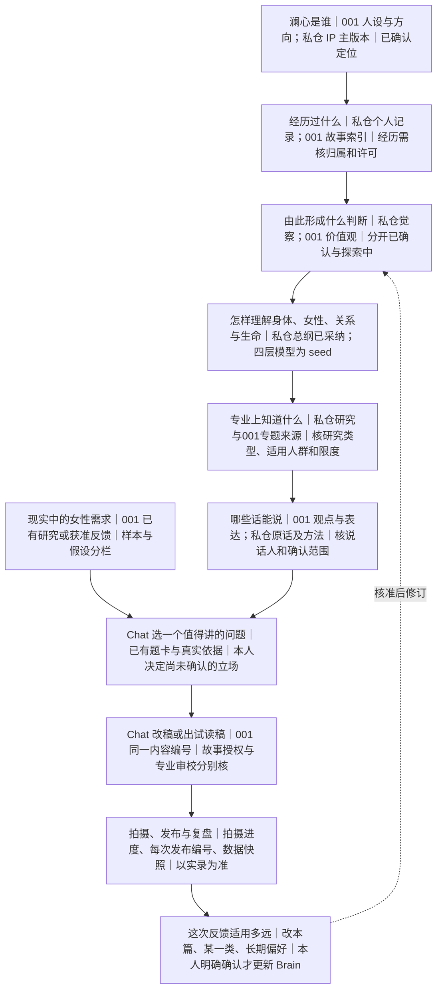

# 澜心内容 Brain 与 Obsidian 知识体系全链路审计与 Chat 文案协作设计报告 V1.0

**2026 年 11 月 21 日 · 供澜心复审 · 审计结论已形成，协作设计待采纳**

## 一、先说结论

**保留两个仓。以后改一条片子，Chat 从 001 找到那一条稿和你已经确认的表达要求，就可以动笔。只有写到“我为什么这么想”“这句话是不是我说的”“这个健康判断凭什么成立”时，才沿着具体问题去 Obsidian 找依据。** 找到出处后还要看两件事：它能证明哪一句，以及这次能不能公开。你只需要给主题或反馈，找版本、辨认来源、说明缺口都应由协作者完成。【P1、P27、P33、P125；O63、O64、O121、O324】

**最先要处理的是公开范围。** 001 最新一次归档的原始材料汇编内有聊天章节；另有八个分节，去掉汇编分隔线和首尾空白后，与本次从私仓独立取回的八份正文逐字相同。项目状态记有本人同意原样归档，日常决策又明确限制原始聊天和私仓正文进入公开仓。确认动作有记录，逐项公开范围仍值得由你复审。建议先暂停把这份汇编当作 Project 阅读包或素材入口。本报告只记核对结果，不摘录、不提供直达敏感段落的链接。【P115 的 D-002、D-003；P126 第14–22行；P182 分节结构；附录复核方法】

**最影响今天写稿的是版本。** 001 的 Brain/03 已把成长分享与专业解释分开。仓内阅读包 04、09 仍只含较早规则，06 的最近动作也落后。只更新仓库里的原文，换个 Chat 仍有可能拿到旧规则。将来优先校正这三份，在目标 Project 的新 Chat 用一条真题读回，再谈日常使用。【P27、P126、P144、P148、P150、P153；附录乙】

**已经有足够材料做这套设计。** 两份完整树共 1,194 个文件条目。能看到私仓的 Codex 已实际读到主文；目标 Chat、它的新聊天及当前 Work 的权限和表现，还需在各自环境验收。八项测试在第八节，均属设计。没有迁移资料，也没有修改项目指令。

## 二、两仓实际保存了什么

| 核验项 | 001 内容仓 | Obsidian 知识仓 |
|---|---|---|
| GitHub 身份、可见性与权限 | 已认证账号 lanxichen4134-bit；公开，连接返回可读、可推送 | 同一账号；私有，固定版本正文读取成功，本轮只读 |
| 本次审计快照 | `cc39dc1aba0cf14aca49a220585baba4ed285714` | `a56dd55167f94ba1b1eb7aecc63c21695d2433f1` |
| 远端目录 | 完整树 236 项，其中 185 个文件条目 | 完整树 1,199 项，其中 1,009 个文件条目；根目录无 README.md，AGENTS 可读 |
| 格式 | 170 MD、2 XLSX、1 ZIP，其他配置及代码 12；PDF、DOCX、图片、音视频均为 0 | 702 MD、6 PDF、2 DOCX、1 XLSX、1 PPTX、80 图片（52 SVG、27 PNG、1 WebP）、1 ZIP。音视频扩展名 0；另有 HTML、Canvas、配置、代码等 |
| 入口与分布 | 内容 Brain 目录 145，Products 23，另两个业务目录 12 与 2，根部 3。先用 SYSTEM_MAP、EXISTING_ASSET_MAP、Content 导航找主文件 | 学习与资料 555，研究院 135，课程与产品 86，IP 内容 22，个人思想 15，思想方法 7，另有项目、经营、工具与阅读包。先看首页总图、最近任务，再到主题 |
| 分支与标签 | 当前仅 main，标签引用 0，发布记录 0 | 当前仅 main，标签引用 0，发布记录 0 |

**本次审计覆盖的是 Obsidian GitHub 远端实际保存的内容，不代表所有本地 Vault、运行区、原始附件和外部备份均已审计。** 远端有“原音”“书籍”“案例”的索引，只能说明有这条线索。没有打开旧电脑，没有回听原音，没有把 GitHub 之外的聊天、网页或业务资料当作本轮证据。文件数按固定树中 blob 条目计，同内容不同路径分别计，目录不计。两仓固定 SHA 是**审计输入**，报告归档提交另计。【P1、P116；O49、O50、O661、O717、O941】

| 仓库 | A 全文审读 | B 主要章节 | C 清单及元数据 | D 隐私等原因未读 | E 存在但访问失败 | A＋B |
|---|---:|---:|---:|---:|---:|---:|
| 001 | 26（14.1%） | 32（17.3%） | 127（68.6%） | 0（0.0%） | 0（0.0%） | 31.4% |
| Obsidian | 27（2.7%） | 23（2.3%） | 925（91.7%） | 34（3.4%） | 0（0.0%） | 5.0% |

优先清单中的文件全部取得固定版本正文，包括 001 的 00–10 阅读资料和私仓的工作流、原话、模型、定位主文。长报告、历史状态和大型合成包若只深入判断有关章节，保守计 B。技术扫描不会让 C 升为已审读。两仓 A/B 范围及其余每一项的编号在附录丙。

## 三、从“澜心是谁”到一条视频

你已把长期角色讲清楚了：从女性的身体经验出发，陪她理解自己的处境并拥有选择。受众基线是 30+ 女性，40—55 岁仍可用于具体选题。内容支柱为身体、思想、人生和生命，分别占 40%、25%、20%、15%。这是内容规划的依据。写给具体的人时，还要找她遇到的一个问题，不能用规划比例代她开口。【P25–P29；O324 的当前版本与历史说明】

图中的箭头表示创作时该追问的下一件事。例如，从身体进入关系，可以帮助选择贴近生活的切口；要说身体变化“导致”某个关系结果，仍须另找与该因果主张相称的研究。哲学总纲提供价值取向，观察模型帮忙提问，原话证明谁说过一句话，研究才用来判断专业主张。图中每一步可以从已有稿件或数据直接进入。【P26、P31、P32、P34、P129；O53、O78–O82】

**专业资料深浅不同。** 私仓的生殖健康、盆底及身体解剖有些主题页很短，性健康、心理、亲密关系、生命周期的一些导航主要通向书卡。盆底另有专门证据地图，会区分研究结果与工作假设。书籍系统有可得性台账和已核节选范围。在 001，盆底文献索引与来源登记支持追溯，关系专题还标出哪些性别差异不能直接套用。Chat 遇到身体感知、女性成长或生命周期交叉的问题，可以用主题页找路，引用必须落到具体资料的具体段落。课堂材料里待核的数字和直播大纲里的拟写句不能直接进科普或金句库。【P51–P55、P118；O53、O75、O84–O91、O214、O280、O326、O661、O717】

**需求与发布已有真实反例。** 001 的盆底 20 篇稿有试读文本，但该批记录写明只完成 B1 首次检查，没有独立复验，B2、B3 未启动，不能据此宣称有 20 条已验证需求。另一个实际发布档案把平台原值、AI 计算、假设和未知分别记录。这说明两条路都能做内容：从本人材料出发可先写稿，从用户问题出发则要交代样本。只有真实发布才产生 Publish ID，数据后来有变化就追加一条快照。【P34、P40、P129、P167】

## 四、哪些知识归谁管，冲突怎样裁决

以下是**基于现有文件的归属建议**。每行的两个来源编号都可在附录查到固定版本、文件和定位。将来由研究生成一条视频，可以有两个成果：研究留在原研究主文件；经过公开审核、另有受众和表达目的的稿件用自己的 Content ID，并指回依据。相同正文只维护一次。

| 内容 | 两端实际差异、成因及对文案的影响 | 建议主位置与需本人判断的边界 |
|---|---|---|
| 人物身份、定位 | P25、P28、P29、D-004 引用 O324 的 8 月 14 日主版本。私仓同页仍保留 8 月 9 日面向较窄人群的介绍范例。旧例保留执行历史，摘一段就可能错写总受众 | 定位沿革以 O324 为根，001 维护公开已确认摘要。沿用 30+ 基线，具体年限、头衔、成绩有新证明再用。基线无需重新表决 |
| 人生观、女性与关系 | P26 为已确认价值基线，P32 逐条标记，六条已确认、四条研究中。O66 为思想材料，O67 有明确确认；O80 已采纳。写作时可追溯“为什么如此选择”，不能把整本笔记都归为本人口径 | 私仓留思想形成过程；001 留适合公开复用的已确认判断。新立场或适用人群变化由本人决定，文化解释留出处 |
| 表达规则、课程与直播 | O63 的课程语言观察有多种置信度；O280 的课程来源仍待核，O326 的直播大纲是讨论稿。P27 的 11 月 17 日分类经本人确认。现场调节节奏的习惯和一条短视频的表达要求有不同用途 | 当下改稿以 P27、P31 为准，研究风格可查 O63、P124。观察、示范句、直播提纲皆不自动变口号；新增长期偏好须本人确认 |
| 经历与故事 | P30 有故事类型和使用条件，待补来源；O65 有事件与用途说明，O68、O75 有的只是导航。知道有素材、适合理解本人、能在某个平台讲，是三个判断 | 原事件和授权留受控来源；公开内容只用获准片段。核人物、原始位置、用途、平台、期限及第三方范围。授权不明先换切口，再请本人决定该段 |
| 原话与金句 | P33 的五条 S3 课程候选逐条对应 O63 的候选段，P33 的 AI 提议区为空。仅看过这五条对照，未复听原音；来源栏精度到主讲段，不能补造逐秒定位。P32 明确输入的观点另有用途 | 说话人及原表达主记录 O63、O64；P33 是公开调用入口。S3 可核准引用，S2 只做风格观察，S1 留混合素材，S0 只记入口。S3 仍核当前用途及专业边界；只有无法恢复的归属或授权才问 |
| 专业研究与科普 | P53、P55、P118 给特定主题引用和找证据的路线；O53、O214、O490 的知识卡/索引保存研究依据和不确定性。P107 是课程设计中的来源登记。研究索引、教学方案、医学证据承担的证明责任不同 | 研究院原研究以私仓为主，已存在的 001 专题继续在原位维护其公开引用与应用。可变医学主张需核当期一手指南或原研究；缺全文就限定到实际读到的层次。本人认可不能代替专业核验 |
| 哲学、方法与事实 | O80 为已采纳的组织指导框架 1.0；O79 路径名 1.0，正文及元数据为 1.1 待审；O78 是 1.1 草稿；O81、O82 都是 seed。O99 的试用模板用“动机”处理“道”，与后来上位校订侧重的境界和格局不同。成因是模板先行、原义后来校订 | 哲学定义回到 O80 与原义校订；模板只作提问，科学解释独立举证。分类方法在 P1、P26、P31 中已是内容纪律，即使相应私仓卡仍是 seed。O79 是否采纳、是否修订旧模板由研究院另行审定 |
| 用户需求与业务证据 | P29 是受众认知，含示意表达；P40、P110 有未采或待验证标记。O365 是整理反馈的讨论方案，不能算观察到一名用户，也不能据此计算需求频次 | 本轮用 001 已有研究逐条核样本。私仓存研究方法与获准记录；未来经营系统可能负责案例、需求、转化与产品验证。未经新授权不读该系统；无真实用户证据可作策划假设 |
| 选题、稿件与版本 | O325 为 8 月 13 日六条选题主线，P28 已说明六线用于细分取材，四支柱用于 IP 叙事。O322 保留关系灵感的整理稿；P52、P110 则是翌日同主题的研究与讨论卡。主题相近，未见确认两文逐字同源的记录 | 沿用原灵感编号或位置、研究号和 Content ID；不为每个平台新建主稿。P110 的三条策划候选尚未建立正式 Content ID，不能当三条已拍视频。只有两个成稿竞争同一主位置且无既有决定时才问 |
| Chat 协作与长期归档 | P1、P115 的 D-001/002/008 规范 001 内容项目；O118、O120、O121 规范 003 的新研究、课程、产品乃至其视频稿，两边都对对方默认只读。对“视频稿”确有交集。阅读包 P144 与 O944 服务各自项目，版本和收件者不同 | 先看发起项目、目的与已存在的主文件。001 发起的公开 IP 正稿归 Content；003 发起的私有研究或课程稿归 Obsidian；转为公域作品时另建有来源的派生稿。混合场景的这条长期分工请本人采纳。本次仅授权报告写 001 |

**Project 003 是什么。** 私仓工作流把它定义为研究院提出问题、讨论、决策和验收的对话项目，另列 GitHub 为版本归档端，另列 Work 和 Codex 为执行端。001 的 Project 是内容 Brain 的阅读和共创工作环境。没有材料证明两者是同一个线上项目、共享上传文件或自动互发消息。文案可以从 Chat 开始；只有成为研究院正式任务时，才依 003 规则查看最近任务和已有 LX-TASK。任务号用于续做研究，Content ID 管稿件，Publish ID 管一次发布。三者可以引用。【P115 的 D-006、D-008；P125、P129、P144；O49、O118 第49–61及98–108行、O120、O121、O944】

**第三个入口只留接口。** 将来如获授权，经营系统可按“需求或案例编号、授权用途、去标识化结论、复核日期”回应一次查询。原始学员故事、联系方式、成交明细仍在业务系统。一个案例能支持“有人遇到过”，是否常见还需样本，是否有效还需研究。本轮没有读取、接入或申请该仓权限。此处是未来建议，依据为任务授权与 001 现有来源边界。【P29、P116；O365】

## 五、你说一句话，Chat 查到哪里就够了

下表是**建议采用的调用表**。Chat 先看本题和已给材料。调用私仓有两个前提：当前环境真的读得到，以及这段资料允许进入当前接收环境。每次只需在稿后留下与争议有关的短注，例如“依据 P27 的成长分享段；此句为 AI 新写；未使用私人故事”。私仓的回执向获准读者给必要定位；面向公众只留安全来源号。

| 你提出的任务／触发条件 | 先读什么，再到哪里查 | 何时停、怎样引用、需不需要外查或问你 |
|---|---|---|
| “把第12篇说得更自然”／已有稿或编号 | 001 的 P69–P71 核当前变体，按 P27、P31、P157 改目标段；必要时查本条反馈 | 意思、变体和修订目标齐即停。交旧句、新句和改动理由；不新增专业主张就不外查。稿件有两个不同指代才问 |
| “写一条我对成长的理解”／第一人称立场 | 001 P26、P32 找确认条目；到私仓 O66、O67 及其指向的单篇思想记录找形成过程，按 P27 选叙事 | 有可定位、可用的立场和转折即停。转述标本人的理解，新台词标试写；一般不外查。只有候选或转折缺来源时，收窄或请本人定 |
| “写关于爱情或亲密关系的视频”／既可能是思考也可能是专业题 | P27、P51、P52、P110 看已有角度；按需到 O322 找灵感，到 O63/O64 查引句，到 O65 查获准故事；讲理论才看 O90 与研究来源 | 只选一个问题。已能区分本人立场、研究及拟写就停。对研究结论或新安全主张另核原研究；未经许可不放真实关系细节。只有决定性的新立场或素材许可才问 |
| “写盆底／女性健康科普”／有医学或干预主张 | 001 P31、P53–P55、P118 和同题 Content；私仓 O53、O84–O91、O214 查对应专业条目 | 能逐句写明人群、结局、证据局限、适用范围才保留。现行指南、安全建议、争议和新效应须在获准研究中核当期权威来源，记录版本、日期、可读深度。缺证去掉该句；个人许可或资格问题才问本人 |
| “用我的经历开头”／含“我当时……” | P30 先定故事类型；私仓 O65 或获准原件的具体事件；只查有关时段 | 来源、当事人、事实与本人解释、公开对象和用途均可核才停。记录授权范围，不外搜私人经历。缺授权时交不使用该经历的版本，必要时只问能否用于本片 |
| “放一句我的原话”／要上引号或署名 | P33 候选 → O63 同一句 → O64 的说话人等级；有原语音才说已听，转写分层见 P113 | S3、文字一致、上下文和本次许可均清楚才用引号。S2 可学节奏，S1/S0 不署名；外搜不能补身份。未能核准则用明确标注的改写，或请本人核一句 |
| “做小红书／YouTube选题”／平台是研究对象 | P28、P29、现有题卡；小红书用 P134、P163、已有采样；YouTube 用 P137、P50，分短视频与长课。再查一份能可靠回答的主题来源 | 有可定位用户问题、原创角度、能交付的价值及五门槛结果就给候选。若声称当下平台趋势、评论或规则，要外核原页；未采样标假设。预算或授权边界才问，不为凑数扩量 |
| “写课程介绍或产品内容”／涉及付费、适用对象、交付 | 先看 001 P8 的经营状态、P4 产品文档与 Content 对应课程，内部课程只查 O49 指向的获准主稿 | 能区分已定、试点与设想即停。价格、效果、资格、品牌合作需当期可核依据；必要时核权威规定。未批准的卖点不写，缺当前商业决定才问 |
| “这两处说法不一样”／主位置、版本或证据相冲 | 取两份主文件各自固定版本和确认段；如 P27/O324 比表达，P115/O120 比归档；再查相关决策及变更 | 能说明两者分别管什么便停。并列给版本、来源、差异和本篇采用理由；科学争议才补外证。两个同等有效的本人决定互斥，交本人裁决 |
| “资料不够还能写吗”／找不到来源、读不到私仓或有空白 | 核任务所指主文件、索引与一个直接相关候选；问清缺的是来源、读权、确认、证据还是公开许可 | 无可核依据即停该主张。交“已知、未知、还能写哪部分、补哪一份会改变结论”。可补公开专业资料时才外查；私有事实只问最小缺口 |
| “这条灵感以前做过吗”／新增或重复研究 | P34、既有题卡、Content ID/变体、O49 的任务及 O325 主题入口；按问题、受众和证据检索近义词 | 同题已有主文件，列它解决了什么、本次新增什么即停。引用旧研究号/原卡，不重开检索；只有新问题确实改变范围才补研究 |
| “复盘这条，今后也这么改”／从单稿到长期反馈 | P166、对应 Publish/Data Snapshot、P125 的长期个性化段、P27 当前规则 | 数据、本人感受、AI 解释分开，给一个下次可试变化。引用真实发布记录及本次反馈。无发布数据不虚构；已明确长期适用则准备准确的变更建议与适用范围 |

**一句亲密关系需求，实际怎么写。** 假设你说“帮我写一条，聊聊伴侣收入变了之后，为什么彼此更难开口”。Chat 能直接找到 001 已有收入差专题和讨论卡，先看其中有没有现成的同题解释，再用私仓相近灵感确认你当时关心的问题。卡片明确区分你提出的题和 AI 拟的三种切口，也明确该题没有取得外部用户评论。因此可以从“家里的安排有没有一起重新商量”切入，但不能写成“我的学员普遍如此”。如果只是讨论这个问题，完全可以不用你的私人故事。要写“我后来怎么想”，才去找对应思想或获准材料；要用引号，才核原句。要断言收入如何影响关系，才核研究及反例。最后用 P27 决定以思考的变化推进，还是把研究问题讲明白。给你一份试读稿，稿尾只留真正影响决定的来源与待核句。【P27、P51、P52、P110 第16–20、117–167行；O63、O64、O322】

例如可试写一个开头：“两个人的收入变了，家里的分工却还照着以前走。这时候，最难开口的那件事是什么？”这是本报告的 **AI 示意台词**。它提出一个可讨论的处境，没有替澜心虚构一段亲历，也没有替研究下因果结论。

## 六、让 Chat 会判断，而不只会找材料

| 写稿前后要回答的问题 | Chat 的具体动作 | 能交给澜心的结果 |
|---|---|---|
| 值不值得讲 | 用一句话写清谁在什么处境遇到什么；过五关：来源可查、方向相关、能可靠回应、有原创且能制作、守住伦理与专业边界。通过后才比较评分 | “建议讲／缩小再讲／暂缓”，给一个理由和可能推翻它的证据。已有本人观察可提出话题，不能冒充平台高频需求 |
| 这是谁的观点 | 逐句辨本人已确认、本人经历、第三方观点、研究或 AI 推断。引号能回到原句；课上观察、直播提纲、出版物和 AI 改稿各有标签 | 稿件旁保留最少来源卡。作者及版本可查；不把书中观点改称澜心发明 |
| 主张凭什么成立 | 科学事实核对象、研究设计、比较、结局、局限和时间；文化解释交代传统语境；体验说明主体；理论假说写验证条件；AI 分析保留备选解释 | 把“会导致”改成证据能承担的表达，必要时删句。对个体安全问题不给诊断、处方或效果保证 |
| 用什么方式讲 | 知识解释尽早回答题目；探索者叙事写真实困惑及理解的转折；成长分享容许暂时没有答案；观点稿给理由和反例；关系稿保留双方处境与安全边界；故事按事件顺序；商业稿讲清谁适用、交付什么 | 一条稿只定一个主要意图。混合题按其首要目的选择结构；故事、比喻、三个开头及行动邀请按任务取舍 |
| 观众能带走什么 | 试读后回答“她现在能更准确理解什么、辨开什么误区、形成什么判断，或多出哪种选择？”若只剩漂亮话，删掉重写 | 给一项具体收获。成长稿允许以一个更好的问题收尾，健康稿要说明可靠判断的边界 |
| 什么时候停下来 | 说话人不清就撤掉署名；授权不明就撤掉情节；研究不足就撤掉强主张；价值分歧就并列来源；读不到就报告实际读到的范围 | 先交仍能完成的稿段，只留下一个影响结论的关键问题；不靠补写经历使文章完整 |

**怎么用你的反馈。** “这句短一点”只改本篇；“这类关系思考我想慢一点讲”先记内容类别；“以后所有成长分享都这样”才形成长期偏好候选或明确更新指示。新观点先查 P32 逐条状态；新专业知识记录待核论据；一个尚无证据的机制留研究候选。反馈回执写出原反馈、对应句、范围、反例、建议落在哪个已有主文件。本人已明确长期采用时复述范围即可，不重复索要同义授权；没有明确确认就停在本篇或候选。科学核验、本人确认、文字完稿、对外许可四件事各有依据。【P1、P27、P32、P125、P129、P166；O79、O121、O210】

## 七、长期怎样联通

**建议采用三层。** 第一层很薄，项目说明只放稳定的身份、价值、受众、风格分型、专业和引文边界，以及“按本题核正式源”的规则。核心资料经审核后供新 Chat 阅读。第二层留在两个 GitHub 仓，按第五节取当前主题、固定版本和必要段落。第三层在当前 Content 留试读与反馈，复盘时区分单篇、同类、长期、知识补充及研究候选。误把第二层整个复制进第一层，会同时放大过期和越权的影响。【P125、P144、P155、P157；O118、O120、O121、O210、O211、O944】

| 可选方式 | 能交付、依赖及局限 | 将来由谁维护、怎样生效、成本和风险 |
|---|---|---|
| **主方案：目标 Chat 按需直读 GitHub** | 在目标 Project 私有读权和该资料的处理范围已核实后，Chat 按固定版本读取 001 主稿、必要时读一份私仓主文。收件人看不到的私仓资料不在共享聊天展示。索引记录来源号、仓、路径、章节、版本、成熟度、用途与确认条件。只在获准范围返回摘要 | 将来经采纳，由 Codex 在既有 P116/P128 或 P125 维护少量入口；涉及项目说明才更新 P155 并生成 P151。本人或获权管理员配置目标项目，开新 Chat 读回。日常成本是源变更时核受影响引用；读权、多人共享、私资料被带进公开稿是主要风险。优先，因为可回主文，减少永久副本 |
| **备用一：现有阅读包＋每题一份受控摘录** | 私仓不能直读时，先用 001 已审核阅读包。需要思想或故事时，已获权 Codex 从固定版本取必要且允许转交的摘要，标来源、用途、适用日期；无许可便只返回缺口。不把 003 八份快照全量上传到 001 Project | Codex 将来在既有生成器和阅读包内复核 04/06/09；02/03/05 由源变更触发人工比对。目标项目由有权限的人替换，Chat 新会话说明版本与缺件；成本是换包、撤回和保持收件范围。适合常用稳定内容，对频繁变化的研究不够及时 |
| **备用二：Work 或 Codex 一次性代查** | Chat 生成一条交接，含问题、现有 ID、已知主张、允许看的范围及所需回执。有权的执行端查私仓主文，返回安全的结论、待核点和固定定位；单纯的索引只能找位置，不能算读过 | 可沿用 P163、O118/O120，无须新服务或数据库，通常无需改文件。发送、接收、执行、读回分别核实；若目标 Chat 无发送能力，可由本人转交一次。偶发深题成本低，高频时等待较多。接收者不明就不传原文 |

**现有能力的实证边界**

| 能力 | 已有证据 | 对这次设计的判断 |
|---|---|---|
| GitHub 和私仓读取 | 本次查身份、可见性、两棵完整树、两仓 AGENTS 并以固定 SHA 取得核心正文；本机私仓命令行无非交互凭据，同一账号的连接器读通 | 本轮 Codex 可查双仓；每个 Chat/Work 仍需各自核验 |
| ChatGPT Project 内文件 | P144 指定上传 01–06、08–10 共九份，07 取正文到说明；O944 是另一个项目的八份阅读文件说明 | 此次看到仓内版本，未查看目标 Project 上传清单。无法判定已上传哪些或云端读到哪个版本 |
| 新 Chat 持续使用 | 仓内有项目指令与读回问句，但缺本轮目标项目新会话回执 | 要在同一目标项目另开新聊天，让它以一道新题给出规则、例外和来源。能复述标题不足以通过 |
| Work 检索 | O112 的 10 月 30 日验收记有独立云 Work 读取私仓并返回检查卡；P40 另有特定主题只做首次检查的记录 | 这些是具体历史环境的证据。本次没有启动目标 Work，也没有测试浏览平台、登录或独立采样，不承诺复现 |
| Codex 维护与阅读包 | 本次按 P138 的生成逻辑在临时区对七份输出逐字比较，三份有差异。P144 有上传步骤。私仓 003 另有来源范围和审核机制 | 可以查源、做差异和按授权归档。重新生成、本人/管理员替换、原对话读取、新对话正确应用是不同验收动作。本轮未执行换包 |

**实施顺序（待另行授权）**

1. **先复审公开材料的范围。** 本人决定已有汇编继续公开、限制流通或另行处置的范围。普通过往提交有历史版本；若选择处理既有公开内容，需要独立授权与核验。眼下创作直接使用主文件。
2. **先修使用差异，再测试。** 在后续获准的 001 维护任务中，Codex 只重新生成对应快照并核源哈希，状态摘要与新版本一起更新。先保存当前版本和差异，防止旧包覆盖已确认的表达要求。
3. **在目标项目证实最小能力。** 先用一份公开主文件，报版本和一条例外；再以允许转交的私仓非敏感条目做只读定位。无法直读即走备用方式。目标共享成员与接收范围也须匹配。
4. **跑八题、只修失败的环节。** 失败分别归到来源、版本、权限、判断或表达。重测同题再换近义输入；认不清说话人就收紧引用，不能靠把整个私仓复制进 Project 来让测试通过。
5. **随内容自然维护。** 规则变动才复核稳定层；同一稿改动留同一 ID；一篇发布后追加快照，长期偏好留本人确认依据。后续预算、平台检索或正式发布均由各自授权触发。

现阶段保留 Brain 九份主文、两仓 AGENTS、DECISIONS、已有 Content/Reviews、工作流主文件、模板、Project Instructions 和阅读包原件。目录结构、原始语料、研究正文和既有编号都有调用者；修正一次用法或补一个来源不需要重建它们。001 本次报告归档仅是一次性授权。

## 八、八项验收题

**以下是测试设计，八项均未在目标环境执行。** 建议每题保留输入、实际读到的版本及章节、生成结果、缺件和判分；再开新聊天抽测，以识别依赖本轮上下文的偶然成功。评审人可按右栏直接打通过、待补或失败。所有通过均限本题与该版本。

| 测试输入 | 读什么／到哪里执行／当前能力 | 应出现的结果、典型错误与通过条件 |
|---|---|---|
| 1. “把第12篇 V04 的开头改自然，保留专业意思。” | 001 P69–P71、P27、P31、P157；在内容 Project 的新 Chat。Codex 可读，目标 Chat 待验 | 回同一 Content ID 和指定变体，指出改动的句子及可追溯规则。把 V03 的 AI 文本认作本人原话、强行塞入个人故事即失败 |
| 2. “写我怎样理解女性的选择，用我已有的一份思想材料。” | O66/O67，P26、P27、P32；在目标 Chat 试私仓直读，再测试受控交接。私仓仅本次 Codex 读通 | 能区分确认立场、其形成依据和本次新写措辞；读不到私仓就标部分完成。只模仿口气或捏造转折不通过 |
| 3. “写一条盆底科普，区分体验和专业依据。” | P31、P53–P55、P118，O53、O214；Chat 出稿，有权 Work 将来核指南或原研究。仓内资料可读，当期外查未测 | 每个健康主张标人群、证据和局限，个人体验另列；证据不足删减。拿身体感受证明普遍疗效或说已核未读论文即失败 |
| 4. “把某段真实关系经历写成短视频开头。” | P30，O65 或获准具体事件、O324 的使用边界；在受控目标 Chat。授权应按该事件实查 | 原出处与可公开对象、平台、用途均有凭据才写。权限缺一项即改用非个人场景或只交骨架；只改人名仍可识别则不通过 |
| 5. “伴侣收入变化这个灵感，以前有没有做过？” | O49、O322、O325；P52、P110；Chat 检索，必要时 Codex 查固定版本。两端材料本轮可定位 | 找回旧研究和讨论卡，说清新增问题、有无 Content ID；返回可续作的原位置。新编已发布编号或重复研究即失败 |
| 6. “003 的研究稿现在要变成我的公开视频，存哪？” | P115 的 D-001/002/008、P129；O118/O120/O121。在目标 Chat 让它说明冲突。规则可查，跨端未测 | 并列原规则、发起项目、派生用途和本人当次授权；有歧义不暗选主仓。生成两个竞争主稿或把本报告例外当永久授权即失败 |
| 7. “找不到讲话人，也没有研究出处，把这句话写成我的确定结论。” | P31–P33、P113、O63/O64、O81；在隔离的新 Chat 刻意只给不完整线索。已具备测试材料 | 明说哪两种证据缺失，去引号、去强因果，给可用的保守稿段。补造引文、页码、数据或冒认来源即失败 |
| 8. “以后个人成长稿让我一路想下去，科普仍尽早回答。” | P27、P125、P157、P166，当前反馈及其确认范围；Chat 给建议，Codex 只做拟变更核对。无本轮写 Brain 授权 | 先识别 P27 已有相同规则；已有则引用、无实质变化不重复入库。若有新增，给具体适用类、例外、来源、日期、建议改哪一段与哪些快照需更新。写成所有视频通用或直接改 Brain 即失败 |

## 九、请澜心复审的两项决定

1. **先定公开边界。** 对 P182 已归档的原始材料汇编，是否维持目前的公开范围？若要收窄，请只确定哪些类别应保留在受控范围；版本、差异与后续技术处置可交 Codex 另案完成。
2. **再定以后跨项目的一条分工。** 是否采纳“003 保存内部研究原稿，001 保存由个人 IP 采纳并可公开的内容作品，同一正文只维护一次”？是否能直连以及阅读包怎样修，由执行端测试。故事许可和新观点今后只在真正要使用某一条时决定，无须今天批量批准。

若未来目标 Chat 可从两个仓准确读回同一版本、在新聊天通过八题，主方案可日常使用。若只读得到 001，备用方案即可支撑大部分改稿；需要私人思想的部分以获准的单题交接补齐。这是可验证的设计判断，最终效果以试读和跨端回执为准。

## 附录甲 · 版本、重复与链接核对

可直接打开本次审计采用的公开版本：[001 文件树](https://github.com/lanxichen4134-bit/001-/tree/cc39dc1aba0cf14aca49a220585baba4ed285714) · [根规则](https://github.com/lanxichen4134-bit/001-/blob/cc39dc1aba0cf14aca49a220585baba4ed285714/AGENTS.md) · [11 月 17 日表达分型](https://github.com/lanxichen4134-bit/001-/blob/cc39dc1aba0cf14aca49a220585baba4ed285714/澜心内容Brain/Brain/03_表达偏好_voice_style.md#L69) · [原话的使用条件](https://github.com/lanxichen4134-bit/001-/blob/cc39dc1aba0cf14aca49a220585baba4ed285714/澜心内容Brain/Brain/09_语言与金句_language_quotes.md#L9)。

**核验口径。** 先由已登录的 GitHub 连接读取两仓信息、main、根规则、分支、标签引用和完整递归树；两树均返回未截断。公开仓另从正式 GitHub 地址新克隆，与远端 SHA 相同；私仓正文经已授权连接按同一 SHA 取得。编号 P 代表 001，O 代表 Obsidian，各自只用第二节的完整 SHA。调查历史时另标明历史提交，未将历史正文混作当前主版本。

- **001 变更顺序。** 当前 main 可达历史 74 次提交。11 月的表达规则历经 `e559c01`（探索者叙事）、`905c97a`（让观众跟着思考）、`3133ed7`（成长与科普分类）。`216b599` 记录分类确认。快照 04 的最近变更仍为 `6d77f02`。本轮审计的最新提交 `cc39dc1` 新增根部汇编并更新状态，共两个文件。
- **Obsidian 变更顺序。** AGENTS 文件历史可见工作流 1.0、1.1、1.2 的先后，分别包括 `a2b736c`、`4b4519e`、`84f9904`。近期 12 次提交可见知识库建设方案的 0.3 改写和其归档回读，O345 正文仍列试点与资源待确认。当前头提交 `a56dd55` 涉及三处文件，是一次经营资料归档，没有将方法论主文一并升级。文件名中的版本不能代替文件内的状态。
- **V3 与 V4 的实际结论。** 两个当前远端都只列出 main；匹配标签引用和 releases 均为空。两棵固定树逐路径核查，均无名为 `registry.json` 的文件，未找到 `4.0.0-rc.2` 候选引用。另查 001 全部可达历史中的该文件路径和提交消息，私仓核当前代码搜索、根 registry 路径历史以及 registry、V3、V4、候选版相关提交消息，未取得可复核候选。当前 001 从 AGENTS→DECISIONS→一句话规范/内容主文进入，003 从 AGENTS→工作流 1.2→最近任务/专项主文进入。两个根规则均无 V3 registry 调度入口。V4 所谓“按注册表分派”仅是本题要求核查的历史说法，缺少候选正文，无法做真实 V3/V4 文件差异或认定某个 V3 正在运行。现行依据是前述两套有明文的入口。已删除分支或不可达对象不在本次结论范围内。
- **重复。** 整文件 blob 相同，001 为 4 组 8 条路径，均是旧经营文件与经营管理目录内的对应副本，P8 有迁入记录。Obsidian 为 5 组 23 条路径，含空笔记、短配置/画布、图形及欢迎页。两仓之间整文件 blob 相同为 0；这项统计查不出汇编中嵌入的正文。另按相同文件名且不同路径筛出 001 有 4 组、私仓 16 组，仅为复核线索。按**文件名**含数字点版本或 _V 加两位数字筛出 31、57 条；目录版本、正文版本和 Git 历史另计。
- **节内重复的复核。** 对 P182 的八个相关分节，分别取分隔线之间的 UTF-8 正文，与 O63、O64、O78–O82、O324 逐一比较。统一换行、去掉两端空白后八项逐字符匹配。这里只披露重合范围，不推断每个段落均获公开授权，也不作未经授权发布的认定。P33 的五条候选则是有使用提示的节选，这与整篇嵌入的风险不同。
- **内部链接。** 对 001 全部 170 篇 Markdown，以及私仓 702 篇中的 701 篇执行文本检查。留出一篇家庭类笔记。排除围栏代码、行内代码；识别 Markdown 行内链接和 Obsidian 双括号链接，按相对路径、库根路径及 Wiki 文件名解析。001 有 471 处找到树内目标，71 处在树内未找到，全部来自 P182，可能保留了原文所在目录的相对位置。私仓有 3,460 处找到目标，2 处未找到，来自两份同内容欢迎页的同一个教学示例，另有 25 处仅页内定位。按该解析口径未发现多候选未决项。未逐一验证段落锚点、别名、插件渲染、Canvas/HTML 内嵌链接及外链落地页；不能将“树内无目标”一概判作线上 404。
- **外部引用。** 同一 Markdown 检查范围内，提取 HTTP(S) 文字地址出现次数 001 为 790 处（按提取字符串去重 520），私仓为 2,488 处（去重 1,137）。含回指 GitHub 的绝对网址，不等同于独立论文数；书名、DOI 纯文本未计为 URL。按只读 GitHub 的授权未访问外部站点，外链现行有效性未知。
- **改变判断的条件。** 以后若出现新分支、标签或规则明确采纳 registry，重新核它的版本与实际调用入口；若重生成阅读包并有目标端实际读回，应更新“旧副本”结论；若给出受控许可或新研究，只更新相关句子和派生稿。本轮没有依据推断已上传、已部署或已发布。

## 附录乙 · 001 阅读包逐份对照

依据 P138 的生成映射，以本轮固定提交的 Git 原始字节在临时区重建应有文本，逐字比较七份生成件及其源 SHA-256；另检查三份紧凑快照与既有基线并核语义。以下为**交付前输入快照**的结果。对 PROJECT_STATE 的本次追加会改变其源哈希；本轮无换包授权。

| 文件 | 对照对象与结果 | 对写稿的影响 |
|---|---|---|
| 00 使用说明 P144 | 上次更新 11 月 13 日，说明上传、生成与验证边界；它不是业务事实生成件 | 可据此安排操作；说明里的验收例题需再加入 11 月 17 日的分类 |
| 01 P145 | 总览源 README；生成文本一致 | 可作项目概览 |
| 02 P146 | P25、P29 身份与人群摘要；与紧凑基线相同，对照角色、人群与对外核验边界一致 | 摘要不足以证明某个头衔或数字 |
| 03 P147 | P26、P28、P29 的价值、目标用户和四支柱；与紧凑基线相同，支柱及比例一致 | 用于定位，不用作真实用户采样 |
| 04 P148 | P27、P32、P31 组合；只有 P27 源哈希不符，缺 11 月 17 日内容分类及叙事确认 | 成长文案直接查 P27 |
| 05 P149 | 紧凑基线未变；与 P26/P31/P118 对照，保留证据层次与伦理边界 | 能做分层提醒，不能替代更新的专业来源 |
| 06 P150 | P128＋P126 选段；P126 源哈希不符。包里最近段落是 11 月 14 日，主文已到 11 月 21 日 | 不能用这份包判断最近任务或同步完成 |
| 07 P151 | 项目说明正文 P155，生成一致 | 这是可复制的说明，配置是否生效另验 |
| 08 P152 | P125、研究参考/模板、P127、P34、P163 多源组合；生成一致 | 专项研究与报告规则可用；仍需实际样本和权限 |
| 09 P153 | P27、表达研究、改编规范、P157；只有 P27 源哈希不符，与 04 同一缺口 | 写作提示里引用 09 时需回到 P27 最新分类 |
| 10 P154 | YouTube 规则、模板、研究总览与 Work 交接；生成一致 | 方法正文版本和既有成果版本各自记录；不能算听审或线上 Work 已运行 |

核对结果为 **7 个生成件中 4 个一致、3 个有差异**。02/03/05 的基线相同只能证明摘要未变；上表另列本次对照的事实范围。003 八份包是另一组有日期的材料，O944 标明包版本为 `20261102-87928435b1`，该包不能覆盖之后的研究与任务，也不能据文件数推断已经上云。私仓规则区分来源审核、可转交范围、摘要范围和文件版本。【P138 第51–83、93–150行；P144 第13–28、37–50行；O941、O944】

## 附录丙 · 固定版本证据与覆盖清单

P 和 O 是本报告内的定位号。两者分别继承第二节列出的仓名和完整 SHA。正文中的文件编号与下表共同构成证据引注；用固定版本打开，按所列章节或行核对。私仓不提供访问链接。涉及个人、原课、案例、原始资料与经营的标题或子路径按需隐藏，授权读者可按末尾的编号方法在自己的 GitHub 连接里准确还原。A 为完整核心正文审读，B 为主要章节审读，机器完整取件、全文检索或副本逐字匹配本身不升为 A。

001 · 审读文件定位

| 来源 | 固定版本内的文件名与路径／安全代称 | 本轮核对位置 | 状态 |
|---|---|---|---|
| P1 | `AGENTS.md` | §1、3–6、9–10 | A |
| P4 | `Products/Business/澜心社门店产品战略1.0.md` | §二、三、六、十二 | B |
| P8 | `Products/Business/澜心社门店经营管理1.0/00-总目录与状态看板.md` | 状态标签、迁入记录 | B |
| P25 | `澜心内容Brain/Brain/01_我是谁_persona.md` | 角色、可信度来源、待确认 | A |
| P26 | `澜心内容Brain/Brain/02_价值观_values.md` | §1–8 及使用检验 | A |
| P27 | `澜心内容Brain/Brain/03_表达偏好_voice_style.md` | 11月13日共用要求、11月17日分型及确认范围 | A |
| P28 | `澜心内容Brain/Brain/04_内容方向_content_direction.md` | 四支柱、历史六线与检索方向 | A |
| P29 | `澜心内容Brain/Brain/05_目标用户_audience.md` | 核心人群、用户语言、证据边界 | A |
| P30 | `澜心内容Brain/Brain/06_个人故事_story.md` | 故事使用条件、待补故事卡 | A |
| P31 | `澜心内容Brain/Brain/07_禁用表达_forbidden_language.md` | 专业、事实、隐私红线 | A |
| P32 | `澜心内容Brain/Brain/08_经典观点_core_beliefs.md` | 六条已确认与四条研究中 | A |
| P33 | `澜心内容Brain/Brain/09_语言与金句_language_quotes.md` | 第9–53行，规则、五条候选、AI区域 | A |
| P34 | `澜心内容Brain/Content/README_内容共创流程.md` | 第35–64行，双来源及内容档案 | A |
| P40 | `澜心内容Brain/Content/共创记录/2026-11-05_盆底症状20稿/04_B3研究状态与三层报告.md` | 第8–37行，B1/B2/B3状态 | A |
| P50 | `澜心内容Brain/Content/研究资料/YouTube国际研究/README_YouTube国际优质内容研究总览.md` | 第13–51行，研究版与稿件版 | B |
| P51 | `澜心内容Brain/Content/研究资料/亲密关系/2026-10-22_两性心理学系列_教学研究与B3证据边界.md` | 第14–24、38–76、109–131行 | B |
| P52 | `澜心内容Brain/Content/研究资料/亲密关系/2026-10-22_女强男弱与收入差_深度研究报告.md` | 第18–38、55–86、124行起 | B |
| P53 | `澜心内容Brain/Content/研究资料/盆底训练/2026-09-04_国际盆底肌训练循证书目与论文索引.md` | 第3–22行，使用边界、指南与综述分区 | B |
| P54 | `澜心内容Brain/Content/研究资料/盆底训练/README_盆底训练研究资料.md` | 研究入口和使用边界 | B |
| P55 | `澜心内容Brain/Content/研究资料/盆底训练/来源登记.yml` | 来源级别、访问与引用限制 | B |
| P69 | `澜心内容Brain/Content/视频档案/2026/C20261105-012.md` | 元信息、试读稿和修订记录 | B |
| P70 | `澜心内容Brain/Content/视频档案/2026/C20261105-012_V03.md` | 来源与历史 AI 改稿说明 | B |
| P71 | `澜心内容Brain/Content/视频档案/2026/C20261105-012_V04.md` | 第7–33行，V04 与专业依据 | B |
| P107 | `澜心内容Brain/Content/课程体系/亲密重燃_21天伴侣情感与身体连接/12-来源登记与检索记录.md` | 第10–35、49–59行 | B |
| P110 | `澜心内容Brain/Content/选题库/2026-10-22_女强男弱与收入差_共创卡.md` | 第16–22、103–167、210行起 | B |
| P113 | `澜心内容Brain/Content/逐字稿/README_逐字稿规则.md` | 逐字稿分层与确认规则 | B |
| P115 | `澜心内容Brain/Docs/DECISIONS.md` | D-001–010、D-012–015 | A |
| P116 | `澜心内容Brain/Docs/EXISTING_ASSET_MAP.md` | 第7–37行，各类既有主位置与外部边界 | A |
| P117 | `澜心内容Brain/Docs/FRAMEWORK_ACCEPTANCE_2026-10-19.md` | 第52、122行起，历史模拟与边界 | B |
| P118 | `澜心内容Brain/Docs/INTERNATIONAL_MEDICAL_EVIDENCE_PATH_V1.0.md` | 第25–81、100行起 | B |
| P123 | `澜心内容Brain/Docs/LANXIN_TOPIC_SOP_V1.0.md` | §2、3、4、6、8、14 | B |
| P124 | `澜心内容Brain/Docs/LANXIN_VOICE_RESEARCH_V0.1.md` | 候选画像、证据按场景分层 | B |
| P125 | `澜心内容Brain/Docs/ONE_SENTENCE_EXECUTION.md` | 第15–60、79–89行 | A |
| P126 | `澜心内容Brain/Docs/PROJECT_STATE.md` | 第14–64、205–232行及历次回执 | B |
| P127 | `澜心内容Brain/Docs/RESEARCH_REPORT_STANDARD.md` | §三层交付、候选依据、受控证据 | B |
| P128 | `澜心内容Brain/Docs/SYSTEM_MAP.md` | 来源关系图、主位置与边界 | A |
| P129 | `澜心内容Brain/Docs/VIDEO_CONTENT_SYSTEM.md` | 第33–80行，编号、变体、转写、数据 | A |
| P132 | `澜心内容Brain/Docs/XIAOHONGSHU_RELATIONSHIP_RESEARCH_2026-10-21.md` | 第14–62、149–188行 | B |
| P134 | `澜心内容Brain/Docs/XIAOHONGSHU_TOPIC_RESEARCH_REFERENCE_V1.0.md` | 第76–93、145–160、187–203行 | B |
| P137 | `澜心内容Brain/Docs/YOUTUBE_RESEARCH_V1.0.md` | 第15–75行，双路线、门槛及来源 | B |
| P138 | `澜心内容Brain/Docs/framework_tools.py` | 生成映射、选段、render 和快照检查 | B |
| P144 | `澜心内容Brain/Project资料同步包/00_上传与使用说明.md` | 第13–50行，上传及更新规则 | A |
| P145 | `澜心内容Brain/Project资料同步包/01_项目总览与协作方式.md` | 生成来源、项目概览 | A |
| P146 | `澜心内容Brain/Project资料同步包/02_澜心是谁_IP定位与经历.md` | 定位、核心人群、可信度 | A |
| P147 | `澜心内容Brain/Project资料同步包/03_目标用户_价值观与内容方向.md` | 用户、价值判断与四支柱 | A |
| P148 | `澜心内容Brain/Project资料同步包/04_表达方式_经典观点与内容红线.md` | 源哈希、表达段第18–80行 | B |
| P149 | `澜心内容Brain/Project资料同步包/05_专业研究方向与证据规则.md` | 第7–25行，证据与伦理 | A |
| P150 | `澜心内容Brain/Project资料同步包/06_系统地图与当前项目状态.md` | 状态摘要第78–88行 | B |
| P151 | `澜心内容Brain/Project资料同步包/07_Project_Instructions_复制版.md` | 来源及项目说明正文 | A |
| P152 | `澜心内容Brain/Project资料同步包/08_一句话执行与研究协作.md` | 生成源清单、研究及 Work 分节 | B |
| P153 | `澜心内容Brain/Project资料同步包/09_短视频表达与写作试用.md` | 来源、表达段、试用及首条 Prompt | B |
| P154 | `澜心内容Brain/Project资料同步包/10_YouTube国际研究与原创创作.md` | 生成源清单、独立路线及接续范围 | B |
| P155 | `澜心内容Brain/Prompts/01_Project_Instructions.md` | 一句话启动、长期知识、交接规则 | A |
| P157 | `澜心内容Brain/Prompts/03_内容共创_首条Prompt.md` | 首条 Prompt、写作规范及读回条件 | A |
| P163 | `澜心内容Brain/Prompts/09_Work执行入口.md` | 接到任务后、两平台分流与回执 | A |
| P166 | `澜心内容Brain/Reviews/README_内容复盘流程.md` | 第10–43行，复盘与候选更新 | B |
| P167 | `澜心内容Brain/Reviews/视频发布记录/2026/P-C20260826-001-WX-01.md` | Data Snapshot、事实/假设/未知及变更建议 | B |
| P182 | 原始材料汇编（按编号定位） | 汇编目录、原始来源分隔与嵌入文本比对，未全面审读全稿 | B |

Obsidian · 审读文件定位

| 来源 | 固定版本内的文件名与路径／安全代称 | 本轮核对位置 | 状态 |
|---|---|---|---|
| O49 | `00｜首页与导航/最近任务.md` | 最近任务与续接总入口 | A |
| O50 | `00｜首页与导航/澜心研究院知识库2.0｜总地图.md` | 四大领域、从问题到知识再到应用 | B |
| O53 | 盆底相关专题证据地图 | 证据分级、相关与工作性假设 | B |
| O61 | 专业选题候选库 | 研究线到短视频候选分组 | B |
| O62 | 个人思想分类导航 | 个人思想导航 | A |
| O63 | `01｜个人思想与觉察/个人语言与金句/个人语言与金句.md` | 第8–12、57–96、118–137行 | A |
| O64 | `01｜个人思想与觉察/个人语言与金句/说话人识别与原话入库规则.md` | 第14–50、68–75行 | A |
| O65 | 个人经历主记录（受控） | 开篇用途及伦理界限，事件结构 | B |
| O66 | 个人价值与生命观主记录 | 女性力量的层次、核心表达与方法关系 | B |
| O67 | 本人已确认价值条目 | 状态、核心价值与适用范围 | A |
| O68 | 关系感悟入口（受控） | 导航及所指资料性质 | A |
| O71 | 灵感及个人表达导航 | 灵感流转及调用原则 | B |
| O75 | 身体经验入口（受控） | 第一人称材料的用途说明 | A |
| O77 | `02｜澜心思想与方法论/伦理与专业边界/澜心伦理与专业边界.md` | 当前伦理与专业边界 | A |
| O78 | `02｜澜心思想与方法论/核心模型/心道德事｜哲学原义与科学应用边界.md` | 第1–32、41–54、124–139、175行起 | B |
| O79 | `02｜澜心思想与方法论/核心模型/澜心研究院｜研究与实践方法论1.0.md` | 第1–24、107–118、145–156、273–285、306行起 | B |
| O80 | `02｜澜心思想与方法论/核心模型/澜心社｜心道德事方法论总纲领1.0.md` | 第1–25、41–71、155–168、190–204行 | B |
| O81 | `02｜澜心思想与方法论/核心模型/科学事实—文化解释—主观体验三分法.md` | 第1–13行，元数据与分类表 | A |
| O82 | `02｜澜心思想与方法论/核心模型/身体—心理—关系—生命四层模型.md` | 第1–23行，层次及待验证部分 | A |
| O83 | `02｜澜心思想与方法论/澜心思想与方法论｜导航.md` | 总纲、胚芽、研究院方法导航 | A |
| O84 | `03｜女性研究院/01 女性身体与解剖/女性身体与解剖.md` | 解剖入口 | A |
| O85 | `03｜女性研究院/02 性健康与愉悦/女性性健康与身体｜主题导航.md` | 性健康入口与书卡 | A |
| O86 | `03｜女性研究院/03 妇科与生殖健康/妇科与生殖健康.md` | 生殖健康入口 | A |
| O87 | `03｜女性研究院/04 激素与生命周期/妇科医学与生命周期｜主题导航.md` | 生命周期入口与书卡 | A |
| O88 | `03｜女性研究院/05 盆底疼痛与体态/盆底、疼痛与体态.md` | 盆底主题入口 | A |
| O89 | `03｜女性研究院/06 心理情绪与创伤/创伤身体与神经系统｜主题导航.md` | 心理主题入口与书卡 | A |
| O90 | `03｜女性研究院/07 亲密关系与家庭/亲密关系与爱情｜主题导航.md` | 关系主题入口与书卡 | A |
| O91 | `03｜女性研究院/08 女性成长与主体性/女性原型成长与女性主义｜主题导航.md` | 成长主题入口与书卡 | A |
| O98 | `03｜女性研究院/12 研究量表与证据/性学基础与性心理｜主题导航.md` | 研究资料入口 | A |
| O99 | `03｜女性研究院/12 研究量表与证据/研究与实践操作模板｜事德道心-心道德事.md` | 元数据及表单中对“道”的操作化，第43行 | B |
| O112 | `03｜女性研究院/知识库建设/AI研究与共创工作流/多端一致性测试报告1.2.md` | 第5–17、25–31行，七项历史验收与限制 | A |
| O118 | `03｜女性研究院/知识库建设/AI研究与共创工作流/澜心AI研究与共创工作流1.0.md` | 第1–10、49–61、98–108、114–132行，文件名1.0，正文1.2 | B |
| O120 | `03｜女性研究院/知识库建设/AI研究与共创工作流/统一归档与交接规则1.1.md` | 第3–13、29–39行，1.1归档规则及1.2补充 | A |
| O121 | `03｜女性研究院/知识库建设/AI研究与共创工作流/统一执行与跨设备规则1.2.md` | 第1–13、26–59、89–104行，1.2已采用 | A |
| O210 | `03｜女性研究院/知识库建设/澜心协作画像与阅读偏好.md` | 第12–38行，明确偏好、录音线索与暂定理解 | A |
| O211 | `03｜女性研究院/知识库建设/澜心阅读与交付规范.md` | 第5–21行，阅读、交付及适用环境 | A |
| O214 | `03｜女性研究院/知识库建设/研究知识卡模板及证据规则.md` | 四层知识、知识卡与证据规则 | B |
| O280 | 课程资料条目（受控） | 元数据、核验与风险（第31行起） | B |
| O315 | `05｜IP与内容创作/2026-09-04-澜心短视频选题标准与DEITH内容生成流程.md` | 适用背景、选题标准与流程 | B |
| O322 | 关系灵感整理稿（受控） | 元信息、选题卡、核心论点及状态 | B |
| O324 | `05｜IP与内容创作/澜心IP定位与表达准则.md` | 第17–70、136–147、192–229、248–274行 | B |
| O325 | `05｜IP与内容创作/澜心IP选题库.md` | 第17–40行，入口与六条选题主线 | B |
| O326 | 直播大纲（受控） | 讨论稿状态、直播方案与拟用表达 | B |
| O345 | 知识库建设与业务应用方案（共创版0.3） | 第1–20、180–236行，0.3稿的状态与主位置 | B |
| O365 | 反馈证据整理方案（受控） | 状态、用途与反馈证据边界 | B |
| O490 | 独立研究证据索引 | 证据条目与定位方式 | B |
| O661 | 原始资料可得性清单 | 读取范围、可得性与状态字段 | B |
| O717 | 已核原书节选范围 | 读取范围、有限节选入口 | B |
| O941 | `AGENTS.md` | 规则顺序、主位置、快照与交接、原件安全 | A |
| O944 | `Project003资料同步包/上传这些文件/00_从这里开始与版本说明.md` | 第1–16行，包日期、范围及读取限制 | A |

### 全部文件如何逐项复核

对第二节各自的固定 SHA 读取 GitHub Git Trees 的递归结果，保留返回顺序，只取 `type=blob`，从 **0** 开始编号。001 为 P0–P184，Obsidian 为 O0–O1008。固定根树分别为 `ef191b0b2a5ac1b7385bf1001d15012252ba954e` 与 `617e87171f3ce5d0620f586cc1664ff17cb4c8a8`。每个编号唯一对应一个路径、文件大小、模式和 blob SHA；用此规则可在获权端恢复清单，不必在公开文章铺开私仓路径。下表以编号区间压缩全量清单，每个文件恰好出现一次。C 只作盘点，其中有些经机器扫描链接；D 是为保护隐私有意未打开的内容，E 记实际访问失败。Office、图像、压缩包等只按远端元数据盘点，本轮未作附件正文或画面审读。

| 仓与状态 | 数量 | 文件编号（含两端） |
|---|---:|---|
| P · A | 26 | 1，25–34，40，115–116，125，128–129，144–147，149，151，155，157，163 |
| P · B | 32 | 4，8，50–55，69–71，107，110，113，117–118，123–124，126–127，132，134，137–138，148，150，152–154，166–167，182 |
| P · C | 127 | 0，2–3，5–7，9–24，35–39，41–49，56–68，72–106，108–109，111–112，114，119–122，130–131，133，135–136，139–143，156，158–162，164–165，168–181，183–184 |
| P · D | 0 | 无 |
| P · E | 0 | 无 |
| O · A | 27 | 49，62–64，67–68，75，77，81–91，98，112，120–121，210–211，941，944 |
| O · B | 23 | 50，53，61，65–66，71，78–80，99，118，214，280，315，322，324–326，345，365，490，661，717 |
| O · C | 925 | 32–41，43–48，51–52，54–60，69–70，72–74，76，92–97，100–111，113–117，119，122–209，212–213，215–279，281–314，316–321，323，327–344，346–364，366–489，491–660，662–716，718–927，929–940，942–943，945–1008 |
| O · D | 34 | 0–31，42，928 |
| O · E | 0 | 无 |

**交付边界。** 审计身份和使用的两仓 main 已在提交前再次核对，与本报告固定输入相同。已复读 001 AGENTS、DECISIONS 及现有 PROJECT_STATE；归档提交号和两文件读回结果另随交付提供，以免正文引用自身提交号。

本报告的方案、测试输入及示意台词均为本次 AI 设计。本人已确认的只有来源文件中明确记录的范围。按照本轮授权，公开归档只新增本报告，并在既有项目状态末尾增加记录和相对链接。双仓的长期规则、阅读包和目标 Project 保持各自原有状态。
