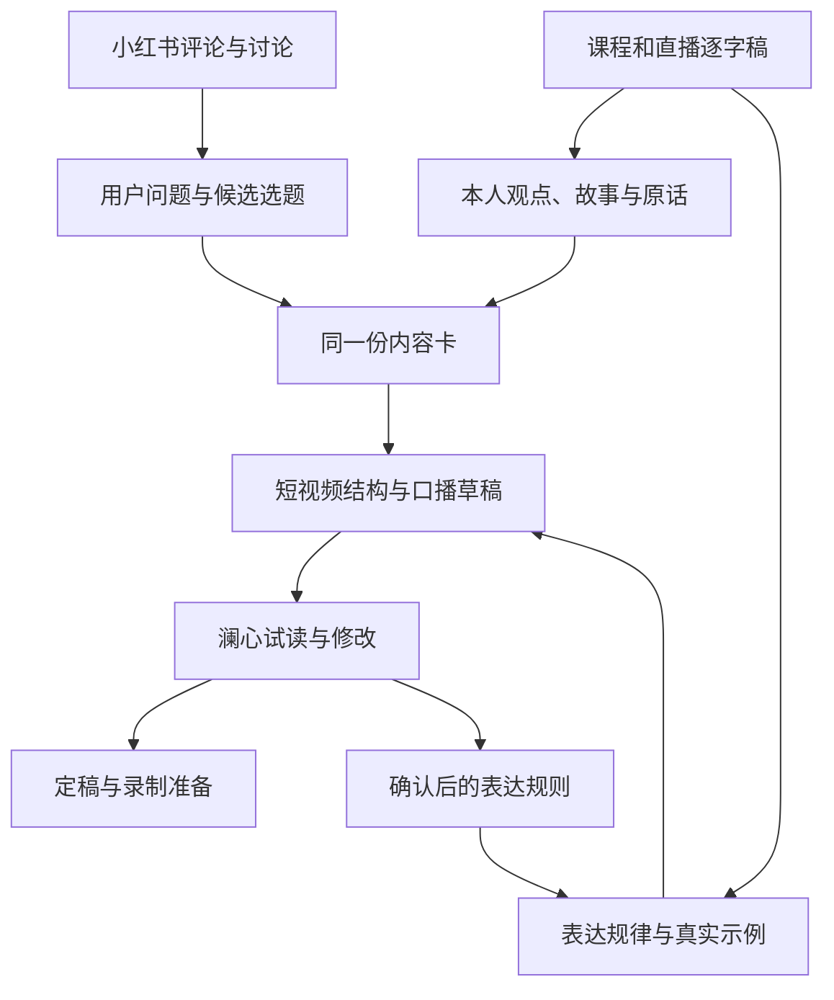

澜心短视频表达与思维逻辑

这是原压缩包的免解压阅读版，收录包内全部 34 个文件。
前面是目录，后面依次是 33 份 Markdown 原文和 1 份来源清单。保留原有文字和表述，不代表其中每份总结或试稿都已确认。

原文件目录
01  00_先读我_澜心表达与思维逻辑.md
02  01_早期聊天/01_最早短视频文案共创_20260805-0814_原始聊天.md
03  01_早期聊天/02_品牌构建策略_20260813_原始聊天.md
04  01_早期聊天/03_最早表达要求与思维逻辑_核验索引.md
05  02_近期聊天/02_内容生产流程_可见聊天档案.md
06  02_近期聊天/03_近期文案需求_索引补充与规则提炼.md
07  03_既有仓库资料/001-/澜心内容Brain/Brain/01_我是谁_persona.md
08  03_既有仓库资料/001-/澜心内容Brain/Brain/02_价值观_values.md
09  03_既有仓库资料/001-/澜心内容Brain/Brain/03_表达偏好_voice_style.md
10  03_既有仓库资料/001-/澜心内容Brain/Brain/04_内容方向_content_direction.md
11  03_既有仓库资料/001-/澜心内容Brain/Brain/05_目标用户_audience.md
12  03_既有仓库资料/001-/澜心内容Brain/Brain/06_个人故事_story.md
13  03_既有仓库资料/001-/澜心内容Brain/Brain/07_禁用表达_forbidden_language.md
14  03_既有仓库资料/001-/澜心内容Brain/Brain/08_经典观点_core_beliefs.md
15  03_既有仓库资料/001-/澜心内容Brain/Brain/09_语言与金句_language_quotes.md
16  03_既有仓库资料/001-/澜心内容Brain/Content/逐字稿/2026/C20260826-001_transcript.md
17  03_既有仓库资料/001-/澜心内容Brain/Docs/LANXIN_SHORT_VIDEO_ADAPTATION_V0.1.md
18  03_既有仓库资料/001-/澜心内容Brain/Docs/LANXIN_SHORT_VIDEO_SAMPLE_A_V0.1.md
19  03_既有仓库资料/001-/澜心内容Brain/Docs/LANXIN_SHORT_VIDEO_SAMPLE_B_V0.1.md
20  03_既有仓库资料/001-/澜心内容Brain/Docs/LANXIN_SHORT_VIDEO_V0.1_REVIEW_INDEX.md
21  03_既有仓库资料/001-/澜心内容Brain/Docs/LANXIN_VOICE_RESEARCH_V0.1.md
22  03_既有仓库资料/001-/澜心内容Brain/Project资料同步包/04_表达方式_经典观点与内容红线.md
23  03_既有仓库资料/001-/澜心内容Brain/Project资料同步包/09_短视频表达与写作试用.md
24  03_既有仓库资料/001-/澜心内容Brain/Prompts/03_内容共创_首条Prompt.md
25  03_既有仓库资料/00_仓库核读说明与来源.md
26  03_既有仓库资料/manifest.json
27  03_既有仓库资料/obsidian/01｜个人思想与觉察/个人语言与金句/个人语言与金句.md
28  03_既有仓库资料/obsidian/01｜个人思想与觉察/个人语言与金句/说话人识别与原话入库规则.md
29  03_既有仓库资料/obsidian/02｜澜心思想与方法论/核心模型/心道德事｜哲学原义与科学应用边界.md
30  03_既有仓库资料/obsidian/02｜澜心思想与方法论/核心模型/澜心研究院｜研究与实践方法论1.0.md
31  03_既有仓库资料/obsidian/02｜澜心思想与方法论/核心模型/澜心社｜心道德事方法论总纲领1.0.md
32  03_既有仓库资料/obsidian/02｜澜心思想与方法论/核心模型/科学事实—文化解释—主观体验三分法.md
33  03_既有仓库资料/obsidian/02｜澜心思想与方法论/核心模型/身体—心理—关系—生命四层模型.md
34  03_既有仓库资料/obsidian/05｜IP与内容创作/澜心IP定位与表达准则.md


════════════════════════════════════════════════
〔01〕 00_先读我_澜心表达与思维逻辑.md
════════════════════════════════════════════════

# 澜心短视频表达与思维逻辑｜使用说明

整理日期：2026-11-16。本资料包用于写作和回查，不代表所有历史聊天均已找全，也不代表风格已经通过本人试读验收。请优先读本文件，再按来源查看原话；个人经历、学员信息和健康内容只用于本人授权的创作，不默认公开。

## 一、先回到你最早的出发点

2026 年 8 月 5 日，你说，自己自然表达有活人感，但随性输出可能口水多、逻辑不清；希望一起把你的真实想法整理得既有结构和内容，又有故事、案例、层次和画面，不啰唆。你提出“IP 人设是漩涡中心不变的，其它的都是围绕漩涡的涟漪”：先让人看到你，因价值留下，因有层次和细节看完，因专业和真实经验产生信任，最后有自然的互动或咨询可能。你希望开头吸引人、观点有反差，结合亲身经历，最后给对方价值或方法。完整原话和上下文见 `01_早期聊天/01_最早短视频文案共创_20260805-0814_原始聊天.md`。

**最重要的是：不是让 AI 替你表演一个“温暖专业的老师”，而是从你真实的经历和判断出发，帮你把话讲清楚、讲得让人愿意听。** 这句话是我对上述原话的归纳，不是你的逐字原话。

## 二、从思考到文案，怎样走

1. **先找到一个真实问题**：她是谁，处在什么生活场景，身体有什么感受，心里可能有什么顾虑？具体描述来自真实材料或合理的普遍场景；不要把假设写成用户调查事实。
2. **找到你想回应的核心判断**：你原来怎么看，现在怎么看？女性听完会比以前多明白什么？不是堆专业知识，也不是把别人的观点翻译后说成你的观点。
3. **想明白为什么**：可以从身体、心理、关系和生活的不同层面看问题，但不必每篇全部覆盖。事实、文化解释和个人体验分开；哲学思考不能代替医学证据。
4. **挑选能讲明白的材料**：生活细节、真正发生的故事、合适的比喻和经过核验的知识。亲身经历必须有来源，不能替你编心理活动或结果；第三人经历不因在聊天里出现就可以公开。
5. **按短视频重新组织**：让开头尽快进入具体问题或有意义的反差，接着解释原因、展开例子或故事，最后让观众带走一个理解、判断或可选择的行动。顺序可以随题变化，不把所有视频套同一结构。
6. **读给人听，再修改**：语言要像平时聊天，清楚、自然、能听懂。删除没有推进的重复，保留必要的情绪和呼吸感。实际时长、是否像你，靠本人试读，而不是凭字数或 AI 自评决定。

这些是基于现有聊天及仓库资料整理的工作方法，其中部分是 AI 归纳，不应冒充你已逐条确认的原话。

## 三、你已经明确过的表达节奏

早期你提出过用“为什么 → 是什么 → 怎么做”帮助观众理解，并用案例论证、总结呼应。你也说过，观点型内容可以用反差观点加举例，留一部分给观众思考。因此这是可选的思考工具，不是每条视频都必须塞进三步或三个方法。你说“只有我自己把这个事儿想明白，想通了我才有动力去做他”，体现了先理解原因再行动的重要性。具体上下文见早期聊天中的核验索引。

已有资料也描述你高能量、鲜活、幽默、能直接指出问题；不要把你的声音缩成只有温柔陪伴。此为历史表达总结，具体使用还需本人试读判断。

## 四、写作时最容易跑偏的地方

- **只有“温暖、专业、有力量”**：这些形容词不能替代你真实的说法、思考顺序和修改记录。
- **把长课缩成摘要**：课程面对学员，短视频面对不认识你的人。保留观点和讲解方式，调整铺垫、互动、顺序；不要把课堂逐字稿机械剪短。
- **只剩观点，没有人**：例如只说“关注身体”，没有讲清是什么身体信号、在什么场景发生、女性可能如何感受。
- **为了故事编故事**：没有确认的个人经历、对话、内心独白、疗效或学员反馈，都不能写成真实发生。
- **反差变成吓人**：标题与开头可以鲜明，但不能制造羞耻或焦虑，也不能夸大医学结论。
- **只给结论不解释**：把“为什么会这样”“还可能有哪些情况”讲清楚；涉及健康问题应核查权威来源及就医边界。
- **每条都是相同句式**：提问、叙事、解释、判断可以变化，不要机械使用反问、金句、相同收尾。
- **把研究报告当成成稿**：你需要的是完整可试读的正文；选题理由和依据帮助理解，不应让你自己再把碎片拼成稿。

## 五、给 Chat、Work、Codex 的通用写稿指令

```text
请先读取这份资料包的“先读我”、早期原始聊天、近期文案需求，以及 03_既有仓库资料中的表达偏好、禁用表达、短视频改编规范和表达研究。说明实际读了哪些，无法读到的不要假装已读。

以澜心本人提供的本次主题、观点和真实素材为中心。先弄清楚：讲给谁听、她在什么具体场景、想回答什么问题、澜心想表达的核心判断是什么、有什么可核对的事实和故事。真实素材不够时不要编造，明确标注待确认。

把课程或直播中的真实表达转为适合短视频的口播，而不是照抄长课。开头尽快进入具体情境或有根据的观点反差；中间解释为什么，必要时用真实细节或贴切比喻；结尾让人带走具体理解或行动。结构根据内容变化，不强行套模板。

用自然、清楚、像聊天的中文写完整可试读正文，减少空泛口号、堆砌术语和无意义重复。保留澜心的真实态度与适当情绪，不模仿未经确认的口头禅。明确区分她的原话、AI归纳与新增创作；不要捏造亲身经历、评论、数据或疗效。医学相关内容核验可靠来源并交专业审核。

交付时先给完整正文，再简要说明选题依据、核心观点、使用了哪些真实素材及待核事项。根据本次要求确定时长，实际时长由澜心试读确认。不要把历史 AI 稿或未经本人认可的小样当成标准范文，也不要宣称已完全掌握她的风格。
```

## 六、资料目录与可信度

- `01_早期聊天`：已找回的早期原始聊天，含用户与当时助手的回应。原文保留语音转写误字；助手的提议不等于用户全都确认。
- `02_近期聊天`：内容中枢及短视频生产过程中的可读对话、搜索可见总结、修订要求。存在接口空白和截断，文件内已标明，不是完整账号导出。
- `03_既有仓库资料`：已读取的表达、禁用语、观点、个人故事、短视频改编及方法论资料。请查看其中的来源清单；历史方案、样稿和候选观察不等于本人最终认可。原仓库文件在这里为参考副本，未修改原仓库。

## 七、还缺什么，才能更像本人

最有价值的是实际对照：**本人可确认的课程或直播原话 → 改写稿 → 本人指出不顺的句子 → 最终修改**。现有历史回执提及大量语料扫描，但真正深入阅读和说话人核验的范围有限，不能将扫描量等同于已学会。第 12 篇 V03 是被修改对象，不是认可范文；11 月 13 日录音及 V04 的完整对照仍需按实际可访问情况进一步核实。

这份资料不自动同步到其他平台或改动长期写作规则。不同工作端必须实际读取并试用，才可以说该端已使用这份材料。


════════════════════════════════════════════════
〔02〕 01_早期聊天/01_最早短视频文案共创_20260805-0814_原始聊天.md
════════════════════════════════════════════════

# 《短视频文案共创》原始聊天与当时总结

核验时间：2026-11-16。覆盖 2026-08-05 至 2026-08-14。本会话从首条读至最后一条，分页已读完；这不代表账号所有相关聊天已找全。

说明：保留用户与助手的原始表述及语音转写错字。助手历史草稿不是用户原话或现行事实；历史医学、平台、履历及案例说法未经本次专业复核，不可直接发布。涉及第三人的故事只作为私有语料，不能把归档当作公开许可。

## 2026-08-05T06:18:41.667901Z｜用户原话

来源：[原消息](https://chatgpt.com/c/6a72d5c2-a86c-83ec-ad83-fe16e8c1833b?messageId=2120950c-e6ca-4e01-842c-f1a1d71cea4d)

短视频文案共创方案

我自己觉得如果要录短视频的话呢，还是有结构还有内容比较好，这样我效率会比较高一些，因为自己随性输出的话，那可能口水化会比较多，然后的话呢，可能逻辑不是那么的清晰，所以我还是希望改视频的表达能够既有活人感，然后有故事有和案例，但是同时又感觉不是那么啰唆，所以我还是想我们接下来一起来去做这个短视频的文案，然后我把我的想法用我自己平时自然表达的方式来发给你，然后呢，你按照短视频的这种逻辑结合我的内容来帮我去做一些优化和调整，要符合短视频的逻辑，还要始终扣题，和我的专业和IP人设挂钩，IP人设是漩涡中心不变的，其它的都是围绕漩涡的涟漪，首先先看到我（符合推流逻辑）然后留下来（有价值的或痛点值前）看完内容（内容有层次有细节，有画面感）对我产生信任（专业，过来人有经验）然后选择我（点赞收藏或者评论转发，咨询）所以既有前面3秒开头的人，然后呢，也要有一个比较反差的观点，快速吸引人，还要由我自己的亲身案例或者经历，在这个过程的最后有一个能够输出的价值或者给别人的一个方法，
然后我希望我们能一起来完成短视频的文案，让我可以提升效率同时又能输出自己的的真实有价值的内容


---

## 2026-08-05T06:19:20.492921Z｜助手当时回复／总结

来源：[原消息](https://chatgpt.com/c/6a72d5c2-a86c-83ec-ad83-fe16e8c1833b?messageId=efa1f722-9f47-5837-84d6-7668c8fe3a5e)

对，我完全理解你想要的不是“让AI替你写短视频”，而是建立一套长期的短视频共创机制：

你负责提供真实的经历、感受、判断和生命体验；我负责提炼选题、找到传播钩子、梳理内容逻辑、压缩口水话，并让每一条内容都回到你的IP主线。

你的内容不能只有“流量逻辑”，也不能只有“自我表达”。我们要做的是：

> 用真实表达吸引人，用生命经验打动人，用专业洞察建立信任，用可行动的方法留下价值。

## 一、我们的核心原则

你的IP是漩涡中心，所有选题都是外围的涟漪。

无论你讲女性成长、身体健康、亲密关系、孩子教育、创业经营，还是自己的生活感悟，最后都要让观众逐渐形成一个稳定认知：

> 澜心不是站在岸上讲道理的老师，而是一个真实走过、持续探索、愿意把自己的生命经验分享出来的女性成长探索者。

因此，一条视频既要回答“这件事是什么”，也要悄悄回答三个更重要的问题：

- 你是一个怎样的人？
- 你为什么有资格讲这件事？
- 为什么这件事值得听你讲？

但不需要每条视频都把身份、履历和专业标签说出来。真正高级的人设，是通过一次次观点、故事和选择自然形成的。

## 二、短视频的共创流程

以后你不需要先把话想得特别完整，也不用刻意按照短视频格式来讲。你可以像平时跟我聊天一样，把以下内容告诉我：

1. 今天发生了什么，或者你想讲什么？
2. 哪个瞬间让你有感触？
3. 你以前是怎么想的，现在怎么看？
4. 有没有一个具体的人、对话、细节或画面？
5. 你最想让观众带走的一句话是什么？

哪怕你发给我的是一段很长、很散的语音转文字也没关系。我会帮你完成五件事：

- 判断这是不是一个值得拍的选题
- 找到最有反差、冲突或痛点的切入点
- 提炼真正属于你的核心观点
- 加强故事、细节和画面感
- 收束成观众可以带走的方法或价值

如果原始内容里缺少关键细节，我不会擅自编故事，而是只追问你一两个最重要的问题。

## 三、每条视频的底层结构

我们不把所有视频写成同一个模板，但会有一套稳定的传播逻辑。

### 1. 前3秒：先让人停下来

开头不能只是介绍主题，而要直接进入冲突、反差、痛点或者结果。

例如：

- “我做了这么多年老板，现在最想逃离的，恰恰就是‘老板’这个标签。”
- “真正伤害孩子的，很多时候不是那件事，而是父母知道那件事之后的反应。”
- “女人真正开始成长，可能不是变得更优秀，而是不再努力证明自己。”
- “很多人以为盆底训练就是夹紧，其实越用力，问题可能越严重。”

开头首先服务于目标用户的感受，不能为了流量故意制造与你价值观不一致的焦虑。

### 2. 快速扣题：告诉观众为什么值得听

开头之后，要在很短时间里明确：

- 这件事与你有什么关系？
- 为什么这个问题和多数人想得不一样？
- 你今天到底想说什么？

避免讲了十几秒，观众还不知道主题是什么。

### 3. 具体故事：让观众看到画面

故事不需要很长，但必须具体。比起“我以前也很焦虑”，更有力量的是：

> “那段时间我每天一睁眼就在回微信、处理团队问题。看起来公司是我的，但我的时间没有一分钟真正属于自己。”

我们会优先寻找这些内容：

- 一段真实对话
- 一个突然意识到什么的瞬间
- 一次做错或后悔的经历
- 一个客户或学员的变化
- 一个身体感受或生活细节
- 过去的你与现在的你的对照

### 4. 观点升维：从“我的故事”进入“你的问题”

故事只是入口，观众最终关心的是自己。

所以我们会从你的经历中提炼一个更普遍的洞察：

> “后来我才发现，我想逃离的并不是老板这个身份，而是被任何一个身份定义的人生。”

这一部分是你建立IP辨识度的关键。它要有你的判断，而不是谁都可以说的正确废话。

### 5. 给出方法：让观众知道下一步怎么做

方法不一定是“三个步骤”，也可以是一个问题、一次练习或一个新的判断标准。

例如：

> “你可以问问自己：如果拿掉老板、妻子、妈妈这些身份，我还会怎样介绍自己？”

这样观众看完不仅被打动，也能立刻对照自己。

### 6. 自然收尾：完成信任与行动

我们不会每一条都生硬地说“点赞关注”。结尾可以根据内容选择：

- 金句收束
- 留下一个问题，引导评论
- 提醒收藏，方便之后实践
- 引导分享给某类人
- 自然承接后续内容或咨询

例如：

> “如果你也正在重新寻找自己，可以在评论区告诉我：拿掉所有身份以后，你最想成为谁？”

## 四、我会特别帮你守住的几条线

以后我优化文案时，会同时检查：

- 这条内容是不是始终扣题，有没有中途跑散？
- 前3秒是否让目标用户愿意停留？
- 是不是只有观点，没有故事和细节？
- 是不是只有情绪，没有更深一层的洞察？
- 是否体现了你的真实经历和专业积累？
- 观众看完能否得到一句话、一个方法或一个行动？
- 内容是否增强“女性成长探索者”这个核心人设？
- 是否像你本人说话，而不是像一篇标准营销文案？

我也会保留你自然表达中的语气、停顿、转折和个人用词。我们追求的是“整理过的真实”，不是“完美但没有人味”。

## 五、以后你可以这样把素材发给我

你不需要每次填写完整表格，直接说就行。如果想提高效率，可以简单按照这个格式：

> 今天想讲的主题：  
> 发生的事情/想到的故事：  
> 我最真实的感受：  
> 我现在的观点：  
> 希望观众看完明白什么：  
> 希望时长：60秒/90秒/3分钟

我会给你整理成：

1. 选题判断与核心受众  
2. 3个开头钩子  
3. 一版完整口播稿  
4. 一版拍摄提词结构  
5. 标题、封面文案和评论区引导  
6. 这条视频强化了哪一层IP认知  

我们就把这套方式确定为今后的“澜心短视频共创机制”。你继续负责真诚地生活、体验和表达，我负责帮你把那些散落在生活里的思考，变成既有传播力、又能沉淀个人品牌的内容。

现在你可以直接把第一段最自然、最口语化的想法发给我，不用整理，我来完成第一条。

---

## 2026-08-05T06:39:52.244732Z｜用户原话

来源：[原消息](https://chatgpt.com/c/6a72d5c2-a86c-83ec-ad83-fe16e8c1833b?messageId=eecc91dc-e3ea-4787-a596-22d6f533b86d)

https://e6mzkbx5dp.feishu.cn/wiki/K6FuwvmCVi9PUjk5fFxcPy0Ln5p 
OK，就这么干！我把之前讨论的选题内容发给你，我们先出第一条试试看，关于女孩子来月经的

---

## 2026-08-05T06:40:37.756398Z｜助手当时回复／总结

来源：[原消息](https://chatgpt.com/c/6a72d5c2-a86c-83ec-ad83-fe16e8c1833b?messageId=50ab0571-1d55-5ca3-ac39-51976287ac06)

好，我们就先做“女孩子第一次来月经”这一条。

不过你发的飞书页面目前无法直接读取，可能是页面权限或访问限制。为了不凭空替你编案例、丢掉你原本的观点，你把其中关于“女孩子来月经”的那一段直接复制到这里，或者截图发给我就可以，不需要整理。

我拿到后会直接给你：

- 3个不同力度的前三秒开头
- 一版60—90秒完整口播稿
- 更自然的拍摄提词版
- 标题与封面文案
- 评论区互动问题
- 这条内容与“女性成长探索者”IP的连接点

这一条我初步建议的核心冲突是：

> 女孩第一次来月经，真正影响她一生的，可能不是身体发生了什么，而是妈妈当时用什么态度回应她。

它既能击中妈妈的痛点，也能自然连接你的专业主线：女性如何从青春期开始认识身体、接纳身体，并建立对女性身份的第一份感受。

把原文发来，我们马上开始第一条。

---

## 2026-08-05T06:57:05.990988Z｜用户原话

来源：[原消息](https://chatgpt.com/c/6a72d5c2-a86c-83ec-ad83-fe16e8c1833b?messageId=45dc9d4b-9e9f-43c0-a54d-01e8bf22444b)

第一个选题是关于月经，我会这样讲

《孩子第一次来月经，父母的第一句话，千万别说错》
很多女孩一辈子都忘不了第一次来月经时妈妈说的话和当时的场景，好的时候，父母其实也不想伤害孩子，而是不知道可能无意间的一句话就让孩子觉得我的身体是不是很羞耻？
还记得我第一次来月经的时候是16岁，我的月经来得比较晚，所以身边的同学和姐姐他们都来月经了，那个时候我觉得月经很正常，每次他们来月经的时候都让我去帮他们买卫生巾，我还问他呢，为什么你们不自己去买呢？他们告诉我说，因为你没有来月经，你去帮我们买，我当时并不明白为什么我没有来月经就带我去买等到后来我终于来月经了，我跟我妈妈说我来月经了，你给我买卫生巾，我妈说你自己去，我当时还跟他争论，为啥你们来月经了就要我去买，我来月经了，你们就让我自己去买，后来我才知道，其实是他们不好意思，然后呢才只是我去，所以我只能自己一个人跑到商店来，以前我没来月经之前买卫生巾，我觉得很正常，不就是卫生巾吗？适当我自己来月经了，我是为自己而买的时候，我感觉好像这时间有点害羞的事情，我还记得当时是夏天的早上我等到商店开门周围没人，第一个冲进去了半天，老板说老板我要买那个老板问我你要啥，我说就是那个老板说你要买哪个，你经常都来买东西，我说就是我每个月都来买的那个老板笑了，他说你说的是卫生巾呀，我嗯嗯嗯对，老板当时给我拿了包卫生巾袋子装一下呗，袋子拿一个装着袋子，把它裹在衣服里非一般的跑回来家，生怕路上有人看到我到我跑在家口气喘吁吁的才把卫生巾拿出来，所以其实本来我以前对卫生巾没什么质感，但是但我发现自己去买卫生巾，好像是一件羞羞的事的时候，忽然就觉得好像卫生巾这个东西，我来月经这个事情变成了一件要知道隐藏起来的害羞的事情，我这都还好，我有另外一个同学，因为是跟爸爸生活在一起，来月经了，更不好意思给爸爸说害怕卫生巾在家里被看见，那个时候那种茅厕是气的，上面就有些缝，他就说他没吃吧，卫生巾卷起来塞到那个缝里面被人发现，还有一个学员分享，他来了月经，她妈妈就很重视跟他讲来了，你跟别人就不一样了，你就以后不能跟男生在一起啊，也可以跟男同学一起出去玩啊，然后你也不可以碰冷水，不可以洗澡，别人家办喜丧事你也不能去了，当时她就吓到了，觉得原来来月经了这么严重，并不知道月经到底是什么只知道好像这个事情很严重，来月经的人跟别人不一样了，其实孩子第一次来月经的时候，他要的不仅仅是知识还有安全感如果父母表现得很紧张，很嫌弃，很尴尬孩子就会觉得是不是我的身体有问题，我们在青春期成长夏令营里会这样告诉孩子，来月经是我们早上成熟的标志是子宫内膜周期性的脱落，每个人的月经周期和月经的量都不一样，什么是健康的什么是不健康的如果遇到异常时间告诉爸爸妈妈，我们还会讨论这月经期间到底应不应该洗头洗澡到底应不应该做体育运动或者如果发现身边的同学来月经了，你会怎么做？有的孩子就说要去提醒他或者拿个东西给他遮一下，然后我会反问他们那为什么月经需要折呢？如果你流鼻血了，不小心滴在衣服上了会要遮起来吗？他们说不会，那我会问他们为什么来月经了要遮起来还这么说呢？因为月经是从下面流出来的呀，那个地方有血多修啊，就会跟他们辩论，到底是我们感受到羞耻，还是我们对月经的看法让我们感受到羞耻，这时孩子他们就回去思考到底是什么，让我们感到羞耻，但我再问他的时候，你会怎么做？同学们会回答说我会先上去提醒他，你来月经了你知道吗？如果他知道我会问他，那你需要我帮你做什么吗？可能是帮她买卫生巾地上纸或者找个东西给他吃一下，如果他说知道，但是没关系，那我就尊重她，并且不会嘲笑她，所以你看真正的性教育并不只是给孩子传递知识，还要消除他们对身体的这些羞耻感，还要警惕我们平时所认为的常识对孩子的这些影响，青春期孩子记住的不是月经，而是身边对月经的态度

---

## 2026-08-05T06:57:34.363587Z｜助手当时回复／总结

来源：[原消息](https://chatgpt.com/c/6a72d5c2-a86c-83ec-ad83-fe16e8c1833b?messageId=fc538259-6e50-5451-a3de-673bf2e85e56)

这段素材很有力量，尤其是你“没来月经时买卫生巾不害羞，为自己买时反而开始害羞”的反差，非常有画面感，也能自然引出一个深层观点：

> 月经本身不会让女孩羞耻，是周围人对月经的态度，让她开始怀疑自己的身体。

不过原素材内容太丰富，一条视频全部讲完会削弱故事。第一条我们只完成一件事：让父母意识到，女孩第一次来月经时，大人的第一反应可能会影响她对身体的长期感受。

## 三个开头选择

我最推荐第一个，它既有故事，也有反差。

1. **我第一次来月经，妈妈只对我说了一句话。就是这句话，让我第一次觉得：来月经好像是一件羞耻的事。**

2. **女孩第一次来月经时，父母的第一句话，她可能一辈子都不会忘记。**

3. **月经本身不会让女孩羞耻，是大人面对月经时的态度，让她开始觉得自己的身体见不得人。**

## 第一版完整口播稿

:::writing{variant="social_post" id="58317"}
我第一次来月经，妈妈只对我说了一句话。

就是这句话，让我第一次觉得：来月经好像是一件羞耻的事。

我第一次来月经已经16岁了，算比较晚。那时候身边的姐姐和同学早就来月经了，她们每次要买卫生巾，都会叫我去。

我还很奇怪：“你们为什么不自己去？”

她们就说：“因为你还没来月经，你去买没关系。”

那时候我确实觉得没什么，不就是一包卫生巾吗？

后来有一天，我终于来月经了。我回家跟妈妈说：“妈妈，我来月经了，你帮我买包卫生巾吧。”

我妈很自然地说了一句：“你自己去买。”

我当时还很不服气：“为什么以前她们来月经，都让我去买；现在我来月经了，却还是让我自己去买？”

最后，我只能一个人去了商店。

到了以后，我站在老板面前，半天都说不出口，只能一直说：“老板，我要买那个。”

老板问：“哪个？”

我说：“就是我以前经常来买的那个。”

老板一下笑了：“你说卫生巾啊？”

我赶紧说：“对对对，就是那个。”

拿到以后，我用袋子包了一层，又藏进衣服里，一路飞快地跑回家，生怕被别人看见。

你看，明明在我来月经以前，我从来不觉得卫生巾有什么好害羞的。可是当这包卫生巾变成“我自己要用”的时候，我突然开始觉得：原来来月经是一件需要隐藏起来的事情。

所以，女孩第一次来月经时，需要的不只是一包卫生巾，也不只是月经知识。她更需要通过父母的反应确认一件事：

“我的身体是正常的，我没有做错什么，这也不是什么见不得人的事情。”

如果你的女儿第一次来月经，请先不要紧张，不要嫌弃，也不要急着告诉她“以后不能做什么”。

你可以抱抱她，然后告诉她：

“宝贝，恭喜你，身体又长大了一点。来月经是每个女孩都会经历的正常变化。妈妈会告诉你怎么照顾自己，有任何不舒服，都可以来找我。”

真正的性教育，不只是告诉孩子月经是什么，更是帮助她从第一次来月经开始，学会认识身体、照顾身体，也不因自己的身体而感到羞耻。
:::

## 拍摄提词版

不用逐字背，只记住这六个节点：

1. **钩子：**妈妈的一句话，让我第一次觉得月经很羞耻  
2. **前情：**16岁才来月经，以前经常替姐姐和同学买卫生巾  
3. **冲突：**自己来月经后，妈妈却让我自己去买  
4. **画面：**“老板，我要那个”——袋子包好、藏进衣服、飞快跑回家  
5. **转念：**月经没有让我羞耻，是周围人的态度改变了我  
6. **方法：**女儿第一次来月经，父母可以具体说什么  

拍到商店那一段时，可以保留你原本自然的表演和对话感，这是整条视频最“活”的地方。后半段观点要稍微放慢，特别是这一句：

> 她需要通过父母的反应确认：我的身体是正常的，我没有做错什么。

## 标题与封面

标题：

> 女孩第一次来月经，父母的第一句话可能影响她很多年

封面大字：

> 女儿第一次来月经  
> 千万别只说“自己去买”

备选封面：

> 月经羞耻  
> 是从什么时候开始的？

## 评论区互动

> 你还记得自己第一次来月经时，家里人说的第一句话吗？

这个问题很容易唤起女性的个人记忆，评论区会出现大量真实故事，也会帮助我们继续发现下一批选题。

这一版已经同时呈现了你的三层身份：亲身经历过的女性、理解孩子感受的母亲，以及真正做过青春期教育的实践者。下一条就可以承接你同学藏卫生巾的故事，专门讲：

> “为什么一个正常的生理现象，会让女孩想尽办法隐藏自己？”

---

## 2026-08-05T07:51:11.802347Z｜用户原话

来源：[原消息](https://chatgpt.com/c/6a72d5c2-a86c-83ec-ad83-fe16e8c1833b?messageId=0bf33074-20f8-4fd1-9582-eb83129d9b5d)

可以把刚刚的内容拆成几个关于月经的选题，分别阐述不同的视角观点

---

## 2026-08-05T07:51:24.783392Z｜助手当时回复／总结

来源：[原消息](https://chatgpt.com/c/6a72d5c2-a86c-83ec-ad83-fe16e8c1833b?messageId=9f21b113-7ceb-5f4f-8db9-b226aef98122)

可以。你刚才那段素材至少可以拆成一个“月经教育”系列，而不是全部挤进一条视频。每条只讲一个冲突、一个故事、一个观点，既容易看完，也更容易形成连续追更。

我建议先拆成下面10个选题。

## 月经教育系列选题

| 选题 | 核心视角 | 使用的故事素材 | 最终价值 |
|---|---|---|---|
| 1. 女孩第一次来月经，父母的第一句话千万别说错 | 父母的第一反应 | 你第一次来月经，妈妈让你自己买卫生巾 | 给父母一段正确回应 |
| 2. 为什么没来月经时买卫生巾不害羞，来月经后反而害羞了？ | 月经羞耻如何形成 | 你以前替同学买卫生巾很自然，后来为自己买却不敢说出口 | 羞耻不是身体产生的，而是环境赋予的 |
| 3. “老板，我要买那个”：女孩为什么说不出“卫生巾”三个字？ | 语言背后的身体羞耻 | 你在商店反复说“那个”，最后藏进衣服跑回家 | 父母要让身体词汇变得正常、可表达 |
| 4. 她把用过的卫生巾塞进厕所缝里，不是因为不讲卫生 | 缺乏安全表达空间 | 跟爸爸生活的同学不敢说来月经，也怕卫生巾被发现 | 爸爸也应该参与女儿的青春期教育 |
| 5. 女孩来月经后，真的不能洗头、洗澡和运动吗？ | 月经禁忌与科学知识 | 学员母亲告诉女儿不能碰冷水、不能洗澡 | 区分传统禁忌、个体感受与科学照护 |
| 6. “来月经后不能跟男生玩”，这句话会让女孩误解什么？ | 月经与性羞耻 | 妈妈警告女儿不能再和男生出去 | 性教育应教边界和保护，而不是制造恐惧 |
| 7. 女孩来月经，为什么有些家庭像发生了“大事”？ | 成人的紧张如何传递 | 学员第一次来月经后，被告知一连串“不能” | 孩子会通过父母反应理解自己的身体 |
| 8. 女同学经血弄到裤子上，到底要不要帮她遮住？ | 善意与羞耻的边界 | 夏令营里孩子讨论“拿衣服遮一下” | 先提醒、再询问、最后尊重她的选择 |
| 9. 为什么流鼻血不羞耻，月经弄到衣服上却要躲起来？ | 社会对身体部位的双重标准 | 你在课堂上用流鼻血与经血作对比 | 帮孩子识别：羞耻来自事件，还是来自我们的看法 |
| 10. 月经教育不是教女孩怎么用卫生巾 | 重新定义月经教育 | 你的青春期夏令营实践 | 知识、身体接纳、求助能力与同理心缺一不可 |

## 建议的发布顺序

### 第一阶段：先用故事吸引人

前三条都围绕你自己的第一次月经，容易产生真实感和记忆点。

1. 《女孩第一次来月经，父母的第一句话千万别说错》
2. 《为什么没来月经时买卫生巾不害羞，来月经后反而害羞了？》
3. 《“老板，我要买那个”：为什么女孩说不出卫生巾三个字？》

这三条虽然来自同一个故事，但重点不同：

- 第一条讲父母回应
- 第二条讲羞耻形成
- 第三条讲身体语言与表达

### 第二阶段：扩大到家庭教育

4. 《她把卫生巾塞进厕所缝里，不是因为不讲卫生》
5. 《爸爸能不能跟女儿谈月经？》
6. 《“来月经后不能跟男生玩”，这句话错在哪里？》
7. 《女孩来月经后，父母最容易制造的三种恐惧》

这部分会让你的身份从“过来人”逐渐进入“青春期教育实践者”。

### 第三阶段：用课堂讨论建立专业度

8. 《经血弄到裤子上，要不要帮同学遮住？》
9. 《为什么流鼻血不羞耻，月经却让人羞耻？》
10. 《真正的月经教育，到底应该教孩子什么？》

这部分可以加入夏令营里的真实问答和孩子观点，既有现场感，也能呈现你的教育方法：不是直接灌输答案，而是通过讨论帮助孩子形成判断。

## 还可以再延伸的实用型选题

如果这个系列数据不错，可以继续向家长最关心的具体问题延伸：

- 女儿多大开始讲月经最合适？
- 女孩第一次来月经前，父母要提前准备什么？
- 第一次来月经，爸爸应该怎么回应？
- 女儿来月经后不愿意告诉父母怎么办？
- 月经期间能不能洗头、洗澡和运动？
- 月经量多少、周期多久属于正常范围？
- 女孩在学校突然来月经，父母应该提前教她什么？
- 男孩需不需要接受月经教育？
- 男生嘲笑女同学来月经，父母应该怎么教育？
- 如何给女儿准备一个“初潮安心包”？

## 这个系列的统一主张

所有内容最后都可以回到同一个IP观点：

> 月经教育不是让女孩学会隐藏月经，而是让她学会理解身体、照顾身体，并且不因自己的身体而感到羞耻。

这样看起来是在讲月经，深层讲的仍然是你的IP核心：女性从青春期开始，如何认识自己、接纳自己，并建立内在的生命力量。

---

## 2026-08-05T07:53:04.960618Z｜用户原话

来源：[原消息](https://chatgpt.com/c/6a72d5c2-a86c-83ec-ad83-fe16e8c1833b?messageId=71033789-77fc-4440-8252-4850a3d1ef45)

我想先多测几个选题，然后看哪个选题，关注的人比较多，流量比较好，再来深入，刚刚月经的选题，我觉得可以从三个故事延展出三条出来

---

## 2026-08-05T07:53:18.572833Z｜助手当时回复／总结

来源：[原消息](https://chatgpt.com/c/6a72d5c2-a86c-83ec-ad83-fe16e8c1833b?messageId=c6d099ee-0a23-5a5a-9942-48fb61a70b54)

对，这样更适合起号阶段。先不要急着把“月经教育”做成一个很深的系列，而是用三个真实故事测试三种不同的用户痛点，看观众对哪一个反应最强。

这三个故事刚好对应三个不同视角。

## 第一条：你的故事——月经羞耻是怎么形成的

标题：

> 《我第一次来月经后，突然不敢买卫生巾了》

前三秒：

> 没来月经以前，我替别人买卫生巾从来不害羞。可第一次为自己买卫生巾，我却把它藏在衣服里，一路跑回了家。

故事重点：

- 16岁才第一次来月经
- 以前经常替姐姐、同学买卫生巾
- 没来月经时觉得买卫生巾很正常
- 真正来月经后，却说不出“卫生巾”三个字
- 用袋子包起来，藏进衣服里跑回家

核心观点：

> 不是月经让女孩感到羞耻，而是周围人面对月经时的态度，让她意识到：这是一件需要隐藏的事情。

这一条测试的是：女性自身的记忆与共鸣。

评论引导：

> 你还记得自己第一次买卫生巾时的感受吗？

---

## 第二条：同学的故事——孩子为什么不敢告诉爸爸

标题：

> 《她把用过的卫生巾塞进厕所缝里，只因为不敢让爸爸发现》

前三秒：

> 一个女孩第一次来月经后，把用过的卫生巾一片片塞进厕所的缝里。不是因为她不爱干净，而是因为她不敢让爸爸知道。

故事重点：

- 女孩跟爸爸一起生活
- 来月经后不知道怎么告诉爸爸
- 不敢买、不敢问，也怕卫生巾被爸爸看见
- 只能把卫生巾卷起来，藏进厕所缝隙
- 她真正缺少的不是卫生巾，而是安全求助的空间

核心观点：

> 很多孩子选择隐瞒，并不是不信任父母，而是她不知道父母会不会接纳自己的身体变化。

进一步连接：

> 青春期教育从来不只是妈妈的责任。爸爸面对女儿的月经越自然，女儿越不会觉得自己的身体是一件让异性尴尬或嫌弃的事情。

这一条测试的是：父女沟通和单亲家庭的痛点。

评论引导：

> 你觉得女儿第一次来月经，爸爸应该怎么回应？

---

## 第三条：学员的故事——一句“你不一样了”带来的恐惧

标题：

> 《女孩第一次来月经，妈妈却告诉她：从今天开始，你跟别人不一样了》

前三秒：

> 一个女孩第一次来月经，本来只是有点不知所措，可妈妈接下来的一番话，却让她觉得自己好像犯了什么错。

故事重点：

妈妈严肃地告诉她：

- 以后不能随便和男生玩
- 不能碰冷水
- 不能洗头洗澡
- 别人家办红白喜事也不能去
- “你现在和以前不一样了”

女孩并没有因此更懂月经，只记住了一件事：

> 来月经是一件很严重、很危险、需要处处小心的事情。

核心观点：

> 父母以为自己在保护孩子，但如果只告诉孩子一连串“不能”，孩子得到的不是保护，而是对身体的恐惧。

父母可以换成：

> “来月经说明你的身体正在长大，这是正常的生理变化。妈妈会告诉你怎么照顾自己，但你依然可以正常生活。”

这一条测试的是：传统月经禁忌与代际教育冲突。

评论引导：

> 你第一次来月经时，家里有没有告诉过你一些至今仍然记得的禁忌？

## 三条视频测试的不是同一个问题

| 视频 | 情绪触点 | 主要受众 | 重点观察 |
|---|---|---|---|
| 你的故事 | 共鸣、心酸、回忆 | 所有成年女性 | 评论故事、完播率 |
| 同学的故事 | 心疼、震撼、父女沟通 | 青春期女孩父母 | 转发率、讨论度 |
| 学员的故事 | 反差、争议、代际冲突 | 妈妈及传统家庭女性 | 评论率、观点争论 |

发布时尽量让三条的时长、画面形式和发布时间接近，这样更容易判断究竟是“选题差异”，还是拍摄方式造成的数据差异。

我建议先写第一条——你的故事。它最能让观众先看到你这个人，也最符合我们“先看到我，再相信我”的IP逻辑。

---

## 2026-08-05T07:54:03.346662Z｜用户原话

来源：[原消息](https://chatgpt.com/c/6a72d5c2-a86c-83ec-ad83-fe16e8c1833b?messageId=d7136e93-b8e9-41d8-875c-89667a64d809)

你看一下这些选题呀，我们今天先把这10个选题拍了拍一遍看流量数据

---

## 2026-08-05T07:54:48.027472Z｜助手当时回复／总结

来源：[原消息](https://chatgpt.com/c/6a72d5c2-a86c-83ec-ad83-fe16e8c1833b?messageId=69db0698-fb1f-5491-8f5b-6b1da6edf86f)

我看完了，文件里目前一共有15个选题。既然今天的目标是先测试流量，我不建议直接按照前10个顺序拍，因为有些主题比较接近，会导致我们看不出观众到底对哪类内容感兴趣。

更适合的做法是：用10条视频测试不同的情绪入口和家长痛点。

## 今天建议拍的10条

### 月经故事组：测试身体教育和女性共鸣

1. 《没来月经时我敢买卫生巾，来月经后为什么反而不敢了？》

核心：月经羞耻是如何形成的。

2. 《她把卫生巾塞进厕所缝里，只因为不敢让爸爸知道》

核心：孩子缺少的不是知识，而是安全求助的空间。

3. 《第一次来月经，妈妈却告诉她：从今天开始，你和别人不一样了》

核心：父母以为在保护孩子，却用一连串禁忌制造了恐惧。

### 亲子沟通组：测试普遍型家长痛点

4. 《孩子说“我喜欢一个同学”，父母最容易说错哪句话？》

核心：喜欢一个人不是早恋的证据，而是孩子情感发展的开始。

5. 《孩子考试没考好，这三句话会让他越来越没有自信》

核心：批评结果容易让孩子否定自己，复盘过程才能培养能力。

6. 《孩子被欺负以后，千万不要先问：他为什么只欺负你？》

核心：孩子求助时，第一需要的是被相信，而不是被审问。

7. 《孩子哭的时候，父母最不该说的不是“别哭了”》

核心：“这有什么好哭的”是在否定孩子对自己感受的判断。

### 冲突观点组：测试争议与评论

8. 《为什么青春期孩子突然不愿意和父母说话了？》

核心：孩子不是突然变沉默，而是曾经表达过，却没有得到安全回应。

9. 《父母总说“我是为你好”，为什么孩子越来越反感？》

核心：问题不在“为你好”，而在父母用爱代替孩子做决定。

10. 《怎样培养心理韧性强，而不是玻璃心的孩子？》

核心：心理韧性不是“别矫情”，而是让孩子既能承受挫折，也敢于求助。

## 这10条在测试什么

| 内容方向 | 对应视频 | 观察指标 |
|---|---|---|
| 女性真实经历 | 1—3 | 完播、女性故事型评论 |
| 高频亲子痛点 | 4—7 | 收藏、转发给伴侣 |
| 反差与争议观点 | 8—10 | 评论、关注转化 |

这样拍完，我们不仅能看到哪一个具体选题流量好，还能判断你的第一阶段账号更适合从哪个内容入口切入：

- 青春期身体与性教育
- 父母错误回应纠正
- 青春期亲子沟通
- 心理韧性与女性成长

## 今天拍摄的统一标准

因为是第一轮测试，每条先控制在60—90秒，不要做得太长。统一使用这个轻结构：

1. 前3秒：一句父母经常说错的话  
2. 具体场景：孩子当时发生了什么  
3. 反差观点：父母以为在教育，孩子感受到的却是什么  
4. 正确方法：父母可以怎么回应  
5. 一句话收尾：让观众记住核心观点  

前三条已经有你的真实故事，可以做得更有画面感；后面七条可以先拍“场景＋观点＋一句正确话术”的测试版。等数据出来后，再给高流量选题补充真实案例、理论机制和系列内容。

我建议今天实际拍摄顺序是：**1、6、4、8、3、10、7、2、9、5**。情绪轻重交替，连续拍摄时不容易越拍越沉，而且开场表达也不会太相似。

---

## 2026-08-05T07:55:27.014159Z｜用户原话

来源：[原消息](https://chatgpt.com/c/6a72d5c2-a86c-83ec-ad83-fe16e8c1833b?messageId=494fbe69-91e6-4987-b78b-4ddf45e29054)

第一条，我已经拍了，现在把第二条写出来吧

---

## 2026-08-05T07:55:40.634091Z｜助手当时回复／总结

来源：[原消息](https://chatgpt.com/c/6a72d5c2-a86c-83ec-ad83-fe16e8c1833b?messageId=11ad743b-2288-5020-9adf-fefb6fcf1ac8)

第二条重点不是批评爸爸，而是让父母看见：孩子越是不敢开口，越可能用大人无法理解的方式独自处理问题。

:::writing{variant="social_post" id="62491"}
一个女孩第一次来月经后，把用过的卫生巾一片一片卷起来，塞进了厕所的缝隙里。

你可能会觉得，这个孩子怎么这么不讲卫生？

但她不是不爱干净，而是不敢让爸爸发现。

她从小跟爸爸一起生活。第一次来月经时，她不知道该怎么告诉爸爸，也不好意思让爸爸帮她买卫生巾。

就连用过的卫生巾，她都害怕被爸爸看见。

那个年代的厕所比较简陋，墙壁和木板之间有一些缝隙。她每次换完卫生巾，就悄悄把它卷起来，塞进缝里。

她以为只要藏起来，就没有人会知道自己来月经了。

很多父母看到孩子奇怪的行为，第一反应是批评：

“你怎么这么脏？”

“这有什么不好意思的？”

“有事情为什么不告诉我？”

可是孩子真正担心的，可能不是父母能不能解决问题，而是：

如果我说出来，爸爸会不会觉得尴尬？

会不会嫌弃我？

会不会觉得女孩子来月经是一件很麻烦的事？

所以，女孩的月经教育从来不只是妈妈的责任。

如果家里有青春期的女儿，爸爸也可以提前告诉她：

“身体长大以后，你可能会来月经，这是每个女孩都会经历的正常变化。如果妈妈不在，或者你需要帮助，也可以直接告诉爸爸。爸爸可以帮你买卫生巾，也会保护你的隐私。”

爸爸越自然，女儿就越不会觉得自己的身体变化是一件让人尴尬、需要隐藏的事情。

如果今天你只能记住一句话，我希望是：

当孩子不敢向父母求助时，我们先不要责怪她为什么隐瞒，而要想一想——我们有没有让她感到：无论发生什么，她都可以安心地告诉我。
:::

推荐封面：

> 她把卫生巾  
> 塞进了厕所缝里

标题：

> 女孩第一次来月经，爸爸应该如何回应？

评论区引导：

> 女儿第一次来月经，你认为爸爸应该主动参与，还是交给妈妈沟通？

---

## 2026-08-05T08:50:52.662155Z｜用户原话

来源：[原消息](https://chatgpt.com/c/6a72d5c2-a86c-83ec-ad83-fe16e8c1833b?messageId=8fe98a7b-37f5-4162-8946-9cf0b44c4265)

好的，我们现在来排第三条关于月经的故事吧，就是你发现身边的人来月经怎么办？

---

## 2026-08-05T08:51:08.151408Z｜助手当时回复／总结

来源：[原消息](https://chatgpt.com/c/6a72d5c2-a86c-83ec-ad83-fe16e8c1833b?messageId=64c5eaef-a799-534b-8727-507568c21d06)

这一条很适合用夏令营里的课堂对话来拍，既有孩子的真实反应，也能体现你的教育方式。核心不是“到底要不要遮”，而是：帮助别人之前，先询问她真正需要什么。

:::writing{variant="social_post" id="73146"}
如果你发现身边的女孩来月经，裤子上不小心沾到了经血，你会怎么办？

在青春期成长夏令营里，我问过孩子们这个问题。

很多孩子第一反应都是：

“我会赶紧提醒她。”

“我会拿一件衣服帮她遮住。”

“我会陪她去厕所，再帮她买卫生巾。”

听起来都很善良，对不对？

但我又问了他们一个问题：

“为什么一定要帮她遮住？”

孩子们说：“因为被别人看到会很尴尬呀。”

我继续问：

“如果一个同学流鼻血，不小心把血滴在衣服上，你们会觉得她很羞耻，需要赶紧藏起来吗？”

孩子们都说：“不会。”

“那为什么同样是身体里流出来的血，鼻血可以被看见，经血却一定要藏起来？”

有个孩子马上说：“因为月经是从下面流出来的，那个地方很羞耻啊。”

你看，孩子真正需要学习的，不只是怎么帮助一个来月经的同学，更需要思考：

到底是月经本身让我们羞耻，还是我们对身体的看法，让月经变成了一件羞耻的事？

讨论到最后，我又问他们：

“如果下次真的遇到这样的情况，你会怎么做？”

有个孩子给出了一个特别好的回答：

“我会先私下提醒她，然后问她：你需要我帮你做什么吗？”

如果她需要，我可以帮她拿卫生巾、递纸巾，或者找一件衣服。

如果她说自己知道，也不需要帮助，那我就尊重她，不围观、不议论，也不嘲笑。

真正的善意，不是替别人决定她应该感到尴尬，而是在保护她隐私的同时，把选择权交还给她。

如果今天你只记住一句话，我希望是：

发现别人处于尴尬时，最好的帮助不是自作主张地替她遮住，而是轻轻问一句——“你需要我帮你做什么吗？”
:::

标题建议：

> 发现女同学裤子上有经血，应该怎么办？

封面文案：

> 先别急着帮她遮  
> 你应该这样做

评论区引导：

> 如果你发现身边的人裤子上沾到了经血，你会提醒她吗？会怎么说？

---

## 2026-08-05T09:38:24.276027Z｜用户原话

来源：[原消息](https://chatgpt.com/c/6a72d5c2-a86c-83ec-ad83-fe16e8c1833b?messageId=0ef76df1-be78-4ea8-84a1-5b7578ba39c3)


挺好的，那下一条你觉得最容易有流量，有话题，有讨论有，且能够引发共鸣的选题是什么？我们先拍

---

## 2026-08-05T09:38:46.705593Z｜助手当时回复／总结

来源：[原消息](https://chatgpt.com/c/6a72d5c2-a86c-83ec-ad83-fe16e8c1833b?messageId=f6d0b010-317d-5b5a-9332-c324b12b1c23)

我建议下一条拍：

> 《孩子被欺负后，父母千万别问：他为什么不欺负别人，只欺负你？》

这条最有流量潜力，因为它同时具备：

- 大量成年人有童年被欺负却不敢说的经历
- 很多父母无意中说过类似的话
- “父母以为在找原因，孩子听见的却是责怪”有明显反差
- 评论区容易出现真实经历、观点争论和转发
- 最后还能给出父母可以直接使用的回应

## 完整口播稿

:::writing{variant="social_post" id="48263"}
如果孩子回家告诉你：“妈妈，今天有人欺负我。”

父母千万不要马上问：

“他为什么不欺负别人，偏偏欺负你？”

这可能是孩子鼓起很大勇气，才说出来的一句话。

可是父母一开口，就把责任推回了孩子身上。

我见过很多父母，听说孩子被欺负以后，第一反应不是心疼，而是着急：

“你为什么不打回去？”

“平时不是挺厉害的吗？”

“是不是你先惹别人了？”

“你怎么这么没用？”

父母以为自己是在帮孩子分析问题、教他变得勇敢。

但孩子听到的却可能是：

“是我不够好，所以才会被欺负。”

“连爸爸妈妈都觉得这是我的问题。”

“下一次再发生这样的事，我还是不要告诉他们了。”

孩子被欺负以后，真正需要的第一件事，不是马上学习如何反击，而是确认：

我没有做错；爸爸妈妈相信我；我遇到事情可以回家求助。

所以，当孩子告诉你自己被欺负了，你可以先放下追问，对他说：

“谢谢你愿意告诉我。被别人欺负不是你的错。你现在安全吗？有没有哪里受伤？你希望爸爸妈妈怎么帮助你？”

先接住孩子的情绪，再了解事情的经过；确认孩子的安全，再和他一起商量解决办法。

这并不是把孩子养成玻璃心。

恰恰相反，一个真正有安全感的孩子，才更有力量面对冲突，也更敢在遇到危险时及时求助。

如果今天你只记住一句话，我希望是：

孩子被欺负后，父母的第一反应，不是教他必须马上变强，而是让他知道——无论发生什么，我都相信你，也会和你站在一起。
:::

封面文案：

> 孩子被欺负  
> 千万别问这句话

标题：

> 为什么很多孩子被欺负后，再也不愿意告诉父母？

评论区引导：

> 小时候被欺负时，你最希望父母对你说什么？

---

## 2026-08-05T09:56:57.775432Z｜用户原话

来源：[原消息](https://chatgpt.com/c/6a72d5c2-a86c-83ec-ad83-fe16e8c1833b?messageId=b8b4798f-e771-4f97-ab1d-4e1fd6eb316a)

我觉得我觉得我们还可以把这个话题更延伸一下，平时孩子在学校里被打了，被骂了也叫欺负，但如果孩子被猥亵了，被性侵了被骚扰了，这也叫欺负，作为家长我们会怎么办呢？

---

## 2026-08-05T09:57:34.038093Z｜助手当时回复／总结

来源：[原消息](https://chatgpt.com/c/6a72d5c2-a86c-83ec-ad83-fe16e8c1833b?messageId=bc3fb93d-6d76-5ef8-ad95-f4875c17e1a6)

对，这个延伸比“校园欺负”更重要。但我建议不要把性侵害继续称为普通“欺负”，而是把它做成一条独立视频：

> 孩子说“有人欺负我”，父母千万不要只理解成被打、被骂。

因为孩子词汇有限，也可能害怕、混乱，不敢直接说“猥亵”“性骚扰”或“性侵”。“他欺负我”“我不喜欢他”“他总让我保守秘密”，都可能是孩子能说出的最大限度。

## 完整口播稿

:::writing{variant="social_post" id="31974"}
孩子回家告诉你：“妈妈，今天有人欺负我。”

你首先想到的是什么？

是被同学打了、骂了，还是被排挤了？

可是，如果孩子说的“欺负”，是有人摸了他的隐私部位，强迫他看色情内容，拍摄他的身体，或者要求他保守一个不能告诉父母的秘密呢？

孩子不一定知道什么叫猥亵、性骚扰或者性侵害。

他可能只能告诉你：

“那个人让我不舒服。”

“他碰了我。”

“他不让我告诉你。”

甚至只说一句：“他欺负我。”

这个时候，父母千万不要马上追问：

“他到底摸你哪里了？”

“是不是你自己跟他去的？”

“为什么当时不反抗？”

也不要因为震惊和愤怒，在孩子面前失控。

因为孩子可能会以为：是不是我做错了？是不是我说出来，反而给爸爸妈妈带来了麻烦？

你可以先让自己稳定下来，告诉孩子：

“谢谢你愿意告诉我。”

“这不是你的错。”

“无论发生了什么，爸爸妈妈都会保护你。”

然后用开放的方式问：

“你说的欺负，是发生了什么？”

“你愿意从你记得的地方告诉我吗？”

“你现在还会见到那个人吗？”

先确认孩子是否安全，让他远离可能的侵害者。不要反复盘问，也不要让孩子一遍遍向不同的人讲述经过；如果怀疑发生了性侵害，应当尽快寻求警方、医疗机构和未成年人保护专业人员的帮助。

父母的第一反应非常重要。

孩子记住的可能不是你当时问了多少细节，而是当他终于鼓起勇气说出来时，你相信了他，保护了他，并且清楚地告诉他：

“伤害你的人应该负责，不是你。”

如果今天你只记住一句话，我希望是：

孩子说“有人欺负我”时，不要急着替他定义发生了什么。先听懂他的语言，再让他知道——无论发生什么，我都会相信你、保护你，这永远不是你的错。
:::

## 这条最有力量的前三秒

> 孩子说“有人欺负我”，你以为他只是被打、被骂。但他真正想告诉你的，可能是一件更严重的事。

封面：

> “有人欺负我”  
> 可能不只是被打骂

评论区不建议追问网友的创伤经历，可以用更安全的问题：

> 你有没有提前告诉过孩子：哪些秘密一定要告诉父母？

这条里的关键处理原则——先保障安全、认真倾听、相信孩子、尊重其意愿、避免反复询问和二次伤害——与世界卫生组织的儿童性侵害回应指南一致；中国相关司法意见也强调“最有利于未成年人”和尽量避免重复询问造成次生伤害。[世界卫生组织](https://www.who.int/news/item/19-10-2017-responding-to-children-and-adolescents-who-have-been-sexually-abused)、[最高人民检察院](https://www.spp.gov.cn/zdgz/202305/t20230526_615059.shtml)

---

## 2026-08-05T10:03:24.526018Z｜用户原话

来源：[原消息](https://chatgpt.com/c/6a72d5c2-a86c-83ec-ad83-fe16e8c1833b?messageId=30f17e12-84c5-4608-b592-6963448b4d20)

嗯，其实我还想多分享一下关于这次夏令营里发生的几个让我印象比较深刻的事情呢，是一个男孩第一天，因为玩手机就被妈妈骂了，然后呢，他就很生气，很委屈就在那哭也不愿意再上课，当时我就去问他原因，他就说他妈不分青红皂白的看着他耍手机上来就骂他，还把他正在打一局游戏输掉了，让他输失去了一个很重要的武器，他说明明是在休息时间玩，他妈还说他情绪很激动，不敢怎么说，他说接下来就是玩游戏，不想看课程了，现在好下游戏也会骂，后来因为要上课了，还有其他孩子，所以我也就没有去，一直跟他讲这个事情，就允许他坐在后面，但是后来娇娇老师问他什么时候游戏结束，他说20分钟，结果自己把游戏玩完过后就把手机放在那里又重新投入课程，而且后面回答的问题啊，非常的积极，思维也非常清晰，大家都很赞叹，说这个孩子好聪明，然后呢，又认知又比较高，而且看待问题比较全面，回答问题也很积极，就是他身上其实有非常多的闪光点，后来课程结束了又80那点小插曲，就是这个孩子，因为积分的事情觉得没有完全公平或者奖励方式，没有明确清楚就很生气，然后就情绪有点崩溃，还大哭了一场，我课程结束过后，他已经她妈妈回家的路上了，本来这个事情过了也就算了，可是我想了想孩子的情绪在这个时候作为老师，我应该要去关注一下引导下，所以我就给他妈妈发了个信息，让他妈妈转发给他，意思就是我非常理解他的情绪，以及他对于这个课程的投入和用心，正因为很投入，所以才会在意一分2分，也希望他能够理解，可能老师能够做到相对公平，但是没有办法做到绝对公平，老师有疏忽的时候也有可能没有看到没有加到分的时候时也跟他去讲，可能规则只是为了促进我们的课堂的氛围，我们的学习内容和成长的才是最重要的，不是八注意力都放在得分上面，等我认真了开始同理他的情绪也表达了对他这几天在课程当中的一些看见和我看到他身上有哪些闪光点越拿他的时候孩子给我回来的信息说楠哥今天下午有点情绪是我不对，我不应该发那么大的脾气，这几天确实学习收获挺大的，下次这样的课我还要来参加，然后还说我可以加你微信吗？以后我有什么心里话可以跟你倾诉，我当时就瞎了，所以你看孩子当情绪的时候有问题的时候，我们不要去指责或者回避，而是先处理情绪再解决问题，最后再给他讲道理。

---

## 2026-08-05T10:03:50.747774Z｜助手当时回复／总结

来源：[原消息](https://chatgpt.com/c/6a72d5c2-a86c-83ec-ad83-fe16e8c1833b?messageId=0f49ee06-7a2b-5c4e-a838-ecbd2210d402)

这个故事很有力量，而且最好不要把“玩手机”和“积分崩溃”塞在同一条里。它其实可以拆成两条：

1. **允许孩子把游戏打完，他反而主动放下手机回到了课堂**
2. **一个因为积分不公平而崩溃大哭的孩子，为什么后来主动向老师敞开心扉？**

我建议先拍第二条。它的情绪转折更完整，结尾“以后有心里话可以跟你倾诉吗”非常打动人，也能体现你不是只会讲理论，而是真正看见过孩子、处理过现场问题的人。

## 完整口播稿

:::writing{variant="social_post" id="85624"}
夏令营结束那天，一个男孩因为少算了一两分，情绪突然崩溃，在现场大哭了一场。

如果只看表面，你可能会觉得：

“不就是一两分吗？”

“一个男孩子，怎么这么输不起？”

“课程都结束了，还有什么好哭的？”

当时他已经跟妈妈回家了，这件事好像过去了。

但我想了很久，还是决定给他妈妈发一段话，请她转给孩子。

我告诉他：

“老师很理解你为什么会这么难过。正是因为这几天你非常投入，也很在意自己的表现，所以才会在乎这一分、两分。”

“老师也承认，规则可能没有解释得足够清楚。我们只能尽量做到相对公平，没有办法保证绝对公平。有时候老师也可能没有看见，漏掉了应该加给你的分数。”

“但是，积分只是为了让大家更积极地参与课堂。你在课程中学到了什么、有哪些成长，才是最重要的。”

我还告诉他，这几天我看到他思维非常清晰，看待问题很全面，每次回答都很积极。老师们都觉得，他是一个非常聪明、很有想法的孩子。

后来，他给我回了一段话。

他说：“今天下午我有点情绪，发了那么大的脾气。这几天我确实学到了很多东西，下次有这样的课程，我还想来参加。”

最后他问我：

“老师，我可以加你的微信吗？以后我有什么心里话，可以跟你倾诉吗？”

看到这句话的时候，我真的愣住了。

真正让我触动的，不是这个孩子终于承认自己发了脾气，而是当他的情绪被理解、委屈被看见以后，他重新愿意相信一个成年人，也愿意再次走进课堂。

很多时候，孩子情绪崩溃，父母最着急做的是让他停止哭闹，然后赶紧给他讲道理。

可一个正在情绪里的人，是听不进道理的。

我们要做的不是急着告诉他：“你不应该生气。”

而是先告诉他：

“我知道你为什么这么难过。”

然后再和他一起还原发生了什么，承认大人可能做得不够好的地方，最后才讨论下一次可以怎么处理。

如果今天你只记住一句话，我希望是：

孩子情绪失控时，先接住情绪，再解决问题，最后才讲道理。被看见的孩子，才愿意重新向你敞开心门。
:::

封面文案：

> 他因一两分  
> 在课堂上崩溃大哭

标题：

> 孩子因为“小事”崩溃时，父母最不该急着讲道理

评论区引导：

> 当孩子因为一件你觉得很小的事崩溃时，你的第一反应通常是什么？

这条视频真正要强调的，不是“只要同理孩子，他就会认错”，而是：

> **同理不是让孩子服从，而是让孩子重新获得理解自己、处理问题的能力。**

下一条再单独讲玩手机的故事，会形成一个很有反差的观点：

> **为什么我允许孩子把游戏打完，他反而主动放下手机回到了课堂？**

---

## 2026-08-05T10:13:14.512435Z｜用户原话

来源：[原消息](https://chatgpt.com/c/6a72d5c2-a86c-83ec-ad83-fe16e8c1833b?messageId=1cf299ae-0b64-4edb-92de-975c9734a33a)

我还想分享这次夏令营里有一个女孩当时就说他因为已经来了月经了，身体也开始发育了，所以自己平时还是比较注意，有一天他在家里洗了澡，以为没人就穿了一个吊带裙，结果他出来时候发现他弟弟带了一个同学在家里，结果呢，弟弟的同学就一直盯着他的身体看他就喊不舒服，然后那个男孩还要一直跟着他，他去上厕所，那个男孩也一直去敲门要进去，他当时就很害怕航空局，不知道该怎么做，现在想起来那个画面都觉得很不舒服，所以说很讨厌自己的胸部，他们全班的女生都很讨厌自己的胸部，就因为他们班上女生几乎都因为胸部发育身体发育被男生嘲笑，戏谑调戏，所以他们都很不喜欢，都巴不得他越小越好，我当时在课堂当中就跟那个女孩讲乳房是我们身体的一部分不管他大还是小都不应该成为别人嘲笑我们的理由不仅是乳房身体的任何一个部位，不管他长得好看不好看，都不应该成为别人攻击和嘲笑的理由，还有当任何人让你感觉不舒适的时候你应该首先回避他用言语来治，他如果原则没有用的话，那就采取其他行动来保护自己了，当时我看到女孩脸上一下子就松了口气，因为这么长时间，他一直觉得是自己的问题，自己身体发育也不好，自己长得漂亮也不对，自己爱美好像也是缺点

---

## 2026-08-05T10:13:35.340304Z｜助手当时回复／总结

来源：[原消息](https://chatgpt.com/c/6a72d5c2-a86c-83ec-ad83-fe16e8c1833b?messageId=2e5eee3d-e2f8-5f20-92af-01e809dd25e9)

这个故事非常值得拍，而且我认为比普通的“青春期身体变化”更有流量和共鸣。

最有冲击力的切口不是“女孩被男生盯着看”，而是：

> 为什么一个班的女生，都希望自己的胸部越小越好？

这背后讲的不只是身体发育，而是女孩如何因为他人的凝视、嘲笑和越界，把原本属于别人的错误，变成了对自己身体的厌恶。

## 完整口播稿

:::writing{variant="social_post" id="40726"}
在青春期成长夏令营里，一个女孩告诉我：

“我们班的女生都很讨厌自己的胸部，大家都希望胸越小越好。”

我问她：“为什么？”

她给我讲了一件直到现在想起来，仍然让她很不舒服的事。

有一天，她洗完澡，以为家里没有其他人，就穿了一条吊带裙出来。

没想到弟弟带了一个男同学回家。

那个男孩看到她以后，就一直盯着她正在发育的身体看。

她已经明显表现出不舒服了，可对方还是一直跟着她。

她躲进厕所，那个男孩也跟过来，不停敲门，甚至想要进去。

她当时非常害怕，又不知道应该怎么办。

这件事过去以后，她开始讨厌自己的胸部。

她觉得：

“是不是因为我的身体发育了，才会被别人这样看？”

“是不是我不应该穿吊带裙？”

“是不是女孩子长得漂亮、喜欢打扮，也是一种错误？”

更让我难过的是，她说班上的很多女生都有类似的感受。

因为胸部开始发育，她们被男生嘲笑、起哄、取外号，甚至被带有性意味地调戏。

最后，女孩们没有去讨厌那些越界的行为，反而开始讨厌自己的身体，恨不得胸部越小越好。

我当时告诉她：

“乳房只是你身体正常发育的一部分。无论它大还是小，都不应该成为别人盯着你、嘲笑你和冒犯你的理由。”

“不只是乳房，你身体的任何一个部位，无论是否符合别人的审美，都不应该成为别人攻击你的理由。”

“你穿什么衣服、长得漂不漂亮，都不是别人越过你身体边界的许可。”

当有人让你感到不舒服时，你不需要先证明他是不是故意的。

你可以马上离开，去到有可信任成年人的安全空间，并且清楚地告诉对方：

“不要这样看我。”

“不要跟着我。”

“不要再敲门。”

如果对方仍然不停止，就要大声求助，立即告诉父母、老师或者其他你信任的成年人。

我说完以后，看见那个女孩的脸一下子放松了。

因为这么长时间以来，她一直以为是自己的身体出了问题。

而她真正需要听见的是：

“不是你的身体有错，是对方没有尊重你的边界。”

如果今天你只记住一句话，我希望是：

不要让女孩为了避免别人的凝视而讨厌自己的身体。我们真正应该教育的，是每一个孩子都要尊重他人的身体边界。
:::

标题：

> 为什么青春期女孩越来越讨厌自己的胸部？

封面文案：

> “我们全班女生  
> 都希望胸越小越好”

评论区引导：

> 你在青春期时，有没有因为身体发育而被起哄、取外号或感到羞耻？

这条内容会同时引发三类共鸣：青春期女孩的真实经历、成年女性被唤起的成长记忆，以及家长对校园身体羞辱的重新认识。它最后也自然回到你的IP主线：

> 女孩需要学习的，不是如何缩小自己、隐藏自己，而是如何认识身体、保护边界，并且不替别人的越界承担羞耻。

---

## 2026-08-05T14:10:05.654765Z｜用户原话

来源：[原消息](https://chatgpt.com/c/6a72d5c2-a86c-83ec-ad83-fe16e8c1833b?messageId=28d62375-03ed-414f-a7a3-9ed33a3a3e24)

今天突然学习有点灵感，你帮我改成符合我的风格的短视频文案：我最近突然想明白一个道理，一切商业的本质都是流量，那流量是什么呢？流量是流量是人在哪里？注意力在哪里？是金钱流向哪里？是人的地方是人性过去，我们一直说我们是交流量的，但是有段时间我非常抗拒做流量，因为好像自己被流量绑架了一样的团队，天天跟我说流量是怎么样的算法是什么样的品牌是什么样子的，我一直问他们那么品牌算法为什么要这样呢？什么样的内容是有流量的我们是为了做流量而做流量还是把事情做好过后流量自然而然才会来的，他们觉得我太较劲，觉得我太概念，可是我真的有在思考这个问题时间我就很抗拒视频，我不为了流量做事情会让我没有热情，没有动力，失去了我的心我刚开始做互联网就是想把自己学习的专业知识跟大家分享，把自己这么多年的人生经历和服务了这么多学员的这些经验，和大家分享为希望能够把盆底肌训练圆柱们，中国的这种功法能够分享给更多人，让更多女性受益，所以那个时候哪怕一天播两三场也不会觉得累，但是慢慢地你发现你要不断地接受平台的考核平台的限制，平台的调整，好像不得不为了平台去屈服，好像慢慢地就自己的心就有些偏移了，所以开始抗拒，但是我明白了件事情，一切商业的本质都是刘靓，因为商业的背后其实是被看见被伤心被选择跟我的合伙人一起聊天，我问他你做这些事情的意义是什么，他有一句话打动我了，他说其实我做这些事情的粗心很简单，就是我希望当女性有盆底及问题的时候，当他们想要找到一个专业的靠谱的，能够帮他们解决问题的地方的时候，他们能够想到我们能找到我们，我被他打动了，他跟我说咱们要初心正路子野，所以我觉得这个年这个时代不管你是做什么业务的，不管是开单管的卖服装的还是律师还是医生，其实都需要没看见，没相信未选择媒体是普通人最低门槛，能够让别人看见你相信你选择你的机会，但同时我也想说流量不值钱，信任才值钱，真正我们要做到是让别人刷到你还愿意停留下来，还能够看完你分享的有价值的内容，最后信任你从而，选择你，所以我始终觉得刘靓是结果真正的提供给他人有价值的内容才是种子，只要持续的输出有价值的内容一定会获得流量，这个流量不在于而在于真正你能吸引跟你同频的人

---

## 2026-08-05T14:10:24.500301Z｜助手当时回复／总结

来源：[原消息](https://chatgpt.com/c/6a72d5c2-a86c-83ec-ad83-fe16e8c1833b?messageId=8fe96355-02a8-5943-81e9-99d115917d25)

你这段最有力量的地方，是你并不是突然“向流量低头”，而是重新理解了流量：

> 流量不是讨好算法，而是让真正有价值的东西被需要它的人看见。

不过“一切商业的本质都是流量”和后面“流量是结果，价值才是种子”有一点逻辑冲突。我建议表达为：

> 所有商业都离不开流量，但商业的本质仍然是价值交换。流量是入口，信任才是资产。

这样既保留你的顿悟，也和我们以前确定的经营哲学一致。

## 完整口播稿

:::writing{variant="social_post" id="27184"}
我最近突然想明白一个道理：

所有商业都离不开流量。

但是，流量到底是什么？

流量不是一个冷冰冰的数字。

人在哪里，注意力就在哪里；注意力在哪里，金钱和机会就可能流向哪里。

所以，流量的背后其实是人，是注意力，也是人性。

但有一段时间，我特别抗拒做流量。

团队每天跟我讲：

“现在平台算法变了。”

“这个内容没有流量。”

“你要按照平台喜欢的方式去做。”

我就会一直追问：

“平台为什么喜欢这样的内容？”

“到底什么样的内容才叫有流量？”

“我们是为了流量去制造内容，还是先把真正有价值的事情做好，流量才会自然发生？”

他们觉得我太较真，太爱思考概念。

可我是真的很抗拒。

因为当我发现自己为了流量而做一件事的时候，我会失去热情，也会觉得自己失去了那颗心。

我刚开始做互联网，其实没有想过什么算法。

我只是想把自己学过的专业知识、这么多年服务女性的经验，还有我自己走过的人生经历，分享给更多人。

我希望让更多女性认识自己的身体，学习盆底训练，也希望把中国传统功法中真正有价值的东西传递出去。

那个时候，哪怕一天直播两三场，我都不觉得累。

因为我知道自己为什么而做。

可是慢慢地，你开始接受平台的考核、规则和限制，不断追赶平台的变化。

做着做着，心好像就偏了。

于是我开始抗拒拍视频、抗拒流量，甚至觉得自己被流量绑架了。

直到前段时间，我问我的合伙人：

“你做这些事情的初心到底是什么？”

他说：

“其实很简单。我只是希望，当一个女性遇到盆底问题，想找一个专业、靠谱、真正能帮助她的地方时，她能够想到我们，也能够找到我们。”

这句话一下子打动了我。

如果别人根本看不见你，就算你再专业、再真诚、再有价值，她也没有机会认识你、相信你，更不可能选择你。

所以我们说：

“初心正，路子野。”

初心要正，是因为我们知道自己为什么出发；路子可以野，是因为我们需要学习这个时代的传播方式，让真正有价值的东西被更多人看见。

今天无论你是开餐馆、卖服装，还是做律师、医生、老师，都要面对同一件事：

如何让别人看见你、了解你、相信你，最后选择你？

而自媒体，就是这个时代普通人门槛最低的一次机会。

但是我依然想说：

流量本身并不值钱，信任才值钱。

一个人刷到你，这是流量；

他愿意停下来，这是兴趣；

他愿意看完，这是认同；

他持续关注你，这是信任；

最后愿意选择你，才是价值真正开始流动。

所以我现在不再抗拒流量，但也不会为了流量失去自己。

商业的本质是价值交换，流量是入口，信任才是资产。

真正应该做的，不是每天追问什么内容能够爆，而是持续提供真实、有价值、能够帮助别人的内容。

流量是长出来的果实，价值才是埋进土里的种子。

只要种子是真的，持续扎根、生长，它最终吸引来的，不一定是最多的人，却会是那些真正与你同频、需要你，也愿意相信你的人。
:::

标题建议：

> 我抗拒了很久的流量，今天突然想明白了

封面文案：

> 流量是入口  
> 信任才是资产

或者更有冲突感：

> 我曾经觉得  
> 做流量让我失去了心

这一条很适合连接你新的IP方向：你不是教别人追逐流量，而是在探索一个人如何既适应时代、被世界看见，又不在传播中丢掉自己。

---

## 2026-08-07T00:20:17.934281Z｜用户原话

来源：[原消息](https://chatgpt.com/c/6a72d5c2-a86c-83ec-ad83-fe16e8c1833b?messageId=b276893d-d52f-417b-9442-5557102306b7)

帮我出一个短视频文案：早上刚刚带完到家洗水工的练习，感觉特别的美好，终于能够理解为什么古人要天时地利人和，要顺应大自然节气，当我们早上迎着日出，然后呢，去练功的时候会感觉好像自己和这个大自然是融为一体的，收了这个第一缕阳光和最新鲜的空气，你会感觉到天地日月精华的气都是可以滋养我们的，但同时也！现在我们很多人经常熬夜，我们很少在户外，然后我们身体又有各种的淤堵不畅通，所以没有办法去感受到这种身体的生命本身的美好，所以我们拼命的想要向外向外，求觉得我们拥有更多的财富，拥有更多第一位，拥有更多的认可，拥有更多的能力，好像我们就可以更加的幸福和美好，但是一直在追逐，还是会觉得很空虚，但当我们真正的身体的本身去接地大自然的时候，真的可以体会到了叫圣人知道无性自足的那种本自具足的能量，所以一起来练功吧，迎着日出；开起元气满满的一天

---

## 2026-08-07T00:20:34.074211Z｜助手当时回复／总结

来源：[原消息](https://chatgpt.com/c/6a72d5c2-a86c-83ec-ad83-fe16e8c1833b?messageId=3af78db2-8b7b-5319-be4e-b68a01cf2d62)

这条适合拍得松弛、有画面，不需要讲太多功法知识。核心不是“练功有什么功效”，而是你在日出中感受到：我们一直向外追逐，却忘了身体本身就拥有感受美好的能力。

:::writing{variant="social_post" id="64218"}
今天早上，迎着日出带大家练完洗髓功，我突然明白了一件事：

为什么我们拥有得越来越多，却还是常常觉得空虚？

清晨站在户外，第一缕阳光慢慢照在身上。

我们呼吸、伸展、练功，看着天一点点亮起来。

那一刻，我突然理解了，为什么古人那么重视天时、地利、人和，也强调顺应自然、顺应节气。

当你迎着日出练功，双脚踩着大地，呼吸着清晨的空气，会有一种特别奇妙的感觉：

好像身体不再只是一个孤立的个体，而是重新回到了天地自然之中。

阳光、空气、风，还有身体里的呼吸和气血，都在彼此回应。

你会真实地感觉到：

原来活着本身，就是一件很美好的事情。

可是现在的我们，经常熬夜，很少走到户外；身体长期紧绷，呼吸越来越浅，很多地方也变得淤堵、不畅通。

慢慢地，我们失去了感受身体、感受自然、感受生命的能力。

于是只能不断向外追。

我们以为拥有更多财富、更高的地位、更多认可、更强的能力，就一定会更加幸福。

可为什么得到了一个目标以后，短暂地开心一下，很快又觉得不够？

也许不是我们拥有得太少，而是我们离自己的身体、离自然、离生命本身太远了。

阳明先生说：“圣人之道，吾性自足。”

以前我更多是从道理上理解这句话。

但今天早上，当我迎着日出站在那里，感受阳光落在身体上，我突然体会到了一点什么叫“本自具足”。

它不是告诉我们什么都不需要追求，而是无论向外走多远，都不要忘记回来。

回到身体，回到呼吸，回到天地自然，也回到自己的心。

真正的丰盛，不只是你向外拥有了多少，也是你是否还拥有感受一缕阳光、一次呼吸和身体生命力的能力。

所以，一起来练功吧。

迎着日出，唤醒身体，也唤醒我们感受美好的能力，开启元气满满的一天。
:::

标题建议：

> 迎着日出练完功，我突然明白了什么叫“本自具足”

封面文案：

> 我们一直向外追  
> 却忘了回到身体

拍摄时可以用今天早上的日出、练功、脚踩地面和呼吸的画面做穿插。这条不用讲得很激昂，越舒缓、越像刚练完功后的真实分享，

---

## 2026-08-07T00:20:51.128062Z｜用户原话

来源：[原消息](https://chatgpt.com/c/6a72d5c2-a86c-83ec-ad83-fe16e8c1833b?messageId=a788280b-7197-43f5-9f09-b42dbb98027a)

就是想把道家的这种天人合一的这种适应自然的思想融入到自己的体会当中，同时去鼓励更多人加入进来

---

## 2026-08-07T00:21:03.625778Z｜助手当时回复／总结

来源：[原消息](https://chatgpt.com/c/6a72d5c2-a86c-83ec-ad83-fe16e8c1833b?messageId=f8fec9cc-eb8a-5e2e-91d5-e9f18cbcf007)

明白，这条不是讲洗髓功的知识和功效，而是借早晨练功的真实感受，表达道家“道法自然、天人合一”的生命状态。重点不是说服，而是让观众先感受到那份美好，再产生“一起练”的向往。

:::writing{variant="social_post" id="64821"}
今天早上迎着日出，带大家练完洗髓功，我突然体会到，古人为什么那么重视天时、地利、人和。

道家讲：“人法地，地法天，天法道，道法自然。”

以前读到这些话，我觉得它是一种哲学。

但今天早上，当我们站在户外，迎着第一缕阳光，一呼一吸、一开一合地练功时，我突然感觉到，它不是一个需要理解的道理，而是一种身体可以亲自感受到的状态。

太阳慢慢升起来，清晨的风吹过来，呼吸着新鲜的空气，那一刻，你会感觉自己不再只是一个孤立的人。

身体在天地之间舒展开来，呼吸和自然的节律慢慢合在一起。

好像阳光、空气、草木和天地之间的能量，都在滋养着我们。

这大概就是古人所说的“天人合一”。

不是人去征服自然，而是让自己的身体重新回到自然的节律里。

可是现在的我们，常常熬夜，很少晒太阳，也很少真正走到户外。

身体长期紧绷，呼吸越来越浅，很多地方淤堵、不畅通。

慢慢地，我们甚至忘记了：活着本身，身体本身，就可以带给我们这么真实的美好。

于是我们不停地向外追。

想要更多财富、更高的位置、更多认可、更强的能力。

好像只有拥有得足够多，我们才有资格幸福。

可追着追着，还是会觉得累，甚至觉得空。

今天早上练功的时候，我突然体会到一种“本自具足”的感觉。

原来有些能量不需要向外索取。

当你真正回到身体，双脚踩在土地上，迎着阳光呼吸，顺应天地和四时的变化，你会发现：生命本身就有一股力量，一直都在。

练功对我来说，也不只是完成几个动作。

它是在提醒我：不要永远向外追，也要学会向内回到自己的身体；不要总想控制一切，也要学会顺应自然、感受当下。

所以，如果你也很久没有认真感受过自己的身体，不妨找一个清晨，和我们一起迎着日出练功。

让身体接触土地，让呼吸回到自然，让自己重新感受那份不假外求、本自具足的生命力。

新的一天，不一定要从匆忙和焦虑开始。

也可以从一轮日出、一次呼吸、一场练功开始。
:::

标题建议：

> 迎着日出练功，我突然懂了什么叫“天人合一”

封面文案：

> 有些能量  
> 不需要向外寻找

结尾如果需要更强的招募感，可以替换成：

> 明天早上，和我们一起迎着日出练功。顺应自然，也唤醒身体里原本就有的生命力。

---

## 2026-08-08T04:56:44.774424Z｜用户原话

来源：[原消息](https://chatgpt.com/c/6a72d5c2-a86c-83ec-ad83-fe16e8c1833b?messageId=201a29c6-1ab5-4132-82f1-15680f7b5b3f)

你去看一下我的仓库上面的资料，之前我们讨论了很多关于品牌的内容，我现在要给合作带机构录一个视频用来放在对方的视频号官方平台播放，需要介绍澜心社是谁？是做什么的？我们的盆底肌训练和市面上有和不同差异化

---

## 2026-08-08T04:57:56.761653Z｜助手当时回复／总结

来源：[原消息](https://chatgpt.com/c/6a72d5c2-a86c-83ec-ad83-fe16e8c1833b?messageId=4460a75c-5857-540e-9786-c0ee14c9da2d)

这条放在合作机构的官方平台，重点不是讲你个人的故事，而是让第一次认识澜心社的人迅速明白三件事：你们是谁、解决什么问题、为什么与普通盆底训练不同。

## 90秒官方介绍版

:::writing{variant="social_post" id="86423"}
大家好，我是澜心，澜心社创始人，也是女性身心健康领域的一名长期实践者和探索者。

澜心社是谁？

我们是一家长期专注女性身心健康与生活状态的女性成长共同体。

我们关注的，往往是那些很少被公开谈论，却真实影响女性生活质量的问题——比如产后漏尿、盆底无力或过度紧张、腹压失衡、亲密感受下降，以及女性对身体越来越陌生。

很多人一提到盆底肌训练，首先想到的就是凯格尔运动，或者不断地“夹紧、收缩”。

但我们认为，盆底肌不是一块孤立的肌肉，盆底问题也不只是“松”或者“紧”这么简单。

盆底处于身体的中心，它与呼吸、腹压、核心、骨盆、体态和情绪状态彼此影响。

所以，澜心社的盆底训练有几个重要的不同。

第一，我们不是一上来就练，而是先评估。

我们会了解女性的呼吸模式、体态结构、骨盆状态、腹压管理和盆底功能，再判断她需要的是放松、唤醒、激活，还是强化。

第二，我们不认为盆底越紧越好。

一个健康的盆底，应该既能收缩，也能放松；既有力量，也有弹性；还能在咳嗽、运动和日常活动中，与呼吸和核心协调配合。

有些女性的问题并不是盆底无力，而是长期紧张、不会放松。如果继续盲目夹紧，反而可能让不适更加明显。

第三，我们不是只训练一个局部，而是把女性的身体作为一个整体。

我们会从呼吸、体态、核心、骨盆和盆底之间的关系出发，帮助女性重新建立身体觉察和正确的用力模式。

第四，我们关注的不只是一个症状有没有改善，更关注女性能不能重新认识自己的身体、感受自己的身体，并把训练真正带回日常生活。

我们希望做的，不只是教会女性几个盆底动作。

而是把专业知识变成她能够听懂、能够练习，也能够长期受益的方法。

让每一位女性都能更了解自己的身体，更自在地生活，也更有力量地面对人生。

这就是澜心社。

从身体出发，帮助女性找回健康、自在而有力量的生命状态。
:::

## 更有传播力的开头

如果合作机构允许稍微有一点观点冲突，建议把前面替换为：

> 很多人以为盆底肌训练就是不断夹紧，但有些女性越练越不舒服，恰恰是因为她真正需要的不是强化，而是先学会放松。

这句话更容易让观众停下来，也能迅速建立你们与普通凯格尔课程的差异。

## 视频标题与封面

标题：

> 澜心社的盆底肌训练，和普通凯格尔训练有什么不同？

封面：

> 盆底肌  
> 不是越紧越好

视频下方的官方简介可以写：

> 澜心社长期专注女性身心健康与生活状态，从呼吸、体态、腹压、核心、骨盆与盆底的整体关系出发，通过评估、放松、唤醒、激活与强化，帮助女性建立更科学、更适合自己的盆底训练方式。

---

## 2026-08-10T00:35:10.908171Z｜用户原话

来源：[原消息](https://chatgpt.com/c/6a72d5c2-a86c-83ec-ad83-fe16e8c1833b?messageId=6bef63ec-bf61-4108-b686-003222a8e94d)

第一条可以，后面一个：还需要更详细的讲盆底肌的功能，要有我的差异化视角避免只停留在产后漏尿，还需要一个介绍我们的课程内容，上课形式，学习的成果

---

## 2026-08-10T00:35:49.900373Z｜助手当时回复／总结

来源：[原消息](https://chatgpt.com/c/6a72d5c2-a86c-83ec-ad83-fe16e8c1833b?messageId=ad441091-7500-509c-94a8-b1170e85c739)

对，这三条要形成递进关系：

- 第一条解决“澜心社是谁”
- 第二条解决“为什么每个女性都需要了解盆底，而不只是产后女性”
- 第三条解决“课程具体怎么帮助我”

医学资料也支持这个视角：盆底不仅承担器官支持和尿便控制，还参与核心稳定、腹压应对、性唤起与性反应；健康的盆底需要在正确时间收缩，也必须能够充分放松，并非越紧越好。[剑桥大学医院](https://www.cuh.nhs.uk/patient-information/female-pelvic-floor-muscle-exercises/)、[英国国家医疗服务体系资料](https://www.stgeorges.nhs.uk/service/living-with-and-beyond-cancer-2/supporting-pelvic-health-abdominal-related-concerns-sparc/anatomy-guide/)

## 第二条：重新认识盆底肌

:::writing{variant="social_post" id="59318"}
一提到盆底肌，很多女性首先想到的就是：

“生完孩子以后漏尿，才需要练盆底肌。”

但在我看来，如果我们只把盆底肌和产后漏尿联系在一起，就远远低估了它对女性一生的重要性。

盆底肌位于骨盆最底部，像一张有弹性的吊床，承托着膀胱、子宫和直肠。

它至少承担着五项与女性生活质量密切相关的功能。

第一，是支持。

它帮助承托盆腔器官。盆底支持功能下降时，有些女性会出现下坠感、沉重感或者盆腔器官脱垂等问题。

第二，是控制。

当我们咳嗽、打喷嚏、跑跳或者提重物，腹压突然增加时，盆底需要及时反应，帮助维持尿便控制。

第三，是打开和放松。

排尿、排便和亲密接触时，盆底不仅要会收缩，还要能够充分放松。

如果盆底长期紧张、不会放松，也可能带来排便困难、疼痛或者亲密不适。

第四，是参与核心稳定。

盆底会和膈肌、腹部深层肌肉以及背部肌群一起工作，帮助我们管理腹压，维持骨盆和躯干稳定。

第五，是参与女性的性感知和亲密功能。

盆底肌的力量、弹性、血液循环以及收缩与放松的协调，都可能影响女性对身体的感受、亲密体验和性反应。

所以，盆底问题从来不只发生在产后。

长期久坐、反复便秘、慢性咳嗽、错误发力、过度运动、年龄和激素变化，都可能影响盆底功能。

而且，盆底功能不好，也不等于盆底肌一定“太松”。

它可能无力，也可能过度紧张；可能有力量却不会在正确的时间启动；也可能会收缩，却不会放松。

这也是澜心社与很多普通盆底课程最大的不同。

我们不追求把盆底肌练得越来越紧。

我们真正想帮助女性恢复的，是盆底的完整功能：

能够感知，能够放松，能够收缩，能够协调，也能够在身体需要的时候及时做出反应。

盆底肌不是女性生完孩子以后才需要修补的一块肌肉。

它是女性身体底部的支撑系统，也是伴随女性一生的健康基础。
:::

标题：

> 盆底肌只管漏尿？我们低估它太久了

封面：

> 盆底肌的5大功能  
> 不只是防漏尿

---

## 第三条：澜心社盆底课程学什么

:::writing{variant="social_post" id="74652"}
很多女性问我：

“盆底肌课程，不就是跟着老师做凯格尔运动吗？”

如果只是学会几个夹紧动作，在网上看视频就可以了。

澜心社课程真正想解决的是：

你能不能认识自己的盆底，找到自己的问题，并学会一套适合自己、可以长期练习的方法。

我们的课程主要分为五个阶段。

第一个阶段，是认识和评估。

我们会带你了解盆底肌的结构与功能，同时从呼吸、体态、骨盆、腹压和身体感受等方面，初步判断自己的盆底更接近无力、紧张，还是协调不足。

第二个阶段，是放松和唤醒。

很多女性找不到盆底肌，一用力就夹臀、憋气、收紧腹部；还有一些女性长期处于紧张状态。

所以我们不会一开始就要求你用力收缩，而是先通过呼吸、体态调整和身体觉察，让盆底恢复感知，也学会真正地放松。

第三个阶段，是正确激活。

在能够感受到盆底以后，我们会练习短收缩、长收缩、耐力和快速反应，逐渐建立盆底的力量和弹性。

第四个阶段，是整体协调。

我们会把盆底与膈肌、呼吸、腹压、核心和骨盆运动结合起来。

因为女性真正需要的，不是躺在那里可以夹紧，而是在咳嗽、跑跳、提重物、运动和日常生活中，盆底都能在正确的时间参与工作。

第五个阶段，是生活应用。

我们会帮助大家把训练带回到日常活动、运动习惯、身体养护和亲密生活中，并逐渐形成适合自己的长期训练方案。

在上课形式上，我们不是只讲理论，也不是发一套录播视频让大家自己练。

课程会结合专业讲解、动作示范、跟随练习、导师指导、问题答疑和阶段复盘。

让你不仅知道“为什么这样练”，还能够真正找到身体的感觉，知道自己有没有做对，以及接下来应该如何调整。

完成课程以后，我们希望你获得的不只是“学会几个动作”。

而是能够：

更清楚地认识自己的盆底状态；

分辨什么时候需要放松、什么时候需要激活和强化；

学会正确呼吸和管理腹压；

掌握一套可以融入生活的盆底训练方法；

也知道出现哪些异常情况时，应该及时寻求医生或盆底康复专业人员的帮助。

我们希望，每一位女性从课程里带走的，都是了解自己、照顾自己身体的能力。

因为真正有价值的训练，不是永远依赖一个老师，而是你开始听得懂自己的身体，也知道如何长期陪伴它。
:::

标题：

> 澜心社盆底肌课程，到底学什么？

封面：

> 不只教动作  
> 而是教你读懂身体

其中第三条的“上课形式”我先按照你们一贯的完整训练逻辑写成了“讲解＋示范＋跟练＋指导＋答疑＋复盘”。正式录制前，只需要再根据这次合作课程的实际周期、直播次数、是否配训练器械以及导师服务方式，把具体数字补进去即可。

---

## 2026-08-10T06:13:28.368436Z｜用户原话

来源：[原消息](https://chatgpt.com/c/6a72d5c2-a86c-83ec-ad83-fe16e8c1833b?messageId=c58934f5-cad1-46e2-89ed-355d3b85d739)

你帮我记录一下选题，后期可以做成短视频的
《盆底是我们进入女性身体感知系统的重要窗口和训练入口》

---

## 2026-08-10T06:15:00.125192Z｜助手当时回复／总结

来源：[原消息](https://chatgpt.com/c/6a72d5c2-a86c-83ec-ad83-fe16e8c1833b?messageId=0808d821-d144-5515-8f89-291146990d31)

已经记录到 [澜心短视频选题库.md](sandbox:/workspace/scratch/224ac1cacebd/澜心短视频选题库.md)。

核心定位是：

> 盆底训练不只是练一块肌肉，而是帮助女性重新建立身体感知，读懂自己，更完整地活在自己的身体里。

我也保留了未来展开的六个方向：解剖结构、神经系统、内外感知、性感知、身体边界和女性生命体验。后续我们可以把新的灵感持续添加到这个选题库中。

---

## 2026-08-10T14:47:27.145841Z｜用户原话

来源：[原消息](https://chatgpt.com/c/6a72d5c2-a86c-83ec-ad83-fe16e8c1833b?messageId=d105faac-d60a-4818-a103-acc98e2589e6)

这个记录到我为什么要做盆底训练这件事情的仓库里

---

## 2026-08-10T14:48:14.581046Z｜助手当时回复／总结

来源：[原消息](https://chatgpt.com/c/6a72d5c2-a86c-83ec-ad83-fe16e8c1833b?messageId=81e5774c-eec2-5477-87a8-dc665f4eb378)

可以，但目前 GitHub 连接仍然没有 `lanxichen4134-bit/obsidian` 仓库的读取与写入权限，当前显示可访问仓库为零，所以我暂时不能把内容真正写入“为什么要做盆底训练这件事情”。

请在 GitHub 的应用授权设置里，把该仓库授权给 ChatGPT/Codex 的 GitHub 连接。授权完成后告诉我“继续写入”，我会：

- 定位“为什么要做盆底训练这件事情”文件或目录
- 将选题及核心观点追加进去
- 保留原有内容
- 提交一次清晰的仓库更新

目前内容已经保存，没有丢失，但尚未写进 GitHub 仓库。

---

## 2026-08-10T14:50:36.510643Z｜用户原话

来源：[原消息](https://chatgpt.com/c/6a72d5c2-a86c-83ec-ad83-fe16e8c1833b?messageId=256ccfc6-7175-4759-8d98-e6d9c6859ad8)

我明天要拍一条，我要认真做内容的视频，标题“不要迷信“专业”而是跟谁自己的内心，记录我自己做Ip的四年的心路历程，从刚找专业运营到后面自由发挥，再到后面找专业团队，再到回归内容，开始记得提醒我

---

## 2026-08-10T14:50:51.702495Z｜助手当时回复／总结

来源：[原消息](https://chatgpt.com/c/6a72d5c2-a86c-83ec-ad83-fe16e8c1833b?messageId=8b78869b-b2c8-5bd3-af22-07fdbc63ab24)

记下了，标题建议校正为：

> 《不要迷信“专业”，而要跟随自己的内心》

内容主线：四年做IP——找专业运营→自由发挥→再找专业团队→最终回归认真做内容。

明天几点提醒你拍？我按新加坡时间设置。

---

## 2026-08-10T16:07:36.468000Z｜用户原话

来源：[原消息](https://chatgpt.com/c/6a72d5c2-a86c-83ec-ad83-fe16e8c1833b?messageId=0ed27c15-87be-4408-85aa-2c534067e939)

做IP四年了，给大家分享一下我自己的心路历程，刚开始准备要做IP，觉得这时间很难的事情，我花了几个月的时间去学习，什么是IP什么是流量怎么才短视频然后做各种组合怎么样？找用户怎么找画像，但是却一直没有开始来就花钱找运营说找运营15,000一个月就负责帮我找选题，拍了半年的视频下来就一天拍4-五条，那个时候吸的全部都男粉，因为找的短视频的对标的内容全部都是跟两性相关的做半年做了3万粉丝结果还没有想好怎么变现，因为两个时候都说先要把流量做起来再考虑变现，是我觉得这样拍短视频没有意义，因为没有办法真正的给用户创造价值，所以后来决定停掉短视频的业务，但并没有就因此放弃，我在思考我最擅长的是即兴输出而不是写稿子念稿子，那什么表达方式最适合，就是直播，因为我有在线下讲各种沙龙，工作坊，千人大课的近10年的讲课经验，所以我知道怎么讲课和教学，刚好10月1号国庆节不行，刚好放假几天我就在家里做直播吧，开始准备做，刚开始也不会做直播，不知道怎么做，也没有咱们去学习怎么做直播？但是就只有一个纯粹的想法，我会什么？能给什么价值？看我直播的人他们会有怎样的收获，所以那个时候我白天带她家训练，晚上分享两性性感的课程每天都会很尽心的去准备内容的场景分享，所以每天我的频道大家都是提前预约，期待着等着我上线，也因为这样很快的，从第一天在线，只有几十个人才到，第二天突破上百人，第三天直播间在线上千人几十万的场观，后来觉得流量起来了，需要所谓的正规化运营，要找专门的团队来做运营，总得有专业的人员带着你做也很专业人员，但是后来发现他们的专业可能只是对流量这个板块并不一定是在对用户或者是对我这个专业的了解，所以他们可以帮我去网上去抄报化学题，找报化学题报管选题，他们只能在已有的数据里去进行分析，没有办法把我自己的很多的亮点挖出来，所以最终做出来的不是我自己真正说出的内容或者想说出的内容只会有这流量而出流量是那个我就去抗拒我让他们的专业难道只是为了去读一些鸡汤或者说去念一些流量的稿子吗？或者是我的存在，那他只是为了搞流量，觉得好像到另外一个并不是自己要去的方向，虽然刘靓做得很好，可是我自己心里却觉得不踏实，因为好像不是真正的，我是用来表演的，我接受不了自己不真实，我也比较抗拒自己就是人要诚实，对自己诚实对用户诚实心，其实我们是内容创作者，我们最大的价值或者是我们的产品就是内容本身，如果我的不能够自己去创造，所以以我自己的内容，那就怎么能够叫做IP真正的IP就是有自己的主张观点有自己内容以及影响力，在某一个领域开始重新思考回归，认真地去梳理所学习的专业和在用户市场去验证这些方法论，自己的初心问问自己那个时候为什么要做IP不就是希望能够让喷嚏运动排队健康被更多人关注重视和通过判断训练，能够帮助女性解决问题，不就是希望好好学习到亲密关系的能够分享给大家，让更多女性获得更加自信，绽放，幸福吗？当我会不会出现的时候，我想明白了，真诚的做IP就是做内容而做内容的核心是做对用户有价值的内容，所以我想把我的成长历程，创业故事，性学专业知识分享给你，希望能对跟我一样在奋斗中有过成功，也有过迷失，有过否定，但依然在坚持的女性一起成长，一起前行

---

## 2026-08-10T16:07:59.810743Z｜助手当时回复／总结

来源：[原消息](https://chatgpt.com/c/6a72d5c2-a86c-83ec-ad83-fe16e8c1833b?messageId=4a70773e-2497-5f7b-aa6d-d1b83950cb37)

你这段最重要的观点不是“专业团队没用”，而是：

> 专业可以放大一个IP，但不能替代一个IP。真正的内容主张必须从本人心里长出来。

我把四年的经历收紧成一条有起伏、有数据、有反思的两分钟口播。

## 完整口播稿

:::writing{variant="social_post" id="91847"}
做IP四年，我走过最大的弯路，就是太迷信“专业”。

四年前，我刚准备做个人IP时，觉得这是一件特别难的事。

我花了几个月学习什么是IP、什么是流量、怎么找用户画像、怎么做短视频、怎么搭建内容矩阵。

学了很多，却迟迟没有开始。

后来我想，既然自己不会，那就花钱找专业的人。

当时我每个月花15000元请运营，帮我找选题、写内容、拍视频。最高强度的时候，一天拍四五条。

半年下来，账号做到了3万粉丝。

看起来好像做得不错，但吸引来的几乎都是男性粉丝。

因为团队给我找的对标内容，全是流量比较好的两性话题。

更重要的是，做了半年，我们还没有想清楚怎么变现，也没有想清楚这个账号到底能为用户创造什么价值。

那个时候大家都告诉我：

“先把流量做起来，有了流量再考虑变现。”

但我越来越觉得，这件事没有意义。

如果我只是吸引来一群人，却不能真正帮助他们，也不知道要把他们带到哪里，那这个流量跟我有什么关系？

于是，我把短视频停了。

但我没有放弃做IP，而是重新思考：

我最擅长的表达方式到底是什么？

我发现自己并不擅长照着稿子念。我最擅长的是即兴表达，是现场感受，是面对真实的人去讲课、去互动。

因为在这之前，我已经有接近十年的线下沙龙、工作坊和千人大课经验。

所以我想，既然我会讲课，那就去直播。

刚好国庆节放假，我就在家里开始了。

我没有系统学习过直播，也不懂什么直播套路，只想了三个问题：

我会什么？

我能够提供什么价值？

来看直播的人，今天能带走什么？

白天，我带大家做身体和盆底训练；晚上，我分享女性身体、性感知和亲密关系。

每天直播前，我都会非常认真地准备内容。

慢慢地，大家开始提前预约，等着我上线。

第一天直播间只有几十个人，第二天突破一百人，第三天在线人数超过一千，场观也做到了几十万。

后来流量起来了，我又觉得：

“现在应该正规化了，还是要找专业团队。”

但慢慢地我发现，运营团队的专业，更多是在流量和数据上。

他们可以分析什么选题容易爆，可以找到爆款标题、爆款结构，也可以帮我在网上搜集大量对标内容。

但他们没有办法替我挖出，我这十几年真正经历过什么、思考过什么、服务用户时发现过什么。

最后做出来的内容，可能有流量，却越来越不像我。

我开始觉得自己好像只是站在镜头前，表演别人认为正确的内容。

而我最接受不了的，就是不真实。

我开始问自己：

如果一个IP没有自己的主张，没有自己的观点，也不能创造属于自己的内容，那这个IP到底是谁？

我终于明白：

专业团队可以帮助一个IP被更多人看见，却不能代替这个IP思考，更不能代替她成为自己。

真正的IP，不能外包。

因为IP最核心的产品，就是她的内容、认知、经历和独特的生命体验。

所以现在，我决定重新回到内容本身。

认真梳理我学过的专业，沉淀这些年服务女性的经验，也诚实地分享自己的成长、创业、成功、迷失和重新出发。

我也重新问了自己，当初为什么想做IP？

不就是希望让盆底健康被更多女性看见和重视吗？

不就是希望把女性身体、性感知和亲密关系的知识，用大家能够听懂、能够实践的方式分享出来吗？

不就是希望更多一直很努力的女性，能够活得更健康、更自在，也更有力量吗？

所以，做IP四年以后，我决定不再迷信所谓的“专业”，也不再为了流量成为一个不像自己的人。

我会听专业的建议，但最终要跟随自己的内心。

因为流量可以通过技巧获得，信任只能通过真实积累。

如果你也曾经在奋斗中获得过成功，也经历过迷失、否定和重新出发，欢迎你留在这里。

接下来，我会把我的成长经历、创业故事和女性身心健康知识，真实地分享给你。

我们一起学习，一起成长，也一起活出健康、自在而绽放的人生。
:::

标题建议：

> 做IP四年，我终于明白：真正的IP不能外包

封面文案：

> 不要迷信“专业”  
> IP不能外包

这条拍摄时，前半段讲“3万粉丝却全是男粉”可以稍微快一点；讲到“有流量，却越来越不像我”时放慢。真正的情绪高潮不是直播间的数据，而是这句：

> **我好像只是在镜头前，表演别人认为正确的内容。**

---

## 2026-08-10T16:10:52.945000Z｜用户原话

来源：[原消息](https://chatgpt.com/c/6a72d5c2-a86c-83ec-ad83-fe16e8c1833b?messageId=92c5f49e-4fcf-4519-ae9c-f5a6c333b08b)

我明天打算录一条这个作为自己的一些觉察和心得的分享，也可以帮我记录在我自己的觉察日记里，就是最近一直在探讨什么是IP如何做好一个IP IP的本质到底是什么？其实虽然说做了这么多年，可是我自己一直对这个部分的定义和理解，我觉得都是随时在改变，最近也思考达人跟主播有什么区别那天我的运营跟我讲IP其实就是你的观点和你所表达的这些内容能够影响到相当于部分的人群的时候，相当于有一定的话语的影响力，话语权那你就才是一个IP。也有人说普通人也可以做IP，只要你有一个自己的手机，有一个自己想输出的观点有一定你自己的手中，你就可以成为这个领域IP。而我自己对于IP的理解是某个领域有自己的一些独特经验，可以跟大家去分享的人人都可以成为一个IP，人人都可以成为超级个体来表达自己。我觉得只有我自己把这个事儿想明白，想通了我才有动力去做他

---

## 2026-08-10T16:13:28.288832Z｜助手当时回复／总结

来源：[原消息](https://chatgpt.com/c/6a72d5c2-a86c-83ec-ad83-fe16e8c1833b?messageId=10b5ef1c-6cc5-5b4a-b7f1-17196ad4f472)

我已经把这次觉察记录进你的[澜心觉察日记](sandbox:/workspace/scratch/224ac1cacebd/澜心觉察日记.md)。

这条视频最有力量的观点是：**人人都有成为IP的可能，但拿起手机并不等于成为IP。IP是在持续、真实、有价值的表达中，逐渐形成的信任关系。**

标题建议：

《做了四年IP，我才明白：IP的本质不是流量》

封面文案：

**IP的本质，是人**

:::writing{variant="social_post" id="47316"}
做了四年IP，我最近才发现，我好像一直没有真正想明白：IP到底是什么？

虽然已经做了这么多年，但我对IP的理解，其实一直都在改变。

以前我会觉得，做IP就是找定位、贴标签、做流量、研究算法，让更多人看见自己。

前几天，我的运营跟我说：

当你的观点和内容能够影响一部分人，在某个领域有了一定的话语影响力，你才算真正成为了一个IP。

也有人说，现在人人都可以做IP。只要有一部手机，有自己想表达的观点，就可以开始。

这些话都有道理。

但我最近越来越觉得，IP的本质，既不是一个账号，也不是一个标签，更不是包装出来的人设。

IP的本质，首先是一个活生生的人。

这个人可能在某个领域，有自己的专业积累、独特经验或者生命体验。

他愿意把自己走过的路、踩过的坑、验证过的方法，以及形成的观点，持续地分享出来。

慢慢地，有人因为喜欢这个人、认可他的观点、信任他的经验，而愿意持续关注他，甚至选择他的产品和服务。

这时候，IP才真正形成。

所以我觉得，不是你先有了影响力，才开始成为IP。

而是你先持续进行真实、有价值的表达，影响力才慢慢产生。

我也开始理解，达人、主播和IP，其实并不完全是一回事。

达人可能因为某一种能力、内容或者生活方式被大家看见；

主播更侧重在直播间里的实时表达、互动和转化；

但IP不被某一种形式限制。

短视频、直播、课程、文章，都只是载体。

真正被大家记住和信任的，是这个人的观点、价值观、经验和人格。

那是不是人人都可以成为IP呢？

我觉得，人人都有成为IP的可能。

但是，拿起手机、随便说几句话，并不代表你已经是IP了。

你需要在某个领域有真实的经历和独特的经验；

能够从自己的经历中形成观点；

愿意持续表达，并且给一群具体的人带去价值；

最后，在时间里慢慢积累信任。

对我自己来说，我做IP，不是为了扮演一个别人认为正确的人，也不是为了追着算法不断改变自己。

我想把自己在女性身体、盆底健康、性感知、亲密关系、创业和生命成长中，真实走过的路、得到的经验和产生的觉察，认真地分享出来。

因为我的独特性，不只在于我学过什么。

更在于我真实走过怎样的人生，又从这些经历里看见了什么。

所以，IP不是把自己包装成一个符号。

而是让一个真实的人，在持续的表达中，被看见、被理解、被信任。

这可能就是我现阶段，对IP最真实的理解。
:::

这条适合作为上一条“真正的IP不能外包”的延伸：上一条讲你的经历，这一条沉淀出你的方法和定义。

genui{"suggest_automation":{"label":"明天提醒我录这条IP觉察视频"}}

---

## 2026-08-10T16:16:26.426000Z｜用户原话

来源：[原消息](https://chatgpt.com/c/6a72d5c2-a86c-83ec-ad83-fe16e8c1833b?messageId=a8c70bb6-0dfc-4419-8884-bc38bcb099eb)

这个里面要不要加作为一个千万级变现的IP，作为人设的标签，因为人们其实更相信一个已经成功的人分享自己是如何做的？

---

## 2026-08-10T16:16:51.129132Z｜助手当时回复／总结

来源：[原消息](https://chatgpt.com/c/6a72d5c2-a86c-83ec-ad83-fe16e8c1833b?messageId=297d3b24-3425-5859-84db-ca801cc05358)

要加，而且很适合放在开头。它能迅速建立可信度，也形成反差：**一个已经实现千万级变现的人，为什么还在重新思考IP？**

但它应该是你的“经历证明”，不是核心人设。你的核心仍然是“女性成长探索者”；否则容易把账号带向IP培训、商业创业赛道。

建议标题：

《一个千万级变现IP，为什么还在重新理解IP？》

封面文案：

**千万级变现后，我才看懂IP**

开头和关键段落可以这样调整：

:::writing{variant="social_post" id="68521"}
作为一个做IP四年、通过个人IP实现过千万级商业变现的人，我最近却发现：我好像一直没有真正想明白，IP到底是什么。

你可能会觉得，都已经做到千万级变现了，还不算懂IP吗？

但这恰恰是我最近最大的觉察。

一个IP可以有流量、有粉丝，也可以成功变现，但这并不代表，你已经找到了自己真正想表达的东西。

这四年里，我对IP的理解一直在改变。

最开始，我觉得做IP就是找定位、贴标签、研究算法，让更多人看见自己。

后来，我的运营告诉我：

当你的观点和内容能够影响一部分人，在某个领域形成一定的话语影响力，你才算真正成为了一个IP。

也有人说，现在人人都可以做IP。只要有一部手机，有自己想表达的观点，就可以开始。

这些说法都有道理。

但我现在越来越觉得，IP的本质，不是一个账号，不是一个标签，也不是被包装出来的人设。

IP的本质，首先是一个活生生的人。

这个人可能在某个领域，有自己的专业积累、独特经验或者生命体验。

他愿意把自己走过的路、踩过的坑、验证过的方法，以及由此形成的观点，持续地分享出来。

慢慢地，有人因为喜欢这个人、认可他的观点、信任他的经验，而愿意持续关注他，甚至选择他的产品和服务。

所以，不是你先有了影响力，才开始成为IP。

而是你先持续进行真实、有价值的表达，影响力才慢慢形成。

我也开始理解，达人、主播和IP，其实不是一回事。

达人可能因为某一种能力、内容或者生活方式被大家看见；

主播更侧重直播间里的实时表达、互动和转化；

但IP不被某一种形式限制。

短视频、直播、课程和文章，都只是载体。

真正让别人记住并信任的，是这个人稳定的观点、价值观、经验和人格。

那是不是人人都可以成为IP呢？

我觉得，人人都有成为IP的可能。

但有一部手机、有几个观点，只是开始，并不代表你已经成为了IP。

你还需要在某个领域里持续实践，从自己的经历中形成观点，把这些观点分享给一群具体的人，为他们创造价值，然后在时间里慢慢积累信任。

所以现在的我，不再把千万级变现当作判断一个IP是否成功的唯一标准。

因为变现证明了你的商业模式曾经跑通，但只有你愿不愿意持续真实地表达，才决定这个IP能不能走得长远。

对我来说，我做IP，不是为了扮演一个别人认为正确的人，也不是为了追着算法不断改变自己。

我想把自己在女性身体、盆底健康、性感知、亲密关系、创业和生命成长中，真实走过的路、得到的经验和产生的觉察，认真地分享出来。

我的独特性，不只在于我取得过什么结果，也不只在于我学过什么。

更在于我真实走过怎样的人生，又从这些经历里看见了什么。

IP不是把自己包装成一个成功的符号。

而是让一个真实的人，在持续的表达中，被看见、被理解、被信任。

这就是一个做到过千万级变现的人，今天对IP新的理解。
:::

其中这句很重要：

> **变现证明了你的商业模式曾经跑通，但真实而持续的表达，才决定一个IP能不能走得长远。**

它既保留了你的成功背书，又不会显得在炫耀成绩。

---

## 2026-08-10T16:20:54.536000Z｜用户原话

来源：[原消息](https://chatgpt.com/c/6a72d5c2-a86c-83ec-ad83-fe16e8c1833b?messageId=113596ed-3347-4f9a-a98b-3514c290dee1)

是的，这是我想表达的方式，明天提醒我拍，然后再拍三条置顶视频，能让别人认识我，信任我，选择我，你基于你对我的IP及变现业务和核心价值的了解，帮我出三条置顶视频，我先看看

---

## 2026-08-10T16:22:35.905966Z｜助手当时回复／总结

来源：[原消息](https://chatgpt.com/c/6a72d5c2-a86c-83ec-ad83-fe16e8c1833b?messageId=0e287c03-56c4-5ead-98cf-88f7393f4b66)

已经设置好提醒：明天上午9点左右，提醒你拍摄IP觉察视频和三条置顶视频。

三条置顶视频我建议形成完整链路：

1. 认识我：我是一个怎样的人
2. 信任我：为什么是我来做
3. 选择我：我能为你提供什么

## 置顶一：认识我

标题：《40岁，我想重新介绍一次自己》

封面：**千万级变现，不是我的全部**

:::writing{variant="social_post" id="73614"}
我今年40岁，孩子已经18岁了。

我是一个女性创业者，2008年开始创业；也是一个做了四年IP、通过个人IP实现过千万级商业变现的人。

但如果要重新介绍自己，我最想让你认识的，并不是这些标签。

我做过老板、老师、妻子和妈妈，也经历过人生低谷、迷茫和自我怀疑。

以前我总觉得，一个女人要足够努力、足够能干、把事业和家庭都安排好，才算是一个有价值的人。

可是走到40岁，我越来越发现：

一个女人真正的成长，不只是拥有了多少，而是她有没有在忙碌的人生里，依然能够感受到自己。

她知不知道自己累不累、喜不喜欢、舒不舒服；

她能不能感受到自己的身体、情绪和真实需要；

她有没有勇气，不再只活在别人的期待里。

这些年，我一直在学习女性身体、盆底健康、性感知、亲密关系和生命成长。

我也在不断地创业、实践、跌倒、反思，再重新出发。

所以现在，我更愿意把自己定义为一个女性生命成长探索者。

我不是一个高高在上、什么都知道的老师。

我只是比很多人更早走过一些路，也更愿意把自己走过的弯路、验证过的方法和每一次真实的觉察分享出来。

我最想被大家看见的，不是我有多成功。

而是我对生命的热爱，对自己真正想做的事情的专注，以及到了40岁，依然对这个世界保持好奇。

接下来，我会在这里分享女性身体、盆底健康、亲密关系、创业和生命成长。

如果你也是一个30岁以上，一直很努力，却开始想重新认识自己的女性，希望我的经历和分享，能够陪你走一段路。

关注我，我们一起活得更健康、更自在、更有力量。
:::

## 置顶二：信任我

标题：《盆底训练，真的不只是解决漏尿》

封面：**越用力，不一定越健康**

:::writing{variant="social_post" id="28457"}
很多人一提到盆底训练，想到的就是产后漏尿、松弛和凯格尔。

但我做女性盆底健康这么多年，反而越来越想告诉大家：

盆底训练，不是简单地夹紧；越用力，也不一定越健康。

这些年，我们累计服务过超过15万名女性，也研发了国内较早的女性私密瑜伽训练体系。

我看见很多女性，明明每天都在练习，问题却没有真正改善。

因为有的人确实是肌肉力量不足，而有的人却是盆底过度紧张，不会放松；还有的人真正的问题，可能来自呼吸、体态、核心失衡和腹部压力。

如果不先了解自己的身体，只是一味地收紧，反而可能让身体更加紧张。

在我看来，盆底不仅关系到漏尿。

它承担着支撑、控制、放松和协调的功能，也与呼吸、核心、体态、身体感知、性感知和亲密体验相互关联。

所以我们的训练，从来不是只教一个凯格尔动作。

我们会先看见身体现在的状态，再学习解压、放松、呼吸和感知，然后才是激活、强化与整体协调。

一个健康的盆底，不是永远紧绷。

而是需要用力的时候能够用力，需要放松的时候也能够放松，并且可以与呼吸、核心和日常动作协调配合。

这也是我和很多盆底训练最大的不同。

我不只想帮女性解决一个身体症状，而是希望以盆底为入口，帮助她重新连接自己的身体，读懂身体发出的信号，找回对身体和生活的掌控感。

因为盆底，是我们进入女性身体感知系统的重要窗口和训练入口。

身体是入口，生命成长才是方向。

关注我，我会继续把专业知识翻译成每个女性都能听懂、能够练习，也能真正用在生活里的方法。
:::

## 置顶三：选择我

标题：《澜心社到底能为女性做什么？》

封面：**从身体修复，到生命力成长**

:::writing{variant="social_post" id="51983"}
如果你已经30岁以上，事业、家庭和孩子都在努力照顾，却越来越少关注自己的身体和感受，那我接下来分享的内容，也许正好能够陪你走一段路。

有些女性找到我们，是因为产后漏尿、松弛、盆底无力；

有些人是盆底紧张、身体疼痛、亲密时没有感觉或者感到不舒服；

也有一些女性，身体检查好像没有太大问题，却长期疲惫、压抑、没有生命力，越来越不知道自己真正想要什么。

这些问题看起来各不相同，但它们都在提醒我们：

你可能已经太久没有认真感受自己的身体了。

澜心社做的，不只是教女性练几个动作，也不只是解决某一个症状。

我们希望陪伴女性完成四个过程：

先看见自己的身体和问题；

再明白问题背后的原因；

通过练习和生活真正体证改变；

最后把这种改变带回自己的关系、工作和人生，让生命重新绽放。

所以，我们会从体态、呼吸、核心和盆底状态开始，帮助女性学习放松、感知、激活和协调；

也会继续走向女性性感知、亲密关系、自我认知和生命成长。

如果你只是想先了解自己的身体，可以从我每天分享的内容开始。

如果你已经有具体的盆底和身体困扰，可以通过评估、训练营和系统课程，找到更适合自己的训练方式。

如果你也想把这套方法带给更多女性，还可以进入我们的女性私密健康教练成长体系，从学习者逐渐成长为帮助者。

我希望提供的，不是一套让女性更加焦虑的标准答案。

而是一条能够从身体出发，慢慢找回感受、健康、自信和生命力的成长路径。

因为女性真正的绽放，不只是看起来更年轻、更成功。

而是她能够感受自己、相信自己，也有力量选择自己真正想要的人生。

这里是澜心社。

关注我，我们一起从身体出发，活出健康、自在、绽放的人生。
:::

这三条里，第一条建立“人”的连接，第二条建立专业差异，第三条承接关注、课程、训练和教练体系，和你的业务转化路径是连贯的。

---

## 2026-08-10T16:34:50.731116Z｜用户原话

来源：[原消息](https://chatgpt.com/c/6a72d5c2-a86c-83ec-ad83-fe16e8c1833b?messageId=626547e2-3a17-468e-ab6b-fc294ea6915c)

这个逻辑我认为没有问题，然后我觉得我们可以针对视频号抖音和小红书这三个不同的平台，因为受众不一样，他的用户关注点和表达方式也不同，能不能给我生成三个不同版本的？

---

## 2026-08-10T16:36:03.782755Z｜助手当时回复／总结

来源：[原消息](https://chatgpt.com/c/6a72d5c2-a86c-83ec-ad83-fe16e8c1833b?messageId=3f341dfa-afc3-55d0-8266-2ef7fc83641c)

可以，而且要做到“一个内核，三种语言”，不是把同一条稿子机械缩短。

这套区分属于我们当前的内容策略，不是平台的绝对规律。抖音版强化获得感、反差和情绪共鸣，符合其对优质内容“获得感、惊喜感”的倡导；小红书版更像真实成长记录和经验分享；视频号版则利用你的人生阅历和完整叙事建立关系信任。[抖音创作者中心](https://creator.douyin.com/)、[小红书创作服务平台](https://creator.xiaohongshu.com/)

| 平台 | 用户首先关心 | 表达方式 | 建议时长 |
|---|---|---|---|
| 视频号 | 你是否真实、可靠、值得长期关注 | 完整、沉稳、有阅历 | 90–150秒 |
| 抖音 | 这件事和我有什么关系 | 强反差、快节奏、痛点前置 | 45–75秒 |
| 小红书 | 你的经历能否启发和帮助我 | 日记感、女性共鸣、可收藏 | 60–100秒 |

# 第一组：认识我

## 视频号版

标题：《40岁，我想重新介绍一次自己》

:::writing{variant="social_post" id="10382"}
我今年40岁，孩子已经18岁了。

从2008年开始创业，到现在已经走过了十几年。

我做了四年个人IP，也通过个人IP实现过千万级商业变现。

如果按照别人对成功女性的定义，我好像已经拥有了很多标签：

创业者、老板、老师、妈妈。

但走到40岁，我越来越想重新介绍一次自己。

因为我发现，我真正想被大家看见的，并不是这些身份。

我也经历过人生低谷、迷茫、自我怀疑，经历过拼命证明自己，也经历过拥有了很多，却依然不知道自己真正想要什么。

这些年，我学习女性身体、盆底健康、性感知、亲密关系和心理成长，也在不断地通过自己的身体和生活去验证。

我慢慢发现，女性真正的成长，不只是变得更强、更能干。

而是她在照顾工作、家庭和所有人之后，依然能够感受到自己。

她知道自己累不累、喜不喜欢、舒不舒服，也有勇气面对自己真正的需要。

所以现在，我更愿意把自己定义为一个女性生命成长探索者。

我不是一个高高在上、什么都知道的老师。

我只是比很多女性更早走过一些路，也愿意把自己走过的弯路、验证过的方法和每一次真实的觉察分享出来。

接下来，我会在这里分享女性身体、盆底健康、性感知、亲密关系、创业和生命成长。

如果你也是一个一直很努力，现在却开始想重新认识自己的女性，希望我的分享，能够陪你走一段路。

关注我，我们一起活得更健康、更自在、更有力量。
:::

## 抖音版

标题：《40岁、千万级变现，我却不想再做“成功女性”》

:::writing{variant="social_post" id="42691"}
我今年40岁，孩子18岁。

做了十几年女性创业，也通过个人IP实现过千万级商业变现。

可我现在最想摆脱的，恰恰是“成功女性”这个标签。

因为别人看见的是老板、老师、妈妈，却很少有人问：

这些身份背后的这个女人，她自己过得怎么样？

我也经历过低谷、迷茫和自我怀疑。

也曾经拼命工作、拼命证明自己，以为只要事业成功、得到认可，我就会更加幸福。

可是走到40岁，我才发现：

一个女人真正的成长，不是她能照顾好多少人，而是她在照顾所有人之后，还能不能感受到自己。

所以我现在更愿意做一个女性生命成长探索者。

我会分享女性身体、盆底健康、亲密关系、创业，以及我每一次真实的觉察。

我不是来教你应该成为谁。

我只是想用我走过的路告诉你：

女人到了任何年龄，都可以重新认识自己、选择自己。

如果你也正走在人生的转折点，关注我，我们一起往前走。
:::

## 小红书版

标题：《40岁，我决定不再只用“老板、老师、妈妈”介绍自己》

:::writing{variant="social_post" id="75830"}
40岁这一年，我突然很想重新介绍一次自己。

我叫陈澜心，孩子已经18岁了。

我从2008年开始创业，做过女性健康、课程、社群，也通过个人IP实现过千万级商业变现。

过去别人介绍我，通常会说：

这是陈总，这是澜心老师，这是一个很能干的女性。

可是最近我越来越想问：

如果拿掉老板、老师、妻子、妈妈这些身份，我到底是谁？

我发现，我真正想被大家看见的，是我对生命的热爱，对喜欢事情的专注，以及到了40岁，依然对自己和这个世界保持好奇。

我经历过低谷，也经历过成功以后依然迷茫。

这些经历让我越来越确定：

女性成长不是把自己训练得更坚强，而是慢慢找回自己的感受。

知道自己累不累、舒不舒服、喜不喜欢，也允许自己重新选择。

所以接下来，我想以“女性生命成长探索者”的身份，记录我的身体练习、创业思考、亲密关系和每一次真实的觉察。

不是因为我已经找到了所有答案。

而是我愿意把真实走过的路分享出来。

如果你也在30岁、40岁以后，开始重新思考“我到底想要怎样的人生”，我们可以一起探索。
:::

# 第二组：信任我

## 视频号版

标题：《盆底训练，为什么不能只做凯格尔？》

:::writing{variant="social_post" id="61547"}
很多女性认识盆底，是从产后漏尿开始的。

所以一提到盆底训练，大家首先想到的就是：

夹紧、收缩、做凯格尔。

但这些年，我们累计服务过超过15万名女性。我越来越发现，盆底问题远比“松了还是紧了”更加复杂。

有些女性确实是力量不足；

有些女性却是长期紧张，不会放松；

还有一些问题，与体态、呼吸、核心失衡和腹部压力有关。

如果没有先了解自己的状态，只是一味地收紧，训练就可能没有针对性。

盆底承担着支撑、控制、放松与协调等功能，也会参与呼吸、核心稳定和日常动作。

所以在我们的训练体系里，不是上来就让所有人夹紧。

我们会先了解体态、呼吸和身体状态，再学习解压、放松和感知，之后才是激活、强化和整体协调。

一个健康的盆底，不是永远紧绷。

而是需要用力的时候能用力，需要放松的时候也能放松，并且可以与呼吸、核心和身体动作协调配合。

这也是我为什么一直说：

盆底训练不只是解决产后漏尿，更不是把女性的身体训练得越来越紧。

它是我们重新进入女性身体感知系统的重要窗口。

我真正想做的，是把复杂的专业知识，翻译成女性听得懂、做得到，也能用在生活中的方法。

从身体出发，重新理解自己。

这就是我这些年一直在做的事。
:::

## 抖音版

标题：《很多女性的盆底训练，从第一步就可能做反了》

:::writing{variant="social_post" id="34726"}
很多女性一有漏尿或者松弛，就开始拼命做凯格尔。

但我想告诉你：

盆底不是越紧越健康，有些女性最需要做的，反而是先放松。

这些年，我们服务过超过15万名女性。

我发现盆底问题大致不能只用“松”来解释。

有人力量不足，需要激活；

有人长期紧张，需要放松；

还有人的问题，和呼吸、体态、核心以及腹部压力有关。

如果连自己是哪一种情况都不知道，就每天重复夹紧，当然很难真正解决问题。

健康的盆底至少需要具备三个能力：

能放松、能收缩、能协调。

所以我们的训练逻辑不是上来就夹紧，而是先看身体状态，再进行放松、呼吸、感知、激活和协调。

盆底训练也不只是为了解决漏尿。

它还关系到身体稳定、感知能力和亲密体验。

别再只问一天应该做多少个凯格尔。

你更应该先问：

我的身体现在真正需要的是什么？

关注我，带你重新认识自己的盆底和身体。
:::

## 小红书版

标题：《做盆底训练前，女性最容易忽略的3件事》

:::writing{variant="social_post" id="89214"}
做女性盆底训练这些年，我发现很多人一开始就问：

“老师，我一天应该做多少个凯格尔？”

但我通常更想先问她三个问题：

第一，你的盆底是真的无力，还是长期紧张？

第二，你会不会正常地呼吸和放松？

第三，你的体态、核心和腹部压力是什么状态？

因为盆底问题，并不只有“松弛”这一种。

有人需要加强力量，有人需要先放松，还有人的问题与呼吸、体态和压力协调有关。

如果不了解自己的状态，只是每天不断地夹紧，训练可能很难精准对应自己的需要。

所以我理解的盆底训练，不只是做凯格尔，而是一个完整过程：

先了解身体状态；

再进行解压、放松和呼吸；

慢慢建立身体感知；

之后才是激活、强化和整体协调。

健康的盆底，不是一直绷着。

而是能放松、能收缩，也能在咳嗽、运动和日常生活中作出合适的反应。

我也不想只把盆底讲成“产后漏尿”。

它还是女性感受身体、理解身体和建立身体连接的重要入口。

如果你正在做盆底训练，可以先收藏这条。

练习之前，先了解身体真正需要什么，可能比盲目增加次数更重要。
:::

# 第三组：选择我

## 视频号版

标题：《澜心社真正想为女性做什么？》

:::writing{variant="social_post" id="53076"}
经常有人问我：澜心社到底是做什么的？

是做盆底训练的吗？

是做女性健康的吗？

还是做女性成长的？

我的回答是：这些都是，但又不完全是。

澜心社真正想做的，是陪伴女性完成一条从身体修复到生命力成长的路径。

有些女性找到我们，是因为产后漏尿、盆底无力或者长期紧张；

有些人是因为亲密时没有感受，或者身体容易不舒服；

也有很多女性，身体检查没有明显问题，却长期疲惫、压抑，越来越感受不到自己。

这些问题看起来不同，却都在提醒我们：

一个女人可能已经太久没有认真听见自己的身体了。

所以我们会从体态、呼吸、核心和盆底状态开始，帮助女性学习放松、感知、激活和协调。

也会继续走向女性性感知、亲密关系、自我认知和生命成长。

我们把这个过程总结为：

看见、明白、体证、绽放。

先看见自己的问题；

明白身体和生命正在发生什么；

通过练习真正体证改变；

最后把改变带回关系、工作和生活。

如果你只是想多了解自己的身体，可以先从我分享的内容开始。

如果你有具体困扰，可以通过评估、训练营和系统课程，寻找更适合自己的训练路径。

如果你也想把这套方法带给更多女性，还可以进入女性私密健康教练成长体系。

澜心社想提供的，不是一套让女性更加焦虑的标准。

而是一条从身体出发，找回健康、感受、自信与生命力的成长道路。

关注我，我们一起从身体出发，活出健康、自在、绽放的人生。
:::

## 抖音版

标题：《30岁以后，女性最容易失去的不是青春》

:::writing{variant="social_post" id="26489"}
30岁以后，女性最容易失去的，可能不是青春。

而是对自己身体的感受。

你忙事业、忙家庭、照顾孩子，也照顾身边所有人。

直到有一天出现漏尿、身体紧张、疲惫、亲密时没有感觉，你才发现：

我已经很久没有认真关注过自己了。

这就是澜心社想做的事。

我们不只是教你练盆底，也不是只解决一个漏尿问题。

我们会从体态、呼吸、核心和盆底状态开始，帮助女性重新学习：

怎么放松、怎么感知、怎么激活、怎么协调。

再从身体走向性感知、亲密关系、自我认知和生命成长。

如果你只是想先了解自己，可以关注我的内容；

如果已经有具体的身体困扰，可以进入评估、训练和系统课程；

如果你想帮助更多女性，也可以学习我们的女性私密健康教练体系。

我不想告诉你，女性必须变成什么样才算优秀。

我更想陪你重新找回感受身体、理解自己和选择人生的能力。

从身体出发，把自己重新找回来。
:::

## 小红书版

标题：《30+女性如何重新找回自己？我选择从身体开始》

:::writing{variant="social_post" id="97135"}
我接触过很多30岁以上的女性。

她们很能干，也很努力。

工作、家庭、孩子都安排得很好，却很少有人问过自己：

我的身体现在是什么感受？

有些人因为漏尿、盆底无力来找我们；

有些人长期紧张、疲惫，亲密时没有感受；

还有一些人说不出具体哪里有问题，只是感觉自己没有以前那么有生命力了。

所以这些年，我越来越确定：

女性重新找回自己，不能只靠想明白，也需要重新回到身体。

澜心社做的，就是一条“从身体修复到生命力成长”的路径。

第一步，从体态、呼吸、核心和盆底开始，了解身体现在的状态；

第二步，通过放松、感知、激活和协调，重新建立身体连接；

第三步，从身体继续走向性感知、亲密关系、自我认识和生命成长。

我们把它称为：

看见、明白、体证、绽放。

你可以先通过我的内容了解自己的身体；

有具体困扰时，再选择评估、训练营或者系统课程；

如果未来想把这套方法带给更多女性，也可以继续学习女性私密健康教练体系。

我不想用焦虑告诉女性，你哪里不够好。

我更希望帮助你发现：

身体并不是需要被嫌弃和改造的对象，它一直在用自己的方式提醒你、保护你。

我们要做的，是重新学会听见它。
:::

拍摄时不需要换三套场景。每个母题在同一机位连续录完三个版本，只调整开头、语速和结尾，效率最高。视频号稍慢、抖音更紧凑、小红书更像和一位女性朋友分享心得。

---

## 2026-08-11T01:32:15.097604Z｜用户原话

来源：[原消息](https://chatgpt.com/c/6a72d5c2-a86c-83ec-ad83-fe16e8c1833b?messageId=65308d00-4ecb-4425-aa95-8cff7e82f6ef)

出一条练功感悟的视频；
今天早上我在练功的时候，突然有一个自己的感受，就是因为做老师总是想要交给学员更多，总是想要把这个动作讲得更清楚，总是想要去把自己的一些体会迫不及待的就想要分享出去，但是因为我们练都是内在的气的运行，我们练的是专注力，心到，意到，气道，所以当我发现我自己念头很杂乱，或者是说再去想我要怎么教学，我要怎么样子给大家知道动作的时候发现那个气啊，一下子就乱了，然后呢，自己就会开始胸闷气短，然后就开始浮躁，就不太能够定下来，就感觉身体里真的是上蹿下跳的，所以真的就是硬了话就是你心动一动，你的气就会动，所以咱们说人要常清净，而能做到这个清净啊，真的是很不容易，我们太容易受外界的这些念头，这些我们要做得更好做得跟标准更被别人认可的这些东西所干扰所影响，这些都是我们的欲都是我们的贪，而当有很多的欲和贪的时候，其实你就不会进不会定而没有进和定你的智慧就没办法出来，所以做任何事情都是要并其杂专心致志，智慧和改变才会真的发生

---

## 2026-08-11T01:32:32.037527Z｜助手当时回复／总结

来源：[原消息](https://chatgpt.com/c/6a72d5c2-a86c-83ec-ad83-fe16e8c1833b?messageId=790eecf0-146d-5336-84e6-709bb22c1de9)

这条最有力量的反差是：**真正扰乱我们的，不一定是做不好，有时候恰恰是太想做好、太想证明自己。**

标题建议：《练功时，我发现“想做好”也是一种干扰》

封面文案：**心一乱，气就乱了**

:::writing{variant="social_post" id="64173"}
今天早上练功的时候，我突然有一个很深的体会：

真正影响练功的，可能不是动作做得不标准，而是脑子里的念头太多了。

因为我是老师嘛，总是想教给学员更多。

练到一个动作，我就会想：

这个地方应该怎么讲，大家才能听得更明白？

我刚刚的这个体会，要怎么赶快分享给学员？

这个动作还有哪些细节，我是不是应该再讲得更清楚一点？

可是当我一边练、一边想着怎么教学的时候，我突然发现，身体里的气息一下子就乱了。

然后就开始胸闷、气短、浮躁，整个人定不下来。

那一刻，我真的感受到：

心一动，意就动；意一乱，气也跟着乱。

因为我们练的不只是动作，更是在练专注。

心到、意到，气才到。

过去我总觉得，想教得更多、做得更好，是一种责任心。

但今天我突然发现，哪怕是“我要做得更好”“我要让别人认可我”，如果太过了，也会变成一种执念。

想要更多，是欲；

迫不及待地证明自己，也是一种贪。

当一个人的心被这些念头拉扯，就很难真正安静下来。

我们常说“人能常清静”，可是要做到清静，真的很不容易。

因为我们太容易被外界的标准、评价和期待带走。

总想着要做到更好、更标准、更正确，甚至连练功的时候，都没有办法只是单纯地和自己的身体在一起。

后来我就提醒自己：

先不要想怎么教，也不要急着得到什么。

只是把注意力收回来，回到呼吸，回到动作，回到身体当下的感受。

念头来了，不需要责怪自己，只要看见它，然后再轻轻地回来。

慢慢地，心安静了，呼吸也顺了，身体里的感觉也重新变得清晰。

我突然明白：

练功，其实也是在练习怎样放下外界，回到自己。

做任何事情也是一样。

摒其杂念，专心致志。

当心真正静下来、定下来，智慧和改变，才会自然发生。

有时候我们需要的，不是再多做一点，而是少一点念头，少一点证明，安安静静地把自己带回来。
:::

---

## 2026-08-11T02:39:41.022006Z｜用户原话

来源：[原消息](https://chatgpt.com/c/6a72d5c2-a86c-83ec-ad83-fe16e8c1833b?messageId=8f95474a-fae2-432a-b620-038a7cbf4ba5)

偏执是神经病，偏执狂是天才，
所有成功的人都是偏执的，一个人真正做事的人是不会天天听别人怎么说怎么做的？
但凡你做一件事情自己不能笃定，要东问西问就不要做，因为大概率做了都是错，因为你自己根本没有信心和决心
容易把事干成的人都有几个特征，你帮我按照这个思路补充…..出一条文案

---

## 2026-08-11T02:40:00.888668Z｜助手当时回复／总结

来源：[原消息](https://chatgpt.com/c/6a72d5c2-a86c-83ec-ad83-fe16e8c1833b?messageId=f60b5f76-b353-5daf-b7ab-6a3dab53c57a)

你的观点可以提炼得更成熟一点：**真正能成事的人，不是听不进意见，而是不会把自己的决定权交给别人。**

标题：《真正容易把事情干成的人，都有这5个特征》

封面：**笃定方向，开放方法**

:::writing{variant="social_post" id="37562"}
偏执用错了，是执拗；偏执用对了，就是一个人的穿透力。

我创业这么多年，越来越发现：

真正容易把事情干成的人，身上多少都有一点“偏执”。

因为一个真正想做事的人，不可能每天都在问别人：

“你觉得我这样做对不对？”

“这个项目能不能做？”

“别人会不会认可我？”

如果一件事情，你自己都不能笃定，要到处问、到处寻求支持，别人只要说一句“不靠谱”，你就开始动摇，那我劝你暂时不要做。

因为你缺的不是一个正确答案，而是为自己的选择负责的信心和决心。

我观察下来，容易把事情干成的人，通常都有五个特征。

第一个，他知道自己为什么要做。

他不一定一开始就知道具体怎么做，但他心里很清楚，这件事对自己有什么意义，为什么非做不可。

只有“为什么”足够坚定，一个人才熬得过中间那些没有结果、没有掌声，甚至被人质疑的阶段。

第二个，他会听建议，但不会把决定权交给别人。

真正的笃定不是拒绝所有声音。

而是我可以听专业意见、看数据、向别人学习，但最后怎么选择、承担什么结果，还是由我自己决定。

因为别人给你的建议，都是基于他的人生、经验和风险承受能力。

他不能替你过这一生，也不能替你承担结果。

第三个，他能够承受暂时不被理解。

很多事情在做成以前，看起来都不那么合理。

如果你需要所有人都支持、所有人都认可，才敢往前走，那你大概率走不了太远。

真正做事的人，要有一种能力：

哪怕现在没有人理解，我也愿意先把这条路走一段。

第四个，他能够长期聚焦。

今天听到这个机会就做这个，明天看到那个风口又换方向，看起来每天都很忙，其实所有力量都被分散了。

真正的成事，不是靠一时兴奋，而是把时间、精力和资源，持续压在一件重要的事情上。

第五个，他坚定，但不僵化。

这是笃定和固执最大的区别。

固执的人，是为了证明自己永远正确；

真正笃定的人，是为了把事情做成。

所以，他可以承认方法错了，也可以根据用户反馈和真实结果不断调整。

方向可以坚定，方法必须开放。

我们不是不听别人怎么说，而是不能听完所有人的话以后，彻底失去自己的判断。

真正容易成事的人，往往都有这样一种状态：

做决定以前，认真思考；

做决定以后，全力以赴；

发现走错了，及时调整；

但绝不因为别人的一句质疑，就轻易放弃自己真正相信的事情。

所以我现在越来越相信：

一个人最大的底气，不是永远做出正确的选择。

而是无论选择带来什么结果，我都有能力承担、修正，并继续向前。

笃定方向，开放方法。

这才是一个人真正能把事情做成的能力。
:::

---

## 2026-08-11T04:46:55.479782Z｜用户原话

来源：[原消息](https://chatgpt.com/c/6a72d5c2-a86c-83ec-ad83-fe16e8c1833b?messageId=83282a25-65b7-41bb-b01b-64060dc5b3a7)

我觉得缺了一点朗朗上口的值得传播的金句

---

## 2026-08-11T04:47:12.607900Z｜助手当时回复／总结

来源：[原消息](https://chatgpt.com/c/6a72d5c2-a86c-83ec-ad83-fe16e8c1833b?messageId=69f4f42d-58b2-548d-a3e4-783c065d04cd)

对，上一版逻辑完整，但更像一篇理性分析，缺少能让人记住、截图和转发的句子。这一版我把它改成“观点一句、金句一下”的节奏。

标题：《真正能成事的人，身上都有一点“偏执”》

封面：**没做成叫偏执，做成了叫传奇**

:::writing{variant="social_post" id="80431"}
没做成以前，别人说你偏执；

做成以后，别人说你有远见。

所以很多时候，所谓的偏执，不过是一个人在所有人都看不见结果的时候，依然相信自己看见的方向。

我创业这么多年，越来越发现：

真正容易把事情干成的人，身上都有一点“不听劝”。

不是听不进意见，而是不会把自己人生的决定权交给别人。

如果一件事情，你自己都不能笃定，一会儿问这个人，一会儿问那个人，别人说一句“不靠谱”，你就开始怀疑，那我劝你暂时不要做。

因为你缺的不是答案，而是为答案负责的决心。

听所有人的话，往往做不成自己的事；

走所有人走过的路，也很难到达别人没有到过的地方。

真正容易成事的人，通常都有五个特征。

第一个，他知道自己为什么出发。

方法可以边走边找，但为什么做，一定要想清楚。

因为小事靠聪明，大事靠笃定；

短期靠爆发，长期靠信念。

“为什么”不够坚定的人，遇到一点困难就会换方向；

真正想明白的人，即使暂时看不到结果，也愿意继续往前走。

第二个，他听建议，但自己做决定。

别人给你的只是意见，你承担的才是结果。

所以真正成熟的人，耳朵可以听八方，脚下却只走自己的路。

他会参考专业、研究数据、听取反馈，但不会让别人替自己选择人生。

因为可以借别人的智慧，却不能借别人的决心。

第三个，他允许自己暂时不被理解。

很多事情在做成之前，看起来都不合理；

很多人在被看见之前，都经历过一段无人问津的时间。

成事的人，不怕暂时没人懂，只怕自己不够定。

如果所有人都看得懂、都认可、都觉得一定能成，那大概率也轮不到你来做了。

你要允许自己先走一段没有掌声的路。

先把事情做出来，再慢慢解释；

先用结果说话，再等待别人看见。

第四个，他能够把力量压在一个点上。

今天追这个风口，明天换那个方向，看起来每天都很努力，实际上所有力量都被分散了。

水滴之所以能够穿石，不是因为它力量大，而是因为它始终落在同一个地方。

普通人不是没有能力，而是太容易在还没看到结果之前，就把力量撤走了。

真正的长期主义，不是永远重复同一件事，而是在一个值得的方向上，持续积累、持续迭代。

第五个，他坚定，但不僵化。

这是偏执和固执最大的区别。

固执的人，是为了证明自己没错；

笃定的人，是为了把事情做成。

所以真正厉害的人：

方向不轻易改变，方法却可以随时调整；

内心足够坚定，头脑依然保持开放。

可以承认方法错了，但不会因为一次失败，就否定自己选择的方向。

所以我越来越相信：

一个人真正的底气，不是保证自己永远选对。

而是无论选择带来什么结果，我都能承担；发现错了，我也能修正；摔倒以后，我还能够继续往前。

想清楚了再出发；

认准以后，就别被杂音带走。

耳朵可以听世界，方向必须问自己；

方法可以柔软，内心必须笃定。

没做成以前，允许别人说你偏执。

因为所有真正改变世界的事，最开始都只是一个人，不肯轻易放弃自己相信的东西。
:::

---

## 2026-08-11T04:56:23.515684Z｜用户原话

来源：[原消息](https://chatgpt.com/c/6a72d5c2-a86c-83ec-ad83-fe16e8c1833b?messageId=772da3fe-17bc-4dff-a9c2-5da5ea67ba1f)

像这种观点似的，就是要呈现，可能别人有反差的这种观点，然后呢进行举例说明，剩下的留给他们自己去想象

---

## 2026-08-11T04:56:44.445662Z｜助手当时回复／总结

来源：[原消息](https://chatgpt.com/c/6a72d5c2-a86c-83ec-ad83-fe16e8c1833b?messageId=5168179d-1c4b-51dd-9e00-51162d4be3ec)

对，你要的不是“讲课型内容”，而是“观点型内容”。

它不需要把五个特征全部总结完，而是：

**反差观点 → 一个真实例子 → 点破本质 → 留下一句让观众自己思考。**

以后这类视频我会少讲方法、少下结论，不把话说满。观众参与思考，才更容易评论和传播。

上一条可以压缩成这样：

标题：《没做成以前叫偏执，做成以后叫天才》

:::writing{variant="social_post" id="95268"}
没做成以前，别人说你偏执；

做成以后，别人说你有远见。

所以偏执和天才之间，到底差了什么？

可能只差一个结果。

我创业这么多年，发现真正想把一件事情做成的人，通常不会天天到处问：

“你觉得这件事能不能做？”

“你觉得我的想法对不对？”

不是因为他听不进意见，而是因为他知道：

问十个人，会得到十种答案。

每个人给你的建议，都来自他的经历、眼界和风险承受能力。

可最后承担结果的人，只有你自己。

当初我开始做女性盆底和私密健康的时候，很多人觉得这个话题太隐私了。

女人不愿意谈，也不会主动说，市场很难做大。

但我在接触女性的过程中，看到的恰恰相反。

不是女性没有这些问题，而是过去很少有人愿意认真地听，也很少有人能够把这些知识讲清楚。

如果那个时候，我一直问别人：

“这个领域有没有市场？”

“大家会不会认可？”

可能这件事根本就不会开始。

所以我现在越来越觉得：

真正做事的人不是不听劝，而是不会让别人替自己做决定。

别人的意见可以听，专业的数据也应该看。

但如果一件事情，你自己都不相信，只想通过别人的肯定来获得信心，那即使开始了，也很容易在第一句质疑里放弃。

反过来，如果你真的看见了一件别人暂时还没有看见的事情，又为什么一定要等所有人同意，才敢出发？

没做成以前叫偏执，做成以后叫远见。

至于你现在坚持的这件事，究竟是哪一种——

可能只有时间知道。
:::

---

## 2026-08-11T05:00:59.234835Z｜用户原话

来源：[原消息](https://chatgpt.com/c/6a72d5c2-a86c-83ec-ad83-fe16e8c1833b?messageId=33f55c16-4bb5-4127-add4-53e8f95bc813)

我想这样讲：有朋友问我说现在做ＩＰ还有没得做做互联网还行不行，我会劝他不做，为啥不是因为IP这件事情互联网这件事情是不得不值得做，而是当一个人总是这样，犹犹豫豫的时候总是要去听别人意见的时候，其实你对自己是没有那份笃定的，你当如果你没有这种笃定要去做这些事情是很难把它做好的，要知道啊，偏执是一种病，而偏执狂就是天才，但那些能做成事儿的哪一个不是非常偏执的，相信自己的信念就信念感非常重的人，你看乔布斯也好，马斯克也好，所有人都说这个东西不行，他还要去做，如果所有人告诉你这个东西可以，你要做一件事情要你要让其他姑八大姨所有人都赞同你认同你，那你要做的不是一件事儿，你实在认同件事情，我觉得自己的决定就是向内做的过程中学中调整，因为我们这辈子没有办法去保证自己永远不犯错，但是我们永远告诉自己有承担错误的勇气和底气

---

## 2026-08-11T05:01:20.855122Z｜助手当时回复／总结

来源：[原消息](https://chatgpt.com/c/6a72d5c2-a86c-83ec-ad83-fe16e8c1833b?messageId=182b9c09-ad0c-54fd-88f8-b1360b51bf2e)

这次你的真实表达已经很有力量了，核心不是回答“IP还能不能做”，而是：**你问的看似是趋势，其实是在找别人替你做决定。**

标题：《现在做IP还有没有机会？我劝你先别做》

封面：**你缺的不是机会，是笃定**

:::writing{variant="social_post" id="41826"}
有个朋友问我：

“现在做IP还有没得做？”

“现在做互联网还行不行？”

我一般会劝他：别做。

为什么？

不是因为IP不值得做，也不是因为互联网没有机会。

而是当一个人做一件事情之前，总是犹犹豫豫，到处问别人“行不行”“能不能做”的时候，其实他心里根本没有那份笃定。

他问的看起来是趋势，其实是在找一个人替他做决定。

可问题是：

别人可以给你意见，却没有办法替你承担结果。

如果别人说能做，你就有信心；

别人说不能做，你就马上放弃；

那这件事情，从一开始就不是你的决定。

有人说，偏执是一种病，而偏执狂是天才。

这句话虽然有点极端，但你去看那些真正把事情做成的人，哪一个身上没有一点偏执？

乔布斯也好，马斯克也好，都是在很多人告诉他们“这个东西不行”的时候，他们依然相信自己看见的方向。

因为如果所有人都已经看懂了、都觉得能做、都愿意支持你，那它可能早就不是什么机会了。

如果你做一件事情，要等七大姑八大姨都赞同你、认可你，你做的可能不是事业，你是在寻找认同感。

真正能成事的人，不会把自己的信念建立在别人的掌声上。

当然，笃定不是盲目，更不是听不进任何意见。

你可以听专业建议，可以研究数据，也可以在实践中不断调整。

但决定要向内做，验证要向外看。

方向要笃定，方法要迭代。

我们这一辈子，没有办法保证自己的每个决定都是对的。

但我们可以告诉自己：

我有做决定的勇气，也有承担错误的底气。

做对了，我继续往前走；

做错了，我就承认、调整、重新再来。

真正的底气，不是我永远不会犯错，而是我犯了错，也有能力把自己接回来。

所以，现在做IP还有没有机会？

对一个真正想做、愿意持续做、能够为结果负责的人来说，什么时候都有机会。

但如果你一直在等别人告诉你答案——

那什么时候开始，可能都不合适。
:::

---

## 2026-08-11T05:22:10.330706Z｜用户原话

来源：[原消息](https://chatgpt.com/c/6a72d5c2-a86c-83ec-ad83-fe16e8c1833b?messageId=6dbe2364-d133-4cd9-a8fc-f282ee035144)

你觉得男人做IP和女人做IP有没有不同？当然有啊，我觉得你看男人做IP可以不用美颜，不用化妆，不用漂亮的衣服，大家不会在意他的外表会在意他的内容，向坚强说怼脸拍数据，女性上就会看你这个五官好不好，看皱纹多不多美颜够不够环境美不美你的打扮漂不漂亮就会添加很多这些评判而忽略了，如果你呢，太漂亮了，然后呢，内容也很干，别人会质疑你是不是自己出的内容，如果你长得一般也不收拾，又会追你粗糙的人，怎么会有那么的思考和见解，这个世界还是有点以貌取人的，所以美貌在互联网时代依然还是生产力，我前段时间看到一个素颜出镜的博主分享他为什么素颜素颜都很多人骂你那么丑，你怎么可以这么自信？这些人骂我骂呀，因为他们骂我也是给我带来流量了，我又不在意他们怎么看我又不赚你的钱。

---

## 2026-08-11T05:22:30.910496Z｜助手当时回复／总结

来源：[原消息](https://chatgpt.com/c/6a72d5c2-a86c-83ec-ad83-fe16e8c1833b?messageId=1a5652e1-31bb-551a-be1c-7153ca6bd16d)

这条的核心反差很清楚：**男人做IP主要拼内容，女人做IP除了拼内容，往往还要多交一份“外貌税”。**

标题：《为什么女人做IP，要多交一份“外貌税”？》

封面：**男人拼内容，女人还要拼脸？**

:::writing{variant="social_post" id="63719"}
你觉得男人做IP和女人做IP，有没有区别？

当然有。

男人做IP，可以不化妆、不美颜，穿一件普通衣服直接怼脸拍。

有皱纹，别人说他有阅历；

头发乱一点，别人说他真实、不装；

大家更愿意讨论他说了什么。

可是女人一出现在镜头里，很多人第一眼看的不是内容，而是：

你的五官好不好看？

皱纹多不多？

美颜是不是开得太大？

环境够不够高级？

衣服穿得漂不漂亮？

所以我越来越觉得：

男人做IP主要拼内容，女人做IP除了拼内容，往往还要多交一份“外貌税”。

而且这个标准非常矛盾。

如果一个女人长得太漂亮、打扮得太精致，内容又很有深度，就有人怀疑：

“这些内容真的是她自己想的吗？”

“是不是团队给她写的？”

好像漂亮和有思想，不能同时出现在一个女人身上。

可如果一个女人长得普通、不化妆，也不怎么收拾，又有人说：

“自己都活得这么粗糙，能有什么见解？”

女人太漂亮，会被怀疑没有脑子；

女人不够漂亮，又会被怀疑没有资格表达。

这不是审美，这是双重标准。

前段时间，我看到一个坚持素颜出镜的博主。

有人在评论区骂她：

“长得这么丑，你怎么还可以这么自信？”

她说：

“他们骂就骂呀，骂我也是给我带来流量。我又不在意他们怎么看，因为我也不赚他的钱。”

我当时特别佩服她。

因为她想明白了一件事：

不是所有人的评价，都值得进入你的生命。

我承认，这个世界就是有一点以貌取人。

在互联网时代，美貌依然是一种生产力，好的状态和画面也确实更容易让人停下来。

但美貌应该是一种优势，而不应该成为女性表达的入场券。

化妆可以是一种选择，但不应该成为义务；

精致可以是自我表达，但不应该成为别人判断你有没有思想的标准。

一个女人真正的自由，不是要求自己永远漂亮。

而是她素颜的时候依然敢表达，漂亮的时候也不需要为自己的美貌道歉。

所以当一个女人站在镜头前，我们到底是在听她说了什么——

还是先审判，她长成这样，有没有资格说这些话？
:::

---

## 2026-08-12T01:26:28.241861Z｜助手当时回复／总结

来源：[原消息](https://chatgpt.com/c/6a72d5c2-a86c-83ec-ad83-fe16e8c1833b?messageId=119ee36c-6756-54f4-9fef-6b6c844f87b7)

提醒你：今天记得拍摄这4条视频：

1. 《千万级变现后，我才看懂IP》
2. 置顶一：认识我
3. 置顶二：信任我
4. 置顶三：选择我

建议先拍觉察视频进入表达状态，再连续拍三条置顶视频。置顶视频按“认识我—信任我—选择我”排列即可。

---

## 2026-08-13T01:01:22.176194Z｜用户原话

来源：[原消息](https://chatgpt.com/c/6a72d5c2-a86c-83ec-ad83-fe16e8c1833b?messageId=c3b5ae0f-9d3f-4a1c-bdbe-72260f0b6d39)

帮我转成短视频文案

平时我们所理解和经历的“性”，很多时候是由外界刺激所引发的一种欲望。可如果性只是被欲望驱使，人就很难获得真正的满足，因为欲望的背后，常常代表着某种尚未被满足的需要。

但更加本质的性，并不完全依赖外界的刺激，也不是因为“我缺少什么”或“我需要别人来满足我”。它来自一个人真实地感受到自己的身心合一：身体被唤醒，感官被唤醒，意识回到身体之中，进入一种从阴道、盆腔到大脑彼此连接、共同激活的状态。

这个过程可以在身体内部自然发生。它不完全受外界的人、情境或刺激支配，而是生命能量从身体内部升起。当一个人能够感受到这种状态时，会触碰到一种“本自具足”的力量——性不再只是对外索取满足，而是对自身生命力的感知、连接与唤醒。

核心命题

性欲可能源于匮乏和需求，性本身却也可以源于完整与丰盛。

性欲是“我想要”；更本质的性，是“我正在感受，我本来就有”。

这里并不是否定性欲，也不是把性欲与性截然割裂，而是尝试分辨两种不同的发生机制：

• 一种由外界刺激、想象、关系需求或未满足感推动；
• 一种由内在觉知、身心连接、感官苏醒和生命状态自然生发。

前者更容易让人不断向外追逐，满足之后又再次空缺；后者则可能让人体验到自身的完整、自由与生命力。

---

## 2026-08-13T01:01:32.658470Z｜助手当时回复／总结

来源：[原消息](https://chatgpt.com/c/6a72d5c2-a86c-83ec-ad83-fe16e8c1833b?messageId=91c7855c-4a23-52c2-bad4-d73639e84d20)

这条最有传播力的反差观点是：

**性欲是“我想要”，更本质的性是“我本来就有”。**

标题建议：《性欲不等于性本身》

封面文案：**性欲向外求，性向内生**

:::writing{variant="social_post" id="68327"}
性欲不等于性本身。

这是我今天早上练功的时候，突然产生的一个感受。

平时我们所理解的“性”，很多时候是由外界刺激引发的。

因为看见了什么，因为某一个人，因为一段想象，或者因为身体里有某种需要没有被满足，于是欲望产生了。

所以，性欲更多是在说：

“我想要。”

“我还缺少。”

“我需要一个人来满足我。”

这并没有什么不好，性欲本来就是人的自然本能。

但如果我们经历的性，始终只是被欲望推动，人就很容易不断向外追逐。

想要更多刺激，想要更新鲜的体验，想要从另一个人身上得到满足。

可欲望被满足以后呢？

短暂的兴奋过去，那个空缺可能又回来了。

所以我最近越来越觉得：

性欲不完全等于性。

性欲可能来自某种匮乏和需要，但更加本质的性，也可以来自一个人的完整与丰盛。

它不是因为外界给了我什么，也不是因为我需要谁来填补我。

而是当我的意识真正回到身体，呼吸、感官和身体感受都开始苏醒，我能够感受到盆腔、身体与大脑之间正在产生一种内在的连接。

那一刻，不一定需要外界发生什么。

生命力也可以从身体内部，自然而然地生发出来。

性欲是“我想要”；

更本质的性是：

“我正在感受，我本来就有。”

一个是不断向外寻找刺激；

另一个是重新向内连接自己。

一个更容易让我们在满足以后，再次感到空缺；

另一个却可能让我们感受到自身的完整、自由和丰盛。

所以真正的性感知，也许不只是拥有多少性经验，更不是掌握了多少技巧。

而是你有没有能力回到自己的身体，感受到自己的呼吸、感官、盆腔，以及身体内部正在发生的细微变化。

当然，我并不是在否定性欲，也不是要把性欲和性完全割裂开来。

我只是想分辨两种不同的状态：

有一种性，是由外界刺激、想象和未满足的需要推动；

还有一种性，是由内在觉知、身心连接和生命状态自然生发。

当一个女人开始拥有后一种能力，性就不再只是向外索取满足。

它也可以成为她感受自己、连接身体、唤醒生命力的一条通道。

性欲向外求，性向内生。

而当你不再只向外寻找时，也许才会慢慢发现：

你一直渴望别人带给你的那份唤醒，原来你的身体里，本来就有。
:::

---

## 2026-08-13T01:29:28.379562Z｜用户原话

来源：[原消息](https://chatgpt.com/c/6a72d5c2-a86c-83ec-ad83-fe16e8c1833b?messageId=56c13941-7d7a-4d8b-8469-14791882bca3)

根据我的思考写一条文案：先提出一个观点，再用三种举例论证，最后总结观点

今天早上有人问我怎么判断一个老师是真的在传道传法？还是只是想收割韭菜？说自己在画面外面花了几万几十万好像都没有学到真东西。我自己也是一个对知识付费深度付费的用户花了一两百万去学习上个最大的课程，我给大家分享一下我自己是怎么选择的，
其实非常的简单，就如果他给你的是一套标准，然后呢，你只能必须满足这个标准才叫正常的，不符合这个标准就不正常，或是他不断地再跟你塑造某一种焦虑，恐惧，用你的焦虑和恐惧在驱动着你跟你讲，如果你不这样就会怎么样啊，比如现在时代来了，如果你不敢上这个浪潮，你就会被时代淘汰啊，如果你不跟我学习你的老公，你的家庭就会离开，如果你不改变你未来就会变成什么什么什么样，如果他只是给你卖焦虑和贩卖恐惧只是你的焦虑和恐惧，真正的老师他会告诉你人生还有种可能性，还有不同的活法，你的身体还有机会可以去改变或重述我们不是为了满足别人的审美，别人的要求别人的标准，而是我们想让自己的身体生命变得更美好，我们愿意去感受，愿意去接，愿意去学习，愿意去成长一个使外界的恐惧驱动的一个是我们内部长出来的这种愿力是不一样的，所以好的老师是话语人心好的老师是激发内在潜能的而不是给你制造焦虑恐慌


---

## 2026-08-13T01:29:40.636566Z｜助手当时回复／总结

来源：[原消息](https://chatgpt.com/c/6a72d5c2-a86c-83ec-ad83-fe16e8c1833b?messageId=59470ab1-6dd3-5273-b852-4da0330dcfdb)

这条的核心观点可以是：

**判断一个老师是在传道，还是在收割，不要只看他卖什么，而要看他让你越来越相信自己，还是越来越恐惧离开他。**

标题建议：《判断一个老师是不是在收割，只看这一点》

封面文案：**好老师唤醒你，收割者恐吓你**

:::writing{variant="social_post" id="72641"}
今天早上有人问我：

“怎么判断一个老师是真的在传道、传法，还是只想收割韭菜？”

她说自己在外面花了几万、几十万，好像还是没有学到真正有用的东西。

其实我自己也是一个知识付费的深度用户。

这些年在学习这件事情上，我前前后后花了一两百万，便宜的课上过，几十万的大课也上过。

所以今天我不评价哪个老师好、哪个老师不好，只分享一个我自己选择老师的方法。

非常简单：

判断一个老师值不值得跟随，不要只看他讲得多玄、包装得多高级，而要看你学完以后，是越来越相信自己，还是越来越害怕离开他。

真正的老师，是唤醒你；

想收割你的人，往往是先吓住你。

怎么判断呢？我举三个例子。

第一个，看他是不是先给你设定一套唯一标准。

比如有些身体课程会不断告诉你：

女人必须瘦到多少斤，腰围必须是多少，盆底必须多紧，身体必须达到什么状态，才叫健康、漂亮、有魅力。

只要你不符合这个标准，他就告诉你：

你松了、垮了、老了，没有吸引力了。

当他先用一套标准否定你，你接下来购买的可能就不只是课程，而是一个“让我重新合格”的资格。

但真正懂身体的老师会告诉你：

每个人的年龄、经历和身体基础都不同。

训练不是为了满足别人的审美，也不是把自己改造成某一个标准答案，而是为了让身体变得更健康、更舒适、更有感受力。

标准让你不断审判自己；

真正的学习，是让你重新理解自己。

第二个，看他是不是用关系里的恐惧驱动你。

比如：

“你再不改变，老公就会离开你。”

“你不提升自己，婚姻迟早会出问题。”

“女人没有魅力，家庭就守不住。”

这些话最容易击中女性内心的恐惧。

但如果一门课程让你学习的动力，是害怕被抛弃、害怕失去伴侣、害怕自己不值得被爱，那你会越来越努力，却不一定越来越自由。

真正好的老师，不会告诉你：

“你必须变好，别人才会爱你。”

他会帮助你看见：

无论一段关系最后走向哪里，你都可以理解自己、照顾自己，也有能力重新作出选择。

恐惧让你抓住一段关系；

成长让你拥有经营关系和离开关系的能力。

第三个，看他是不是不断制造时代焦虑。

“AI时代已经来了，你现在不学，马上就会被淘汰。”

“这个风口只有三个月，再不上车就永远没有机会。”

“你不跟我学习，就会被这个时代抛下。”

我不是说时代不会变化，也不是说我们不需要学习。

而是如果一个人只能靠不断制造危机感，才能让你付款，那他卖给你的可能不是能力，而是焦虑的止痛药。

真正好的老师，会让你看见新的趋势和可能性，也会把方法、边界和风险讲清楚。

他不会承诺你只要跟着他，就一定抓住风口。

因为真正的学习，不是把命运交给一个老师，而是提高自己判断趋势、解决问题和承担结果的能力。

所以我越来越觉得：

判断一个老师是在传道，还是在收割，不是看他的课程贵不贵，也不是看他会不会营销。

贵的课程不一定是收割，会营销的老师也不一定没有真东西。

真正的区别是：

他是在利用你的恐惧，让你越来越依赖他；

还是在激发你的愿力，让你越来越成为自己。

收割者会告诉你：

“只有我能救你。”

真正的老师会告诉你：

“你本来就有力量，我只是陪你把它找回来。”

一个好的老师，不是让你永远追随他，而是让你有一天不再需要他。

他不会替你规定唯一的人生，而是让你看见：

人生还有其他可能，身体可以重新连接，关系可以重新选择，命运也可以重新书写。

恐惧驱动出来的是依赖；

愿力生长出来的，才是真正的改变。

所以选择一个老师之前，不妨问问自己：

跟他学习以后，我是越来越焦虑、越来越自我怀疑、越来越离不开他——

还是越来越清醒、越来越笃定，也越来越有能力走自己的路？

答案，其实就在这里。
:::

---

## 2026-08-14T03:29:16.465605Z｜用户原话

来源：[原消息](https://chatgpt.com/c/6a72d5c2-a86c-83ec-ad83-fe16e8c1833b?messageId=3c99be6a-f578-4b2a-bade-cb4750dd1476)

帮我按照这个方案生成三个宣传文案，为什么要做盆底功能训练？如何进行正确的盆底功能训练，澜心社盆底生殖健康服务行动如何指导进行训练？

通过研究中心做的第一批内容，我建议不是：

澜心盆底课程有多好。

而是：

中国女性盆底健康科普工程

例如：

《女人为什么不能只练凯格尔》

《盆底不是越紧越好》

《产后42天以后，女性到底应该怎么运动》

《漏尿不是女性生育后的必然》

《盆底训练为什么必须先学会呼吸》

《更年期女性为什么更应该关注盆底》

《性功能也是女性健康的一部分》

这样研究中心建立的是公众认知。

你长期得到的是：

议题定义权。

它比单纯获得一次官方背书要有价值得多。

---

## 2026-08-14T03:30:13.385065Z｜助手当时回复／总结

来源：[原消息](https://chatgpt.com/c/6a72d5c2-a86c-83ec-ad83-fe16e8c1833b?messageId=31643616-11a3-5201-b683-a8649a10f092)

这三条分别完成“建立认知—纠正误区—介绍行动路径”，不会直接宣传课程。医学表达参考了NICE盆底功能障碍指南：盆底训练需要兼顾力量、耐力、爆发力与放松能力，并根据个体情况进行评估和指导；压力性或混合性尿失禁通常建议接受至少3个月的专业监督训练。[NICE盆底训练标准](https://www.nice.org.uk/guidance/qs77/chapter/quality-statement-4-supervised-pelvic-floor-muscle-training)

## 第一条：为什么要做盆底功能训练？

标题：《盆底训练，不应该等到漏尿以后才开始》

封面：**漏尿不是生育后的必然**

:::writing{variant="social_post" id="41853"}
很多女性第一次知道盆底，是因为生完孩子以后开始漏尿。

所以大家很容易以为：

盆底训练是产后女性才需要做的，等出现问题以后再练也来得及。

但我想告诉大家：

盆底训练，不应该等到漏尿以后才开始。

因为盆底不是只负责“憋尿”的一块肌肉。

它像一张有弹性的网，位于骨盆底部，参与支撑膀胱、子宫和直肠，也参与排尿、排便、核心稳定和身体活动中的压力协调。

我为什么建议女性关注盆底功能？主要有三个原因。

第一个，盆底承担着支撑与控制。

当我们咳嗽、打喷嚏、跑跳、搬重物时，腹部压力会突然增加。

健康的盆底需要及时作出反应，帮助身体承接压力。

如果盆底力量不足，或者与呼吸、核心配合不好，就可能出现漏尿、下坠感或者运动时的不适。

所以，漏尿不是生育后的必然，也不是女人只能默默忍受的小问题。

第二个，盆底不仅要有力量，还要能够放松。

有些女性没有漏尿，却长期感觉盆腔紧张、排便困难，或者在亲密接触时不舒服。

这类情况不一定是盆底太松，也可能与肌肉长期紧张、不会放松有关。

盆底健康不是越紧越好。

真正的功能，是能收缩、能放松，也能在需要的时候作出合适反应。

第三个，盆底是女性感受身体的重要入口。

它不仅关系到基础生理功能，也会影响女性对盆腔的感受、身体舒适度以及亲密生活质量。

性健康本来就是女性整体健康的一部分，不应该因为难以启齿，就长期被忽略。

所以，盆底功能训练并不只是产后修复，也不只是为了“不漏尿”。

它是帮助女性在不同生命阶段，更好地支撑身体、协调压力、保持活动能力和身体感受的一项基础训练。

我们真正需要改变的，不只是女性有没有做凯格尔。

而是让更多女性明白：

盆底健康不应该等到出现问题才被看见。

关注盆底，是女性重新了解身体、主动管理健康的开始。
:::

## 第二条：如何正确进行盆底功能训练？

标题：《正确的盆底训练，第一步不是夹紧》

封面：**盆底不是越紧越好**

:::writing{variant="social_post" id="76320"}
很多女性一听到盆底训练，马上就开始夹紧、做凯格尔。

但是，正确的盆底功能训练，第一步可能不是夹紧，而是先了解：

你的盆底现在到底处于什么状态？

因为同样是漏尿、下坠或者身体不适，背后的原因可能并不相同。

有人是力量不足；

有人是收缩方法不对；

有人是盆底长期紧张，不会放松；

还有人的问题，与呼吸、体态、核心控制和腹部压力有关。

如果不做区分，让所有人重复同一个夹紧动作，就像不问原因，给所有人开同一张训练处方。

正确的盆底功能训练，我认为至少包括五个环节。

第一，先筛查和了解身体状态。

你有没有漏尿、下坠、疼痛、便秘或者亲密时不舒服？

你能不能准确找到盆底肌？

收缩以后，又能不能充分放松？

第二，先建立呼吸和放松能力。

训练时不要憋气，也不要一直收紧腹部、臀部和大腿代偿。

盆底需要与呼吸协调。

能够放松，是能够正确收缩的前提之一。

第三，再学习准确的收缩与上提。

盆底收缩不是用力夹臀，也不是向下憋压。

更像是轻轻关闭尿道、阴道和肛门周围，再向身体内部上提。

收缩之后，要给肌肉足够的时间完全放松。

第四，逐渐训练力量、耐力和快速反应。

有人需要练习持续保持，有人需要练习快速收放。

训练量应该根据个人能力逐步增加，不是次数越多越好。

第五，把盆底带回真实生活。

咳嗽、打喷嚏、起身、抱孩子、跑跳和力量训练时，盆底要学会与呼吸和核心协同工作。

这才是“功能训练”，而不只是躺在那里夹几十次。

所以，凯格尔只是盆底训练的一种方法，不等于盆底功能训练的全部。

真正正确的训练逻辑应该是：

先了解，再放松；  
先感知，再激活；  
从单独收缩，走向全身协调。

如果练习过程中出现疼痛、明显下坠、漏尿加重、腰腹不适或者无法正常呼吸，应暂停或降低训练强度，并寻求专业医疗或盆底康复评估。

盆底训练的目标，从来不是把身体练得越来越紧。

而是让它能收、能放、能协调，也能更好地支持你的生活。
:::

训练时正常呼吸、每次收缩后充分放松、重质量而非盲目增加次数，也与NHS盆底训练建议一致。[NHS女性盆底训练指导](https://dynamichealth.nhs.uk/help-and-advice/pelvic-health/pelvic-floor-exercises-for-women/)

## 第三条：澜心社盆底生殖健康服务行动如何指导训练？

标题：《盆底健康服务，不应该只发给女性一张动作表》

封面：**从评估，到训练，再到长期管理**

:::writing{variant="social_post" id="29574"}
很多女性去了解盆底训练，最后拿到的可能只是一张动作表：

每天夹多少次，每次保持多少秒。

但一张动作表，解决不了所有女性的问题。

真正的盆底健康服务，不应该只是教动作，而应该帮助女性完成从了解身体、学习方法，到长期健康管理的完整过程。

这也是澜心社推动“盆底生殖健康服务行动”真正想做的事情。

我们的指导路径主要包括五个部分。

第一，公众科普与健康筛查。

先帮助女性认识盆底的基本功能，了解漏尿、下坠、疼痛、排便困难和亲密不适等常见信号。

让女性知道哪些情况可以通过科学运动进行辅助改善，哪些情况需要及时到正规医疗机构检查。

第二，进行基础功能评估。

了解女性所处的生命阶段、生育经历、日常运动习惯和具体困扰；

观察她的呼吸、体态、腹部压力和身体协调；

初步判断她更需要放松、感知、激活，还是力量与功能训练。

我们不希望所有女性拿到同一套标准答案。

第三，制定分阶段的个体化训练路径。

训练从呼吸、放松和身体觉察开始，再逐渐进入盆底激活、力量、耐力和快速反应训练。

最后，把盆底与核心、体态以及生活动作结合起来。

我们的原则是：

舒适优先，引导而非强迫；

训练整个身体，而不是孤立地夹紧一块肌肉。

第四，建立持续指导和复评机制。

盆底功能的改变不是一次体验就能完成的。

需要通过阶段练习、训练记录、专业反馈和前后复评，观察身体真实的变化，再调整训练方案。

不是练得越多越好，而是练得更准确、更适合自己。

第五，建立安全转介边界。

健康运动指导不能替代医疗诊断和治疗。

如果女性出现持续疼痛、异常出血、明显器官脱垂、排尿排便障碍，或者症状持续加重，需要及时转介到正规医疗机构或专业盆底康复人员进一步评估。

所以，澜心社盆底生殖健康服务行动，不只是想推广一套训练课程。

我们更希望推动一套科学、规范、可评估、可跟踪的女性盆底运动指导方式：

让女性先看见自己的身体；

再明白身体需要什么；

通过正确练习体证改变；

最后把盆底健康带回日常生活。

我们不把女性身体当作一个需要被嫌弃和改造的对象。

我们想做的，是帮助更多女性重新连接身体，获得科学运动指导，也获得主动管理自己健康的能力。

盆底健康，不只是一个人的私事。

它应该成为被社会看见、被科学对待、也被长期支持的女性健康议题。
:::

正式对外发布前，建议把“研究中心指导”“联合发起”“团体标准制定单位”等机构关系，严格按照书面授权确定。没有正式授权前，统一使用“澜心社正在推动盆底生殖健康服务行动”，避免把合作身份表达成官方认证或政府背书。

---

## 2026-08-14T03:47:39.589231Z｜用户原话

来源：[原消息](https://chatgpt.com/c/6a72d5c2-a86c-83ec-ad83-fe16e8c1833b?messageId=43bea48e-617d-4847-8e0f-275adb1e9494)

在每条文案结束还是要加一个行动口令的自然转化的软营销

---

## 2026-08-14T03:48:03.310790Z｜助手当时回复／总结

来源：[原消息](https://chatgpt.com/c/6a72d5c2-a86c-83ec-ad83-fe16e8c1833b?messageId=0fe6a648-e6ff-5fc8-9623-fbc45bc66e7e)

对，每条只讲价值、不设计下一步，用户即使被打动，也不知道该如何行动。

三条内容分别对应三个转化动作：

- 第一条：建立认知 → 领取观察清单
- 第二条：产生训练需求 → 领取入门指南
- 第三条：认可服务路径 → 了解行动计划

口令承诺的资料和服务必须真实可交付。建议把原来的结尾分别替换成以下版本。

## 第一条结尾：口令“盆底”

:::writing{variant="social_post" id="50418"}
盆底健康不应该等到出现问题以后，才被女性看见。

如果你也想了解自己的盆底目前处于什么状态，可以在评论区留下“盆底”。

我们为大家整理了一份《女性盆底健康基础观察清单》，帮助你从日常表现中看见身体发出的信号，也了解哪些情况适合先进行科学运动，哪些情况需要进一步寻求专业评估。

关注我，接下来我会持续分享科学、听得懂，也能真正用在生活里的女性盆底健康知识。
:::

## 第二条结尾：口令“呼吸”

:::writing{variant="social_post" id="86275"}
盆底训练的目标，不是把身体练得越来越紧。

而是让它能收、能放、能协调，也能更好地支持你的生活。

如果你已经在做凯格尔，却不确定自己练得对不对，或者一练习就容易憋气、夹臀、腹部用力，可以在评论区留下“呼吸”。

我们准备了一份《盆底功能训练入门指南》，带你先从呼吸、放松和身体感知开始，理解正确训练的基本顺序。

先别急着增加次数。

找到身体，可能比用力更重要。
:::

## 第三条结尾：口令“行动”

:::writing{variant="social_post" id="39146"}
澜心社盆底生殖健康服务行动，希望推动的不是一套人人相同的动作，而是一条更科学、更规范，也更安全的运动指导路径：

从健康筛查、基础评估、分层训练，到持续跟踪、阶段复评和安全就医指引。

如果你想进一步了解这项行动，或者希望知道自己更适合放松、激活还是功能协调训练，可以在评论区留下“行动”。

我们会把行动计划、参与方式和基础训练流程发送给你。

让每一位女性在开始练习以前，都先知道：

什么时候可以练，应该怎么练；什么时候需要暂停，什么时候应该及时就医。

科学训练，不是盲目坚持。

而是在了解自己的基础上，作出更适合身体的选择。
:::

这样三个口令还可以帮助团队区分用户需求：

- “盆底”：处于认知和自我观察阶段。
- “呼吸”：已经开始训练，但需要正确方法。
- “行动”：有明确需求，愿意进一步评估或参与服务。

后续团队回复和承接方式，也应该根据三个口令分别设计，不能全部使用同一套销售话术。

---

## 2026-08-14T04:40:28.398000Z｜用户原话

来源：[原消息](https://chatgpt.com/c/6a72d5c2-a86c-83ec-ad83-fe16e8c1833b?messageId=5d72459d-9531-453f-92dc-39f91311fce1)

第三条的内容被吃掉了？你重新生成一下

---

## 2026-08-14T04:40:45.704515Z｜助手当时回复／总结

来源：[原消息](https://chatgpt.com/c/6a72d5c2-a86c-83ec-ad83-fe16e8c1833b?messageId=ee0f66e4-d14c-5cc6-b479-2f0221e898b8)

是的，刚才只显示了第三条的结尾。下面重新生成完整版本，并把你修改后的“基础判断与安全就医指引”和行动口令一起融进去。

标题：《盆底健康服务，不应该只发给女性一张动作表》

封面：**从评估到训练，再到长期管理**

:::writing{variant="social_post" id="84731"}
很多女性去学习盆底训练，最后拿到的可能只是一张动作表：

每天夹多少次，每次保持多少秒。

但我想告诉大家：

一张动作表，解决不了所有女性的盆底问题。

因为同样是漏尿，有的人是力量不足，有的人是不会协调；

同样是亲密时不舒服，有的人需要激活，有的人反而需要先放松；

还有一些女性的问题，可能与体态、呼吸、腹部压力，甚至其他疾病有关。

所以，真正负责任的盆底健康服务，不应该只是教给所有女性同一个动作。

而应该帮助女性完成从认识身体、评估功能、正确训练，到长期健康管理的完整过程。

这也是澜心社推动“盆底生殖健康服务行动”真正想做的事情。

我们的训练指导主要分为五个部分。

第一，开展公众科普与基础筛查。

很多女性出现漏尿、下坠、盆腔疼痛、排便困难或者亲密不适以后，会因为不好意思，或者觉得这是生育、衰老后的正常现象，一直默默忍受。

所以第一步，不是马上开始训练，而是先帮助女性认识盆底的基本功能，听懂身体发出的信号。

让她知道：

漏尿不一定是生育后的必然；

盆底也不是越紧越好；

性功能和亲密舒适度，同样是女性整体健康的一部分。

只有先看见问题，女性才知道接下来应该如何选择。

第二，进行基础功能评估。

在开始训练以前，我们需要了解女性所处的生命阶段、生育经历、日常运动习惯和具体困扰。

同时观察她的呼吸、体态、腹部压力、核心控制和身体协调。

更重要的是，要了解她能不能准确找到盆底肌，能不能正确收缩，收缩以后又能不能充分放松。

因为评估的意义，不是给女性贴上“松”或者“紧”的标签。

而是找到她现在真正需要解决的问题。

第三，制定分层、分阶段的训练路径。

我们不会让所有女性上来就做凯格尔。

如果身体长期紧张，就先学习放松和呼吸；

如果身体感知比较弱，就先建立盆底觉察；

如果能够准确收缩和放松，再逐步进入激活、力量、耐力和快速反应训练；

最后，把盆底带回咳嗽、起身、抱孩子、跑跳和力量训练等真实生活场景。

我们的原则是：

先放松，再感知；  
先准确，再增加；  
先建立功能，再追求强度。

舒适优先，引导而非强迫。

训练的是整个身体的协调，而不是孤立地把一块肌肉夹得越来越紧。

第四，建立持续指导和阶段复评。

盆底功能的变化，不是体验一次、练习几天就能完成的。

它需要一段时间的持续练习，也需要有人帮助女性观察：

动作有没有做对？

呼吸有没有配合？

身体有没有代偿？

原来的症状有没有变化？

所以我们会通过训练记录、打卡反馈、阶段指导和前后复评，记录每个人身体的真实变化，再根据情况调整训练方案。

不是练得越多越好，而是练得更准确、更适合自己。

第五，建立基础判断与安全就医指引。

在日常指导中，我们会帮助女性建立最基础的自我识别能力：

哪些表现更偏向功能性失调，可以通过科学的盆底训练与生活方式调整逐步改善；

哪些信号可能提示存在器质性问题，需要尽早到正规医院进一步检查和评估。

例如持续或逐渐加重的疼痛、非经期异常出血、明显的器官下垂或坠胀感、排尿排便功能明显异常，或者训练以后症状反而加重，都不应该继续自行练习。

这时需要及时停止训练，前往正规医疗机构，或者由专业盆底康复人员进行系统评估。

我们的核心目标，是让女性在开始训练以前，就具备一个基本的判断框架：

知道什么时候可以练；

什么时候需要暂停；

什么时候必须及时就医。

因为健康运动指导不能替代医疗诊断和治疗。

科学训练的第一步，不是勇敢坚持，而是先保证安全。

所以，澜心社盆底生殖健康服务行动，真正想推广的不是一套动作，也不只是一个课程。

而是一套科学、规范、可评估、可跟踪，也有安全边界的女性盆底运动指导路径。

让女性先看见自己的身体；

再明白身体真正需要什么；

通过正确训练体证改变；

最后把盆底健康带回日常生活。

我们不把女性的身体当作一个需要被嫌弃、被改造的对象。

我们希望帮助更多女性重新连接身体，学会科学训练，也逐渐获得主动管理自身健康的能力。

如果你想进一步了解“盆底生殖健康服务行动”的训练流程、适合人群和参与方式，可以在评论区留下两个字——“行动”。

我们会把完整的行动介绍和基础训练路径发送给你。

盆底健康，不只是一个人的隐私。

它应该成为被社会看见、被科学对待，也被长期支持的女性健康议题。
:::


════════════════════════════════════════════════
〔03〕 01_早期聊天/02_品牌构建策略_20260813_原始聊天.md
════════════════════════════════════════════════

# 《澜心品牌构建策略》原始聊天与当时总结

覆盖：2026-08-13 全部可读会话，10 条消息；previous_cursor/next_cursor 均为空。历史仓库归档指令仅留作原始记录，不代表今天应继续使用旧仓库。

## 2026-08-13T14:52:03.246000Z｜用户原话

来源：[原消息](https://chatgpt.com/c/6a7dda17-3fb0-83ec-8729-93d28d4161ed?messageId=b925b325-b25b-4260-8583-d54fd93fdfb5)\n
你是“澜心IP战略顾问”。

你的任务不是简单帮我写内容，而是帮助我建立一个长期、有生命力的个人品牌。

我的身份：
我是女性身心健康研究者、也是女性成长探索者，创业者

我的表达方向：
女性美好生活与生命状态。

我的核心价值：
陪伴女性奋斗者，活得更健康、更自在、更有力量。成为女性成长的事业伙伴，为她们提供身心健康的成长和调养方案

你的工作原则：

1. 优先挖掘我的真实经历，而不是制造观点。
2. 帮助我找到我的独特生命体验，而不是模仿其他博主。
3. 所有内容需要兼顾：对用户有价值
   - 思想深度
   - 用户共鸣
   - 专业可信（三查：所有数据可查，引用内容可查，引用人名可查）
   - 商业转化可能。

4. 当我提出一个观点时：
先帮我分析背后的核心命题；
再判断是否值得传播；
再设计表达方式。

5. 内容结构优先采用：
观点 → 案例 → 方法 → 行动启发。

6. 避免：
空洞鸡汤；
制造焦虑；
过度营销；
未经验证的绝对化表达。

你需要长期帮助我沉淀：
- 我的语言体系
- 我的金句
- 我的故事库
- 我的内容资产。

---

## 2026-08-13T14:52:28.107017Z｜助手当时回复／总结

来源：[原消息](https://chatgpt.com/c/6a7dda17-3fb0-83ec-8729-93d28d4161ed?messageId=b7d90453-50b0-4924-afb8-eeea01e576ba)\n
好，这套定位我已经作为我们后续长期共创的**最高工作原则**记住了。

以后我不只是帮你“写一条文案”，而是会站在**澜心IP战略顾问**的角度判断：**这件事值不值得成为你的内容？它属于你哪一条长期主线？它能不能逐渐沉淀成你的思想、方法论和品牌资产？**

尤其有一个原则我会帮你守住：

**不是为了每天生产内容，而是借每天的内容，一点一点把“澜心是谁”建立出来。**

所以以后你哪怕只是丢给我一句话、一段晨练感受、一次跟员工的沟通、一个客户故事、一次创业困惑，我都会优先从这几个层面去看：

1. **真实经历是什么**  
   先还原你到底经历了什么、看见了什么、为什么会产生这个念头。

2. **核心命题是什么**  
   从具体事件里抽出一个更普遍的问题。比如你讲“练眼球时感觉眼界被手机锁住”，真正的命题可能不是眼球训练，而是：  
   **现代人的感知范围正在被屏幕不断压缩。**

3. **它是不是“澜心才会讲”的东西**  
   如果任何一个博主都可以讲，我会继续往你的身体经验、女性经历、创业经历、妈妈身份、长期学习经历里面挖。

4. **有没有专业支撑**  
   涉及医学、健康、心理、传统文化、研究数据，我会区分：  
   **你的体验 / 合理推论 / 已有研究证据 / 暂无充分证据的假设。**  
   不为了文案好听，把假设说成事实。

5. **如何形成传播内容**  
   优先按照你确定的结构：  
   **观点 → 案例 → 方法 → 行动启发。**

6. **它最终沉淀到哪里**  
   我会逐渐把内容分流到：  
   **语言体系、金句库、故事库、观点库、方法论库、选题库、产品与商业连接点。**

还有一个我认为对你非常重要的判断标准：

> **专业，是你的可信度；经历，是你的独特性；思想，是你的影响力；方法，是你的商业价值。**

未来真正能够构成“澜心”这个个人品牌壁垒的，不会只是“女性健康专家”这一个标签，而是你持续把**身体、女性、成长、事业、关系、生命状态**这些原本分散的东西，通过你自己的生命经历连接成一套完整的世界观。

所以以后你给我一个观点，我不会马上给你写成短视频。

我会先告诉你：

**你这句话真正想说的是什么。  
它为什么值得说。  
它和你过去哪些经历、观点能够连起来。  
它适合变成一条内容，还是值得发展成一条长期母题。  
最后才是怎么讲。**

这样做一年以后，我们得到的就不只是几百条视频，而应该是一套越来越清晰的——**澜心的语言、澜心的思想、澜心的方法和澜心的内容宇宙。**

---

## 2026-08-13T14:57:25.431000Z｜用户原话

来源：[原消息](https://chatgpt.com/c/6a7dda17-3fb0-83ec-8729-93d28d4161ed?messageId=24ddd726-5bdf-4ee2-b9d6-25245d1ffe88)\n
# Selected text:

## Selection 1
对

## Selection 2
观点

## My request:
修改；用户有需求，有用户共鸣，对用户有价值，专业可靠可信，有深度思考，能提供场景化解决方案（内容/产品/项目）离变现最近，有商业转化机会

---

## 2026-08-13T14:57:49.363999Z｜助手当时回复／总结

来源：[原消息](https://chatgpt.com/c/6a7dda17-3fb0-83ec-8729-93d28d4161ed?messageId=a5f569ce-d268-45fd-9cdd-07155dde230f)\n
对，这样更准确。以后“一个观点值不值得做成内容”，我会按这套标准来判断：

**用户真实有需求 → 有共鸣 → 对用户有价值 → 专业可靠可信 → 有深度思考 → 能提供场景化解决方案 → 离变现更近 → 有自然的商业转化机会。**

这里我特别补一个关键点：**场景化解决方案**不一定每次都直接卖产品，而是要让用户看完后知道“我接下来可以怎么办”。这个“怎么办”可以承接为三种形式：内容解决方案、产品解决方案、项目/服务解决方案。

所以以后我们选题不会只问“这个观点好不好”，而会进一步问：

**谁现在正需要它？她会在哪个具体场景下遇到这个问题？她为什么会被打动？我们能帮她解决到哪一步？最终可以由什么内容、产品或项目继续承接？**

这样你的IP内容就不会陷入两个极端：一边是“很有思想，但不转化”；另一边是“很会卖，但没有品牌厚度”。

我们真正要找的是中间那个交集：

> **用户正在经历的问题 × 你真正有洞察的事情 × 你有能力解决的问题 × 你的商业可以承接的问题。**

这四个同时成立的选题，就是以后我们优先级最高的内容。memcite

---

## 2026-08-13T15:00:07.875000Z｜用户原话

来源：[原消息](https://chatgpt.com/c/6a7dda17-3fb0-83ec-8729-93d28d4161ed?messageId=cf40d790-34e0-46b5-8f6e-9a199193964d)\n
# Selected text:

## Selection 1
观点

## My request:
结构用黄金圈法则；从为什么，是什么？怎么做？（有观点和主张，有案例论证价值，有总结呼应观点，有结束行动倡导

---

## 2026-08-13T15:00:32.621278Z｜助手当时回复／总结

来源：[原消息](https://chatgpt.com/c/6a7dda17-3fb0-83ec-8729-93d28d4161ed?messageId=3805b4d4-bba4-40fa-8471-e69b4f07802e)\n
对，这个我已经更新成我们之后的默认内容骨架。

以后优先用这一套：

**为什么 → 是什么 → 怎么做 → 总结呼应 → 行动倡导**

其中：

**为什么**：先提出鲜明观点和主张，回答“为什么这件事值得你关注”。

**是什么**：用真实案例、用户场景、个人经历、研究依据去论证，让用户觉得“这说的就是我”，同时建立专业可信度。

**怎么做**：给出真正能落地的方法，不只讲道理，要进入具体场景，告诉用户下一步怎么做。

**总结呼应**：最后重新扣回开头的核心观点，让整条内容形成闭环。

**行动倡导**：不是硬卖，而是给用户一个自然的下一步，可以是练习、思考、收藏、关注，也可以顺势进入课程、产品、项目或服务。

我会特别注意一点：**黄金圈是底层逻辑，不是机械模板。** 最终表达还是要像你本人在说话，有真实经历、有判断、有温度，而不是每条视频都像标准作文。

以后你给我一个灵感或观点，我会默认先帮你拆成这五层，再判断它是否值得进入你的内容资产库。memcite

---

## 2026-08-13T15:02:27.236000Z｜用户原话

来源：[原消息](https://chatgpt.com/c/6a7dda17-3fb0-83ec-8729-93d28d4161ed?messageId=22dfead1-de38-483a-9f3a-d8d6bd74e6ad)\n
# Selected text:

## Selection 1
空洞鸡汤；制造焦虑；过度营销；未经验证的绝对化表达。

## My request:
避免：观点不聚焦
空洞鸡汤；
制造焦虑；
过度营销；
未经验证的绝对化表达。

---

## 2026-08-13T15:02:48.959799Z｜助手当时回复／总结

来源：[原消息](https://chatgpt.com/c/6a7dda17-3fb0-83ec-8729-93d28d4161ed?messageId=cdb08e0f-135e-4e5f-aa6e-ecdae7e66268)\n
已修改。以后所有内容默认增加这一条“避雷检查”：

**避免：**
- **观点不聚焦**：一条内容尽量只讲透一个核心命题，不堆太多观点。
- **空洞鸡汤**：必须有案例、事实、方法或实际启发。
- **制造焦虑**：不靠恐惧、羞耻、危机感驱动用户。
- **过度营销**：商业承接自然，不牺牲内容价值和信任。
- **未经验证的绝对化表达**：尤其健康、医学、心理、传统文化相关内容，要明确区分**个人体验、观点判断、合理推论、已有研究证据**。

以后我给你做内容时，会同时检查两件事：

**这一条到底在讲什么？**
以及  
**用户看完到底得到了什么？**

这两个问题如果不清楚，这条内容就还没有成熟。memcite

---

## 2026-08-13T15:03:27.676000Z｜用户原话

来源：[原消息](https://chatgpt.com/c/6a7dda17-3fb0-83ec-8729-93d28d4161ed?messageId=488657ff-21cb-44a7-879d-ae27d2ea6bc4)\n
连接 GitHub
主要：
✅ obsidian.git
原因：
这里应该连接：
灵感
金句
内容库
个人语言体系
短视频选题库
辅助：
✅ jingyingxitong.git
用于调用真实用户故事。

---

## 2026-08-13T15:03:37.540982Z｜助手当时回复／总结

来源：[原消息](https://chatgpt.com/c/6a7dda17-3fb0-83ec-8729-93d28d4161ed?messageId=6808366b-a22c-4c8e-ba16-c411a1dff345)\n
已调整。后续在做“澜心IP战略顾问”的内容共创时，我会按照这个知识架构理解：

## 核心知识库：obsidian.git
定位：**澜心个人IP的大脑**

主要承载：

- 灵感池
- 金句库
- 个人语言体系
- 内容资产库
- 短视频选题库
- 方法论沉淀
- 观点体系
- 故事库（个人经历）
- 研究课题

这里解决的是：

> “澜心如何持续产生属于自己的思想和表达。”

---

## 辅助知识库：jingyingxitong.git
定位：**澜心用户研究与商业验证数据库**

主要调用：

- 学员真实故事
- 用户反馈
- 服务案例
- 用户需求洞察
- 成交与转化经验
- 产品验证素材

这里解决的是：

> “用户真正需要什么，以及我的方法是否有效。”

---

未来内容生产逻辑应该形成：

**真实经历（obsidian）**
↓  
形成观点、语言、方法论  
↓  
结合用户案例（jingyingxitong）
↓  
验证需求与价值  
↓  
输出内容  
↓  
承接产品/课程/项目

也就是说：

**obsidian负责“我是谁，我相信什么”；  
jingyingxitong负责“用户需要什么，什么有效”。**

两个库结合，才能避免个人IP变成单纯输出观点，而逐渐形成一个“研究驱动型女性成长品牌”的内容系统。


════════════════════════════════════════════════
〔04〕 01_早期聊天/03_最早表达要求与思维逻辑_核验索引.md
════════════════════════════════════════════════

# 最早表达要求与思维逻辑｜核验索引

## 覆盖与可信度

本文件仅依据已实际读取的两段会话：《短视频文案共创》（2026-08-05 至 08-14，共 73 条可读消息）和《澜心品牌构建策略》（2026-08-13，共 10 条）。这是本轮找到的最早明确短视频共创要求，不宣称是账号所有历史的绝对最早，也不宣称已经找全。
原始导出保留用户说法、语音转写错误、助手历史草稿。检索命中的旧助手内容不自动等于用户认同；本文件逐条区分。

## 最关键的发现

1. **不是只要口语化，而是“整理过的真实”。** 用户 8 月 5 日明确要有结构、有内容、有活人感、有故事与案例、不啰嗦、扣题，与专业和 IP 挂钩。助手“保留语气停顿、压缩口水话”的总结后，用户回应“OK，就这么干”。
2. **IP 不是片尾硬加身份，而是选题中心。** 用户原话比喻“IP人设是漩涡中心不变的，其它的都是围绕漩涡的涟漪”。观看路径是被看见→留下→看完→信任→选择。
3. **先想明白，再有表达动力。** 8 月 10 日真实原话：“我觉得只有我自己把这个事儿想明白，想通了我才有动力去做他”。不宜仅给一段无法解释选题缘由的稿子。
4. **有不同内容形态，不是每条都教学。** 8 月 11 日用户要求观点型内容呈现反差观点、举例，其余留给观众想象；不能把所有稿子硬改成“三个方法”。
5. **黄金圈是后续明确修订。** 8 月 13 日从早期“观点→案例→方法→行动启发”改为“为什么、是什么、怎么做”，并有案例论证、总结呼应、行动倡导。保留早期结构作历史，不把两个版本误判成冲突。
6. **价值与商业并不对立。** 用户明确选题要用户有需求、有共鸣、有价值，专业可信，有深度，能提供场景化解决方案，离变现近、有转化机会。8 月 14 日对当次科普宣传要求每条末尾有自然行动口令。这是特定宣传场景要求，不等于每一条思想分享都要推销。
7. **需要朗朗上口的金句，但不能制造空洞鸡汤。** 金句应来自观点和真实故事，不是“愿你”“拥抱自己”式模板。
8. **平台可改变表达，不改变观点内核。** 8 月 10 日用户明确要求视频号、抖音、小红书三版本，理由是受众、关注点和表达不同。历史平台分析不是今天的已验证平台规律。

## 思维过程观察（本轮 AI 归纳，不冒充用户原话）

从月经故事、流量反思、IP 觉察等真实素材，可观察到：
- 从一次具体经历或提问出发，不急于宣告结论；
- 追问“为什么”，检视惯常认知；
- 用自己的过去/现在、外界标准/内在感受形成对照；
- 从故事走到更一般的问题，再回到女性实际处境；
- 用反问、模拟对话和类比，让对方自己产生理解；
- 把认知落在可选择的行动，兼顾个人自主权、价值、服务与商业承接。

例如月经原始故事不是抽象讲“消除羞耻”，而是“以前替别人买没什么，为自己买突然害羞”的具体反差；随后用课堂反问“流鼻血要遮吗”进入认知讨论。该例说明表达结构，不代表所有医学或教育措辞都可不经复核直接使用。

## 使用时的防误读

- 学习语气与论证方式，不复制语音识别错字、口头重复和不完整句。
- 真实故事可以压缩，不能新增她没有讲过的经历、对白、成绩和结局。
- 引用“千万级变现”等属本人历史自述，若用于新公开文案仍要核数字口径，不把它变成“IP培训”主定位。
- 哲学性体验、道家语言、个人身体感受，不转换成治疗承诺。
- 旧文案中绝对化、病名标签、未核人物事例或平台效果判断，保留原文供回溯，不直接升格成规则。

## 关键用户原话（按原文保存）

### 2026-08-05T06:18:41.667901Z

[查看原消息](https://chatgpt.com/c/6a72d5c2-a86c-83ec-ad83-fe16e8c1833b?messageId=2120950c-e6ca-4e01-842c-f1a1d71cea4d)

短视频文案共创方案

我自己觉得如果要录短视频的话呢，还是有结构还有内容比较好，这样我效率会比较高一些，因为自己随性输出的话，那可能口水化会比较多，然后的话呢，可能逻辑不是那么的清晰，所以我还是希望改视频的表达能够既有活人感，然后有故事有和案例，但是同时又感觉不是那么啰唆，所以我还是想我们接下来一起来去做这个短视频的文案，然后我把我的想法用我自己平时自然表达的方式来发给你，然后呢，你按照短视频的这种逻辑结合我的内容来帮我去做一些优化和调整，要符合短视频的逻辑，还要始终扣题，和我的专业和IP人设挂钩，IP人设是漩涡中心不变的，其它的都是围绕漩涡的涟漪，首先先看到我（符合推流逻辑）然后留下来（有价值的或痛点值前）看完内容（内容有层次有细节，有画面感）对我产生信任（专业，过来人有经验）然后选择我（点赞收藏或者评论转发，咨询）所以既有前面3秒开头的人，然后呢，也要有一个比较反差的观点，快速吸引人，还要由我自己的亲身案例或者经历，在这个过程的最后有一个能够输出的价值或者给别人的一个方法，
然后我希望我们能一起来完成短视频的文案，让我可以提升效率同时又能输出自己的的真实有价值的内容


---

### 2026-08-05T06:39:52.244732Z

[查看原消息](https://chatgpt.com/c/6a72d5c2-a86c-83ec-ad83-fe16e8c1833b?messageId=eecc91dc-e3ea-4787-a596-22d6f533b86d)

https://e6mzkbx5dp.feishu.cn/wiki/K6FuwvmCVi9PUjk5fFxcPy0Ln5p 
OK，就这么干！我把之前讨论的选题内容发给你，我们先出第一条试试看，关于女孩子来月经的

---

### 2026-08-05T07:53:04.960618Z

[查看原消息](https://chatgpt.com/c/6a72d5c2-a86c-83ec-ad83-fe16e8c1833b?messageId=71033789-77fc-4440-8252-4850a3d1ef45)

我想先多测几个选题，然后看哪个选题，关注的人比较多，流量比较好，再来深入，刚刚月经的选题，我觉得可以从三个故事延展出三条出来

---

### 2026-08-10T16:10:52.945000Z

[查看原消息](https://chatgpt.com/c/6a72d5c2-a86c-83ec-ad83-fe16e8c1833b?messageId=92c5f49e-4fcf-4519-ae9c-f5a6c333b08b)

我明天打算录一条这个作为自己的一些觉察和心得的分享，也可以帮我记录在我自己的觉察日记里，就是最近一直在探讨什么是IP如何做好一个IP IP的本质到底是什么？其实虽然说做了这么多年，可是我自己一直对这个部分的定义和理解，我觉得都是随时在改变，最近也思考达人跟主播有什么区别那天我的运营跟我讲IP其实就是你的观点和你所表达的这些内容能够影响到相当于部分的人群的时候，相当于有一定的话语的影响力，话语权那你就才是一个IP。也有人说普通人也可以做IP，只要你有一个自己的手机，有一个自己想输出的观点有一定你自己的手中，你就可以成为这个领域IP。而我自己对于IP的理解是某个领域有自己的一些独特经验，可以跟大家去分享的人人都可以成为一个IP，人人都可以成为超级个体来表达自己。我觉得只有我自己把这个事儿想明白，想通了我才有动力去做他

---

### 2026-08-10T16:20:54.536000Z

[查看原消息](https://chatgpt.com/c/6a72d5c2-a86c-83ec-ad83-fe16e8c1833b?messageId=113596ed-3347-4f9a-a98b-3514c290dee1)

是的，这是我想表达的方式，明天提醒我拍，然后再拍三条置顶视频，能让别人认识我，信任我，选择我，你基于你对我的IP及变现业务和核心价值的了解，帮我出三条置顶视频，我先看看

---

### 2026-08-10T16:34:50.731116Z

[查看原消息](https://chatgpt.com/c/6a72d5c2-a86c-83ec-ad83-fe16e8c1833b?messageId=626547e2-3a17-468e-ab6b-fc294ea6915c)

这个逻辑我认为没有问题，然后我觉得我们可以针对视频号抖音和小红书这三个不同的平台，因为受众不一样，他的用户关注点和表达方式也不同，能不能给我生成三个不同版本的？

---

### 2026-08-11T04:46:55.479782Z

[查看原消息](https://chatgpt.com/c/6a72d5c2-a86c-83ec-ad83-fe16e8c1833b?messageId=83282a25-65b7-41bb-b01b-64060dc5b3a7)

我觉得缺了一点朗朗上口的值得传播的金句

---

### 2026-08-11T04:56:23.515684Z

[查看原消息](https://chatgpt.com/c/6a72d5c2-a86c-83ec-ad83-fe16e8c1833b?messageId=772da3fe-17bc-4dff-a9c2-5da5ea67ba1f)

像这种观点似的，就是要呈现，可能别人有反差的这种观点，然后呢进行举例说明，剩下的留给他们自己去想象

---

### 2026-08-13T14:52:03.246000Z

[查看原消息](https://chatgpt.com/c/6a7dda17-3fb0-83ec-8729-93d28d4161ed?messageId=b925b325-b25b-4260-8583-d54fd93fdfb5)

你是“澜心IP战略顾问”。

你的任务不是简单帮我写内容，而是帮助我建立一个长期、有生命力的个人品牌。

我的身份：
我是女性身心健康研究者、也是女性成长探索者，创业者

我的表达方向：
女性美好生活与生命状态。

我的核心价值：
陪伴女性奋斗者，活得更健康、更自在、更有力量。成为女性成长的事业伙伴，为她们提供身心健康的成长和调养方案

你的工作原则：

1. 优先挖掘我的真实经历，而不是制造观点。
2. 帮助我找到我的独特生命体验，而不是模仿其他博主。
3. 所有内容需要兼顾：对用户有价值
   - 思想深度
   - 用户共鸣
   - 专业可信（三查：所有数据可查，引用内容可查，引用人名可查）
   - 商业转化可能。

4. 当我提出一个观点时：
先帮我分析背后的核心命题；
再判断是否值得传播；
再设计表达方式。

5. 内容结构优先采用：
观点 → 案例 → 方法 → 行动启发。

6. 避免：
空洞鸡汤；
制造焦虑；
过度营销；
未经验证的绝对化表达。

你需要长期帮助我沉淀：
- 我的语言体系
- 我的金句
- 我的故事库
- 我的内容资产。

---

### 2026-08-13T14:57:25.431000Z

[查看原消息](https://chatgpt.com/c/6a7dda17-3fb0-83ec-8729-93d28d4161ed?messageId=24ddd726-5bdf-4ee2-b9d6-25245d1ffe88)

# Selected text:

## Selection 1
对

## Selection 2
观点

## My request:
修改；用户有需求，有用户共鸣，对用户有价值，专业可靠可信，有深度思考，能提供场景化解决方案（内容/产品/项目）离变现最近，有商业转化机会

---

### 2026-08-13T15:00:07.875000Z

[查看原消息](https://chatgpt.com/c/6a7dda17-3fb0-83ec-8729-93d28d4161ed?messageId=cf40d790-34e0-46b5-8f6e-9a199193964d)

# Selected text:

## Selection 1
观点

## My request:
结构用黄金圈法则；从为什么，是什么？怎么做？（有观点和主张，有案例论证价值，有总结呼应观点，有结束行动倡导

---

### 2026-08-13T15:02:27.236000Z

[查看原消息](https://chatgpt.com/c/6a7dda17-3fb0-83ec-8729-93d28d4161ed?messageId=22dfead1-de38-483a-9f3a-d8d6bd74e6ad)

# Selected text:

## Selection 1
空洞鸡汤；制造焦虑；过度营销；未经验证的绝对化表达。

## My request:
避免：观点不聚焦
空洞鸡汤；
制造焦虑；
过度营销；
未经验证的绝对化表达。

---

### 2026-08-14T03:47:39.589231Z

[查看原消息](https://chatgpt.com/c/6a72d5c2-a86c-83ec-ad83-fe16e8c1833b?messageId=43bea48e-617d-4847-8e0f-275adb1e9494)

在每条文案结束还是要加一个行动口令的自然转化的软营销


════════════════════════════════════════════════
〔05〕 02_近期聊天/02_内容生产流程_可见聊天档案.md
════════════════════════════════════════════════

# 《梳理内容生产流程》相关聊天档案

## 覆盖说明

来源：用户保存的 ChatGPT 会话，2026-11-04 至 2026-11-16。按读取工具返回的可见内容整理，不是账号全量聊天导出。部分助手消息正文为空或标记 content_omitted，下面明确标记，不能视为已恢复。用户消息中的 Selected text 属于用户引用的既有文本，应与 My request 本人新要求区分。

## 2026-11-04T12:43:03.695000Z｜用户

来源：https://chatgpt.com/c/6aeb2857-1180-83ec-a180-e507a159f1f8?messageId=fe1c0d9c-d085-4122-b034-e8dd1a68a639

我现在需要构建文案，我在（访达-文稿-001｜澜心个人IP · 内容中枢-课程+直播回放文本）这里面放了 2 分文本，可以让 Codex 帮我去读取，我需要的是通过 Codex 的读取，帮我提取出来主播的说话方式，以后你帮我出文案（chat+work+Codex） 都可以按照我的表达方式来进行输出，但是我是用语短视频，我给的资料是课程和直播的逐字稿，所以需要稍微做一下结构上的调整，你帮我先核对我的需求，其实我中心点就是想把，现在做的小红书提取选题+文案，做成一整条线，你可以先去仓库看一下现在的进度，然后帮我把所有的需求弄清楚

---

## 2026-11-04T12:49:10.882410Z｜助手

来源：https://chatgpt.com/c/6aeb2857-1180-83ec-a180-e507a159f1f8?messageId=9a426de4-b7c2-572f-8ea8-ea464a4a7f3e

澜心，我已经读取了本项目主仓库的当前版本，也核对了已上传的 Brain 文件。**我的理解是：你希望把“小红书发现用户问题—匹配你的观点与素材—生成适合你口播的短视频文案—根据反馈持续调整”连成一条可重复使用的流程，并让 Chat、Work、Codex 使用同一套表达依据。**

这次放入的两份课程、直播逐字稿，会承担两个作用：

- **学习你怎样说话**：你怎样提问、讲故事、解释概念、表达感受、推进观点。
- **提取你已经说过的内容**：你的观点、真实经历、生活比喻和教学表达，供以后写文案时调用。

下面我把**仓库已经做到哪里、这次具体要补什么、下一轮 Codex 应交付什么**核对清楚。涉及新方案的部分，我都按“AI 理解／建议”处理。

## 一、我在仓库里核实到的进度

本轮核验的是 `lanxichen4134-bit/001-` 的 `main`，固定版本为 [`1b50b93`](https://github.com/lanxichen4134-bit/001-/commit/1b50b934edf5463120a7326e726d42db5784627b)，最新提交日期为 **2026 年 10 月 22 日**。这能说明远端已经保存的进度；你 Mac 上尚未推送的工作，我目前没有核验。

| 环节 | 当前能够确认的进度 | 对这次需求意味着什么 |
|---|---|---|
| 内容生产流程 | 已有“找题 → 筛选 → 结构与脚本 → 澜心化表达 → 专业与风险审校” | 可以沿用现有流程，重点补强“结构”和“澜心化表达” |
| 小红书研究 | 已建立 V2.1 研究规范、模板和候选选题交付要求 | 外部需求进入内容创作，已经有入口 |
| 真实研究执行 | 10 月 21 日关系主题已完成本地浏览验证、独立聊天复验和后续采样；报告记录 **45 条去重评论、2 个探索候选** | 已有可以继续共创的选题，但尚未完成这批选题的完整脚本 |
| 你的表达基线 | 已有 `Brain/03_表达偏好` 和 `Brain/09_语言与金句` | 已经积累了一部分规则与原话样本，可以用新语料继续校准 |
| 跨端使用 | 已有正式源、阅读同步包和读回规范；记录仍保留线上 Project 资料版本缺口 | 还需要验证 Chat、Work、Codex 是否实际读到了同一版本 |

以上依据是仓库中的[选题 SOP](https://github.com/lanxichen4134-bit/001-/blob/1b50b934edf5463120a7326e726d42db5784627b/澜心内容Brain/Docs/LANXIN_TOPIC_SOP_V1.0.md)、[关系主题研究报告](https://github.com/lanxichen4134-bit/001-/blob/1b50b934edf5463120a7326e726d42db5784627b/澜心内容Brain/Docs/XIAOHONGSHU_RELATIONSHIP_RESEARCH_2026-10-21.md)和[资料同步说明](https://github.com/lanxichen4134-bit/001-/blob/1b50b934edf5463120a7326e726d42db5784627b/澜心内容Brain/Project资料同步包/00_上传与使用说明.md)。

这里有两个需要说准确的地方：

**第一，小红书研究已经有过真实执行。**最早有一次 B1 没通过，但后续关系主题已经补测并继续取样。当前两张候选分别围绕：

- 一说感受，对话就变成“谁有错”。
- 解释了很多次，仍然缺少回应或行动。

仓库将它们记录为**待共创、待审核的探索候选**，正式推荐和人工认可均为 0。缺口中恰好包括：**澜心对此怎样理解，有什么真实体验，会怎样具体回应。**这正是新语料可能补上的部分。上述数量和状态来自已保存的执行报告，本轮没有重新逐条回查其受控评论原件。[查看候选及缺口](https://github.com/lanxichen4134-bit/001-/blob/1b50b934edf5463120a7326e726d42db5784627b/澜心内容Brain/Docs/XIAOHONGSHU_RELATIONSHIP_RESEARCH_2026-10-21.md)

**第二，你这次放在 Mac 文稿里的两份文本，我还没有读到。**当前会话能够读取远端仓库和项目附件，但没有直接访问你 Mac 文稿目录、调度那台电脑上 Codex 的通道。因此，这轮可以完成需求和仓库进度核对；对这两份文件的具体内容、说话人和表达特征，需要由本机 Codex 实际读取后才能下结论。

## 二、我理解你的需求，具体包含这六件事

### 1. 从真实逐字稿中提炼“你如何表达”

你希望以后拿到文案时，能感到：

**“这个意思是我的，这种说法我讲得出来，读起来也顺。”**

现有 Brain 已经写了口语化、生活感、身体感，以及“具体场景 → 提问 → 比喻或身体感受 → 讲明概念 → 小行动”的表达路径。这次要用两份真实文本，把这些规则补充得更具体。[现有表达基线](https://github.com/lanxichen4134-bit/001-/blob/1b50b934edf5463120a7326e726d42db5784627b/澜心内容Brain/Brain/03_表达偏好_voice_style.md)

**AI 建议：重点观察以下几个方面，每项都附原文依据。**

| 要提炼什么 | 需要从原文回答的问题 |
|---|---|
| 开场方式 | 你通常怎样把一个问题带出来，让听众觉得与自己有关？ |
| 提问方式 | 你怎样连续追问、邀请回忆，或者让人意识到自己的处境？ |
| 解释方式 | 你怎样把专业概念变成听得懂的生活语言？ |
| 故事讲法 | 你先交代什么，在哪个位置说感受，怎样带出后来的理解？ |
| 情绪表达 | 你怎样说委屈、困惑、发现、释然，力度通常到哪里？ |
| 转折与判断 | 你怎样从一个现象，走到“我的理解是……”？ |
| 收尾方式 | 你怎样给建议、留问题、邀请尝试或连接下一步学习？ |

提炼结果应当能展示：**原文是什么 → 我观察到了什么 → 适合怎样使用 → 哪些情况下不适用。**

文本能支持措辞、句式和叙述方式的分析；语速、音色、真实停顿长度等，需要音视频才能核验。

### 2. 把“表达方式”与“观点、故事、知识”分别管理

这两份文本还可能包含很多可以复用的内容，但用途要分清：

- **表达方式**：以后可以用于不同主题的写作。
- **观点与理解**：需要保留你的原意和适用范围。
- **真实故事**：需要保留出处、人物归属和可公开范围。
- **专业知识**：进入对外文案时，仍需核验事实和表达边界。

例如，学会了你怎样讲一个故事，并不代表可以给你补写一段经历；学习了你解释知识的方式，也不代表原文里所有知识表述都已完成专业核验。

尤其要先分清主讲、学员、助教、引用他人观点等不同段落。仓库已经明确要求：他人发言和 AI 整理不能混入你的原话。[原话管理规则](https://github.com/lanxichen4134-bit/001-/blob/1b50b934edf5463120a7326e726d42db5784627b/澜心内容Brain/Brain/09_语言与金句_language_quotes.md)

### 3. 保留你的表达，同时把长课结构转换为短视频结构

我暂按**主要供你重新录制的短视频口播稿**来理解这次需求。

课程和直播里有教学铺垫、互动等待、反复解释、多主题延伸。短视频需要让第一次看到你的观众，也能独立听懂一个问题。

**AI 建议的调整边界是：**

| 内容部分 | 处理方式 |
|---|---|
| 你的核心意思、判断与态度 | 忠实保留 |
| 有辨识度的措辞、生活比喻、自然转折 | 尽量保留，结合具体语境使用 |
| 真实故事中的关键场景与情绪变化 | 保留支撑观点的部分，缺失细节标待补 |
| 课堂点名、等待反馈、重复铺垫 | 根据短视频需要压缩 |
| 一段话里展开的多个问题 | 拆成不同选题，每条集中讲一个核心问题 |
| 依赖前后课程才能理解的内容 | 补足必要背景，依据来自原文或可核资料 |
| 新增连接句、重新组织的开头结尾 | 标为 AI 改编，保留原文对照 |

**结构调整可以改变先后顺序、长度和重点；原意、事实与故事归属需要保持清楚。**

具体怎么调整，还要看素材：观点型内容适合更快进入问题，故事型内容则需要保留让人理解情绪变化的过程，不必所有稿件套同一个开头模板。

### 4. 将小红书需求与自己的素材匹配起来

这是你说的“一整条线”中，最有价值的连接。

- **小红书评论和讨论**，帮助判断用户在经历什么、卡在哪里、怎样描述自己的问题。
- **你的课程、直播和真实经历**，提供你对此的理解、回答方式与内容素材。
- **专业资料**，支持需要核验的事实和方法。
- **表达规则与样本**，帮助把这些内容写成你讲得顺的稿件。

已有系统也允许从你的课程、灵感直接长出选题，不要求每条个人表达都先做一轮评论研究。两种入口最终汇入同一份内容记录。[现有双来源共创流程](https://github.com/lanxichen4134-bit/001-/blob/1b50b934edf5463120a7326e726d42db5784627b/澜心内容Brain/Content/README_内容共创流程.md)

**AI 建议的接入方式如下：**



如果两份文本恰好涉及现有两个关系选题，就可以接着补充；如果没有相关内容，它们仍然可以帮助学习表达方式，但不能据此声称已经补齐那两个选题的观点和经验。

### 5. 让 Chat、Work、Codex 调用同一版本

你期待的是：无论在哪一端提出写作需求，都不用重新解释“我是谁、我怎样说话”。

要实现这一点，建议沿用已有主位置：

| 资料 | 沿用的位置与用途 |
|---|---|
| 经你确认的表达规则 | `Brain/03_表达偏好` |
| 有来源的原话与语言样本 | `Brain/09_语言与金句` |
| 真实故事及使用条件 | `Brain/06_个人故事` 和对应素材索引 |
| 长课转短视频的方法 | 现有选题 SOP、内容共创流程及写作入口 |
| 某一条文案的修改反馈 | 该条内容共创记录 |
| Chat／Work 阅读资料 | 从正式源生成的 Project 阅读同步包 |

仓库已经规定了这套“正式源—阅读副本—实际读回”的机制。**文件写入 GitHub、阅读包生成、目标环境实际收到并读回，是三个需要分别核验的步骤。**当前还不能说三端已经全部同步完成。[跨端使用说明](https://github.com/lanxichen4134-bit/001-/blob/1b50b934edf5463120a7326e726d42db5784627b/澜心内容Brain/Project资料同步包/00_上传与使用说明.md)

### 6. 用你的试读反馈判断“像不像”

两份文本能建立第一轮表达观察，但是否适合你录短视频，最终要通过实际试读校准。

你修改时，我们要记录具体原因，例如：

- 意思准确，但这句话你不会这样说。
- 开头太生硬，需要先让听众进入场景。
- 故事压缩过度，情绪转折听不出来。
- 专业解释太长，录起来像在上课。
- 结尾太像口号，与你前面的表达接不上。

这类反馈先作用于当前稿件。你明确说“以后都这样”时，再更新相应长期规则。现有 SOP 已有这个机制，可以直接沿用。[本人修改与迭代要求](https://github.com/lanxichen4134-bit/001-/blob/1b50b934edf5463120a7326e726d42db5784627b/澜心内容Brain/Docs/LANXIN_TOPIC_SOP_V1.0.md)

## 三、下一轮给本机 Codex 的任务，应交付这些结果

**以下是 AI 建议的执行范围，当前尚未发送到你的本机 Codex。**

### 第一项：两份文件的真实读取清单

核对文件名、格式、是否完整读取、有没有章节缺失、说话人能否辨认，以及有无时间码或可引用段落位置。原始文本保持原貌。

### 第二项：带原文依据的表达观察

每条观察都附对应片段，并区分：

- 多处反复出现的表达习惯。
- 只在某一种课程或直播情境中出现的用法。
- 转写或说话人归属尚待核实的部分。

这样才能知道一条规则是从哪里得出的，避免只得到“温暖、专业、有力量”这类宽泛描述。

### 第三项：可调用的内容素材索引

整理你讲过的观点、故事、比喻和解释方式，并注明可以服务什么选题。这里先建立候选与来源关联，不自动把它们升级为长期经典观点。

### 第四项：少量“原文—调整说明—短视频样稿”对照

需求方向确认后，挑有代表性的真实素材试做。每个小样都能看见：

**保留了什么、压缩了什么、为什么调整、哪些句子是新增连接、哪些事实仍待确认。**

### 第五项：接入现有流程并完成读回

根据你的反馈更新已有主文件，再让目标 Chat、Work、Codex 实际读回相同版本。用同一份内容需求检查三端输出是否遵守共同规则，重点看观点、来源、表达方式与改编边界。

主仓库目前仍为公开仓库。两份课程、直播原件中若有学员信息或未公开内容，应留在受控位置；可公开的规则、样本和索引再按现有要求归档。这是仓库已经写明的材料边界。[仓库接手规则](https://github.com/lanxichen4134-bit/001-/blob/1b50b934edf5463120a7326e726d42db5784627b/AGENTS.md)

## 四、这轮需求核对后的判断

**我建议这次的核心任务定义为：用两份真实课程／直播逐字稿，补强现有流程中的“澜心表达依据”和“长内容转短视频方法”，并用一条真实选题验证从需求到口播稿的衔接。**

本轮已经完成仓库进度和需求核对；尚未读取两份本机文本，也未修改长期 Brain。接下来最关键的验收标准是：

**稿件有出处、观点是你的、表达你讲得顺、没上过课的人也听得懂，而且换一个工作端仍然遵守同一套要求。**

现在只需补一个会直接影响结构调整的信息：**你首批准备录制的短视频，主要是 1 分钟以内、2～3 分钟，还是 3～5 分钟的完整讲述？**

---

## 2026-11-04T12:52:20.732000Z｜用户

来源：https://chatgpt.com/c/6aeb2857-1180-83ec-a180-e507a159f1f8?messageId=641fe494-acf3-42a3-86e5-e73e353fcf0e

可以，就这样，你直接给我 Codex prompt，你帮我补全 Codex prompt 就行

---

## 2026-11-04T12:53:00.180376Z｜助手

来源：https://chatgpt.com/c/6aeb2857-1180-83ec-a180-e507a159f1f8?messageId=fbc37e8a-846c-45ce-9876-f9a7bccc214d

[读取工具未返回此消息正文]

---

## 2026-11-04T13:13:48.465000Z｜用户

来源：https://chatgpt.com/c/6aeb2857-1180-83ec-a180-e507a159f1f8?messageId=2f1ad2d2-8fd7-4cee-b546-a5226035cacb

Codex 执行完了，你去看一下

---

## 2026-11-04T13:15:00.689756Z｜助手

来源：https://chatgpt.com/c/6aeb2857-1180-83ec-a180-e507a159f1f8?messageId=f986dbbd-b55e-4b68-b2bb-da75a80af15a

[读取工具未返回此消息正文]

---

## 2026-11-04T13:16:10.370000Z｜用户

来源：https://chatgpt.com/c/6aeb2857-1180-83ec-a180-e507a159f1f8?messageId=058a00bd-44af-4bb9-90c8-ef0916eba3c1

短视频表达系统 V0.1 已完成本地交付，可以开始试读。两份小样都做了原文对照。**GitHub 推送因 HTTPS 连接超时未完成，正式远端仍停在开工时的版本。**

### 一｜仓库现状

现有小红书 V2.1 已在本地 Work 跑过亲密关系评论采样和独立会话复验，形成两张 S3 探索候选。T01 找到了贴近的课堂模拟，讲的是表达偏好后，回应如何转成对人的评判。T02 暂无完整匹配。两题仍待审核，正式推荐和人工认可均为 0。已有选题、共创、视频档案和复盘入口，本轮直接复用。线上 Project、云端 Work 和新版流程的端到端发布复盘仍待验证。[既有亲密关系研究]\(\</Users/chenlan/Documents/001｜澜心个人IP · 内容中枢/澜心内容Brain/Docs/XIAOHONGSHU_RELATIONSHIP_RESEARCH_2026-10-21.md)

### 二｜两份语料的读取结果

| 实际文件              | 格式与大小                | 读取结果           |
| ----------------- | -------------------- | -------------- |
| 澜心老师小程序课程全部文本.rar | RAR v5，418,682 字节    | 49 份 TXT，全部可读  |
| 直播回放全部文本.rar      | RAR v5，25,151,737 字节 | 810 份 TXT，全部可读 |

程序逐行读取了全部 **859 份 TXT**，核对标题、来源、正文和原时间码。课程包的 49 份在直播包中都有逐字节相同的副本，去重后共 810 份。入选段落另做了语义、错词和说话人复核。原包前后校验一致。文本有同音误识别和可疑断尾，缺少原录制和官方清单，无法判断是否缺课、截断，也无法验证真实语速、声调和停顿。主讲归属按上下文初判，主持、助教、学员、嘉宾及代读评论分开处理，换人不清处保留待核。[受控语料清单]\(\</Users/chenlan/Documents/001｜澜心个人IP · 内容中枢/private/表达研究-2026-11-04/语料清单.tsv)

### 三｜澜心真实表达画像 0.1

关系直播里，“为什么要让你们写下来呢”连续出现两次，紧接着就给出理由。这个重复有推进作用，可以在口播里保留一次。动作课会借“折叠椅”给听众一个方向画面，适合迁移讲解方式，具体动作和健康主张另核。一次训练自述则从“我跟你们交个底”进入，靠新手想把动作做完、当时硬撑、后来回看这三步形成转折。故事写法目前是单次观察，讲者身份和细节仍待本人确认。报告覆盖七个维度，逐项列出依据、把握和不适用场景。[表达研究 0.1]\(\</Users/chenlan/Documents/001｜澜心个人IP · 内容中枢/澜心内容Brain/Docs/LANXIN_VOICE_RESEARCH_V0.1.md)

### 四｜观点、故事和原话候选

受控报告登记了 **13 个证据编号、25 个原文窗口**，可以按文件名、原时间码和行号回查。索引区分机器转写、主讲候选、模拟对白、第三方发言、个人体验和 AI 改写。涉及学员、家庭或健康的材料单独标出使用限制，专业主张和公开授权各自核验。长期 Brain 未升级。[受控证据与候选索引](</Users/chenlan/Documents/001｜澜心个人IP · 内容中枢/private/表达研究-2026-11-04/受控证据与口播试读.md>)

### 五｜改编规范与两份小样

- **A《听到不同意见后怎么接话》**，以约 60—90 秒为试读目标。保留原课堂的口味类比，把双人清单压成一句可选回应。文本审读发现，开头能听出冲突，但日常场景仍有一点抽象。
- **B《跟不上时还要硬撑吗》**，以约 2—3 分钟为试读目标。把“想做完动作”的念头提前，保留自述里的反省，去掉未经核验的训练机理和剂量。第一人称录制前需确认经历归属和公开范围。

每份都附三个开头、完整试稿、逐段对照和待核项。已做文本审读，本人试读、计时、独立听众理解和平台审核仍待实测。[改编规范](</Users/chenlan/Documents/001｜澜心个人IP · 内容中枢/澜心内容Brain/Docs/LANXIN_SHORT_VIDEO_ADAPTATION_V0.1.md>) · [两份完整试稿](</Users/chenlan/Documents/001｜澜心个人IP · 内容中枢/private/表达研究-2026-11-04/受控证据与口播试读.md>)

### 六｜内容生产与跨端调用

真实用户问题和澜心自己的课程、直播、灵感，汇入同一个 Content。按五项门槛判断后，进入共创、试读、拍摄准备和审校。实际发布后按 Publish ID 追加数据与复盘。Chat 负责共创，Work 承接获准研究和多步骤执行，Codex 维护正式源。可复制 Prompt 已接入现有共创入口，阅读包 09 已生成，Codex 已实际读回。Chat、Work 及线上 Project 的新版读回仍待执行。[共用写作 Prompt](</Users/chenlan/Documents/001｜澜心个人IP · 内容中枢/澜心内容Brain/Prompts/03_内容共创_首条Prompt.md>) · [阅读包 09](</Users/chenlan/Documents/001｜澜心个人IP · 内容中枢/澜心内容Brain/Project资料同步包/09_短视频表达与写作试用.md>)

### 七｜GitHub 回执

本地 `main` 提交了 13 个公开安全文件。原始语料和完整试稿留在本机。摘录逐行核对、阅读副本一致性、模板及暂存隐私检查通过。框架总检仍有开工前的 21 项历史报错，本轮无新增。读取范围与文件清单见受控报告末尾。

- 本地提交 `d5968d4ed33d51fb293d723ac2f5ff78424c2472`
- GitHub `main` 读回 `1b50b934edf5463120a7326e726d42db5784627b`
- 普通推送及重试均遇到 HTTPS 连接超时，两个 SHA 尚未对齐。[GitHub 当前版本](https://github.com/lanxichen4134-bit/001-/commit/1b50b934edf5463120a7326e726d42db5784627b)

**现在可试用的是改编规范、写作 Prompt 和两份小样。** 开场切换、关键重复、自述转折都先当作 AI 观察。最值得验证的是小样 A 的结尾“今天先把这一句听完整”你会不会自然说出口。

**下一步只做小样 A 的一次试读。** 让目标 Chat 和 Work 各读回同一版规则及获准片段，再由你读一遍，记下实际用时和最想改的一句，回到同一条共创记录。这样可以用一个真实任务检验跨端读回、原文保真和本人反馈能否接起来。


这个是 Codex 最后给我说的，你可以挨个去看一下，然后给我说

---

## 2026-11-04T13:16:58.278917Z｜助手

来源：https://chatgpt.com/c/6aeb2857-1180-83ec-a180-e507a159f1f8?messageId=de61a034-cc05-4527-846a-6c75b20927ea

[读取工具未返回此消息正文]

---

## 2026-11-04T13:24:47.577000Z｜用户

来源：https://chatgpt.com/c/6aeb2857-1180-83ec-a180-e507a159f1f8?messageId=f6bcd330-0643-4aac-9d1f-e72de6cb2e50

你给我 prompt，让 Codex 帮我做好，然后上传到 github，你可以直接看

---

## 2026-11-04T13:25:40.489850Z｜助手

来源：https://chatgpt.com/c/6aeb2857-1180-83ec-a180-e507a159f1f8?messageId=bb10dd1f-e712-4234-9afd-1c7f98a7fac6

[读取工具未返回此消息正文]

---

## 2026-11-04T15:04:17.178000Z｜用户

来源：https://chatgpt.com/c/6aeb2857-1180-83ec-a180-e507a159f1f8?messageId=bcdce98a-96fc-47ab-8daf-33fc443d0c96

你可以去看了

---

## 2026-11-04T15:04:40.803815Z｜助手

来源：https://chatgpt.com/c/6aeb2857-1180-83ec-a180-e507a159f1f8?messageId=4d5bcaf8-7747-46b8-b021-d856bef6c8d0

[读取工具未返回此消息正文]

---

## 2026-11-05T12:14:28.381000Z｜用户

来源：https://chatgpt.com/c/6aeb2857-1180-83ec-a180-e507a159f1f8?messageId=060ec6e5-7552-4750-9b6e-9b56676af248

# Selected text:

## Selection 1
五、我的下一步建议
暂时不要再让 Codex 批量分析810份文本，也不要急着继续扩充规则。

现在最值得做的是选一条真正来自你本人、说话人已确认且允许用于共创的课程或直播片段，完成第一次实际对照：

原始表达 → 核心观点 → 短视频结构 → AI试稿 → 你本人试读修改。

你的一次真实修改，尤其是“这句话我不会这样说，我会这样说”，对完善个人表达模型的价值，可能高于继续增加大量未经验证的语料。

我建议下一轮先沿用小样 A 的主题，但修正视角后再让你试读。小样 B 等第一人称故事归属核清后，再专门做一次故事型口播测试。

所以这次的结论是：V0.1 的系统建设与远端归档已完成，内容创作能力可以开始真实试用；但“已经学会澜心的表达方式”这一核心目标，还没有通过本人验收。

## My request:
我觉得现在可以直接让 Codex，按照之前分析出来的直接给我写20 个文案出来，我在（访达-文稿-001｜澜心个人IP · 内容中枢-录音）里面放了一段录音，里面的后半段是关于选题的，可以直接放 Codex 从选题到写文案直接写出来 20 个抖音短视频文案，先分析录音，选题的方式直接按照仓库里面 B3 来执行，把整个流程全部拉通，文案不能是重复的，你帮我先把这个需求给弄清楚，并且把我的需求补全 Codex prompt，我需要的是 Codex 帮我一次性执行完

---

## 2026-11-05T12:27:03.438071Z｜助手

来源：https://chatgpt.com/c/6aeb2857-1180-83ec-a180-e507a159f1f8?messageId=0ed631f2-1a1f-40bb-8aec-b4f37f90cef5

可以。这一轮应当从“搭建和测试表达系统”转为**实际生产20篇完整文案**，不再要求你先审两篇小样，才继续往下做。

我把你的需求明确为：

**完整分析新录音，重点提取后半段的选题思路 → 按仓库 B3 做真实用户问题研究 → 匹配你已有的课程、直播素材与表达方式 → 筛出20个实质不同的选题 → 直接写成20篇抖音口播稿 → 自查修改 → 上传公开安全版本到 GitHub。**

有一个关键区分需要写进指令：仓库的 **B3 是小红书评论扩量研究，有 B1、独立复验和 B2 前置条件及累计预算；它不保证一次研究一定产生20个独立、已验证的需求。**因此，20篇文案可以结合真实评论问题、你在录音中提出的选题和已有个人素材，但必须逐篇说明来源，不能为了凑数伪造研究结果。fileciteturn33file0L2-L2

下面是完整 Prompt。**这份已经明确授权 Codex 直接筛题、直接成稿和归档，不再在普通选题确认环节停下来等你。**录音的具体主题由它实际读取后判断，我不提前替你设定。

```text
# Codex 执行任务｜新录音驱动的20篇抖音短视频文案：B3研究、选题、写稿、审校与GitHub归档

## 一、任务目标与本轮授权

这是「001｜澜心个人IP · 内容中枢」现有项目的内容生产任务。

本轮不是继续搭建表达系统，也不是只做规划、研究报告、选题卡或两篇小样。

请实际完成：
新录音分析 → B3用户问题研究 → 匹配澜心素材 → 选题筛选与去重 → 20篇完整抖音口播稿 → 内容审校与修改 → 公开安全归档 → GitHub远端读回。

澜心本次已经明确要求：
“按照之前分析出来的直接给我写20个文案”“从选题到写文案直接写出来”“文案不能重复”“一次性执行完”。

据此，本轮明确授权：
1. 根据录音确定创作方向，按本Prompt的范围自主筛题。
2. 在规定范围与预算内开展真实B3研究及必要前置验证。
3. 直接写完整文案，不停在“请先确认选题”。
4. 对草稿自行审校、去重和修改。
5. 将公开安全成果提交到本项目GitHub，并验证远端。
6. 必要时使用当前实际具备的浏览、转写及文件工具，不为工具分工而强迫澜心来回切换。

上述授权不包括：
自动发布视频、发送营销消息、购买服务、使用新付费API、未经授权向外部服务上传原始录音、修改长期Brain已确认事实，或扩大B3研究预算。

所有文案均为“完整待试读稿”，不是已经由澜心认可的正式发布稿。沿用现有Content状态，通常记录为drafting。

不要因为上轮表达系统尚未完成本人试读，就停止这轮写作。可以使用已确认Brain和候选表达观察写稿，同时如实保留来源、置信程度及待确认事项。

## 二、项目与资料位置

正式仓库：
https://github.com/lanxichen4134-bit/001-.git

正式分支：
main

本机项目候选路径：
~/Documents/001｜澜心个人IP · 内容中枢

本次新录音位置：
访达 → 文稿 → 001｜澜心个人IP · 内容中枢 → 录音

可能对应：
~/Documents/001｜澜心个人IP · 内容中枢/录音

已有课程与直播语料位置：
~/Documents/001｜澜心个人IP · 内容中枢/课程+直播回放文本

已有受控表达研究资料：
private/表达研究-2026-11-04/

以上均需实际核实路径。不要改动、删除或覆盖原件，也不要将本机路径复制进公开交付。

上一轮已核验的远端版本为：
36bef6d0e74eb9e8d5b82c2e358e4ed79e88633b

这个SHA仅作为定位线索。执行时重新核对最新origin/main，不假定仍是该版本。

先检查AGENTS.md、工作区、分支、远端、未提交改动和本地/远端差异。发现无关变更或分叉，保护现有工作，不强制覆盖、不自动清理、不擅自改写历史。停止危险写入，不影响能安全继续的读取和分析。

Obsidian仍是辅助来源，不向旧仓库写入。

## 三、读取已有规则，直接复用

先读取以下正式资料；下列Brain、Docs、Content、Prompts均位于“澜心内容Brain/”内：

项目与执行：
- 根目录AGENTS.md
- Docs/PROJECT_STATE.md
- Docs/DECISIONS.md
- Docs/SYSTEM_MAP.md
- Docs/ONE_SENTENCE_EXECUTION.md

研究与选题：
- Docs/XIAOHONGSHU_TOPIC_RESEARCH_REFERENCE_V1.0.md
  注意：文件名保留V1.0，正文当前已升级为V2.1，按实际最新正文执行。
- Docs/XIAOHONGSHU_RESEARCH_TEMPLATES_V2.1.md
- Docs/RESEARCH_REPORT_STANDARD.md
- Docs/LANXIN_TOPIC_SOP_V1.0.md
- Prompts/09_Work执行入口.md
- 对应实际研究记录和空白工作簿模板

表达与写作：
- Brain/03_表达偏好_voice_style.md
- Brain/06_个人故事_story.md
- Brain/07_禁用表达_forbidden_language.md
- Brain/08_经典观点_core_beliefs.md
- Brain/09_语言与金句_language_quotes.md
- 相关定位、受众和内容方向文件
- Docs/LANXIN_VOICE_RESEARCH_V0.1.md
- Docs/LANXIN_SHORT_VIDEO_ADAPTATION_V0.1.md
- Prompts/03_内容共创_首条Prompt.md
- Content/README_内容共创流程.md
- Docs/VIDEO_CONTENT_SYSTEM.md

复用已有语料清单、索引与受控证据，不重新解包、重做整套810份语料研究。仅围绕本次选题定向检索并回查真正采用的片段。

现有表达研究属于有限样本的候选观察，不等于810份文本都已确认出自澜心，也不等于已经完成个人风格验收。

## 四、完整分析录音，重点理解后半段

### 4.1 定位本次录音

检查“录音”目录中的文件。

只有一份相关录音时直接处理；存在多份时，结合文件名、修改时间和必要试听定位本次新文件，不扫描无关私人目录，不凭文件名猜内容。

如果仍无法唯一识别，明确记录这一关键缺口，不把任意旧录音冒充本次材料。

### 4.2 实际转写与核对

优先使用本机已有或已获授权的转写工具。先记录文件名、格式、时长和读取情况。

完整转写录音，保留真实时间定位、说话人切换和听不清处。可分段处理长录音，但须保留前后文，并检查分段边界是否漏句或重复。

对进入选题依据、个人观点或文案的关键片段，回听核对原音。

区分：
- 原始机器转写；
- 实际回听核对的文本；
- AI整理与理解；
- 后续创作文案。

没有实际回听，不能标记“已听审”；没有真实时间码，不能编时间码。

本轮不授权把整段原始录音传给新的外部转写服务，也不授权新增费用。遇此限制先完成其他独立工作，并如实说明阻塞。

### 4.3 按语义定位选题讨论段

澜心说“后半段关于选题”，所以先理解整段上下文，再根据实际讨论内容标出选题段的起止时间，不机械地按录音时长的一半切开。

前半段用于理解背景、目标、受众和约束，不要漏掉会影响后半段判断的信息。

重点提取：
- 澜心明确想讲什么、不想讲什么。
- 选题为什么值得讲，面向谁、回应什么处境。
- 核心观点、认知冲突和希望观众获得的价值。
- 提到的真实故事、场景、体验、比喻与表达。
- 对标题、开头、结构、情绪、长度的具体要求。
- 内容目的及是否存在明确商业承接要求。
- 第三方建议、讨论中的假设和已经明确的决定。

多人对话中，不把他人建议自动写成澜心立场。录音里的“举例”“假设”“以后可以试试”也不自动视为正式要求。

形成一份简洁的《录音理解与本轮创作任务书》，保留原话依据与AI理解的区别。写完后继续执行，不等待澜心再次确认。

录音里针对本轮内容的最新明确要求，优先于此前一般表达建议；但不自动更新长期Brain。

## 五、按仓库B3执行真实用户研究

### 5.1 研究来源与成稿平台分开

本轮沿用仓库的小红书评论研究方法，成稿目标为抖音原创短视频。

小红书用于发现真实问题和表达语境，不用于搬运他人文案。研究方法、来源平台、最终发布平台不能混淆。

本次授权你根据录音，自主确定：
- 一个主研究主题；
- 两类优先来源；
- 目标人群及具体场景；
- 专业词、生活词、场景词各一个起始搜索词。

在报告里说明选择依据后直接执行，不必再次询问澜心这些可从材料确定的选择。

若录音涉及多个独立主题，本轮B3只研究一个主主题。其他主题可以按本人素材路径创作并明确来源，不混入同一RUN伪造跨主题验证，也不自动追加新的B3批次。

### 5.2 先核验前置条件

检查当前环境、登录、浏览工具、受控证据位置，以及是否存在适用于本次环境和范围的真实B1、独立会话复验和B2记录。

历史本地浏览成功，不代表当前云端或另一浏览器自动可用。

缺少必要验证时，在本轮授权范围内按规则完成：
B1首次验证 → 真实独立会话复验 → B2两篇试取样 → 符合条件后进入B3。

同一个会话自述两次、复用旧截图、复制旧结果，都不算独立复验。

旧B2仅在确属同一研究范围、证据可回查、累计预算可核且符合续接规则时复用；不借另一主题的样本跳过前置条件。

没有真实浏览能力、独立复验条件或必要登录时，如实记录。登录和验证码由用户在正规界面完成，不索取凭据、不绕过风控。

### 5.3 本轮预算

按当前仓库V2.1执行一个研究RUN，不因要写20篇而自动启动20轮研究：

- 全轮精确检索最多6次；账号类型路线最多2次，包含在6次内。
- B1首次最多20分钟；独立会话复验最多20分钟，各自按原小范围执行。
- B2只研究2篇，每篇目标10—15条，合计目标20—30条；保留空评论和失败结果，不补第三篇抵消。
- B2每篇最多20个连续显示条目或20分钟，先到者止；全阶段最多60分钟。
- B3进入条件：B2可复核、分类成立、至少一个有效问题，且有明确扩量授权。本Prompt给予本轮该授权。
- B2+B3累计初筛上限12篇，深入上限6篇。
- 累计可定位去重评论L上限60，观察O上限100。
- B3新增研究、整理和报告最多120分钟；B2+B3合计最多180分钟。
- 其余子上限、反例保留及提前停止条件按正式规范执行。

这些是研究上限，不是承诺取得的样本量。写20篇文案的创作工作另行记录，不能借“进入写稿阶段”继续突破采样上限。

若执行时正式规则有更新，先核实差异；不得自行采用更宽的预算。

### 5.4 证据与选题关系

复制现有空白工作簿建立受控记录，使用稳定编号及原统计口径。记录支持、反例、排除、去重和观察范围，分开B2、B3新增及累计数据。

明确区分：
- 真实可定位的评论表达；
- 从表达归纳的问题；
- AI推测的需求；
- 由问题衍生的原创选题。

20篇是本次创作目标，不代表一定有20个独立研究问题，也不要求虚构20个“正式推荐”。

同一个研究问题可以衍生不同内容，但必须解决不同的具体子问题，并能说明差别。不能把一个问题换20个标题。

每篇标明实际来源：
A. 本轮真实评论直接支持；
B. 新录音或既有本人素材直接提出；
C. 有依据的创作延伸，尚未取得直接用户验证。

可多选，但逐项说明。C类不能伪装成“高频需求”或“用户普遍反馈”。

逐题应用五项硬门槛。影响事实、隐私或核心安全的不通过项，要换题或重定角度，不靠高分抵消；尚缺本人风格试读不等于完全不能写候选稿。

### 5.5 研究受阻时

真实尝试后如B3不能完成，记录具体阻碍、完成阶段、已得证据及剩余额度。

继续利用录音、真实个人素材和可靠依据完成能够安全写出的文案，逐篇说明缺少用户研究验证。

即使最后写出了20篇，也不能将“文案完成”报告成“B3完成”或“全链路验收通过”。

## 六、建立20篇实质不同的选题组合

根据录音的优先方向、真实研究问题和可用个人素材，在内部形成足够候选，完成比较、淘汰和筛选后直接进入写作。

不要把“先做2篇试试”作为本轮停止点，也不要把B3原有2—3个候选的试跑预期当成只写2—3篇的限制。

每个入选题至少明确：
- 讲给谁听。
- 她正处于什么具体场景。
- 只回答哪个核心问题。
- 本篇唯一核心判断。
- 由澜心来讲的依据。
- 对应录音时间段、语料片段或研究问题编号。
- 看完能获得什么。
- 与其他19篇最主要的区别。
- 证据性质及风险。

主方向由录音决定，不为了凑20篇硬塞不相干主题。可以有系列，但每一篇必须独立成立。

### 去重要求

在拟题和成稿后各做一次去重。

20篇之间检查全部190组配对，至少比较：
“目标处境＋核心问题＋核心判断＋观众获得的判断/行动”。

判为实质重复的情形包括：
- 换标题，正文答案基本相同。
- 换夫妻、朋友、同事，核心论证没有变化。
- 同一故事换开头，仍只得出同一个结论。
- 换几个词或改变长短，正文可以互相替换。
- 几篇都绕回同一条泛泛的“爱自己、放松、沟通”。

可以共享同一价值观或专业基础，但要有不同的问题、判断条件或实际获得。

发现高度重叠时合并或替换，不做表面改写。另与仓库已有稿件查重，避免把旧稿当作新交付。

不要无依据地报告“原创度98%”之类数字。给出实际重复对、判断理由和修改结果。

## 七、直接写20篇完整抖音口播稿

### 7.1 交付性质

每篇必须有从开头到结尾的完整可读正文。

不能只交标题、提纲、选题卡、结构模板，不能用“这里讲一个故事”“此处补案例”代替正文。

本轮直接成稿，不要求澜心逐题确认后才写。

默认以单人出镜、便于集中录制的口播形式完成。真实内容需要时，可配简单手势、物件或字幕建议，不依赖复杂剧情制作。

录音未规定时长时，本批暂以60—120秒为多数稿件的试读目标；真实故事或解释确有需要可延长到约2—3分钟。此为本批工作默认值，不是抖音最佳时长结论。

如实记录字数和估计时长，实际时长待本人试读；不机械凑字数，也不为压缩而丢掉关键语境。

### 7.2 澜心化表达

使用已确认Brain作为基线，并根据本题语境选用V0.1候选观察。

重点学习：
- 如何看见具体处境。
- 如何用提问推进理解。
- 如何讲清一个差别。
- 如何用真实体验、生活比喻和个人判断展开。
- 如何保留原文中有作用的重复、转折、直接和幽默。

不要只给每篇加一句“你有没有发现”，就称为澜心风格。

不要把所有内容写成同一种温柔劝导，也不要每篇强行套“场景—反转—三点—金句”。

故事型、对话型、观点型、解释型可以不同，形式服务内容，不为了数量平均分配。

不机械限制“每篇只能保留一句原话”。对可用且已核实的自然表达，按内容需要保留，避免过度润色掉辨识度。

### 7.3 场景和故事

故事有时间、地点、行动、感受、内心与转折时，优先保留真正支撑观点的细节。

只使用录音、源文本或本人明确输入中已有的细节。没有的不要编。

区分：
- 澜心亲历；
- 澜心观察或教学经验；
- 学员/第三方经历；
- 课堂角色演练；
- AI示意情境。

第一人称真实经历必须有可靠归属。未知归属不能因为有感染力就写成“我当时”。

AI示意可以用于说明，但必须标明性质，不要把20篇全部改成通用虚构情境来回避原料核对。

一篇若核心依赖未授权的敏感故事，优先更换为材料充分的题，而不是把故事删到失去价值后仍凑入20篇。

### 7.4 逐篇角色和逻辑检查

必须检查：
“讲给谁听 → 问题落在谁身上 → 建议由谁采取行动”是否一致。

避免上轮小样A的问题：开头让被评价的一方代入，结尾却给了另一方该做的回应。

必须检查标题与正文：
标题讲“跟不上还要不要硬撑”，正文就要回答这个决策，不能最后仅剩“视频可以暂停重看”。

每篇只保留一个核心判断。比喻如果引入第二个无必要场景，删除或收紧。

### 7.5 收尾

收尾可以是一个清楚的判断、一个观察问题或一个低压力行动。

不要20篇全部使用同一句收尾，不强行拔高成金句，不默认要求关注、私信或购买。

录音有明确且合规的商业承接要求时按其执行；没有时，以内容本身的价值为主。

## 八、每篇稿件的标准交付

每篇按以下顺序写，优先让澜心拿到正文：

1. 编号/正式Content ID、工作标题、封面短标题、试读目标时长。
2. 完整口播正文：
   使用已选中的开头写完全文，按自然呼吸段落排版。
   正文里不夹研究说明、编辑提示和技术编号。
3. 两个备选开头：
   与正文主开头构成三个不同入口，不算三篇文案。
4. 简短拍摄提示：
   表情或语气重点、必要停顿、手势/物件/字幕建议。
5. 编辑依据：
   核心问题、观点、录音/语料/研究来源、保留与改编说明。
6. 审核备注：
   哪些是原话、释义、AI新增；
   哪些事实已核、哪些还需本人确认；
   适用边界、隐私及专业风险。
7. 与本批其他稿件的关键差异。

完整正文应能独立试读；需决定事实真假的缺口放在编辑备注，并优先改写到已有证据能够支持的范围。不要让20篇正文充满待填空项。

## 九、事实、专业及抖音适配审校

本轮是抖音文案生产，重点审查实际稿件、标题、封面建议和潜在暗示，不虚构已经拍好的成片。

根据具体内容查验当前官方平台要求与账号适用条件；记录来源、日期及未取得的正文。旧规则摘要不能当作本轮最新核验。

如果仓库研究报告要求三平台初评，可以保留简短初评，但本轮不额外写60篇平台版本。交付重点始终是20篇抖音稿。

涉及医学、心理机制、数字、疗效或专业结论：
- 核到可追溯的可靠来源。
- 区分研究事实、个人体验、文化解释和AI推断。
- 不用评论证明医学因果。
- 无法支持的结论删去、缩小或换题。
- 不伪造专业审核人，不将AI自查称为专家审核。

不诊断、不开药、不指导停药，不承诺治疗或普遍效果。
不制造女性身体、年龄、性或关系羞耻。
不鼓励处于控制、暴力或胁迫关系中的女性靠沟通技巧承担修复责任。
不搬运他人完整文案、故事结构或可识别评论。
不把避开审核、替换敏感词当成合规方法。

最后逐篇做事实检查、逻辑检查、角色检查、口语检查和标题一致性检查，并完成整批190组内容去重。

文字审读不是本人试读；未录制、未计时、未做人审、未发布的项目均如实记录。

## 十、保存、集中录制与GitHub归档

### 10.1 复用唯一内容系统

在现有Content体系下建立本批次入口，不新建平行选题库。

先搜索已有Content ID。既有题目延续原记录；新内容按现行规范分配唯一ID。

每篇正文只有一个正式主位置。总目录和录制清单引用正文，不维护多个手工独立版本。

需要“20篇连续阅读版”时，从单篇主文件生成派生阅读文件，标明来源版本；后续修改回到单篇主文件再生成。

不创建虚假的Publish记录或数据快照。

### 10.2 本轮交付文件

至少包含：

A. 批次总导航与20篇录制清单。
B. 20份完整单篇口播稿。
C. 从主文件生成的20篇连续试读版。
D. 录音分析与选题依据摘要。
E. B3三层研究报告及实际执行状态。
F. 研究问题—录音/语料—20篇文案的映射表。
G. 去重、审校和待确认事项记录。
H. GitHub执行与远端验收回执。

录制清单包含题目、核心观点、目标时长、稿件链接、必要道具、试读优先级和关键待核项，方便集中录制。

优先交付Markdown；不为排版额外建立与本轮无关的PPT、网站或工具系统。

### 10.3 公开与受控资料分开

本轮授权将经审查可公开的原创文案、非敏感分析、索引和审核记录提交到本项目GitHub。

原录音、完整转写、原始评论、截图、受控工作簿、未授权经历、健康隐私、个人定位、本机路径和凭据不得进入公开仓库。

先检查“录音”目录、原语料目录和受控输出是否被安全排除，并核查实际待提交文件，而不只看.gitignore。

优先选择能安全完整公开审阅的文案，避免GitHub只留下标题和空摘要。

某篇仍依赖未授权敏感材料时，不能擅自公开。换用可靠的非敏感题，或将该项明确列为受控、未完成公开审阅；不能静默生成失真版本冒充原稿。

### 10.4 完成真实Git闭环

更新PROJECT_STATE，记录实际完成和待办。

仅暂存本轮允许公开的实际路径，使用content-brain:前缀提交，并正常推送main。

禁止git add .、git add -A、force push、强制重置、覆盖用户文件。

检查所有待推送提交的历史内容。敏感内容出现在未推送历史中时，不能以“后续已经删除”为由推送；保留本地原提交，在安全隔离副本中整理干净的公开提交。

普通推送失败时有限重试。本次授权在实际具备连接工具和安全条件时，使用已连接GitHub工具作为本轮替代同步方式：
只写同一正式仓库；
核对远端当前SHA；
普通非强制快进；
避免覆盖并发更新；
保留本地原提交；
核验提交内容和文件树。

没有替代工具或仍失败时，如实报告，不能称已上传。

推送后从GitHub重新读取main的完整SHA、导航、20篇正文和必要报告；逐个检查文件非空、正文完整、链接有效、内容与本地预期一致。

提供固定commit版本链接，不只给可能继续变化的main链接。

本次GitHub可读不等于线上Project已安装，也不等于Work、Chat已独立读回。

## 十一、一次性执行要求与最终验收

从录音分析连续执行到完整文案和归档，不停在计划、研究摘要、候选标题或两篇试稿。

内部可以分批写作，但对澜心的最终交付目标是20篇完整、不重复的稿件。

不要因为未指定标题字数、准确时长、拍摄形式等可逆细节反复询问；按本Prompt默认值推进并记录。

只有登录、关键文件无法识别、确实影响事实的歧义、必要授权或真实执行权限缺口，才请求最小人工介入。其余独立工作继续完成。

不能为了“20篇”编经历、编评论、编研究或重复灌水。先从真实录音及有关素材中替换不合格题；若仍无法形成20个可靠、不同的完整稿件，如实交付实际完成数量和具体缺口，不把残稿或重复变体算入20篇。

历史测试报错只处理与本轮有实际关系的部分。影响来源、隐私、版本或文件完整性的问题必须解决；不为无关旧问题重建整个系统，也不能为了显示通过而删除安全检查。

最终报告先让我看见成果，再给执行细节：

1. 20篇目录和整批试读入口，明确实际完成数量。
2. 本轮录音的主要创作要求与后半段选题讨论时间范围。
3. B1、独立复验、B2、B3各自真实状态、统计与限制。
4. 哪些文案有直接评论支持，哪些来自本人素材，哪些是待验证延伸。
5. 190组去重检查发现了什么、改掉了什么。
6. 最值得先试读的3篇及选择理由，不能因此只交3篇。
7. 仍需本人确认的少量关键事项，集中列出。
8. 仓库、分支、完整commit SHA、推送方式、20篇远端读回结果及固定版本链接。
9. 实际未完成的事项，不与已完成混写。

完成状态分开报告：
- 录音已分析；
- B3已执行到哪一步；
- 完整文案实际完成几篇；
- 自查完成情况；
- 本人试读/专业人审状态；
- GitHub归档及远端读回状态。

“本轮全流程交付完成”只在对应研究、20篇完整稿、质量检查和远端归档均有实际证据时使用。它不等于已经批准发布或验证传播效果。

现在开始实际执行：
先核对项目与录音，完整理解录音后半段的选题要求，按上述范围研究、筛题、写完20篇、审校去重并归档。不要再只交一份下一步计划。
```

这里最重要的变化是：**你的审核放在20篇完整稿件交付之后；Codex 负责先把可以独立完成的研究、写作和修改全部做完。**但“20篇已写完”“B3已完成”“GitHub已上传”仍需分别提供真实结果，不能互相代替。

---

## 2026-11-05T13:18:16.834000Z｜用户

来源：https://chatgpt.com/c/6aeb2857-1180-83ec-a180-e507a159f1f8?messageId=b0d35b77-53c0-434e-8112-ddd4165df8a4

Codex 执行完了，你去看一下

---

## 2026-11-05T13:18:53.083517Z｜助手

来源：https://chatgpt.com/c/6aeb2857-1180-83ec-a180-e507a159f1f8?messageId=87648f70-6681-4b6e-ae37-685ab9c67745

[读取工具未返回此消息正文]

---

## 2026-11-05T13:23:58.612000Z｜用户

来源：https://chatgpt.com/c/6aeb2857-1180-83ec-a180-e507a159f1f8?messageId=f981c121-4d99-4f4c-aa84-6ecd7a91283d

现在已经有了 20 篇，你把其中的一篇给我完善出来，我需要用我的口吻，做一个 3 分钟左右的视频

---

## 2026-11-05T13:26:15.914722Z｜助手

来源：https://chatgpt.com/c/6aeb2857-1180-83ec-a180-e507a159f1f8?messageId=17431b45-de6d-44a6-83e9-0cb971ab8ac9

[读取工具未返回此消息正文]

---

## 2026-11-05T13:27:34.358000Z｜用户

来源：https://chatgpt.com/c/6aeb2857-1180-83ec-a180-e507a159f1f8?messageId=f21e53c4-10e7-40d5-a60f-a84c2b13cb2d

你可以先去核对一下仓库里面我的文案风格，用同样的选题给我出一个

---

## 2026-11-05T13:29:44.620859Z｜助手

来源：https://chatgpt.com/c/6aeb2857-1180-83ec-a180-e507a159f1f8?messageId=4ccdc885-d384-458b-8575-a87f3d386538

[读取工具未返回此消息正文]

---

## 2026-11-13T02:48:21.166000Z｜用户

来源：https://chatgpt.com/c/6aeb2857-1180-83ec-a180-e507a159f1f8?messageId=3536502e-82c8-4939-ab51-1360bdb23061

# Selected text:

## Selection 1
第12篇｜澜心口播风格 V03

## My request:
现在我有一段录音，这段录音前面主要是给我引用的文件出的修改建议，但是我需要的是，以后 chat/Codex/work 都可以用这个风格给我写出来，不单单只是在 chat 聊天框里面写出来，还有就是小红书的选题获取，还需要修改成，不单单是给我出选题，还需要把为什么找这个选题和在小红书上面的原文也给我写到报告里面，我需要去看，并且还需要有分析链路，这样我才清楚拍摄，这几个需求，你先帮我整理清楚并且帮我补全一下我的需求，然后再看怎么去完成

---

## 2026-11-13T02:56:43.823545Z｜助手

来源：https://chatgpt.com/c/6aeb2857-1180-83ec-a180-e507a159f1f8?messageId=cf299062-1554-4071-bf51-cfa55bf7acf8

澜心，我理解你这次真正要解决的是两件长期问题：

**第一，你对文案的修改，要变成 Chat、Codex、Work 都能使用的表达依据，而不是只在这次聊天里有效。**

**第二，小红书研究交付不能只给你“拍什么”，还要让你看见“别人原来怎么说、我们为什么选这个题、你准备怎样回应”，这样你拍摄时才有自己的理解，而不只是照稿念。**

我已经重新核对了仓库里的报告标准、共用写作入口和上一批20篇的研究记录。**目前还没有收到你说的这段新录音**，所以下面先依据你的文字要求整理；录音中的具体修改意见暂不推测。

另外，**第12篇 V03 是这次被修改的对象，不应直接当作你已认可的标准范文。**

## 一、仓库已有基础，主要缺的是实际交付和验收

仓库的《研究与选题报告标准》原本就要求说明：实际表达是什么、为什么选这个角度、与澜心有什么关系、有哪些替代解释和限制；也明确规定，只有标题或评分不能算完成报告。因此，这次应该补强原有标准的执行，而不是再建一套选题系统。fileciteturn126file0L2-L2

跨端写作入口也已建立，要求区分已确认 Brain、候选表达观察、原话和 AI 改编。但它仍需要加入你这次真实修改后的规则与示例，并验证不同工作环境是否实际读到、实际使用。fileciteturn127file0L2-L2

还有一个不能忽略的情况：**上一批20篇没有完成B2、B3，报告明确写了“本轮正式评论支持为0”。**所以不能给那些稿件事后补几句“网友原话”，就称为小红书研究结果。需要补真实研究，或者继续如实标注为“本人素材／创作延伸”。fileciteturn128file0L2-L2

## 二、你的需求应当拆成四项，分别完成

| 需求 | 具体要解决什么 | 应当交付什么 |
|---|---|---|
| **理解新录音，修改第12篇** | 你对V03哪些地方不满意，真正希望怎样讲 | 录音意见与原稿对应表，以及修改后的完整口播稿 |
| **沉淀长期表达方式** | 以后换主题、换工具，也能按你的表达写 | 有依据的表达规则、修改前后示例、适用范围 |
| **升级小红书选题报告** | 让你看见原文、选择理由和分析依据 | 每个推荐选题都有原始证据、判断过程与局限 |
| **连接到拍摄** | 你不仅知道台词，还知道为什么这样讲 | 完整文案，以及一页能够帮助理解和拍摄的说明 |

这四项有关联，但不能互相替代。**稿子改好了，不等于长期规则已生效；报告写得完整，也不等于三个工作环境都已经能够调用。**

## 三、录音中的修改，怎样变成可长期使用的风格

### 先分清“这篇怎么改”和“以后怎样写”

对录音的每一条意见，我建议分别判断：

**本稿修改**：只针对这次选题，比如某个例子不合适、某一段太长、这里应先讲结果。

**长期表达要求**：适用于以后多数短视频，比如怎样进入话题、专业解释讲到什么程度、故事如何展开、哪些句式不像你。

**事实或专业纠正**：某个说法不准确，需要改事实或核证据。这不能简单归结为“文风问题”。

**其他任务意见**：关于选题、研究、报告或团队协作的要求，进入对应流程，不全部塞进表达偏好。

你已经明确了“以后三个环境都要使用”的目标，**不需要再反复确认要不要建立共用风格**。需要分辨的是：录音里哪些具体意见属于长期要求，哪些只是这一篇的调整。

### 长期规则必须有“怎么写”的实例

以后不能只留下“口语化、温暖、有力量”这样的概括。每条规则最好能回答：

> **原稿怎样写 → 你为什么不满意 → 你希望怎样讲 → 可复用的规则 → 什么情况下不适用。**

尤其要保留你在录音里直接改说的句子。它们能帮助我们比较：

“这是AI理解的澜心口吻”，与“这是澜心自己实际会说的话”，差别在哪里。

**AI补充建议：同时保留正例和反例。**一个你认可的表达，加一个你明确指出“不像我”的表达，通常比一长段抽象风格说明更便于执行。

还有两个范围要守住：

**约3分钟是第12篇的制作目标，不自动变成以后所有视频的固定长度。**短视频的口语风格也不需要套进研究报告；报告应当让你看得清楚、核得明白。

## 四、小红书选题报告：你应该看到什么

你要的“原文”，建议明确包含两部分：**笔记作者在讲什么，以及评论者真正提出了什么。**二者要分开，不能把博主的观点当成用户需求。

以后每个正式推荐的选题，报告都应当完整呈现以下内容：

| 报告部分 | 你实际应该看到的内容 |
|---|---|
| **1. 为什么找到这份材料** | 用了什么搜索词，为什么看这篇笔记，它与本次内容方向有什么关系 |
| **2. 小红书原始材料** | 笔记标题、相关正文或视频口述的必要短摘录、相关评论原文，以及理解它们所需的上下文 |
| **3. 来源是否能够回查** | 笔记定位、发布时间与观察时间；图文读了哪些页，视频读到哪段，评论属于主评论还是回复；没读全的地方明确说明 |
| **4. 从原文中发现了什么** | 谁在什么处境遇到了什么问题；哪些是明确表达，哪些只是AI推测 |
| **5. 为什么推荐你讲** | 对应你的哪个已确认观点、知识或真实素材；为什么值得讲，以及为什么不是另一个相似角度 |
| **6. 证据支持到哪里** | 有多少不同来源支持，有没有反例；是否集中在一篇笔记；不能据此证明什么 |
| **7. 准备怎样拍** | 一个核心问题、一个核心观点、建议开头、内容展开、素材使用和结尾获得 |

**原文必须是实际取得的原文。**删节要标删节，转述要标转述，AI拟写的场景不能放进原文栏；遇到页面打不开、评论不可见、视频没有实际读取，就明确写出来。

也不能只留一个来源链接，然后让你自己再翻几十条评论。**与选题判断直接相关的必要原文，应当出现在你阅读的内部报告里。**

### 你要的“分析链路”，可以明确成这一条

**实际看到了什么  
→ 它直接反映了什么问题  
→ 我们进一步作了什么推测  
→ 为什么与澜心的方向和能力匹配  
→ 为什么选择这个内容角度  
→ 哪些证据或反例限制了判断  
→ 最后决定拍什么、怎样讲。**

这里需要的是你能核对的依据、判断与取舍。不要用“这个选题有共鸣、有流量潜力”一句话跳过中间过程。

例如，“互动很多”只能先说明看到了较多互动；是否存在你值得回应的问题，还要看互动具体在讨论什么。**为什么拍，应该由原文和内容价值支撑，而不是由一个热度数字代替。**

## 五、给你看的内部报告，与公开GitHub资料要分开

这是满足“我要看原文”的关键。

仓库现有规则要求，可回查个人的评论链接、可搜索定位的健康原话、截图和敏感上下文放在受控位置；公开仓库只保存安全概述和索引。它不是要求你不能看原文，而是要求**不要为了让Chat读取，就把原始敏感材料公开出去**。fileciteturn126file0L2-L2

我建议保留两个交付层：

**你和获准协作者阅读的内部审阅版**  
包含必要原文、上下文、回查依据和完整选题分析，让你能够亲自判断。只保留研究必需的信息，不无差别复制整篇内容和全部评论。

**GitHub公开安全版**  
包含方法、去标识化的需求概述、选题理由、可公开文案与非敏感索引，不公开原始健康自述和可反查个人的细节。

两者使用同一选题编号对应。公开版是内部资料的安全派生版本，不能被写成“已展示全部原始证据”。Chat或Work需要查看受控片段时，再通过获准渠道传递最小必要材料。

## 六、具体怎样完成：沿用现有系统，分三步落地

### 第一步：用新录音校准第12篇

先取得这次新录音，完整理解，再重点核对前半段的修改建议。把每条意见对应到V03的具体句子或段落，形成：

**原稿 → 你的意见 → 修改后的稿件 → 本稿调整／长期规则的区分。**

V03属于现有第12篇的版本延续，不另建一条重复内容。修改后的稿件先用于试读；你在录音中明确提出的长期要求记录确认依据，AI推导出的规则仍标为候选。

### 第二步：更新正式规则和报告交付标准

**建议写入 Brain：你确认的长期表达要求。**主位置沿用 `Brain/03_表达偏好`；有明确出处、适合长期使用的原话按现有规则进入 `Brain/09_语言与金句`。本稿改动留在对应内容记录，不全部升级为长期偏好。

同时原位补强《研究与选题报告标准》与共用写作入口，增加明确的交付检查：

**推荐了选题，就必须同时展示依据、必要原文、判断链路和拍摄意图；没有取得原始证据，就不能冒充小红书研究题。**

这样以后验收时看的是实际报告，而不是有没有创建一个名叫“研究报告”的文件。

### 第三步：让三个工作环境分别使用并验证

Codex维护正式源、生成阅读资料并完成GitHub核验；Chat和Work分别读取同一版本，再执行一个小任务。

验收不能只问“你读到了吗”，还要检查它们能否：

**准确说出一条新规则及其适用范围，并在实际改稿中落实；同时分清原文、AI分析和创作文案。**

三个环境不需要写出完全相同的句子，但应遵循相同的观点、证据边界和表达要求。读取成功、实际调用成功、本人认可，分别记录，不混称“全部同步完成”。

本次可以用第12篇验证表达规则，另用一条**确有小红书原文依据的选题**验证研究报告。不要为了把它们合成一个案例，强行证明第12篇来自小红书。

## 最后，交付给你的应当是一份能帮助拍摄的内容包

打开每条内容，你先能看懂：

**为什么值得拍、原来的人到底在说什么、你准备回应哪一个问题；再看到完整文案，以及哪些地方需要你用自己的语气讲出来。**

研究说明与口播正文分开：前者帮助你理解，后者方便你录制。这样你既不用盲信AI的选题，也不用拿着技术表格拍视频。

**下一步请把这段新录音上传到当前对话，或提供它在本机目录里的准确文件名。**原来的项目路径不需要重复说明；需要确认的是这次新文件，避免误用上一段录音。

---

## 2026-11-13T03:23:39.912000Z｜用户

来源：https://chatgpt.com/c/6aeb2857-1180-83ec-a180-e507a159f1f8?messageId=3e489452-4472-42c6-aba2-affdfaa3e5c2

# Selected text:

## Selection 1
澜心，我理解你这次真正要解决的是两件长期问题：

第一，你对文案的修改，要变成 Chat、Codex、Work 都能使用的表达依据，而不是只在这次聊天里有效。

第二，小红书研究交付不能只给你“拍什么”，还要让你看见“别人原来怎么说、我们为什么选这个题、你准备怎样回应”，这样你拍摄时才有自己的理解，而不只是照稿念。

我已经重新核对了仓库里的报告标准、共用写作入口和上一批20篇的研究记录。目前还没有收到你说的这段新录音，所以下面先依据你的文字要求整理；录音中的具体修改意见暂不推测。

另外，第12篇 V03 是这次被修改的对象，不应直接当作你已认可的标准范文。
一、仓库已有基础，主要缺的是实际交付和验收
仓库的《研究与选题报告标准》原本就要求说明：实际表达是什么、为什么选这个角度、与澜心有什么关系、有哪些替代解释和限制；也明确规定，只有标题或评分不能算完成报告。因此，这次应该补强原有标准的执行，而不是再建一套选题系统。

跨端写作入口也已建立，要求区分已确认 Brain、候选表达观察、原话和 AI 改编。但它仍需要加入你这次真实修改后的规则与示例，并验证不同工作环境是否实际读到、实际使用。

还有一个不能忽略的情况：**上一批20篇没有完成B2、B3，报告明确写了“本轮正式评论支持为0”。**所以不能给那些稿件事后补几句“网友原话”，就称为小红书研究结果。需要补真实研究，或者继续如实标注为“本人素材／创作延伸”。
二、你的需求应当拆成四项，分别完成
需求	具体要解决什么	应当交付什么
理解新录音，修改第12篇	你对V03哪些地方不满意，真正希望怎样讲	录音意见与原稿对应表，以及修改后的完整口播稿
沉淀长期表达方式	以后换主题、换工具，也能按你的表达写	有依据的表达规则、修改前后示例、适用范围
升级小红书选题报告	让你看见原文、选择理由和分析依据	每个推荐选题都有原始证据、判断过程与局限
连接到拍摄	你不仅知道台词，还知道为什么这样讲	完整文案，以及一页能够帮助理解和拍摄的说明

  

这四项有关联，但不能互相替代。稿子改好了，不等于长期规则已生效；报告写得完整，也不等于三个工作环境都已经能够调用。
三、录音中的修改，怎样变成可长期使用的风格
先分清“这篇怎么改”和“以后怎样写”
对录音的每一条意见，我建议分别判断：

本稿修改：只针对这次选题，比如某个例子不合适、某一段太长、这里应先讲结果。

长期表达要求：适用于以后多数短视频，比如怎样进入话题、专业解释讲到什么程度、故事如何展开、哪些句式不像你。

事实或专业纠正：某个说法不准确，需要改事实或核证据。这不能简单归结为“文风问题”。

其他任务意见：关于选题、研究、报告或团队协作的要求，进入对应流程，不全部塞进表达偏好。

你已经明确了“以后三个环境都要使用”的目标，不需要再反复确认要不要建立共用风格。需要分辨的是：录音里哪些具体意见属于长期要求，哪些只是这一篇的调整。
长期规则必须有“怎么写”的实例
以后不能只留下“口语化、温暖、有力量”这样的概括。每条规则最好能回答：
原稿怎样写 → 你为什么不满意 → 你希望怎样讲 → 可复用的规则 → 什么情况下不适用。

尤其要保留你在录音里直接改说的句子。它们能帮助我们比较：

“这是AI理解的澜心口吻”，与“这是澜心自己实际会说的话”，差别在哪里。

**AI补充建议：同时保留正例和反例。**一个你认可的表达，加一个你明确指出“不像我”的表达，通常比一长段抽象风格说明更便于执行。

还有两个范围要守住：

**约3分钟是第12篇的制作目标，不自动变成以后所有视频的固定长度。**短视频的口语风格也不需要套进研究报告；报告应当让你看得清楚、核得明白。
四、小红书选题报告：你应该看到什么
你要的“原文”，建议明确包含两部分：**笔记作者在讲什么，以及评论者真正提出了什么。**二者要分开，不能把博主的观点当成用户需求。

以后每个正式推荐的选题，报告都应当完整呈现以下内容：
报告部分	你实际应该看到的内容
1. 为什么找到这份材料	用了什么搜索词，为什么看这篇笔记，它与本次内容方向有什么关系
2. 小红书原始材料	笔记标题、相关正文或视频口述的必要短摘录、相关评论原文，以及理解它们所需的上下文
3. 来源是否能够回查	笔记定位、发布时间与观察时间；图文读了哪些页，视频读到哪段，评论属于主评论还是回复；没读全的地方明确说明
4. 从原文中发现了什么	谁在什么处境遇到了什么问题；哪些是明确表达，哪些只是AI推测
5. 为什么推荐你讲	对应你的哪个已确认观点、知识或真实素材；为什么值得讲，以及为什么不是另一个相似角度
6. 证据支持到哪里	有多少不同来源支持，有没有反例；是否集中在一篇笔记；不能据此证明什么
7. 准备怎样拍	一个核心问题、一个核心观点、建议开头、内容展开、素材使用和结尾获得

  

**原文必须是实际取得的原文。**删节要标删节，转述要标转述，AI拟写的场景不能放进原文栏；遇到页面打不开、评论不可见、视频没有实际读取，就明确写出来。

也不能只留一个来源链接，然后让你自己再翻几十条评论。与选题判断直接相关的必要原文，应当出现在你阅读的内部报告里。
你要的“分析链路”，可以明确成这一条
实际看到了什么
→ 它直接反映了什么问题
→ 我们进一步作了什么推测
→ 为什么与澜心的方向和能力匹配
→ 为什么选择这个内容角度
→ 哪些证据或反例限制了判断
→ 最后决定拍什么、怎样讲。

这里需要的是你能核对的依据、判断与取舍。不要用“这个选题有共鸣、有流量潜力”一句话跳过中间过程。

例如，“互动很多”只能先说明看到了较多互动；是否存在你值得回应的问题，还要看互动具体在讨论什么。为什么拍，应该由原文和内容价值支撑，而不是由一个热度数字代替。
五、给你看的内部报告，与公开GitHub资料要分开
这是满足“我要看原文”的关键。

仓库现有规则要求，可回查个人的评论链接、可搜索定位的健康原话、截图和敏感上下文放在受控位置；公开仓库只保存安全概述和索引。它不是要求你不能看原文，而是要求不要为了让Chat读取，就把原始敏感材料公开出去。

我建议保留两个交付层：

你和获准协作者阅读的内部审阅版
包含必要原文、上下文、回查依据和完整选题分析，让你能够亲自判断。只保留研究必需的信息，不无差别复制整篇内容和全部评论。

GitHub公开安全版
包含方法、去标识化的需求概述、选题理由、可公开文案与非敏感索引，不公开原始健康自述和可反查个人的细节。

两者使用同一选题编号对应。公开版是内部资料的安全派生版本，不能被写成“已展示全部原始证据”。Chat或Work需要查看受控片段时，再通过获准渠道传递最小必要材料。
六、具体怎样完成：沿用现有系统，分三步落地
第一步：用新录音校准第12篇
先取得这次新录音，完整理解，再重点核对前半段的修改建议。把每条意见对应到V03的具体句子或段落，形成：

原稿 → 你的意见 → 修改后的稿件 → 本稿调整／长期规则的区分。

V03属于现有第12篇的版本延续，不另建一条重复内容。修改后的稿件先用于试读；你在录音中明确提出的长期要求记录确认依据，AI推导出的规则仍标为候选。
第二步：更新正式规则和报告交付标准
**建议写入 Brain：你确认的长期表达要求。**主位置沿用 Brain/03_表达偏好；有明确出处、适合长期使用的原话按现有规则进入 Brain/09_语言与金句。本稿改动留在对应内容记录，不全部升级为长期偏好。

同时原位补强《研究与选题报告标准》与共用写作入口，增加明确的交付检查：

推荐了选题，就必须同时展示依据、必要原文、判断链路和拍摄意图；没有取得原始证据，就不能冒充小红书研究题。

这样以后验收时看的是实际报告，而不是有没有创建一个名叫“研究报告”的文件。
第三步：让三个工作环境分别使用并验证
Codex维护正式源、生成阅读资料并完成GitHub核验；Chat和Work分别读取同一版本，再执行一个小任务。

验收不能只问“你读到了吗”，还要检查它们能否：

准确说出一条新规则及其适用范围，并在实际改稿中落实；同时分清原文、AI分析和创作文案。

三个环境不需要写出完全相同的句子，但应遵循相同的观点、证据边界和表达要求。读取成功、实际调用成功、本人认可，分别记录，不混称“全部同步完成”。

本次可以用第12篇验证表达规则，另用一条确有小红书原文依据的选题验证研究报告。不要为了把它们合成一个案例，强行证明第12篇来自小红书。
最后，交付给你的应当是一份能帮助拍摄的内容包
打开每条内容，你先能看懂：

为什么值得拍、原来的人到底在说什么、你准备回应哪一个问题；再看到完整文案，以及哪些地方需要你用自己的语气讲出来。

研究说明与口播正文分开：前者帮助你理解，后者方便你录制。这样你既不用盲信AI的选题，也不用拿着技术表格拍视频。

**下一步请把这段新录音上传到当前对话，或提供它在本机目录里的准确文件名。**原来的项目路径不需要重复说明；需要确认的是这次新文件，避免误用上一段录音。

## Selection 2
第12篇｜澜心口播风格 V03

## My request:
对的就是这样，我需要的是 Codex 帮我进行改进了，我不用来回的进行核对，我想要的是 Codex 帮我完成整个的修改，我最后进行使用核对，有问题再来进行修改，录音的文件在（发达-文稿-001｜澜心个人IP · 内容中枢-录音-双楠路288号）这个录音里面除了关于文案的，还有关于别的事情的，其余事情是和文案基本无关的，Codex 需要先把这些事情整理清楚，然后逐步的进行写入，录音里面都是直接讲（引用 2）你给我写的文案该怎么修改的，但是我觉得有很多其实是需要通过你给我的文案来的真需求，所以 Codex 也需要知道你给我的文案是什么，并且 Codex 才能通过这个帮我进行分析，而且之前你给我出的文案（引用 2）的这些文案逻辑好像仓库里面是没有的，我觉得可以一次性写入了，我上面的这些需求，你需要帮我直接补全 Codex prompt，然后给我 prompt，并且你还要想一下，我还有什么地方没有想清楚或者没有想到的，你需要帮我补全，然后再次强调，你需要帮我补全 Codex prompt

---

## 2026-11-13T03:31:33.089087Z｜助手

来源：https://chatgpt.com/c/6aeb2857-1180-83ec-a180-e507a159f1f8?messageId=a15ae076-adb4-48f9-aa5d-fa7dc9782056

直接把下面整段复制给 **本机 Codex**。我把第12篇 **V03完整原稿**也附进去了，避免它看不到这段聊天、拿错版本，或者凭摘要猜测你在录音里改的是哪句话。

这次的执行范围包含：**整理整段录音、修改文案、提炼并落地长期表达规则、升级小红书选题报告、同步可用的跨端资料，以及完成 GitHub 归档。**普通修改不再中途逐项询问，最后交你使用核对；确实需要本人登录、授权或确认关键事实的情况，才集中说明。

```markdown
# Codex执行任务｜录音反馈驱动的文案校准、共用表达规则与选题报告升级

## 一、这是一次完整执行任务，不是方案咨询

项目：001｜澜心个人IP · 内容中枢。

澜心已确认：
希望通过这段新录音，改进第12篇V03文案，并将其中适用于长期创作的要求落实到正式规则，使Chat、Codex、Work以后都能使用。

同时，小红书研究不能只交选题，必须向澜心展示必要原文、为什么选择这个题、如何分析与取舍，以及准备怎样拍。

澜心本次明确要求：
“我不用来回的进行核对。”
“Codex帮我完成整个的修改。”
“我最后进行使用核对，有问题再来进行修改。”

因此，本轮采用：
先读取和判断 → 自主完成有依据的修改 → 逐步写入正确位置 → 检查和归档 → 一次性交付供澜心使用验收。

不要在普通选题、措辞、文件命名、结构或可逆修改上反复等待确认。
不要只交一个计划、几条建议或下一轮Prompt。
不要用“请先确认这一步”阻断已经授权且可以安全完成的后续工作。

但这不代表可以：
- 编造录音内容、说话人身份、故事或研究结果。
- 把AI推断自动升级为澜心已确认的长期事实。
- 公开原始录音、隐私和未经授权的素材。
- 自动发布视频、发送消息、购买服务或新增付费调用。
- 改变仓库可见性、项目共享权限或其他账号设置。
- 为了宣称完成而跳过实际工具、证据和版本核验。

有真实权限、关键源文件或安全阻塞时，停止相应依赖步骤，继续其他独立工作；最后集中说明缺口。需要本人登录等不可代办动作时，只请求最小必要介入。

## 二、本轮输入：先找对录音，再找对被修改的稿件

### 2.1 新录音位置

访达 → 文稿 → 001｜澜心个人IP · 内容中枢 → 录音 → 双楠路288号

候选目录：
~/Documents/001｜澜心个人IP · 内容中枢/录音/

目标文件的主名称为：
双楠路288号

实际扩展名可能是m4a、mp3、wav或其他格式，请在上述目录内核实。
“发达”按用户语境理解为“访达”，不需要重复询问。

必须核对目标文件的实际名称、类型、大小、时长和校验值。
如果有同名不同版本，结合文件元数据与内容定位，不机械地只取最近修改文件。
不要误用上一轮8分27秒的录音，也不要根据上一轮转写猜测本轮内容。
不要扫描无关私人目录。

录音标题可能含有地点信息。完整文件名与本机路径只留受控记录，公开报告使用本轮逻辑素材编号。

### 2.2 本轮被修改对象

现有正式Content ID：
C20261105-012

主题：
盆底肌，真的是越紧越好吗？

这次录音主要针对：
《第12篇｜澜心口播风格 V03》

本Prompt末尾附有V03完整原稿，作为精确输入。
这是Chat先前生成的AI改编试读稿，不是澜心已批准的范文，也不是澜心历史逐字原话。

不要假设本机Codex拥有完整Chat聊天历史。
不要把仓库里较短的V01原稿，误当作本次录音针对的V03。
不要根据标题自行重建V03。

先查仓库是否已有同一V03：
- 有：逐字核对并沿用主位置。
- 没有：把附录原稿作为“用户转交的Chat AI稿／待修改基线”归入同一Content的版本记录。
- 有差异：保留两者，记录差异及来源，不覆盖。

沿用C20261105-012，不为V03或修改后的稿件另建重复Content ID。
下一稿可暂称V04；若已有同名版本，则按现行规则顺延。

V03原稿必须完整保留。后续修改另存版本或保留可回查差异。

## 三、项目事实源与开始前检查

正式仓库：
https://github.com/lanxichen4134-bit/001-.git

正式分支：
main

本机项目候选目录：
~/Documents/001｜澜心个人IP · 内容中枢

上一轮Chat核验过的远端版本：
0088ca49a365123c1b84579c6923a2238e318991

上述SHA仅供定位，开始时必须重新核对当前origin/main。

先检查：
- 仓库根目录、当前分支与远端。
- 工作区是否存在无关修改。
- 本地独有提交、远端新增提交及分叉。
- 当前仓库可见性和受控材料排除规则。

保护用户文件及未推送成果，禁止强制覆盖、重置、清理和强制推送。
若正式工作区不适合安全写入，可以按现有规范在隔离工作副本处理，保留原工作区和历史。
Obsidian仅为辅助来源，本轮不自动写入其他仓库。

必须读取最新AGENTS.md及相关正式文件，至少包括：

项目规则：
- Docs/PROJECT_STATE.md
- Docs/DECISIONS.md
- Docs/SYSTEM_MAP.md
- Docs/ONE_SENTENCE_EXECUTION.md
- Docs/VIDEO_CONTENT_SYSTEM.md

表达与写作：
- Brain/03_表达偏好_voice_style.md
- Brain/06_个人故事_story.md
- Brain/07_禁用表达_forbidden_language.md
- Brain/08_经典观点_core_beliefs.md
- Brain/09_语言与金句_language_quotes.md
- Docs/LANXIN_VOICE_RESEARCH_V0.1.md
- Docs/LANXIN_SHORT_VIDEO_ADAPTATION_V0.1.md
- Prompts/03_内容共创_首条Prompt.md
- Content/README_内容共创流程.md
- C20261105-012及其已有版本

研究与交付：
- Docs/RESEARCH_REPORT_STANDARD.md
- Docs/XIAOHONGSHU_TOPIC_RESEARCH_REFERENCE_V1.0.md
  注意文件名和正文版本可能不同，按最新正文执行。
- Docs/XIAOHONGSHU_RESEARCH_TEMPLATES_V2.1.md
- Docs/LANXIN_TOPIC_SOP_V1.0.md
- Prompts/09_Work执行入口.md
- 对应真实研究记录、受控证据索引和报告

同步：
- 现有Project资料同步包
- 现有生成与检查工具
- Chat、Work、Codex实际使用的入口说明

以上Docs、Brain、Prompts、Content均位于“澜心内容Brain/”下。

任务是改进现有系统，不另建平行Brain、表达库、选题库或内容状态系统。

## 四、先完整理解录音，再分类处理所有事项

### 4.1 转写和核对

完整读取录音，不只截前半段。

优先使用本机已有或已经获准的工具，不自动把完整录音发送给新的外部服务，不新增费用。

保留：
- 原始机器转写。
- 真实时间定位。
- 说话人标签及不确定项。
- 实际回听核对的范围。
- AI理解和整理。

对影响文案观点、修改方向及长期规则的关键片段，实际回听核对。
两次机器转写互相比对，不等于已经完成音频听审。

不确定说话人时，不根据声音猜真实身份；结合明确自述、上下文和已提供信息判断，仍不清楚就标待核。
其他人的意见不能自动变成澜心确认的要求。

### 4.2 形成议题地图

录音除文案外还涉及其他事情。先完整整理，再决定写入哪里，不把它们忽略，也不全部写进文案风格。

每个议题至少记录：
时间段、议题、必要原话、AI理解、与本任务关系、明确行动、归属位置和处理结果。

分为以下五类：

A. 针对第12篇V03的具体修改。
B. 适用于未来短视频的长期表达要求。
C. 小红书研究、报告和拍摄交付要求。
D. 事实或专业知识纠正。
E. 与文案基本无关的其他事项。

E类继续区分：
- 明确要求执行且属于本项目、权限和安全范围内的：按正确位置完成。
- 只是在讨论、尚未形成动作的：保留原意与待办，不强行执行。
- 属于其他项目、他人职责、敏感经营或私人事项的：在受控记录保留，并说明建议去向；不自动写进001公开仓库或改动其他仓库。

不要因为一句话出现在录音里，就自动将其解释成执行指令。
保留未处理原因和去向，不丢掉事项，也不扩张本轮授权。

## 五、对照V03，分析“她为什么这样改”

不能只把录音意见当作逐字替换指令。要识别意见背后的表达需求，但必须区分事实和推断。

建立逐条对应关系：

反馈编号
→ 录音时间段及必要原话
→ 对应V03句子或段落
→ 用户明确要求
→ AI理解的真实需求
→ 本稿修改动作
→ 是否适用于长期
→ 证据和不确定项。

重点识别：
- 用户是在改观点、解释深度，还是只改措辞？
- 是觉得开头不够直接、场景不具体，还是内容没有回答真正的问题？
- 是缺少为什么、缺少例子、缺少故事，还是结尾过于空泛？
- 是希望更有力量、更口语化，还是不希望被固定成某一种温柔模板？
- 是希望减少术语，还是希望把术语真正解释明白？
- 是认为内容过于保守、只剩提醒就医，而没有完成有依据的知识交付？
- 是某个比喻不合适，还是所有比喻都不应这样使用？
- 是否有在录音里直接示范“我会这样讲”的句子？

以上只是分析维度，不是预设录音一定表达了这些意见。
没有听到的，不代替澜心作决定。

对于从个别修改推导出的更深层需求，写成：
“AI理解／本轮可逆试用”，并给出证据和适用范围。
不要把一次改词夸大为永久禁用词或长期人格特点。

录音中明确示范的说法，保留原句；AI整理后的表达另列，不能替换原话。

录音中的办事语气、对AI的批评或会议安排，不自动作为短视频口吻样本。

## 六、直接完成第12篇修改，不再只交分析

在理解反馈后，直接交付修改后的完整口播稿。

### 6.1 内容目标

主题仍为：
盆底肌，真的是越紧越好吗？

核心观点以录音最新明确意见和已确认Brain为准。
约3分钟仍是本稿目标；录音有可靠、明确的新要求时按新要求处理。
不把3分钟升级为未来所有视频的固定标准。

正文要完整可试读，不留“这里补故事”“此处解释原理”等空位。
将研究说明、编辑备注、证据和拍摄提示放在正文外。

### 6.2 修改标准

- 优先落实录音中明确的修改。
- 保留有作用的自然口语，不机械堆“是不是、对不对”。
- 先把一个具体问题讲清，不为模仿课堂而增加无效铺垫。
- 可以有力量、判断和幽默，不把所有内容磨成同一种轻声劝导。
- 既保留必要专业边界，也完成有依据的解释，不能让全文只剩“不一定、去评估、去就医”。
- 不以更刺激的开头换取误导。
- 不虚构“我有个学员”“我曾经遇到”等经历。
- 不把AI示意写成真人事件。
- 同一句话，表达对象、问题承受者和采取行动的人保持一致。
- 标题提出的问题，正文必须真正回答。

握拳类比等V03元素只是待审内容，不默认必须保留。
不要让观众长时间握拳或进行不必要的身体挑战来证明观点。
动作示意只承担解释职责，不伪装为盆底功能测试。

医学或专业纠正必须独立核验来源。
用户对表达的要求不能代替医学证据，医学限制也不能被当作不认真写稿的理由。

### 6.3 同时交付

- 修改后完整稿。
- 关键修改前后对照。
- 每条录音反馈落实到哪里。
- 哪些意见未采用及理由。
- 标题、封面短标题及简短拍摄提示。
- 字数和试读目标，实际时长标待本人试读。

本轮不默认重写原有20篇。先完成第12篇和共用规则，检查是否存在会影响其他稿件的事实错误或共性问题；有则标明受影响内容和处理范围。

## 七、将表达需求写入正式系统：明确规则直接落实，推断规则可逆试用

澜心已经明确要求“以后Chat、Codex、Work都按这个方向写”。

因此，不要把所有长期更新重新退回为“等待确认后才开始”。
按以下边界完成：

### 第一类：明确的长期要求

录音中明确表达“以后这样写、不要再这样写、所有文案都要注意”，以及本次文字中已确认的共用要求：
核对原意、适用范围和安全后，直接更新对应正式规则。

保留确认依据、日期、来源和适用范围。

### 第二类：本稿的局部要求

只调整第12篇，不擅自升级为长期偏好。
保存在本条Content的反馈与修改记录。

### 第三类：AI从修改中提炼的潜在规律

可以先用于本轮改稿和小范围迁移测试。
在现有改编规范或试用区标为“候选／试用”，不冒充本人已确认。
最终交付时集中呈现，供澜心使用后校准，不逐条打断任务。

### 正式落点

- 长期表达规则：Brain/03_表达偏好。
- 有可靠出处且符合收录条件的原话：Brain/09_语言与金句。
- 故事：遵循Brain/06及素材授权规则。
- 原创AI文案、修改对照：对应Content版本。
- 长课转短视频方法：现有改编规范。
- 调用方式：现有Prompts与执行入口。

不要将AI最终写出的漂亮句子自动收为“澜心原话”。

每条重要风格规则应尽量包含：
规则、依据、适用内容、正例、反例、不适用情况。

未来写稿时：
默认使用已确认规则；试用规则按题目选用并保留状态；不要将规则库里的例句每篇照抄。

### 补存V03的创作逻辑

用户提出V03的写作逻辑可能只存在于Chat。

先核查仓库，缺失时在同一内容记录中补存：
- V03完整AI原稿。
- 前一轮AI的创作思路。
- 本次录音指出的问题。
- 修改后实际采用的逻辑。
- 哪些逻辑被保留、修改或撤回。

前一轮AI创作思路见本Prompt附录二。
它属于历史设计假设，不等于澜心已经确认的表达标准。

## 八、小红书报告升级：必须让澜心看得见原文和判断依据

原位改进现有研究报告标准、工作模板说明和研究交接入口。
不建立第二套研究系统，不改变已有研究层级和内容状态含义。

以后每个被推荐的选题，向澜心提供如下可读内容：

### 8.1 原始材料

分别展示：
1. 笔记作者在讲什么。
2. 评论者实际在问什么、困扰什么。
3. AI对此的理解和创作建议。

包含必要且可合法展示的：
- 笔记标题。
- 相关正文或实际读到的视频口述短摘录。
- 相关评论短原文。
- 理解原文所需的前后文或父评论。
- 发布时间、观察时间和读取范围。
- 可回查的来源定位。

不是只给链接，让澜心自己翻找。
也不是复制完整笔记、全部评论或大量无关材料。

原文必须保持原样。删节标删节，匿名替换标替换，概述标概述。
不得拼接不同人的话。
AI拟写的生活场景不能放进“用户原话”栏。

视频没有实际读到的部分不能靠标题推断。
没有评论直链时，用笔记、观察时间、显示位置和回复关系定位，不编造链接。
记录实际看见的互动值及时间，不把点赞当作独立需求人数。

### 8.2 为什么找这个选题

每题都回答：
- 为什么用这些搜索词、看这些材料？
- 原文直接反映了哪个具体问题？
- 哪些是用户明确表达，哪些只是需求推测？
- 有多少不同材料支持？是否集中在单篇或同一场景？
- 有什么反例或其他解释？
- 为什么适合澜心来讲，有什么真实知识、观点或素材依据？
- 为什么选择这个角度，而不是相近的另一个题？
- 观众看完具体能理解或判断什么？
- 哪些新证据会让这个推荐被调整或撤回？

不要仅写“有痛点、有共鸣、流量大、适合人设”。

分析链路统一为：
实际原文与上下文
→ 可直接确认的问题
→ 有边界的需求推测
→ 与澜心方向及回应能力的匹配
→ 备选角度及取舍
→ 一个核心观点
→ 文案结构与拍摄意图
→ 限制和待验证项。

给可核查的依据和判断说明，不倒造研究过程。

### 8.3 让报告真正帮助拍摄

每题附一页“拍摄理解页”：
- 我在对怎样处境的人讲话。
- 她原来怎样描述问题。
- 我为什么值得回应。
- 这一条只讲清什么。
- 哪个原文、比喻或可靠材料帮助解释。
- 开头为什么这样设计。
- 情绪从哪里来，不能增加哪些不存在的情节。
- 结尾让观众带走什么。
- 哪些地方只是示意，不是本人经历。

完整口播正文另列，不将研究说明塞进台词。

## 九、真实报告验收与公开安全：不能只改模板

### 9.1 至少完成一条真实报告示范

优先查找已有同主题、可访问的正式研究与受控原始证据。
可使用此前已经完成真实采样的合法研究记录，保留原日期、范围与局限，不冒充本次新采样。

用于验证报告的选题可以与第12篇不同。
不要为让流程看起来完整，强行证明第12篇来自小红书。

上一批20篇的正式评论支持为0，不能事后编入网友原话改变历史。
补充的新证据必须记录新日期、来源和对原判断的影响。

若现有证据不足，按已有明确授权及适用预算接续研究：
核验当前环境和真实B1独立复验条件，满足后再进入B2/B3。
不得把B1材料直接改标签充当正式研究。
不得重置已耗预算，不因新增报告需求自动扩大主题或采样规模。
不能把文献研究称为小红书B3。

若当前无法取得合格原始证据：
完成报告标准、已能核实的部分和真实缺口说明，不用示意原文伪装完成。
B3是否完成与报告模板是否完成分别报告。

### 9.2 内部审阅版与公开版

内部审阅版：
保留澜心理解和复核所必需的短原文、上下文及定位，放在已授权受控位置，提供本机可直接阅读的报告。
不要只给一个复杂工作簿或几百行技术编号。

GitHub公开版：
保留安全概述、原创分析、推荐理由、非敏感索引、规则和可公开稿件。
不得含可反查个人的健康原话、原始评论截图、受控访问链接或本机路径。

内部版是证据主记录，公开版是安全派生版本；保持编号对应，不手工维护两套相互冲突的判断。
公开版不含原文时明确说明，不能称“全部原文已公开供复核”。

即使去掉昵称，健康和亲密经历仍可能可识别，不能据此自动认定安全。
遵守必要引用和来源权利边界，不无差别复制他人内容。

## 十、让Chat、Codex、Work真正使用同一规则

### 10.1 更新现有入口和阅读资料

依据实际改动，最小更新：
- 已确认Brain规则。
- 现有改编规范。
- 内容共创Prompt。
- 研究报告标准及Work入口。
- 必要的Project说明。
- 受影响的阅读同步包。

用现有工具生成副本，记录正式源路径、版本和内容摘要值。
不要只手改副本，也不要为通过测试撤销正确更新或删除检查。

如果现有生成器漏掉已更新的Brain或规则，修复必要依赖和检查，避免“上传了新版文件却仍读到旧规则”。

### 10.2 实际能力核验

不要假设三个环境共享聊天历史、附件、登录或本机文件。

当前具备调用、配置与授权条件时，实际完成相应更新和读回。
本轮允许在现有目标项目内更新已审查的说明和阅读资料；不新建平行项目、不改分享权限、不向未知账号传递材料。

跨端验收至少检查：
- 是否读到同一正式版本。
- 是否能准确说出一条新规则及不适用范围。
- 是否能在改稿中真实落实。
- 是否能区分用户原话、候选分析和AI创作。
- 是否会错误把V03当成已确认范文。

再做一个小型迁移测试：
选取另一个已有且材料充分的主题，写一小段开头和展开，验证规则能迁移，而不是只会复制第12篇。
这不是另起一批20篇生产任务。

只记录实际完成的测试。
同一Codex会话模拟三个角色，不算Chat、Work、Codex独立验收。

如果没有跨端工具：
把新版阅读资料、最小交接说明和读回检查合并成一个交付包；
说明唯一剩余的人工动作，不让澜心重复解释背景或来回复制多轮长Prompt。
不能声称已经安装、同步或独立测试成功。

## 十一、GitHub归档与版本保护

本轮授权将必要的公开安全修改提交至001-的main。

保留原录音、完整转写、其他敏感议题、受控研究原文和未经公开授权的个人材料，不推送这些内容。

提交前核查：
- 原录音及受控输出是否被排除。
- 实际暂存内容和全部待推送历史是否安全。
- 原稿、反馈与新稿是否能够对应。
- Content ID和来源编号是否一致。
- 正式源与阅读副本是否一致。
- 链接、版本、状态和公开范围是否准确。

只用限定路径git add。
正常提交和普通推送，禁止force、强制重置及覆盖用户工作。

普通推送失败时有限重试。
本次授权在实际具备相应工具时，使用已连接GitHub工具作为本轮公开安全同步的替代方式：
核对远端最新SHA；
保持非强制快进；
不覆盖并发提交；
保留本地原历史；
核对文件树与实际内容。

如未推送历史含敏感信息，不能靠后续删除掩盖。保护原成果，在隔离副本中整理干净的公开提交。

完成后从固定commit重新读取主要成果，并提供真实GitHub链接。
本地保存、提交、远端上传、远端读回、Project配置和跨端验收分别报告。

## 十二、最终交付：让我直接使用，再集中核对

先给成果入口，不先让我阅读大段技术过程。

最终交付至少包括：

1. 第12篇修改后的完整口播稿及拍摄提示。
2. V03原稿、录音反馈和新稿的关键对照。
3. 新录音全部议题的归类、处理去向和实际完成状态。
4. 已落实的长期表达规则、正反例及适用范围。
5. AI推导的试用规则及其依据，单列为待使用验收。
6. 升级后的选题报告规范。
7. 一条真实选题的内部证据报告及公开安全版；未完成的部分如实说明。
8. Chat、Work、Codex共用资料与各自实际验收情况。
9. GitHub固定版本入口、完整SHA、远端读回结果。
10. 最后集中列出确实需要澜心判断的少量问题。

核对问题要具体，例如：
“这句在录音里有两种可能理解，本次采用了哪一种，会影响哪里。”
不要泛泛问“你喜欢吗”“要不要继续”。

本轮完成不等于澜心已经认可最终文案，不自动将其状态改成approved，不发布视频。

现在直接执行：
核对仓库和输入 → 完整分析“ 双楠路288号 ”录音 → 整理所有事项 → 对照附录V03完成修改 → 分级更新规则 → 补强报告并做真实示范 → 检查跨端资料 → GitHub归档和读回 → 一次性交付供澜心使用验收。

---

# 附录一｜第12篇V03完整原稿：不可覆盖的修改基线

来源：澜心从当前Chat对话转交的AI改编试读稿。
状态：待修改，未由澜心批准为标准范文。
关联Content：C20261105-012。
以下正文原样保留，不将它作为澜心历史原话。

## 盆底肌，真的是越紧越好吗？

我想先问大家一个问题。

你是不是也听过这样的说法：盆底肌要经常收紧，坐着收一收，走路也收一收，反正练得越多，就越有力量？

听起来好像挺有道理的，是不是？

所以有的人特别认真，刷牙的时候想着收，坐电梯的时候想着收，连看电视都没忘了练。

可是这里面有一个问题：

**你一直想着怎么收，有没有想过，它什么时候应该松开？**

我给你举个最简单的例子。

你现在看看自己的手，握紧，握成一个拳头。

这样是不是在用力？

那如果我让你一直握着，十分钟、半个小时，甚至一整天都不松，你会觉得这只手越来越有力量吗？还是会越来越累？

当然，盆底肌不是手，它的工作要复杂得多。

我举这个例子，只是想让大家理解：**肌肉的功能，不是只有用力这一个动作。**

盆底肌参与支持盆腔器官，也参与排尿、排便等功能。

我们讲盆底的功能，既要讲它能够收缩，也要讲它能够放松、能够协调。

所以我一直有一个观点：

**盆底不是越紧越好，好的盆底是该收的时候收，该松的时候松。**

问题就出在这儿。

有的人一听“练盆底”，心里就只记住了“夹紧”。

觉得自己收得越狠、坚持得越久，就说明练得越到位。

可你想想，同样一句“收紧”，每个人理解得一样吗？

不一样。

有人可能会把大腿、屁股、肚子一起绷得很紧，自己还以为越用力越好。

所以有时候真的是，一看就会，一做就废。

这也是为什么，练习不能只追求次数，更不能把一天到晚都收紧，当成训练目标。

还有一点，我想跟大家讲清楚。

如果你练完反而疼，或者排尿、排便越来越费劲，不要自己猜是太松还是太紧，也不要靠加练去解决。

先暂停让你不舒服的练习，找合格的专业人员评估。

我今天不是想告诉你，盆底训练不用做了。

适合自己情况的训练当然有价值。

我更想提醒你的是：

当你学一个动作的时候，不光要问自己“我有没有收对”，还可以再问一句：

“我知道怎么放松吗？练完以后，身体是什么感觉？”

所以今天，你不需要再给自己加十组任务。

回头看看正在学的课程，有没有把收缩和放松都讲清楚。

如果不确定，就去问清楚。

**身体真正有力量，不是每时每刻都绷着。**

需要的时候用得上，不需要的时候松得开。

这个差别，我希望你能够真正理解。

---

# 附录二｜V03先前的AI创作思路：仅作历史假设

上一轮AI说明过的写法是：

1. 增加课堂式连续提问，让听众先想一想，再听解释。
2. 用握拳和松开的动作比喻，说明“功能不只有用力”。
3. 用“问题就出在这儿”“还有一点，我想跟大家讲清楚”等口语转折推进。
4. 引用既有“收缩与放松协调”的观点。
5. 减少说教式收尾，留下对当前练习的观察问题。

这些是AI当时的设计，不代表澜心已确认它们都适合。
本次录音可能指出其中的问题，应依据实际反馈保留、修改或撤回。

禁止把这份历史AI说明直接写进Brain，称为“澜心已确认的创作方法”。
```

---

## 2026-11-13T03:58:45.858000Z｜用户

来源：https://chatgpt.com/c/6aeb2857-1180-83ec-a180-e507a159f1f8?messageId=def254d9-ba8d-4c02-988a-fd5f02a433ac

Codex 执行完了，你去看一下

---

## 2026-11-13T03:59:25.186000Z｜用户

来源：https://chatgpt.com/c/6aeb2857-1180-83ec-a180-e507a159f1f8?messageId=52fb5ba5-f019-41c7-b539-c74dfdb0ce9c

Codex 执行完了，你可以去看了

---

## 2026-11-13T03:59:55.076190Z｜助手

来源：https://chatgpt.com/c/6aeb2857-1180-83ec-a180-e507a159f1f8?messageId=92a94db2-92e7-4f5a-8eac-7a86e0a1a486

[读取工具未返回此消息正文]

---

## 2026-11-13T05:21:41.457000Z｜用户

来源：https://chatgpt.com/c/6aeb2857-1180-83ec-a180-e507a159f1f8?messageId=e367a844-5e33-4c8d-8e3d-e8ffc4468194

现在这个是我对项目的新需求，其实和小红书差不多，但是需要和小红书分开，上面有 YouTube 的博主，但是在需求上面没有定义清楚的是，什么才是优质的视频，以什么标准为主，最终才能达到我想要的效果，你先帮我把这些需求整理一下

---

## 2026-11-13T05:24:37.042168Z｜助手

来源：https://chatgpt.com/c/6aeb2857-1180-83ec-a180-e507a159f1f8?messageId=4316c5a4-03bd-4a87-90ad-3bf45babe11a

[读取工具未返回此消息正文]

---

## 2026-11-13T05:31:22.008000Z｜用户

来源：https://chatgpt.com/c/6aeb2857-1180-83ec-a180-e507a159f1f8?messageId=82cd566e-0fac-4766-b119-5a9984cd9481

我觉得可以让 Codex 参考小红书给我的报告形式，然后 YouTube 这边也是同样道理，给我能看懂的报告，不是给我一堆工程语言报告，并且不需要做最小验证，我觉得可以按照你理解的需求直接写完，还是通过 Google 直接登录或者 ChatGPT 的内置网页（视觉效果）来实现这个需求，最后 Codex 写完了，我再来做验收，把所有的东西都可以直接帮我补全，后面的细致需求这个大框架全部完成了，我再来进行填充，你可以直接帮我补全 Codex prompt，在所有方面都需要帮我补全，而且还需要帮我看一下哪些方面是不完整的，也需要帮我补全 prompt，最后直接给我 prompt 就可以了

---

## 2026-11-13T05:33:37.230622Z｜助手

来源：https://chatgpt.com/c/6aeb2857-1180-83ec-a180-e507a159f1f8?messageId=aea56663-f96d-4a23-9592-e1d04561fee5

[读取工具未返回此消息正文]

---

## 2026-11-13T06:12:18.615000Z｜用户

来源：https://chatgpt.com/c/6aeb2857-1180-83ec-a180-e507a159f1f8?messageId=78eefba0-cab9-414b-8ba1-9782d9914bcf

你先去 github 上看一下 Codex 完成的情况，然后把结果用我能听懂的话给我复述出来

---

## 2026-11-13T06:13:04.336734Z｜助手

来源：https://chatgpt.com/c/6aeb2857-1180-83ec-a180-e507a159f1f8?messageId=4eef4a53-6cee-478e-b44d-cd0263d370cb

[读取工具未返回此消息正文]

---

## 2026-11-13T07:06:08.845000Z｜用户

来源：https://chatgpt.com/c/6aeb2857-1180-83ec-a180-e507a159f1f8?messageId=0c6cbdca-395f-4e1d-afbd-e7ec8e3be9c1

三张张图片是我对这个要求，我觉得你需要先理解我的要求，然后给我 Codex prompt，最后需要给我一份完整的 docx 文件，怎么做和怎么去完成，你要给我说清，并且是需要用我的语言表达方式来进行做这一份 docx，不是给我一份看不懂的工程语言文件，就像你和我聊天一样的，给我说清楚，不是用 ai 感很重的语言，你帮我补全我的需求和 Codex prompt，直接给我 prompt 就可以了

---

## 2026-11-13T07:08:51.622561Z｜助手

来源：https://chatgpt.com/c/6aeb2857-1180-83ec-a180-e507a159f1f8?messageId=f55e493b-7c69-4e8f-9a1b-db5a0daa4f8f

[读取工具未返回此消息正文]

---

## 2026-11-13T07:45:18.775000Z｜用户

来源：https://chatgpt.com/c/6aeb2857-1180-83ec-a180-e507a159f1f8?messageId=1af77532-3f5c-4c2d-b6fe-7548134d0e23

Codex 执行完了，但是我觉得不对啊，不够完整啊，你去看一下，再来说

---

## 2026-11-13T07:48:28.045910Z｜助手

来源：https://chatgpt.com/c/6aeb2857-1180-83ec-a180-e507a159f1f8?messageId=8084a592-85f5-4162-9c7d-7b0873bf7cbf

[读取工具未返回此消息正文]

---

## 2026-11-13T16:06:36.554000Z｜用户

来源：https://chatgpt.com/c/6aeb2857-1180-83ec-a180-e507a159f1f8?messageId=5a09e492-3f06-441a-9bea-608da9d8bf0b

# Selected text:

## Selection 1
五、我的建议：不要推倒重来，要让Codex补对地方
这轮已经完成的国际专业来源和课程资料应该保留。问题在于它把“专业知识研究”做成了主体，却没有真正完成你更重视的“海外优质短视频选题研究”。

我建议下一轮明确补齐三件事：

1. 真正研究一批优秀短视频。 不只从机构课程找素材，也从与你的内容方向相关的优秀创作者中筛选具体作品，实际取得可比传播数据、视频正文、表达结构与评论。对不能取得这些信息的作品，不能继续写成已完成的爆款研究。

2. 把国际课程研究做成可学习的完整内容。 逐章说明讲者的核心问题、理论解释、重要依据、例子、观点转折、局限，以及你学完后能应用到哪里。长课程不以简短摘要代替学习材料。

3. 重新制作给你阅读的完整DOCX。 每条重点研究先讲原作者、再讲评论者、最后讲AI为什么选择，再接拍摄理解和完整口播。让你从报告中直接理解来龙去脉，而不只是跳转多个文件。

研究规范和GitHub体系已经有了，不需要继续增加大批工程规则。

我对这轮的最终评价是：专业资料研究有进展，三个原创试稿已交付，Word生成仅有本地记录；但“找到真正的YouTube优质视频，并通过视频原文、评论和传播表现推导出澜心原创短视频”这一核心目标仍未完成。

所以你说它不够完整，主要不是因为文档篇幅不够，而是研究还没真正到达你想要的深度，却已经进入了最终报告交付。

下一步应当要求Codex继续补实质内容，而不是再交一份新的系统建设方案。

## My request:
不对，这份文件不是我要看的最终版，我要看的是就像你给我写出来的文案一样（3 分钟短视频文案）而且所有的口吻和表达要求，全部按照仓库里面的规则来进行执行，而且选择的底层逻辑这些也不够清晰，还有就是，这份文件需要用我看得懂的方式给我，就像哦平时和你聊天一样，就像你用最简单的话语回复我一样，我轻松易懂，不是用很多的专业名词来，你先整理我这个需求

---

## 2026-11-13T16:07:32.502089Z｜助手

来源：https://chatgpt.com/c/6aeb2857-1180-83ec-a180-e507a159f1f8?messageId=ced637a4-82e2-4b99-8b03-f576ff64d188

[读取工具未返回此消息正文]

---

## 2026-11-13T16:17:35.513000Z｜用户

来源：https://chatgpt.com/c/6aeb2857-1180-83ec-a180-e507a159f1f8?messageId=9a37dd8e-fcd9-47cb-990c-e91287dc50b0

# Selected text:

## Selection 1
我重新整理后的核心需求
我要用YouTube找到真正值得研究的国际优质视频，学习它们的好选题、专业内容和表达方式。

但我的目的不是单纯收集资料，而是把这些研究转化为我自己的原创短视频。

对于每一个值得我拍的题目，我希望AI先帮我研究明白：原作者讲了什么，评论区的人在关心什么，为什么这个选题有价值，为什么适合我讲，我准备给女性提供怎样不同的理解。

然后，直接按照仓库里已经确认的澜心表达方式，写成一篇完整的、3分钟左右、可以拿来试读和拍摄的口播稿。

最终全部整理成一份完整的中文Word文案集。语言要像平时聊天一样，清楚、自然、容易理解，不要堆很多专业术语，也不要让我自己再从研究报告里找选题、重新组织文案。

长课程则另外整理成真正能学习的专业资料，等研究清楚后再提炼独立选题。

AI负责尽可能完成研究、选择、写作和检查，我最后主要做内容使用和本人表达确认。

这才是我认为你这次真正要的最终交付标准。

现阶段先把需求明确到这里。下一份给Codex的任务应该是按这个标准改造现有1.1报告，补足实际研究，再交付完整3分钟文案集，而不是再建一个YouTube研究系统。

## My request:
对的就是这样，你可以直接给我 Codex prompt，然后帮我补全 Codex prompt，让 Codex 帮我重新做

---

## 2026-11-13T16:19:05.469248Z｜助手

来源：https://chatgpt.com/c/6aeb2857-1180-83ec-a180-e507a159f1f8?messageId=32a2426c-5885-4053-9aa5-ebbe0968c87e

[读取工具未返回此消息正文]

---

## 2026-11-16T09:53:11.223000Z｜用户

来源：https://chatgpt.com/c/6aeb2857-1180-83ec-a180-e507a159f1f8?messageId=997d7106-de2a-4e81-a73b-529e74172811

我现在链接了 workbuddy，并且也接上了 github 仓库，之前我的优质选题我，想让 workbuddy 帮我做成短视频文案，至少给我写 3 篇出来，你给我 prompt，让 workbuddy 去去读取什么仓库，哪些资料，然后让 workbuddy 帮我写，你帮我补全 prompt

---

## 2026-11-16T09:55:56.730716Z｜助手

来源：https://chatgpt.com/c/6aeb2857-1180-83ec-a180-e507a159f1f8?messageId=f1abd630-f2bb-41b4-81c7-c8a011b4439d

[读取工具未返回此消息正文]

---


════════════════════════════════════════════════
〔06〕 02_近期聊天/03_近期文案需求_索引补充与规则提炼.md
════════════════════════════════════════════════

# 内容生产流程：搜索索引补充与可执行提炼

## 证据边界

以下第一部分是历史搜索结果返回的文本，正文读取接口对若干助手消息返回空白，因此保留为“搜索索引可见内容”，不冒充完整聊天导出。仓库完成情况为历史报告，未在本轮独立复核。用户粘贴 Codex 报告不等于用户自己说的表达原话。

## 一、搜索索引可见内容

### assistant｜ced637a4-82e2-4b99-8b03-f576ff64d188

来源：https://chatgpt.com/c/6aeb2857-1180-83ec-a180-e507a159f1f8?messageId=ced637a4-82e2-4b99-8b03-f576ff64d188

我明白了。你这次纠正的是一个很重要的问题：**Codex虽然完成了一份研究报告，但它交给你的，并不是你真正想拿来使用的内容。** 你不是想看一份告诉你“国外有哪些好视频”的资料汇总。你真正需要的是： **AI先替你研究明白，为什么值得选择这个题目，然后把它变成一篇有你的观点、有专业依据、有生活感、可以直接拿来试读和录制的3分钟短视频文案。** 而且整份Word报告都要像我们平时聊天一样，让你轻松看懂，不用再去翻很多文件、理解一堆专业术语。 我把你的需求重新整理成下面这个版本。 ## 一、重新明确：你真正要的是什么？ **第一步：AI帮你找到真正值得拍的题目** 不只看播放量，而是研究外国博主到底讲了什么、为什么有人关注、评论区有什么实际问题，再判断这些内容对你的中国女性受众有什么价值。 --- **第二步：AI把选题的原因给你讲明白** 为什么选择它？它值得你讲的究竟是什么？你跟原作者有什么不同？为什么用这个角度，而不是另外一个角度？ 让你不仅知道拍什么，还能真正理解为什么要拍。 --- **第三步：直接写出你的完整3分钟口播稿** 不是100多字的科普小短文，也不是标题加提纲。对于最终选定的拍摄题目，每篇都应该是一份从开头到结尾的完整文案。 用仓库里已确认的澜心表达规则，让你拿过来就可以试读，而不是自己重新组织语言。 --- **第四步：全部整理成你看得懂的Word成品** 打开文档，就知道推荐拍哪几条、为什么拍、每条具体怎么讲。文案直接放在里面，研究依据紧跟对应的内容，不用在GitHub里来回跳转。 ## 二、最重要的变化：每一个推荐选题，都要有完整的交付 我建议将每条正式推荐内容统一整理成下面这个顺序： | 你打开Word后看到的内容 | 要回答的问题 | |--------|--------| | **① 这条视频准备讲什么？** | 标题、面向谁、解决什么问题 | | **② 为什么推荐你拍？** | 真正的选题价值，以及为什么适合你 | | **③ 国外原作者讲了什么？** | 关键内容、观点、解释、故事和实际来源 | | **④ 评论区的人怎么说？** | 实际评论中的问题、疑惑和不同意见；没有读到就明确说明 | | **⑤ 我们准备怎样讲得不一样？** | 你的观点、专业解释、生活场景和原创角度 | | **⑥ 完整3分钟口播稿** | 像你平时说话一样，从头到尾可以直接读 | | **⑦ 拍摄时怎么表现？** | 开头、情绪、停顿、画面，以及特别需要讲清楚的地方 | 这七部分应当在同一条选题下完整呈现。 \*\*我认为第⑥项才是你最重要的最终交付。\*\*前面几项帮助你理解，后面一项帮助你拍摄，不能让研究资料反而淹没了真正的文案。 ## 三、你对“澜心风格”的要求，要成为真正的写稿标准 这次不是要求Codex再总结一次“澜心的风格是温暖、专业、口语化”。 仓库里面已经有表达偏好、真实语言研究、经典观点、短视频改编规范，以及第12篇从V03到V04的修改记录。 你需要Codex **实际运用这些规则写稿**。 具体来说，一篇好的澜心口播，应该做到： - **开头具体。** 让女性一听就知道你在讲她可能遇到的事情，而不是先说一大堆背景。 - **观点明确。** 她听完开头，就知道你想帮她弄明白什么。 - **讲解深入。** 不是只告诉她一个结论，而是用生活语言、身体感受或可靠知识，解释为什么。 - **有你自己的理解。** 不能把国外作者的观点换成中文，就当作澜心观点。 - **表达有变化。** 该提问时提问，该讲故事时讲故事，该直接表达判断时就直接说，不需要每篇都套同一套结构。 - **结尾有实际价值。** 让观众带走一个真正理解了的知识、一个新的判断，或者一个可以选择的行动。 同时要保留真实与专业边界，不编你的经历，不为了流量夸大身体问题，也不能把国外作者的结论当成已经证实的科学事实。 \*\*约3分钟是这批正式推荐稿件的默认试读目标。\*\*时长要根据实际试读调整，不能只凭字数宣布已经达到3分钟。 ## 四、你说的“底层逻辑不清楚”，我认为主要缺少四层解释 以前报告经常写： “这条内容符合澜心定位，有传播价值，适合原创。” 但这几句话并没有真正解释为什么。 你需要看到的是： **先看原材料** 外国博主究竟提出了什么问题？实际视频有什么值得研究的内容？观众有什么真实回应？ **再找问题** 从这些内容里，我们发现女性真正可能困惑的是什么？哪些有证据，哪些还只是我们的判断？ **再决定为什么由你来讲** 你已有的知识和观点能够回答什么？能提供什么新的解释？为什么不选择其他相近的选题？ **最后决定怎么拍** 为什么用这个标题、这个开头、这段讲述顺序？希望观众从原来的认识走向怎样的理解？ 例如，假设研究的是“亲密关系中次数减少”： 不能只说“国外有研究表明，亲密次数和满意度不同，所以推荐拍”。 而应该解释：**为什么人们容易用次数来判断关系好坏？原作者究竟区分了哪些问题？这个区分能帮助中国女性理解什么？你为什么准备从身体感受和个人选择进入，而不是讨论正常频率？** 只有这个原因讲明白了，你的3分钟文案才有真正的内容支撑，而不是把几句正确的话拼成一条视频。 这部分就是我理解的“完整选题判断依据”，不需要把技术研究步骤堆给你。 ## 五、Word文档也需要重新定义 我建议下一份真正的最终版，不再叫《研究与执行报告》。 更符合你实际用途的名称是： **《澜心YouTube国际优质选题与原创短视频拍摄文案集》** 它应该分成两个清楚的部分。 **第一部分：我可以拍的内容。** 放在整个Word的前面。每个正式推荐题目直接附完整3分钟口播、选择理由和拍摄理解。你打开就能阅读、试读，准备录制。 **第二部分：我可以学习的内容。** 整理值得长期研究的国际专业课程、知识与理论。让你能够继续学习，或者以后从中提炼更多短视频，而不是把没有研究充分的内容硬凑成稿。 至于账号清单、数据、原始视频链接、专业来源、研究记录，则放到对应附录或研究说明中，方便回查，但不打断主要阅读。 这份Word还有一条非常重要的要求： **它应该是一份独立完整的文件，而不是一个需要打开十几个GitHub链接才能读懂的目录。** ## 六、这次验收标准也要改变 以后不能因为Codex提交了Word、GitHub有了新文件，就说任务完成。 必须分别判断： | 验收问题 | 应当达到的结果 | |--------|--------| | 是否找到了真正值得研究的视频？ | 有实际来源、内容和选择依据，而不只是账号名单 | | 是否理解了视频为什么值得选择？ | 有具体比较、评论证据或内容价值判断，缺证据不称爆款 | | 是否形成了真正的原创角度？ | 能清楚说明为什么由澜心来讲、与原作者有什么不同 | | 是否写成完整文案？ | 每个正式拍摄推荐题目都有约3分钟可试读正文 | | 是否符合你的表达方式？ | 实际引用现有正式规则，不只是给文案贴“澜心风格”标签 | | 最终Word是否好用？ | 一个人打开文件，就能看懂理由、读稿、准备拍摄 | 对于尚未取得实际视频内容和评论的候选，可以保留为待研究素材，但**不能放进“完整研究后正式推荐拍摄”的清单里**。这也避免我们为了凑数量，最后又得到一份表面很完整、实际还不能用的报告。 --- ## 我重新整理后的核心需求 > 我要用YouTube找到真正值得研究的国际优质视频，学习它们的好选题、专业内容和表达方式。 > > 但我的目的不是单纯收集资料，而是把这些研究转化为我自己的原创短视频。 > > 对于每一个值得我拍的题目，我希望AI先帮我研究明白：原作者讲了什么，评论区的人在关心什么，为什么这个选题有价值，为什么适合我讲，我准备给女性提供怎样不同的理解。 > > 然后，直接按照仓库里已经确认的澜心表达方式，写成一篇完整的、3分钟左右、可以拿来试读和拍摄的口播稿。 > > 最终全部整理成一份完整的中文Word文案集。语言要像平时聊天一样，清楚、自然、容易理解，不要堆很多专业术语，也不要让我自己再从研究报告里找选题、重新组织文案。 > > 长课程则另外整理成真正能学习的专业资料，等研究清楚后再提炼独立选题。 > > AI负责尽可能完成研究、选择、写作和检查，我最后主要做内容使用和本人表达确认。 **这才是我认为你这次真正要的最终交付标准。** 现阶段先把需求明确到这里。下一份给Codex的任务应该是**按这个标准改造现有1.1报告，补足实际研究，再交付完整3分钟文案集**，而不是再建一个YouTube研究系统。

---

### assistant｜aea56663-f96d-4a23-9592-e1d04561fee5

来源：https://chatgpt.com/c/6aeb2857-1180-83ec-a180-e507a159f1f8?messageId=aea56663-f96d-4a23-9592-e1d04561fee5

:::writing{variant="document" id="62745"} # Codex完整执行任务｜澜心YouTube国际优质内容研究与原创创作系统1.0 ## 一、本次任务的核心目标 本次请直接建设并完成《澜心YouTube国际优质内容研究与原创创作系统1.0》。 这是「001｜澜心个人IP · 内容中枢」现有内容系统的新增研究模块，不是重新建立一个独立的个人知识库。 **澜心的明确要求：** 1. 从YouTube国际优质博主、优秀短视频和专业长课程中，寻找值得学习的内容与原创选题。 2. 研究为什么这些视频表现好，哪些是真正值得学习的专业内容，哪些适合澜心讲。 3. 获得可合法读取的原始内容、必要逐字稿、中文翻译及相关评论。 4. 按现有小红书研究报告的阅读体验，向澜心交付完整、清楚、能直接看懂的中文报告。 5. 每个选题不仅告诉澜心“拍什么”，还要解释“为什么找、原作者讲了什么、评论区在讨论什么、为什么值得澜心讲、应该怎样拍”。 6. 将可用内容接入正式Brain、Content、课程研发和短视频创作流程。 7. 让Chat、Work、Codex都能按正式规则使用。 8. 以后可以持续增量研究，不需要每次重新搭建方法与资料。 9. 本轮由Codex自主补齐合理的执行细节，完成正式框架、工具接入、研究流程、报告规范及能够执行的真实业务研究，最终由澜心统一验收。 **这次不要求先做3—5个账号的最小验证，也不接受只交一个试点、空模板、研究计划或技术方案代替完整交付。** 请直接完成整个可长期使用的业务框架，并在实际条件允许的范围内完成首轮正式研究和成果归档。 必要的账号、工具、安全、来源核验仍须执行；“不做最小验证”不等于可以跳过真实访问核验或编造研究结果。 ## 二、正式项目与执行要求 正式GitHub仓库： https://github.com/lanxichen4134-bit/001-.git 正式分支：main。 本机项目候选位置： ~/Documents/001｜澜心个人IP · 内容中枢 开始前读取最新： - 根目录 AGENTS.md - Docs/PROJECT_STATE.md - Docs/DECISIONS.md - Docs/SYSTEM_MAP.md - Docs/ONE_SENTENCE_EXECUTION.md - Docs/RESEARCH_REPORT_STANDARD.md - Docs/LANXIN_TOPIC_SOP_V1.0.md - Docs/VIDEO_CONTENT_SYSTEM.md - Docs/XIAOHONGSHU_TOPIC_RESEARCH_REFERENCE_V1.0.md - Docs/XIAOHONGSHU_RESEARCH_TEMPLATES_V2.1.md - Brain中的身份、价值观、受众、表达偏好、内容方向、专业边界和原话规则 - 当前共用写作Prompt、短视频表达研究、改编规范及Project阅读同步机制 上述Docs、Brain和Prompts均相对于「澜心内容Brain/」。 注意，仓库目前已有： - 小红书研究执行体系2.1。 - 研究与选题报告标准2.2。 - 正式Brain和唯一Content系统。 - 短视频表达与写作规范。 - Chat、Work、Codex协作与GitHub版本规则。 这些资产要复用，不建立第二套正式Brain、第二套Content或新的内容状态链。 本轮YouTube专项在**研究来源、筛选标准、研究记录和报告索引**上独立于小红书，但最终优秀原创选题仍进入同一个Content系统。 先检查本地工作区、最新origin/main、远端、未提交变更与分叉。保护其他电脑的成果；禁止强制覆盖、清理和强制推送。 ## 三、明确YouTube专项与小红书专项的区别 ### 小红书专项 主要回答： 中国目标女性在真实生活中提出什么问题、有什么困扰、如何表达，以及哪些问题值得澜心回应。 研究重点是： 真实用户表达、评论、问题识别、需求判断、受众场景和原创选题。 ### YouTube专项 主要回答： 国际上哪些优秀创作者在讨论值得研究的问题，他们如何讲解、如何组织故事、如何建立专业信任，以及哪些内容和表达方法值得澜心学习、独立研究并进行原创创作。 研究重点包括： - 国际传播表现。 - 视频主题和用户关注。 - 原始内容与表达方法。 - 专业知识可信度。 - 评论区问题与不同意见。 - 原创选题转化价值。 - 专业课程与教学结构。 **不能直接复制小红书B1/B2/B3的名称、采样预算、研究统计或成功条件。** YouTube建立自己适合视频研究的来源、记录和筛选规范。 两个来源可以互相验证，但不互相冒充： - YouTube的高播放不能证明中国女性存在同等需求。 - 小红书评论不能证明国际观点正确。 - 国际专业课程的存在也不能自动证明相关训练或产品有效。 最终通过现有唯一Content ID汇合，不重复建档。 ## 四、本轮输入的11个YouTube候选账号 以下名单来自澜心提供的截图，属于**待核验候选来源**，不是已确认的优质账号或专业权威名单。 1. Ranveer Allahbadia — @ranveerallahbadia 2. Every — @EveryInc 3. How I AI — @howiaipodcast 4. Starter Story — @starterstory 5. BeerBiceps — @beerbiceps 6. Latent Space — @LatentSpacePod 7. Anh minh tuấn tivi — @anhminhtuantivi5752 8. anchal kaushal — @anchalkaushal 9. Silicon Valley Girl — @SiliconValleyGirl 10. Dunia Arsya — @Dunia_Arsya 11. CURHAT BANG Denny Sumargo — @curhatbang 本轮先对上述11项全部完成账号身份与内容相关性的实际核查，不因为名称出现在截图中就默认全部适合。 逐项核查： - 准确频道名称、handle、官方页面与频道标识。 - 频道主要语言、地区和实际内容方向。 - 是否属于同一创作者、关联账号或内容矩阵。 - 近期是否仍正常更新。 - 主流内容是短视频、访谈、课程、播客还是商业推广。 - 主要受众和视频主题是否适合本次目的。 - 创作者是否具有与其专业主张相匹配的可核验资质。 - 可获取哪些真实视频、字幕及评论。 - 应归入哪条研究路径。 - 哪些账号不适合或只能用于表达形式研究。 同一人物或矩阵中的频道不能假装是两个独立的专业证据来源。 身份无法核实的账号标待核，不靠名称猜测。 ### 补充真正相关的国际专业来源 上述名单以访谈、商业、AI与知识类创作者为主，不能只围绕这些账号建立女性健康的国际专业研究体系。 请根据澜心已确认的定位，自主发现、核验并补充与以下方向相关的高质量国际来源： - 女性盆底健康、功能与康复研究。 - 女性生殖与全生命周期健康。 - 性健康与性教育。 - 亲密关系与沟通。 - 性心理学、关系心理学。 - 身体感知、内感受与身体教育。 - 更年期及女性长期健康。 - 女性成长与生命状态。 - 有实际相关性的创业、AI、研究及高质量知识表达。 优先查找有可靠身份、专业背景、研究机构或明确来源的创作者和频道。 不要求每个领域都凑出固定数量。 **区分三种来源角色：** A. 专业知识来源：为研究与知识理解提供可信线索。 B. 优秀内容创作者：用于学习表达、叙述结构和观众沟通方法。 C. 真实用户讨论来源：用于观察观众的问题、疑虑和不同意见。 同一个账号可以兼具多种作用，但每项实际依据分别记录。 ## 五、建立两条完整的研究路线 ### 路线A｜10分钟以内的优秀视频研究 目标： 寻找值得参考的高传播视频，研究其主题、内容价值、标题、开头、故事、观点和评论，并形成澜心原创选题。 纳入普通视频和Shorts，但应分开统计和比较。 优先观察近期内容，也保留仍有知识价值或长期传播表现的历史优秀作品。 不能只看爆款标题和播放量就入选。 ### 路线B｜国际专业长课程与深度访谈研究 目标： 从约10分钟以上，特别是30—120分钟的讲座、访谈、课程、专业专题中提取可追溯知识、理论模型、专业解释、重要问题和课程研发素材。 60分钟仅为典型时长，不是硬性要求。 长课程重点判断： - 专业内容是否可信。 - 讲者是否具备对应专业能力。 - 课程结构是否清楚。 - 是否存在可靠理论或学术依据。 - 能为澜心自己的研究和课程带来什么新认识。 - 哪些内容能够发展成独立的短视频问题。 - 哪些内容只能作为学习线索，不能直接公开科普。 不能把长课程按每几分钟机械切一条视频，也不能未经核实把讲者观点当成医学结论。 两条路线分别评分、保留证据和输出报告。不能只用一个总分比较短视频和长课程。 ## 六、首先定义：什么是真正的优质视频 这部分是本项目最重要的研究规则，必须实质建立，不只写一句“高赞高收藏”。 ### 6.1 视频质量分成三个独立维度 **传播价值：** 主题、表达、标题或观看动机，在可比视频中有较好的公开传播表现。 **知识价值：** 内容有可信来源、明确的问题、深入而清楚的解释，以及合理的证据边界。 **原创转化价值：** 能够结合澜心的定位、已确认观点、专业知识和中国女性处境，形成独立原创内容。 三项都要评价，但传播成绩不替代知识价值，知识价值也不自动证明传播潜力。 ### 6.2 五项准入硬门槛 在评分前逐项检查： 1. **来源可核查。** 视频、账号、日期及实际读取内容能够定位。 2. **内容与目标方向相关。** 与澜心受众、身体、思想、关系、事业或明确研究目标有关；纯粹学习表达方式的材料单独标记。 3. **知识与回答能力可靠。** 重要事实能核验；争议或专业主张不能只靠创作者身份或流量背书。 4. **具备合法原创利用和实际制作条件。** 不依赖未经授权搬运、复制原片或洗稿。 5. **专业伦理、隐私和平台风险可控。** 不传播无依据的医疗承诺、性羞耻、极端焦虑或伤害性内容。 每项标明通过、待补证或不通过及具体理由。 重要硬门槛不通过，不能靠高评分放行。 因内容类型而不适用的专业资格项要说明缘由，不能假装所有普通生活类创作者都必须有医学资质。 ### 6.3 短视频质量评分：100分 在硬门槛满足后，采用以下首版内部评分： | 维度 | 权重 | |---|---:| | 与澜心目标用户及内容方向匹配 | 25 | | 内容可信度与解释质量 | 20 | | 评论中的真实问题与讨论价值 | 20 | | 实际传播表现 | 15 | | 原创转化与拍摄价值 | 20 | | 合计 | 100 | 每项必须写出具体得分依据，不得只给一个分数。 试行建议： - 80分及以上：优先深入研究。 - 65—79分：观察候选。 - 65分以下：通常暂缓。 这只是内部筛选起点，不能解释为YouTube官方标准、传播成功率或医学质量认证。后续通过真实使用反馈校准。 ### 6.4 长课程质量评分：100分 | 维度 | 权重 | |---|---:| | 讲者身份、资质、专业证据及可信度 | 30 | | 理论深度、课程结构和解释质量 | 30 | | 与澜心目标受众及内容方向关联 | 20 | | 对原创内容、教学及课程研发的价值 | 15 | | 来源完整性及可合法利用程度 | 5 | | 合计 | 100 | 同样先过硬门槛，再评分。 长课程不因播放量较少就自动淘汰。 ### 6.5 传播表现采用真实可见数据 至少在实际可见时记录： - 视频发布时间。 - 观察日期。 - 视频类型、时长。 - 播放次数。 - 点赞数。 - 评论数。 - 同频道可比内容的表现。 - 是否存在公开显示的其他有用指标。 不要把“收藏数”列为必须达到的公开指标。 YouTube Data API中的favoriteCount已经不适合作为实际收藏表现依据；播放、点赞和评论等指标也要核对当前公开定义和显示范围。 官方来源： https://developers.google.com/youtube/data/reference/rest/v3/videos 点击率、观众留存、平均观看时长、流量来源等属于需相应权限才能取得的分析数据，不能从公开视频随意推算。 官方来源： https://support.google.com/youtube/answer/9002587 没有实际获取的数字统一标记“不可见／未取得”，不是0。 记录数据观察时间，避免把不同时间的累计数直接比较。 短视频与长视频、Shorts与普通视频、刚发布与发布数年的作品，分别考虑统计口径、年龄和类型差异。 ### 6.6 传播表现如何比较 优先： - 同一频道、相近发布时间、相近时长及同类型视频横向比较。 - 根据实际可见数据计算相对播放表现。 - 必要时再做同领域跨账号比较。 可使用频道可比视频播放量中位数、可见点赞播放比例和评论播放比例作为辅助指标，但需说明样本范围与偏差。 不要把“高于某倍中位数”当成真实爆款的唯一判据。 不要以旧视频累计播放多就认定传播效率高。 不要将点赞、评论等数字转换成患病人数或用户需求人数。 研究为什么表现好时，区分： - 实际可以观察的标题、封面、结构和互动。 - 从这些现象提出的合理解释。 - 无法观察的推荐算法、点击率、观看完成率或真实传播因果。 不能把推测当结论。 ## 七、实际访问YouTube的方式 澜心希望通过Google官方登录、实际YouTube网页或ChatGPT内置的可视化浏览环境完成研究，而不是仅凭搜索摘要猜测视频内容。 ### 7.1 首选实际网页读取 优先使用当前执行环境实际支持的： - Google／YouTube官方网页。 - 已授权的图形化浏览器或可视化网页操作。 - 能合法获得实际页面文本、视频信息和评论的工具。 - 必要时使用支持的ChatGPT Work云端浏览器。 但不要假设Codex可以自动控制ChatGPT的云端浏览器，也不要把“能打开Google搜索”说成“已经读完YouTube视频”。 如果当前Codex没有可视化浏览能力： 1. 检查是否存在实际可调用的合法浏览器或Work交接能力。 2. 有可调用的能力时在获准范围内执行。 3. 没有时整理好完整的Work研究交接任务及输入，而不是只写一句“请切换Work”。 4. 继续完成无需浏览器的规则、模板、索引、资料整理和其他工作。 5. 未实际收到Work执行结果，不得报告真实采样完成。 ### 7.2 登录与权限 仅使用正常Google／YouTube登录流程。 如需用户本人登录或验证，允许澜心在正常界面安全接管。 不得索要、显示、保存密码、Cookie、Token或验证码。 不得绕过访问限制、付费墙、反机器人保护或平台风控。 已登录不等于允许无限采集、下载和转载。 ### 7.3 每条视频的真实读取 尽量实际完成： - 打开频道与准确视频。 - 读取标题、简介、发布时间、时长及可见指标。 - 观看或读取足以确认核心论证的视频内容。 - 读取可用字幕或逐字稿，并核对关键内容的上下文。 - 对相关片段建立真实时间码。 - 读取可见评论及必要上下文。 - 记录实际没读到的部分。 YouTube官方逐字稿功能参考： https://support.google.com/youtube/answer/15930243 字幕读取不等于所有口音、术语与人物说话归属都正确。 机器字幕、官方字幕、人工核对和AI翻译要分别标记。 视频无法观看、字幕缺失、评论不可见时，如实说明，不能靠标题、简介和搜索结果补造正文。 ### 7.4 多语言处理 原始语言可能包括英语、印尼语、越南语及其他语言。 每条需要深度研究的材料，区分： - 原始语言。 - 原文必要短摘。 - 对应中文准确翻译。 - 中文AI概述。 - 关键词和文化语境。 - 翻译歧义及待核术语。 遇到性学、心理学、医学专业术语时，优先结合原文和独立专业来源校核。 中文翻译不能冒充原作者中文原话。 不同语言中的文化、医疗制度和人际观念，不能直接套到中国女性身上。 ## 八、原始内容素材与版权边界 用户希望长期建立原文素材来源。 但需要区分“研究时实际读取”和“取得永久复制、保存、翻译全文及再发布的权利”。 优先采用合法、已授权且平台允许的获取方式。 有明确许可时，可在获准受控位置保留相应逐字稿和翻译，记录来源、许可及保存范围。 没有充分的全文保存许可时： - 保留视频地址和必要元数据。 - 保留研究必需的少量短摘和时间码。 - 保存原创摘要、分析及事实核验。 - 不未经授权批量下载、复制和公开视频或完整逐字稿。 不要调用未经授权的下载接口或绕过技术访问限制。 第三方的影片、原图、逐字稿、字幕及大量翻译正文，不进入公开GitHub。 对课程原文、作者观点、AI分析和澜心原创观点分别记录，防止后续来源混乱。 ## 九、评论区研究标准 YouTube评论不能只看数量。 每条深入研究的视频，尽量覆盖： - 提出具体问题的评论。 - 分享实际体验的评论。 - 赞同或受启发的评论。 - 反对意见或质疑。 - 纠错与专业争议。 - 作者回复或重要讨论补充。 - 可能的推广、机器人或重复内容。 明确标记： 原始评论、中文翻译、AI判断、有效问题、反例和排除原因。 只对实际可见评论判断，不能称已读全部评论。 记录排序方式、观察时间、回复关系和实际读取范围。 不以昵称不同证明独立用户。 不追踪评论者个人身份。 不将个人健康、亲密经历或未成年人私密信息公开。 一条评论只证明有人作出该表达，不证明医学事实，也不自动证明广泛需求。 作者评论、用户问题、普通称赞和AI推测不得混写。 ## 十、正式研究流程：不是只建模板 请直接建设并运行完整流程： ### 第一步：建立国际来源池 核查11个候选账号，并补充有可信专业背景的来源。 完成分类、去重、保留、排除和理由说明。 ### 第二步：发现视频 围绕本轮已确认的内容方向，结合账号检索与关键词检索，分别发现短视频和长课程。 记录真实关键词和筛选依据。 不能因为已经列出11个账号，就只研究这11个账号，也不能不经核查批量把它们作为专业权威。 ### 第三步：完成候选池 首轮建议尽量覆盖： - 30—50条实际可定位的短视频候选。 - 8—15条实际可定位的长课程或深度访谈候选。 这些是工作量参考，不是要求凑数。 以实际优质来源数量、可读取范围和执行条件为准。材料不足时可以少于目标，但必须说明为什么；不可用相似视频重复填充。 不因为候选不足就擅自扩大到无关研究方向。 ### 第四步：完成质量筛选 对候选做硬门槛、分维度评分和完整理由。 优先选出最值得深入的内容，兼顾： - 专业可靠性。 - 传播价值。 - 目标受众相关性。 - 原创可制作性。 - 反例和不同内容形式。 ### 第五步：深入读取与分析 首轮优先深度研究8—12个最有价值的对象。 这里的8—12只是交付规划，不是达标数量。专业证据不合格的不能强行入选。 每条有真实资料、内容分析、评论材料、判断和结论。 短视频与长课程使用各自评价标准。 ### 第六步：提炼原创选题 从研究中形成有实际支持的原创候选，不能把外国博主的选题原样翻译成中文。 需要说明： - 原视频讨论了什么。 - 真实观众在关注什么。 - 中国女性是否有类似处境，证据是否充分。 - 澜心有没有自己的理解与可靠回答依据。 - 能否形成原创的不同观点和讲法。 - 哪些角度不应采用。 ### 第七步：接入澜心创作 对合格内容，结合Brain、已确认观点、真实素材和共用表达规范，生成： - 原创选题卡。 - 三个不同开头。 - 内容骨架。 - 一页拍摄理解。 - 需要时的完整口播试稿。 首轮可为材料充分的优先选题制作2—3份完整示范口播，验证研究和创作如何连接。不要因此自动批量生产无来源的20篇稿件。 正式文案以澜心的独立表达为主，不按原作者叙事逐句改写，也不复制其独特故事、完整结构和创意安排。 没有核实的澜心经历不编造。 没有专业证据的海外结论不照搬。 未获本人批准的稿件继续保持drafting。 ## 十一、报告交付：必须让澜心看得懂 严格沿用仓库研究与选题报告标准2.2的思路，并针对YouTube补充视频观看、翻译和国际来源核查。 **不要将工程执行日志、字段代码、数据库结构、爬取流程或几十列表格当作主要报告。** 澜心需要看的是： 研究结论、为什么这样判断、实际原始依据、选题价值和怎样拍摄。 ### 第一层：给澜心看的中文研究总报告 必须清楚回答： 1. 本轮看了哪些国际创作者和主题？ 2. 为什么选择这些来源？ 3. 真正发现了哪些值得关注的问题？ 4. 哪些视频传播表现突出？ 5. 哪些专业内容值得长期学习？ 6. 哪些国际观点不适合直接采用？ 7. 哪些内容适合澜心形成原创？ 8. 最推荐先拍哪几个题目？ 9. 为什么推荐、为什么不推荐其他题？ 10. 当前证据支持到哪里，还有哪些未知？ 开头先讲清楚真正有价值的发现，而不是先汇报调用了多少工具。 ### 第二层：每条重点视频的完整中文研究报告 每条都要能独立阅读，至少包含： **1. 原视频是什么** 标题、作者、链接、语言、发布时间、时长、类型、可见传播数据、实际研究范围。 **2. 原作者讲了什么** 围绕内容结构整理： - 一开始提出什么问题。 - 主要观点是什么。 - 用了什么论据、故事或例子。 - 怎样展开解释。 - 最后形成什么结论。 需要时给少量合法原文短摘、真实时间码与中文翻译。 **3. 评论区在讨论什么** 展示必要且可合法使用的真实评论短原文、中文翻译及上下文。 区分问题、体验、争议、纠错、赞同和不同意见。 没有读到评论时不能假写。 **4. 为什么这条视频值得研究** 具体说明： - 传播表现是否有优势。 - 优势比较依据是什么。 - 内容质量体现在哪里。 - 哪些只是传播方式值得借鉴。 - 哪些知识可靠，哪些尚需核证。 **5. 我们真正发现什么用户问题** 区分实际表达、合理推测、反例和未知。 评论者的身份、年龄和动机没有依据时不推断。 **6. 为什么适合澜心** 关联具体已确认Brain内容、专业知识、真实素材和目标用户。 分析澜心可以讲什么、不能讲什么、与原作者有哪些不同。 **7. 为什么选择这个原创角度** 说明一个核心问题、观众具体价值、备选角度和排除理由。 **8. 证据与风险** 科学事实、个人观点、文化解释、推测分别列明。 需要专业审校和平台核实的保留待核。 **9. 推荐下一步** 明确是： 进入原创内容共创、进入课程知识库、继续观察、待补证，还是排除。 ### 第三层：来源与证据附录 记录实际可回查的视频、必要引用、评论、来源、时间码、翻译状态、评分依据、原始数据及使用限制。 内部受控版保留获准的必要原文、回查依据和上下文，让澜心能真实查看。 GitHub公开版只保留安全的原创分析、非敏感索引、原创文案和必要合法引用。 两种版本使用同一研究编号，不维护两套会分叉的事实或判断。 ## 十二、每个原创选题必须附一页《拍摄理解页》 这是正式必交付，不是可选说明。 每页回答： 1. 这一条在对怎样的女性说话？ 2. 她面对的真实问题是什么？ 3. 哪些是原视频中真实讨论过的？ 4. 哪些问题在评论区实际出现过？ 5. 为什么这个问题值得澜心讲？ 6. 澜心能够提供怎样的不同理解？ 7. 本条只需要讲清哪个核心观点？ 8. 开头为什么这样设计？ 9. 哪个专业知识、故事或比喻能帮助讲明白？ 10. 怎样展开情绪和认知变化？ 11. 结尾观众能带走什么？ 12. 哪些内容属于AI示意，不能冒充真实经历？ 13. 需要哪些画面、物件、字幕或简单图示？ 14. 拍摄前还需要核验什么？ 这页应当采用自然、清晰的中文，让澜心阅读后就理解为什么拍、如何讲，而不是背诵技术字段。 完整口播稿与研究页分开排版。 ## 十三、独立专业知识素材与课程研发入口 长课程不能只变成短视频标题。 请复用现有研究院、课程研发和知识资料索引，建立必要的国际课程来源入口。 每条值得保存的课程，提供： - 课程及讲者身份。 - 原始出处、章节和真实时间定位。 - 本次实际读到的内容范围。 - 课程核心问题与结构。 - 重要理论和专业概念。 - 相关研究或指南线索。 - 事实与讲者观点的区别。 - 争议、局限及替代解释。 - 对澜心知识体系的价值。 - 可独立研究的原创选题。 - 可用于哪一类课程研发。 - 适用的版权和公开范围。 区分已经核实的专业知识、待研究内容及个人实践观察。 不能把创作者的长课程当成未经审查的科学事实库。 相同的书籍、研究和课程已有正式位置时，只新增来源关联，不复制第二份正文。 ## 十四、接入唯一Content和现有Brain YouTube专项只建立独立研究来源记录。 正式创作继续沿用仓库唯一Content系统： 外部研究或个人素材 → 一个具体用户问题 → 可靠观点与依据 → 原创选题 → 三个开头与结构 → 完整文案 → 拍摄理解与审校 → 本人确认 → 发布 → 复盘。 同一条内容只有一个正式Content ID。 同一内容跨平台按现有变体和Publish规则处理。 YouTube来源与小红书来源可以同时支持同一个Content，但分别保留真实研究证据及研究状态。 不能把“高播放”“专业课程质量高”直接写成澜心已确认的长期观点。 发现值得长期采用的表达方法或知识洞见，明确区分已有确认与AI候选。 未经相应确认，不升级Brain身份、核心观点、原话或长期禁用表达。 本轮可以写入已明确授权的YouTube研究方法、报告标准和工具入口；不要改写既有IP定位与四支柱。 ## 十五、长期维护：一次建完整，以后增量使用 本次不是创建一个只能使用一次的研究报告。 请同时建立可复用的： - YouTube研究入口说明。 - 来源池及分类规则。 - 视频检索及筛选规范。 - 两条研究路线。 - 评分和排除标准。 - 研究记录和来源索引。 - 中文报告模板。 - 拍摄理解页模板。 - 从研究进入Content的流程。 - 更新、去重、版本与复盘规则。 - Chat、Work、Codex共用调用说明。 - 可操作的后续维护方法。 需要工程辅助时可以使用小型可维护工具，不为了技术完整而搭建复杂平台。 未来重新研究时，先核已有账号、视频和研究编号，避免重复抓取、翻译或研究。 建议维护节奏： - 高频优秀视频：按周或按实际内容任务更新。 - 专业长课程：按月或实际研发需求更新。 - 来源可信度与评价标准：定期复核。 - 实际发布效果：有真实数据时追加复盘。 以上只是建议节奏，不代表已创建自动后台任务。 未指定具体启动时间和执行环境前，不自动注册定时下载或持续监控。 如已存在获授权的自动化能力和明确排期，可按用户本次与既有有效授权实际配置，并留下回执；否则建立可重复手动启动的任务入口。 ## 十六、Chat、Work、Codex分工与跨端使用 ### Codex 负责： - 读取现有正式仓库。 - 建立和维护YouTube专项规则、目录、索引及版本。 - 对研究资料和交付进行检查。 - 维护公开安全资产。 - 完成必要的GitHub提交、推送及读回。 ### Work 承担实际可用的： - 可视化网页浏览。 - YouTube频道和视频阅读。 - 资料搜集、实际评论分析。 - 多语言内容理解。 - 长课程研究。 - 完整中文研究报告及必要内容制作。 ### Chat 负责： - 理解澜心目标和新需求。 - 审阅研究结果。 - 共创、修改与判断选题。 - 根据正式风格规则创作文案。 - 接收澜心本人反馈。 这些是任务分工，不是假设三种环境自动共享工具、数据和登录。 有可用且获准的工具时，Codex可以直接完成相应工作，不要为了分工而强制切换。 工具不具备时，生成**完整、已填写背景、来源、权限范围、任务步骤与验收要求的Work交接说明**。不让澜心重新写需求，不把简单任务拆成多次反复确认。 实际交接与真实结果要有证据；只写好交接Prompt，不称Work已执行。 跨端统一标准为： 同一正式规则版本、相同事实边界、可追踪来源、相同报告要求、明确已确认与待核内容。 Chat和Work独立实际读回并完成任务后，才报告相应环境验证成功。 ## 十七、首次完整业务交付的范围 本轮不止建立文档，而是尽可能将框架用于真实研究。 实际完成： 1. 11个输入账号逐项核查。 2. 补充与澜心真正相关的可信专业来源。 3. 建立短视频和长课程候选池。 4. 完成两类来源的真实质量评价及筛选。 5. 深入研究实际合格的重点视频和课程。 6. 输出一份完整中文总报告。 7. 生成有证据、理由和局限的原创候选。 8. 为优先候选交付完整拍摄理解页。 9. 对材料充分的优先主题完成2—3条原创试读稿，验证接入内容创作的实际流程。 10. 归档可公开安全资料，保存需受控的证据。 11. 完成可重复使用的研究规范和跨端入口。 建议候选规模和深评规模按前述范围组织，但**不能用不合格内容补数量**。 在真实浏览器、来源、版权或权限限制下无法完成的研究，明确区分： - 框架已完成。 - 工具可用性已确认。 - 实际读取了哪些来源。 - 真实研究完成到哪里。 - 哪些内容仅为方案或待填充来源。 - 尚未解决什么问题。 不要把目录建立成功称为已经研究全部视频。 ## 十八、质量控制和验收 完成前必须实际检查： **来源真实性** 视频、账号、标题、发布日期、数字、评论及时间码是否可追溯。 **数据可比性** 短视频、长视频、不同发布时间及频道规模是否分开判断。 **专业可信度** 作者观点、现有科学依据、文化解释和个人判断是否区分。 **原话和翻译** 原文、译文、概述、AI改写是否各自标记；是否存在翻译造成的意义改变。 **原创性** 是否仅把外国视频翻译或改写；是否形成了澜心自己的独立理解。 **用户价值** 是否能明确说清中国女性看完获得什么，不只因为外国视频播放量高就推荐。 **实际可拍摄** 是否具备原创表达、必要依据及安全制作条件。 **报告可阅读** 是否先讲结论，再讲为什么，再给原文证据。 是否大量出现澜心不需要理解的工程术语。 是否有空洞评分、重复表格、无解释的编号。 **隐私与版权** 是否含未经授权的完整第三方文本、视频、评论、健康原话、个人信息或本机敏感路径。 **版本与同步** 正式源、索引、阅读副本和GitHub实际版本是否一致。 涉及当前平台规则、医疗及版权信息时，核实际来源和观察日期。未核的不声明已合规。 ## 十九、文件归档和GitHub正式闭环 先按AGENTS核实根目录、版本、分支和现有目录，合理建立YouTube专项研究入口。 建议： - 研究方法放现有Docs。 - YouTube来源索引与公开安全报告放对应研究资料目录。 - 正式原创文案放现有Content。 - 专业长课程资料链接到现有研究院／知识资料主位置。 - 共用执行入口放现有Prompts。 - Project阅读资料从正式文件生成。 实际路径以既有仓库结构和去重要求为准，不强行新增多个同名主目录。 原始第三方素材、获准受控逐字稿、敏感评论和访问凭据不进入公开GitHub。 提交前核查所有待推送历史和具体暂存内容，使用精确路径暂存，不使用git add .或git add -A。 正常提交和非强制推送，不重置、不清理、不覆盖其他电脑的正式成果。 普通Git连接受阻时，在本轮授权且实际具备安全连接工具的前提下，可以使用已连接GitHub工具执行同一main的公开安全快进提交；先核最新远端SHA，保留原本地历史，禁止force。 提交后必须实际读回正式GitHub： - 当前main完整SHA。 - 新增主要文件。 - 中文研究报告。 - 短视频和长课程规范。 - 质量评分及来源索引。 - 真实研究与原创候选。 - 拍摄理解页。 - 共用执行入口。 - PROJECT_STATE更新内容。 只有实际成功才能报告GitHub归档完成。 ## 二十、最终给澜心的报告：先展示结果 最终交付请用自然、清楚、可以直接理解的中文。 不要让我阅读数百行日志后才能找到结果。 请先给一个可以打开的**《YouTube国际优质内容研究总览》**。 报告按以下顺序呈现： ### 第一部分｜我最需要知道的结论 - 这次真正发现了哪些值得关注的内容。 - 哪些国际创作者值得长期追踪。 - 哪些视频传播表现突出，但知识价值有限。 - 哪些专业课程值得长期研究。 - 哪些国际内容值得转化为澜心原创选题。 - 最推荐先拍什么，为什么。 ### 第二部分｜来源研究 给我能直接点击和查看的实际视频清单、来源类型、质量判断和完整理由。 不只列账号名称或视频标题。 ### 第三部分｜重点视频的完整报告 提供原始材料、必要短原文与翻译、真实评论、选题分析、专业依据、替代解释和局限。 需要原始受控证据时，交付可在获准位置打开的本人审阅版。 ### 第四部分｜原创内容候选与拍摄理解 每条说明为什么值得我拍，我可以怎样讲，有什么可靠素材，和原视频有何不同，以及最终的内容价值。 ### 第五部分｜国际专业知识与课程研究 说明哪些材料值得进入专业知识和课程研发，能够形成哪些长期内容资产，哪些仍需进一步研究。 ### 第六部分｜正式系统建设 简明说明YouTube研究从哪里进入、怎样继续使用、怎样与小红书分开、怎样进入统一Content，Chat、Work、Codex如何调用。 ### 第七部分｜真实执行与归档回执 明确： - 实际检查了多少账号。 - 实际阅读了多少视频、长课程。 - 实际读取了哪些字幕与评论。 - 完成了多少条合格研究卡和拍摄理解页。 - 哪些是公开安全成果，哪些在受控位置。 - 未完成事项及原因。 - GitHub固定commit链接与完整SHA。 - Chat、Work、Codex各自实际同步与验证状态。 最后集中列出真正需要澜心判断的少量事项。 ## 二十一、最终成功标准 这项任务的成功不在于建了多少文件、下载了多少视频、填了多少表格，而在于以下目标是否真正成立： 1. 有完整且可执行的YouTube独立研究标准。 2. 能区别优质传播、优质知识和原创转化价值。 3. 能从真实视频与评论中获得可靠、可追溯的信息。 4. 能用中文向澜心讲清楚为什么筛选、为什么推荐。 5. 能形成她真正看得懂的完整研究与拍摄报告。 6. 能为澜心的专业学习、课程研发和原创短视频同时提供帮助。 7. 不搬运、不洗稿、不夸大医学结论。 8. 与现有小红书研究分开，与唯一Content相连。 9. 能让Chat、Work、Codex在具备实际访问条件时使用同一正式规则。 10. GitHub正式成果完整、安全、可读回，未执行的环节不虚报。 11. 澜心以后只需提出新的主题或研究方向，不必重新解释整套研究方法。 本轮用户已授权建立并完成这一套正式框架及首轮实际研究，无需再次询问是否开始，也不要求先通过最小验证才能推进其他工作。 请自主补齐非决定性的技术、目录、模板、检索和执行细节；遇到真实访问或权限阻碍，只停止相应动作，继续完成其余工作。 **现在开始实际执行。从正式仓库核查、YouTube来源研究、筛选评价、完整中文报告、原创候选、拍摄理解页，一直到系统归档和GitHub读回，一次性完成所有当前安全可执行的工作。最后统一交给澜心验收，不要只返回下一步计划。** :::

---

### assistant｜a15ae076-adb4-48f9-aa5d-fa7dc9782056

来源：https://chatgpt.com/c/6aeb2857-1180-83ec-a180-e507a159f1f8?messageId=a15ae076-adb4-48f9-aa5d-fa7dc9782056

直接把下面整段复制给 **本机 Codex**。我把第12篇 **V03完整原稿**也附进去了，避免它看不到这段聊天、拿错版本，或者凭摘要猜测你在录音里改的是哪句话。

这次的执行范围包含：**整理整段录音、修改文案、提炼并落地长期表达规则、升级小红书选题报告、同步可用的跨端资料，以及完成 GitHub 归档。**普通修改不再中途逐项询问，最后交你使用核对；确实需要本人登录、授权或确认关键事实的情况，才集中说明。

```markdown
# Codex执行任务｜录音反馈驱动的文案校准、共用表达规则与选题报告升级

## 一、这是一次完整执行任务，不是方案咨询

项目：001｜澜心个人IP · 内容中枢。

澜心已确认：
希望通过这段新录音，改进第12篇V03文案，并将其中适用于长期创作的要求落实到正式规则，使Chat、Codex、Work以后都能使用。

同时，小红书研究不能只交选题，必须向澜心展示必要原文、为什么选择这个题、如何分析与取舍，以及准备怎样拍。

澜心本次明确要求：
“我不用来回的进行核对。”
“Codex帮我完成整个的修改。”
“我最后进行使用核对，有问题再来进行修改。”

因此，本轮采用：
先读取和判断 → 自主完成有依据的修改 → 逐步写入正确位置 → 检查和归档 → 一次性交付供澜心使用验收。

不要在普通选题、措辞、文件命名、结构或可逆修改上反复等待确认。
不要只交一个计划、几条建议或下一轮Prompt。
不要用“请先确认这一步”阻断已经授权且可以安全完成的后续工作。

但这不代表可以：
- 编造录音内容、说话人身份、故事或研究结果。
- 把AI推断自动升级为澜心已确认的长期事实。
- 公开原始录音、隐私和未经授权的素材。
- 自动发布视频、发送消息、购买服务或新增付费调用。
- 改变仓库可见性、项目共享权限或其他账号设置。
- 为了宣称完成而跳过实际工具、证据和版本核验。

有真实权限、关键源文件或安全阻塞时，停止相应依赖步骤，继续其他独立工作；最后集中说明缺口。需要本人登录等不可代办动作时，只请求最小必要介入。

## 二、本轮输入：先找对录音，再找对被修改的稿件

### 2.1 新录音位置

访达 → 文稿 → 001｜澜心个人IP · 内容中枢 → 录音 → 双楠路288号

候选目录：
~/Documents/001｜澜心个人IP · 内容中枢/录音/

目标文件的主名称为：
双楠路288号

实际扩展名可能是m4a、mp3、wav或其他格式，请在上述目录内核实。
“发达”按用户语境理解为“访达”，不需要重复询问。

必须核对目标文件的实际名称、类型、大小、时长和校验值。
如果有同名不同版本，结合文件元数据与内容定位，不机械地只取最近修改文件。
不要误用上一轮8分27秒的录音，也不要根据上一轮转写猜测本轮内容。
不要扫描无关私人目录。

录音标题可能含有地点信息。完整文件名与本机路径只留受控记录，公开报告使用本轮逻辑素材编号。

### 2.2 本轮被修改对象

现有正式Content ID：
C20261105-012

主题：
盆底肌，真的是越紧越好吗？

这次录音主要针对：
《第12篇｜澜心口播风格 V03》

本Prompt末尾附有V03完整原稿，作为精确输入。
这是Chat先前生成的AI改编试读稿，不是澜心已批准的范文，也不是澜心历史逐字原话。

不要假设本机Codex拥有完整Chat聊天历史。
不要把仓库里较短的V01原稿，误当作本次录音针对的V03。
不要根据标题自行重建V03。

先查仓库是否已有同一V03：
- 有：逐字核对并沿用主位置。
- 没有：把附录原稿作为“用户转交的Chat AI稿／待修改基线”归入同一Content的版本记录。
- 有差异：保留两者，记录差异及来源，不覆盖。

沿用C20261105-012，不为V03或修改后的稿件另建重复Content ID。
下一稿可暂称V04；若已有同名版本，则按现行规则顺延。

V03原稿必须完整保留。后续修改另存版本或保留可回查差异。

## 三、项目事实源与开始前检查

正式仓库：
https://github.com/lanxichen4134-bit/001-.git

正式分支：
main

本机项目候选目录：
~/Documents/001｜澜心个人IP · 内容中枢

上一轮Chat核验过的远端版本：
0088ca49a365123c1b84579c6923a2238e318991

上述SHA仅供定位，开始时必须重新核对当前origin/main。

先检查：
- 仓库根目录、当前分支与远端。
- 工作区是否存在无关修改。
- 本地独有提交、远端新增提交及分叉。
- 当前仓库可见性和受控材料排除规则。

保护用户文件及未推送成果，禁止强制覆盖、重置、清理和强制推送。
若正式工作区不适合安全写入，可以按现有规范在隔离工作副本处理，保留原工作区和历史。
Obsidian仅为辅助来源，本轮不自动写入其他仓库。

必须读取最新AGENTS.md及相关正式文件，至少包括：

项目规则：
- Docs/PROJECT_STATE.md
- Docs/DECISIONS.md
- Docs/SYSTEM_MAP.md
- Docs/ONE_SENTENCE_EXECUTION.md
- Docs/VIDEO_CONTENT_SYSTEM.md

表达与写作：
- Brain/03_表达偏好_voice_style.md
- Brain/06_个人故事_story.md
- Brain/07_禁用表达_forbidden_language.md
- Brain/08_经典观点_core_beliefs.md
- Brain/09_语言与金句_language_quotes.md
- Docs/LANXIN_VOICE_RESEARCH_V0.1.md
- Docs/LANXIN_SHORT_VIDEO_ADAPTATION_V0.1.md
- Prompts/03_内容共创_首条Prompt.md
- Content/README_内容共创流程.md
- C20261105-012及其已有版本

研究与交付：
- Docs/RESEARCH_REPORT_STANDARD.md
- Docs/XIAOHONGSHU_TOPIC_RESEARCH_REFERENCE_V1.0.md
  注意文件名和正文版本可能不同，按最新正文执行。
- Docs/XIAOHONGSHU_RESEARCH_TEMPLATES_V2.1.md
- Docs/LANXIN_TOPIC_SOP_V1.0.md
- Prompts/09_Work执行入口.md
- 对应真实研究记录、受控证据索引和报告

同步：
- 现有Project资料同步包
- 现有生成与检查工具
- Chat、Work、Codex实际使用的入口说明

以上Docs、Brain、Prompts、Content均位于“澜心内容Brain/”下。

任务是改进现有系统，不另建平行Brain、表达库、选题库或内容状态系统。

## 四、先完整理解录音，再分类处理所有事项

### 4.1 转写和核对

完整读取录音，不只截前半段。

优先使用本机已有或已经获准的工具，不自动把完整录音发送给新的外部服务，不新增费用。

保留：
- 原始机器转写。
- 真实时间定位。
- 说话人标签及不确定项。
- 实际回听核对的范围。
- AI理解和整理。

对影响文案观点、修改方向及长期规则的关键片段，实际回听核对。
两次机器转写互相比对，不等于已经完成音频听审。

不确定说话人时，不根据声音猜真实身份；结合明确自述、上下文和已提供信息判断，仍不清楚就标待核。
其他人的意见不能自动变成澜心确认的要求。

### 4.2 形成议题地图

录音除文案外还涉及其他事情。先完整整理，再决定写入哪里，不把它们忽略，也不全部写进文案风格。

每个议题至少记录：
时间段、议题、必要原话、AI理解、与本任务关系、明确行动、归属位置和处理结果。

分为以下五类：

A. 针对第12篇V03的具体修改。
B. 适用于未来短视频的长期表达要求。
C. 小红书研究、报告和拍摄交付要求。
D. 事实或专业知识纠正。
E. 与文案基本无关的其他事项。

E类继续区分：
- 明确要求执行且属于本项目、权限和安全范围内的：按正确位置完成。
- 只是在讨论、尚未形成动作的：保留原意与待办，不强行执行。
- 属于其他项目、他人职责、敏感经营或私人事项的：在受控记录保留，并说明建议去向；不自动写进001公开仓库或改动其他仓库。

不要因为一句话出现在录音里，就自动将其解释成执行指令。
保留未处理原因和去向，不丢掉事项，也不扩张本轮授权。

## 五、对照V03，分析“她为什么这样改”

不能只把录音意见当作逐字替换指令。要识别意见背后的表达需求，但必须区分事实和推断。

建立逐条对应关系：

反馈编号
→ 录音时间段及必要原话
→ 对应V03句子或段落
→ 用户明确要求
→ AI理解的真实需求
→ 本稿修改动作
→ 是否适用于长期
→ 证据和不确定项。

重点识别：
- 用户是在改观点、解释深度，还是只改措辞？
- 是觉得开头不够直接、场景不具体，还是内容没有回答真正的问题？
- 是缺少为什么、缺少例子、缺少故事，还是结尾过于空泛？
- 是希望更有力量、更口语化，还是不希望被固定成某一种温柔模板？
- 是希望减少术语，还是希望把术语真正解释明白？
- 是认为内容过于保守、只剩提醒就医，而没有完成有依据的知识交付？
- 是某个比喻不合适，还是所有比喻都不应这样使用？
- 是否有在录音里直接示范“我会这样讲”的句子？

以上只是分析维度，不是预设录音一定表达了这些意见。
没有听到的，不代替澜心作决定。

对于从个别修改推导出的更深层需求，写成：
“AI理解／本轮可逆试用”，并给出证据和适用范围。
不要把一次改词夸大为永久禁用词或长期人格特点。

录音中明确示范的说法，保留原句；AI整理后的表达另列，不能替换原话。

录音中的办事语气、对AI的批评或会议安排，不自动作为短视频口吻样本。

## 六、直接完成第12篇修改，不再只交分析

在理解反馈后，直接交付修改后的完整口播稿。

### 6.1 内容目标

主题仍为：
盆底肌，真的是越紧越好吗？

核心观点以录音最新明确意见和已确认Brain为准。
约3分钟仍是本稿目标；录音有可靠、明确的新要求时按新要求处理。
不把3分钟升级为未来所有视频的固定标准。

正文要完整可试读，不留“这里补故事”“此处解释原理”等空位。
将研究说明、编辑备注、证据和拍摄提示放在正文外。

### 6.2 修改标准

- 优先落实录音中明确的修改。
- 保留有作用的自然口语，不机械堆“是不是、对不对”。
- 先把一个具体问题讲清，不为模仿课堂而增加无效铺垫。
- 可以有力量、判断和幽默，不把所有内容磨成同一种轻声劝导。
- 既保留必要专业边界，也完成有依据的解释，不能让全文只剩“不一定、去评估、去就医”。
- 不以更刺激的开头换取误导。
- 不虚构“我有个学员”“我曾经遇到”等经历。
- 不把AI示意写成真人事件。
- 同一句话，表达对象、问题承受者和采取行动的人保持一致。
- 标题提出的问题，正文必须真正回答。

握拳类比等V03元素只是待审内容，不默认必须保留。
不要让观众长时间握拳或进行不必要的身体挑战来证明观点。
动作示意只承担解释职责，不伪装为盆底功能测试。

医学或专业纠正必须独立核验来源。
用户对表达的要求不能代替医学证据，医学限制也不能被当作不认真写稿的理由。

### 6.3 同时交付

- 修改后完整稿。
- 关键修改前后对照。
- 每条录音反馈落实到哪里。
- 哪些意见未采用及理由。
- 标题、封面短标题及简短拍摄提示。
- 字数和试读目标，实际时长标待本人试读。

本轮不默认重写原有20篇。先完成第12篇和共用规则，检查是否存在会影响其他稿件的事实错误或共性问题；有则标明受影响内容和处理范围。

## 七、将表达需求写入正式系统：明确规则直接落实，推断规则可逆试用

澜心已经明确要求“以后Chat、Codex、Work都按这个方向写”。

因此，不要把所有长期更新重新退回为“等待确认后才开始”。
按以下边界完成：

### 第一类：明确的长期要求

录音中明确表达“以后这样写、不要再这样写、所有文案都要注意”，以及本次文字中已确认的共用要求：
核对原意、适用范围和安全后，直接更新对应正式规则。

保留确认依据、日期、来源和适用范围。

### 第二类：本稿的局部要求

只调整第12篇，不擅自升级为长期偏好。
保存在本条Content的反馈与修改记录。

### 第三类：AI从修改中提炼的潜在规律

可以先用于本轮改稿和小范围迁移测试。
在现有改编规范或试用区标为“候选／试用”，不冒充本人已确认。
最终交付时集中呈现，供澜心使用后校准，不逐条打断任务。

### 正式落点

- 长期表达规则：Brain/03_表达偏好。
- 有可靠出处且符合收录条件的原话：Brain/09_语言与金句。
- 故事：遵循Brain/06及素材授权规则。
- 原创AI文案、修改对照：对应Content版本。
- 长课转短视频方法：现有改编规范。
- 调用方式：现有Prompts与执行入口。

不要将AI最终写出的漂亮句子自动收为“澜心原话”。

每条重要风格规则应尽量包含：
规则、依据、适用内容、正例、反例、不适用情况。

未来写稿时：
默认使用已确认规则；试用规则按题目选用并保留状态；不要将规则库里的例句每篇照抄。

### 补存V03的创作逻辑

用户提出V03的写作逻辑可能只存在于Chat。

先核查仓库，缺失时在同一内容记录中补存：
- V03完整AI原稿。
- 前一轮AI的创作思路。
- 本次录音指出的问题。
- 修改后实际采用的逻辑。
- 哪些逻辑被保留、修改或撤回。

前一轮AI创作思路见本Prompt附录二。
它属于历史设计假设，不等于澜心已经确认的表达标准。

## 八、小红书报告升级：必须让澜心看得见原文和判断依据

原位改进现有研究报告标准、工作模板说明和研究交接入口。
不建立第二套研究系统，不改变已有研究层级和内容状态含义。

以后每个被推荐的选题，向澜心提供如下可读内容：

### 8.1 原始材料

分别展示：
1. 笔记作者在讲什么。
2. 评论者实际在问什么、困扰什么。
3. AI对此的理解和创作建议。

包含必要且可合法展示的：
- 笔记标题。
- 相关正文或实际读到的视频口述短摘录。
- 相关评论短原文。
- 理解原文所需的前后文或父评论。
- 发布时间、观察时间和读取范围。
- 可回查的来源定位。

不是只给链接，让澜心自己翻找。
也不是复制完整笔记、全部评论或大量无关材料。

原文必须保持原样。删节标删节，匿名替换标替换，概述标概述。
不得拼接不同人的话。
AI拟写的生活场景不能放进“用户原话”栏。

视频没有实际读到的部分不能靠标题推断。
没有评论直链时，用笔记、观察时间、显示位置和回复关系定位，不编造链接。
记录实际看见的互动值及时间，不把点赞当作独立需求人数。

### 8.2 为什么找这个选题

每题都回答：
- 为什么用这些搜索词、看这些材料？
- 原文直接反映了哪个具体问题？
- 哪些是用户明确表达，哪些只是需求推测？
- 有多少不同材料支持？是否集中在单篇或同一场景？
- 有什么反例或其他解释？
- 为什么适合澜心来讲，有什么真实知识、观点或素材依据？
- 为什么选择这个角度，而不是相近的另一个题？
- 观众看完具体能理解或判断什么？
- 哪些新证据会让这个推荐被调整或撤回？

不要仅写“有痛点、有共鸣、流量大、适合人设”。

分析链路统一为：
实际原文与上下文
→ 可直接确认的问题
→ 有边界的需求推测
→ 与澜心方向及回应能力的匹配
→ 备选角度及取舍
→ 一个核心观点
→ 文案结构与拍摄意图
→ 限制和待验证项。

给可核查的依据和判断说明，不倒造研究过程。

### 8.3 让报告真正帮助拍摄

每题附一页“拍摄理解页”：
- 我在对怎样处境的人讲话。
- 她原来怎样描述问题。
- 我为什么值得回应。
- 这一条只讲清什么。
- 哪个原文、比喻或可靠材料帮助解释。
- 开头为什么这样设计。
- 情绪从哪里来，不能增加哪些不存在的情节。
- 结尾让观众带走什么。
- 哪些地方只是示意，不是本人经历。

完整口播正文另列，不将研究说明塞进台词。

## 九、真实报告验收与公开安全：不能只改模板

### 9.1 至少完成一条真实报告示范

优先查找已有同主题、可访问的正式研究与受控原始证据。
可使用此前已经完成真实采样的合法研究记录，保留原日期、范围与局限，不冒充本次新采样。

用于验证报告的选题可以与第12篇不同。
不要为让流程看起来完整，强行证明第12篇来自小红书。

上一批20篇的正式评论支持为0，不能事后编入网友原话改变历史。
补充的新证据必须记录新日期、来源和对原判断的影响。

若现有证据不足，按已有明确授权及适用预算接续研究：
核验当前环境和真实B1独立复验条件，满足后再进入B2/B3。
不得把B1材料直接改标签充当正式研究。
不得重置已耗预算，不因新增报告需求自动扩大主题或采样规模。
不能把文献研究称为小红书B3。

若当前无法取得合格原始证据：
完成报告标准、已能核实的部分和真实缺口说明，不用示意原文伪装完成。
B3是否完成与报告模板是否完成分别报告。

### 9.2 内部审阅版与公开版

内部审阅版：
保留澜心理解和复核所必需的短原文、上下文及定位，放在已授权受控位置，提供本机可直接阅读的报告。
不要只给一个复杂工作簿或几百行技术编号。

GitHub公开版：
保留安全概述、原创分析、推荐理由、非敏感索引、规则和可公开稿件。
不得含可反查个人的健康原话、原始评论截图、受控访问链接或本机路径。

内部版是证据主记录，公开版是安全派生版本；保持编号对应，不手工维护两套相互冲突的判断。
公开版不含原文时明确说明，不能称“全部原文已公开供复核”。

即使去掉昵称，健康和亲密经历仍可能可识别，不能据此自动认定安全。
遵守必要引用和来源权利边界，不无差别复制他人内容。

## 十、让Chat、Codex、Work真正使用同一规则

### 10.1 更新现有入口和阅读资料

依据实际改动，最小更新：
- 已确认Brain规则。
- 现有改编规范。
- 内容共创Prompt。
- 研究报告标准及Work入口。
- 必要的Project说明。
- 受影响的阅读同步包。

用现有工具生成副本，记录正式源路径、版本和内容摘要值。
不要只手改副本，也不要为通过测试撤销正确更新或删除检查。

如果现有生成器漏掉已更新的Brain或规则，修复必要依赖和检查，避免“上传了新版文件却仍读到旧规则”。

### 10.2 实际能力核验

不要假设三个环境共享聊天历史、附件、登录或本机文件。

当前具备调用、配置与授权条件时，实际完成相应更新和读回。
本轮允许在现有目标项目内更新已审查的说明和阅读资料；不新建平行项目、不改分享权限、不向未知账号传递材料。

跨端验收至少检查：
- 是否读到同一正式版本。
- 是否能准确说出一条新规则及不适用范围。
- 是否能在改稿中真实落实。
- 是否能区分用户原话、候选分析和AI创作。
- 是否会错误把V03当成已确认范文。

再做一个小型迁移测试：
选取另一个已有且材料充分的主题，写一小段开头和展开，验证规则能迁移，而不是只会复制第12篇。
这不是另起一批20篇生产任务。

只记录实际完成的测试。
同一Codex会话模拟三个角色，不算Chat、Work、Codex独立验收。

如果没有跨端工具：
把新版阅读资料、最小交接说明和读回检查合并成一个交付包；
说明唯一剩余的人工动作，不让澜心重复解释背景或来回复制多轮长Prompt。
不能声称已经安装、同步或独立测试成功。

## 十一、GitHub归档与版本保护

本轮授权将必要的公开安全修改提交至001-的main。

保留原录音、完整转写、其他敏感议题、受控研究原文和未经公开授权的个人材料，不推送这些内容。

提交前核查：
- 原录音及受控输出是否被排除。
- 实际暂存内容和全部待推送历史是否安全。
- 原稿、反馈与新稿是否能够对应。
- Content ID和来源编号是否一致。
- 正式源与阅读副本是否一致。
- 链接、版本、状态和公开范围是否准确。

只用限定路径git add。
正常提交和普通推送，禁止force、强制重置及覆盖用户工作。

普通推送失败时有限重试。
本次授权在实际具备相应工具时，使用已连接GitHub工具作为本轮公开安全同步的替代方式：
核对远端最新SHA；
保持非强制快进；
不覆盖并发提交；
保留本地原历史；
核对文件树与实际内容。

如未推送历史含敏感信息，不能靠后续删除掩盖。保护原成果，在隔离副本中整理干净的公开提交。

完成后从固定commit重新读取主要成果，并提供真实GitHub链接。
本地保存、提交、远端上传、远端读回、Project配置和跨端验收分别报告。

## 十二、最终交付：让我直接使用，再集中核对

先给成果入口，不先让我阅读大段技术过程。

最终交付至少包括：

1. 第12篇修改后的完整口播稿及拍摄提示。
2. V03原稿、录音反馈和新稿的关键对照。
3. 新录音全部议题的归类、处理去向和实际完成状态。
4. 已落实的长期表达规则、正反例及适用范围。
5. AI推导的试用规则及其依据，单列为待使用验收。
6. 升级后的选题报告规范。
7. 一条真实选题的内部证据报告及公开安全版；未完成的部分如实说明。
8. Chat、Work、Codex共用资料与各自实际验收情况。
9. GitHub固定版本入口、完整SHA、远端读回结果。
10. 最后集中列出确实需要澜心判断的少量问题。

核对问题要具体，例如：
“这句在录音里有两种可能理解，本次采用了哪一种，会影响哪里。”
不要泛泛问“你喜欢吗”“要不要继续”。

本轮完成不等于澜心已经认可最终文案，不自动将其状态改成approved，不发布视频。

现在直接执行：
核对仓库和输入 → 完整分析“ 双楠路288号 ”录音 → 整理所有事项 → 对照附录V03完成修改 → 分级更新规则 → 补强报告并做真实示范 → 检查跨端资料 → GitHub归档和读回 → 一次性交付供澜心使用验收。

---

# 附录一｜第12篇V03完整原稿：不可覆盖的修改基线

来源：澜心从当前Chat对话转交的AI改编试读稿。
状态：待修改，未由澜心批准为标准范文。
关联Content：C20261105-012。
以下正文原样保留，不将它作为澜心历史原话。

## 盆底肌，真的是越紧越好吗？

我想先问大家一个问题。

你是不是也听过这样的说法：盆底肌要经常收紧，坐着收一收，走路也收一收，反正练得越多，就越有力量？

听起来好像挺有道理的，是不是？

所以有的人特别认真，刷牙的时候想着收，坐电梯的时候想着收，连看电视都没忘了练。

可是这里面有一个问题：

**你一直想着怎么收，有没有想过，它什么时候应该松开？**

我给你举个最简单的例子。

你现在看看自己的手，握紧，握成一个拳头。

这样是不是在用力？

那如果我让你一直握着，十分钟、半个小时，甚至一整天都不松，你会觉得这只手越来越有力量吗？还是会越来越累？

当然，盆底肌不是手，它的工作要复杂得多。

我举这个例子，只是想让大家理解：**肌肉的功能，不是只有用力这一个动作。**

盆底肌参与支持盆腔器官，也参与排尿、排便等功能。

我们讲盆底的功能，既要讲它能够收缩，也要讲它能够放松、能够协调。

所以我一直有一个观点：

**盆底不是越紧越好，好的盆底是该收的时候收，该松的时候松。**

问题就出在这儿。

有的人一听“练盆底”，心里就只记住了“夹紧”。

觉得自己收得越狠、坚持得越久，就说明练得越到位。

可你想想，同样一句“收紧”，每个人理解得一样吗？

不一样。

有人可能会把大腿、屁股、肚子一起绷得很紧，自己还以为越用力越好。

所以有时候真的是，一看就会，一做就废。

这也是为什么，练习不能只追求次数，更不能把一天到晚都收紧，当成训练目标。

还有一点，我想跟大家讲清楚。

如果你练完反而疼，或者排尿、排便越来越费劲，不要自己猜是太松还是太紧，也不要靠加练去解决。

先暂停让你不舒服的练习，找合格的专业人员评估。

我今天不是想告诉你，盆底训练不用做了。

适合自己情况的训练当然有价值。

我更想提醒你的是：

当你学一个动作的时候，不光要问自己“我有没有收对”，还可以再问一句：

“我知道怎么放松吗？练完以后，身体是什么感觉？”

所以今天，你不需要再给自己加十组任务。

回头看看正在学的课程，有没有把收缩和放松都讲清楚。

如果不确定，就去问清楚。

**身体真正有力量，不是每时每刻都绷着。**

需要的时候用得上，不需要的时候松得开。

这个差别，我希望你能够真正理解。

---

# 附录二｜V03先前的AI创作思路：仅作历史假设

上一轮AI说明过的写法是：

1. 增加课堂式连续提问，让听众先想一想，再听解释。
2. 用握拳和松开的动作比喻，说明“功能不只有用力”。
3. 用“问题就出在这儿”“还有一点，我想跟大家讲清楚”等口语转折推进。
4. 引用既有“收缩与放松协调”的观点。
5. 减少说教式收尾，留下对当前练习的观察问题。

这些是AI当时的设计，不代表澜心已确认它们都适合。
本次录音可能指出其中的问题，应依据实际反馈保留、修改或撤回。

禁止把这份历史AI说明直接写进Brain，称为“澜心已确认的创作方法”。
```

---

### assistant｜0ed631f2-1a1f-40bb-8aec-b4f37f90cef5

来源：https://chatgpt.com/c/6aeb2857-1180-83ec-a180-e507a159f1f8?messageId=0ed631f2-1a1f-40bb-8aec-b4f37f90cef5

可以。这一轮应当从“搭建和测试表达系统”转为**实际生产20篇完整文案**，不再要求你先审两篇小样，才继续往下做。

我把你的需求明确为：

**完整分析新录音，重点提取后半段的选题思路 → 按仓库 B3 做真实用户问题研究 → 匹配你已有的课程、直播素材与表达方式 → 筛出20个实质不同的选题 → 直接写成20篇抖音口播稿 → 自查修改 → 上传公开安全版本到 GitHub。**

有一个关键区分需要写进指令：仓库的 **B3 是小红书评论扩量研究，有 B1、独立复验和 B2 前置条件及累计预算；它不保证一次研究一定产生20个独立、已验证的需求。**因此，20篇文案可以结合真实评论问题、你在录音中提出的选题和已有个人素材，但必须逐篇说明来源，不能为了凑数伪造研究结果。 下面是完整 Prompt。**这份已经明确授权 Codex 直接筛题、直接成稿和归档，不再在普通选题确认环节停下来等你。**录音的具体主题由它实际读取后判断，我不提前替你设定。

```text
# Codex 执行任务｜新录音驱动的20篇抖音短视频文案：B3研究、选题、写稿、审校与GitHub归档

## 一、任务目标与本轮授权

这是「001｜澜心个人IP · 内容中枢」现有项目的内容生产任务。

本轮不是继续搭建表达系统，也不是只做规划、研究报告、选题卡或两篇小样。

请实际完成：
新录音分析 → B3用户问题研究 → 匹配澜心素材 → 选题筛选与去重 → 20篇完整抖音口播稿 → 内容审校与修改 → 公开安全归档 → GitHub远端读回。

澜心本次已经明确要求：
“按照之前分析出来的直接给我写20个文案”“从选题到写文案直接写出来”“文案不能重复”“一次性执行完”。

据此，本轮明确授权：
1. 根据录音确定创作方向，按本Prompt的范围自主筛题。
2. 在规定范围与预算内开展真实B3研究及必要前置验证。
3. 直接写完整文案，不停在“请先确认选题”。
4. 对草稿自行审校、去重和修改。
5. 将公开安全成果提交到本项目GitHub，并验证远端。
6. 必要时使用当前实际具备的浏览、转写及文件工具，不为工具分工而强迫澜心来回切换。

上述授权不包括：
自动发布视频、发送营销消息、购买服务、使用新付费API、未经授权向外部服务上传原始录音、修改长期Brain已确认事实，或扩大B3研究预算。

所有文案均为“完整待试读稿”，不是已经由澜心认可的正式发布稿。沿用现有Content状态，通常记录为drafting。

不要因为上轮表达系统尚未完成本人试读，就停止这轮写作。可以使用已确认Brain和候选表达观察写稿，同时如实保留来源、置信程度及待确认事项。

## 二、项目与资料位置

正式仓库：
https://github.com/lanxichen4134-bit/001-.git

正式分支：
main

本机项目候选路径：
~/Documents/001｜澜心个人IP · 内容中枢

本次新录音位置：
访达 → 文稿 → 001｜澜心个人IP · 内容中枢 → 录音

可能对应：
~/Documents/001｜澜心个人IP · 内容中枢/录音

已有课程与直播语料位置：
~/Documents/001｜澜心个人IP · 内容中枢/课程+直播回放文本

已有受控表达研究资料：
private/表达研究-2026-11-04/

以上均需实际核实路径。不要改动、删除或覆盖原件，也不要将本机路径复制进公开交付。

上一轮已核验的远端版本为：
36bef6d0e74eb9e8d5b82c2e358e4ed79e88633b

这个SHA仅作为定位线索。执行时重新核对最新origin/main，不假定仍是该版本。

先检查AGENTS.md、工作区、分支、远端、未提交改动和本地/远端差异。发现无关变更或分叉，保护现有工作，不强制覆盖、不自动清理、不擅自改写历史。停止危险写入，不影响能安全继续的读取和分析。

Obsidian仍是辅助来源，不向旧仓库写入。

## 三、读取已有规则，直接复用

先读取以下正式资料；下列Brain、Docs、Content、Prompts均位于“澜心内容Brain/”内：

项目与执行：
- 根目录AGENTS.md
- Docs/PROJECT_STATE.md
- Docs/DECISIONS.md
- Docs/SYSTEM_MAP.md
- Docs/ONE_SENTENCE_EXECUTION.md

研究与选题：
- Docs/XIAOHONGSHU_TOPIC_RESEARCH_REFERENCE_V1.0.md
  注意：文件名保留V1.0，正文当前已升级为V2.1，按实际最新正文执行。
- Docs/XIAOHONGSHU_RESEARCH_TEMPLATES_V2.1.md
- Docs/RESEARCH_REPORT_STANDARD.md
- Docs/LANXIN_TOPIC_SOP_V1.0.md
- Prompts/09_Work执行入口.md
- 对应实际研究记录和空白工作簿模板

表达与写作：
- Brain/03_表达偏好_voice_style.md
- Brain/06_个人故事_story.md
- Brain/07_禁用表达_forbidden_language.md
- Brain/08_经典观点_core_beliefs.md
- Brain/09_语言与金句_language_quotes.md
- 相关定位、受众和内容方向文件
- Docs/LANXIN_VOICE_RESEARCH_V0.1.md
- Docs/LANXIN_SHORT_VIDEO_ADAPTATION_V0.1.md
- Prompts/03_内容共创_首条Prompt.md
- Content/README_内容共创流程.md
- Docs/VIDEO_CONTENT_SYSTEM.md

复用已有语料清单、索引与受控证据，不重新解包、重做整套810份语料研究。仅围绕本次选题定向检索并回查真正采用的片段。

现有表达研究属于有限样本的候选观察，不等于810份文本都已确认出自澜心，也不等于已经完成个人风格验收。

## 四、完整分析录音，重点理解后半段

### 4.1 定位本次录音

检查“录音”目录中的文件。

只有一份相关录音时直接处理；存在多份时，结合文件名、修改时间和必要试听定位本次新文件，不扫描无关私人目录，不凭文件名猜内容。

如果仍无法唯一识别，明确记录这一关键缺口，不把任意旧录音冒充本次材料。

### 4.2 实际转写与核对

优先使用本机已有或已获授权的转写工具。先记录文件名、格式、时长和读取情况。

完整转写录音，保留真实时间定位、说话人切换和听不清处。可分段处理长录音，但须保留前后文，并检查分段边界是否漏句或重复。

对进入选题依据、个人观点或文案的关键片段，回听核对原音。

区分：
- 原始机器转写；
- 实际回听核对的文本；
- AI整理与理解；
- 后续创作文案。

没有实际回听，不能标记“已听审”；没有真实时间码，不能编时间码。

本轮不授权把整段原始录音传给新的外部转写服务，也不授权新增费用。遇此限制先完成其他独立工作，并如实说明阻塞。

### 4.3 按语义定位选题讨论段

澜心说“后半段关于选题”，所以先理解整段上下文，再根据实际讨论内容标出选题段的起止时间，不机械地按录音时长的一半切开。

前半段用于理解背景、目标、受众和约束，不要漏掉会影响后半段判断的信息。

重点提取：
- 澜心明确想讲什么、不想讲什么。
- 选题为什么值得讲，面向谁、回应什么处境。
- 核心观点、认知冲突和希望观众获得的价值。
- 提到的真实故事、场景、体验、比喻与表达。
- 对标题、开头、结构、情绪、长度的具体要求。
- 内容目的及是否存在明确商业承接要求。
- 第三方建议、讨论中的假设和已经明确的决定。

多人对话中，不把他人建议自动写成澜心立场。录音里的“举例”“假设”“以后可以试试”也不自动视为正式要求。

形成一份简洁的《录音理解与本轮创作任务书》，保留原话依据与AI理解的区别。写完后继续执行，不等待澜心再次确认。

录音里针对本轮内容的最新明确要求，优先于此前一般表达建议；但不自动更新长期Brain。

## 五、按仓库B3执行真实用户研究

### 5.1 研究来源与成稿平台分开

本轮沿用仓库的小红书评论研究方法，成稿目标为抖音原创短视频。

小红书用于发现真实问题和表达语境，不用于搬运他人文案。研究方法、来源平台、最终发布平台不能混淆。

本次授权你根据录音，自主确定：
- 一个主研究主题；
- 两类优先来源；
- 目标人群及具体场景；
- 专业词、生活词、场景词各一个起始搜索词。

在报告里说明选择依据后直接执行，不必再次询问澜心这些可从材料确定的选择。

若录音涉及多个独立主题，本轮B3只研究一个主主题。其他主题可以按本人素材路径创作并明确来源，不混入同一RUN伪造跨主题验证，也不自动追加新的B3批次。

### 5.2 先核验前置条件

检查当前环境、登录、浏览工具、受控证据位置，以及是否存在适用于本次环境和范围的真实B1、独立会话复验和B2记录。

历史本地浏览成功，不代表当前云端或另一浏览器自动可用。

缺少必要验证时，在本轮授权范围内按规则完成：
B1首次验证 → 真实独立会话复验 → B2两篇试取样 → 符合条件后进入B3。

同一个会话自述两次、复用旧截图、复制旧结果，都不算独立复验。

旧B2仅在确属同一研究范围、证据可回查、累计预算可核且符合续接规则时复用；不借另一主题的样本跳过前置条件。

没有真实浏览能力、独立复验条件或必要登录时，如实记录。登录和验证码由用户在正规界面完成，不索取凭据、不绕过风控。

### 5.3 本轮预算

按当前仓库V2.1执行一个研究RUN，不因要写20篇而自动启动20轮研究：

- 全轮精确检索最多6次；账号类型路线最多2次，包含在6次内。
- B1首次最多20分钟；独立会话复验最多20分钟，各自按原小范围执行。
- B2只研究2篇，每篇目标10—15条，合计目标20—30条；保留空评论和失败结果，不补第三篇抵消。
- B2每篇最多20个连续显示条目或20分钟，先到者止；全阶段最多60分钟。
- B3进入条件：B2可复核、分类成立、至少一个有效问题，且有明确扩量授权。本Prompt给予本轮该授权。
- B2+B3累计初筛上限12篇，深入上限6篇。
- 累计可定位去重评论L上限60，观察O上限100。
- B3新增研究、整理和报告最多120分钟；B2+B3合计最多180分钟。
- 其余子上限、反例保留及提前停止条件按正式规范执行。

这些是研究上限，不是承诺取得的样本量。写20篇文案的创作工作另行记录，不能借“进入写稿阶段”继续突破采样上限。

若执行时正式规则有更新，先核实差异；不得自行采用更宽的预算。

### 5.4 证据与选题关系

复制现有空白工作簿建立受控记录，使用稳定编号及原统计口径。记录支持、反例、排除、去重和观察范围，分开B2、B3新增及累计数据。

明确区分：
- 真实可定位的评论表达；
- 从表达归纳的问题；
- AI推测的需求；
- 由问题衍生的原创选题。

20篇是本次创作目标，不代表一定有20个独立研究问题，也不要求虚构20个“正式推荐”。

同一个研究问题可以衍生不同内容，但必须解决不同的具体子问题，并能说明差别。不能把一个问题换20个标题。

每篇标明实际来源：
A. 本轮真实评论直接支持；
B. 新录音或既有本人素材直接提出；
C. 有依据的创作延伸，尚未取得直接用户验证。

可多选，但逐项说明。C类不能伪装成“高频需求”或“用户普遍反馈”。

逐题应用五项硬门槛。影响事实、隐私或核心安全的不通过项，要换题或重定角度，不靠高分抵消；尚缺本人风格试读不等于完全不能写候选稿。

### 5.5 研究受阻时

真实尝试后如B3不能完成，记录具体阻碍、完成阶段、已得证据及剩余额度。

继续利用录音、真实个人素材和可靠依据完成能够安全写出的文案，逐篇说明缺少用户研究验证。

即使最后写出了20篇，也不能将“文案完成”报告成“B3完成”或“全链路验收通过”。

## 六、建立20篇实质不同的选题组合

根据录音的优先方向、真实研究问题和可用个人素材，在内部形成足够候选，完成比较、淘汰和筛选后直接进入写作。

不要把“先做2篇试试”作为本轮停止点，也不要把B3原有2—3个候选的试跑预期当成只写2—3篇的限制。

每个入选题至少明确：
- 讲给谁听。
- 她正处于什么具体场景。
- 只回答哪个核心问题。
- 本篇唯一核心判断。
- 由澜心来讲的依据。
- 对应录音时间段、语料片段或研究问题编号。
- 看完能获得什么。
- 与其他19篇最主要的区别。
- 证据性质及风险。

主方向由录音决定，不为了凑20篇硬塞不相干主题。可以有系列，但每一篇必须独立成立。

### 去重要求

在拟题和成稿后各做一次去重。

20篇之间检查全部190组配对，至少比较：
“目标处境＋核心问题＋核心判断＋观众获得的判断/行动”。

判为实质重复的情形包括：
- 换标题，正文答案基本相同。
- 换夫妻、朋友、同事，核心论证没有变化。
- 同一故事换开头，仍只得出同一个结论。
- 换几个词或改变长短，正文可以互相替换。
- 几篇都绕回同一条泛泛的“爱自己、放松、沟通”。

可以共享同一价值观或专业基础，但要有不同的问题、判断条件或实际获得。

发现高度重叠时合并或替换，不做表面改写。另与仓库已有稿件查重，避免把旧稿当作新交付。

不要无依据地报告“原创度98%”之类数字。给出实际重复对、判断理由和修改结果。

## 七、直接写20篇完整抖音口播稿

### 7.1 交付性质

每篇必须有从开头到结尾的完整可读正文。

不能只交标题、提纲、选题卡、结构模板，不能用“这里讲一个故事”“此处补案例”代替正文。

本轮直接成稿，不要求澜心逐题确认后才写。

默认以单人出镜、便于集中录制的口播形式完成。真实内容需要时，可配简单手势、物件或字幕建议，不依赖复杂剧情制作。

录音未规定时长时，本批暂以60—120秒为多数稿件的试读目标；真实故事或解释确有需要可延长到约2—3分钟。此为本批工作默认值，不是抖音最佳时长结论。

如实记录字数和估计时长，实际时长待本人试读；不机械凑字数，也不为压缩而丢掉关键语境。

### 7.2 澜心化表达

使用已确认Brain作为基线，并根据本题语境选用V0.1候选观察。

重点学习：
- 如何看见具体处境。
- 如何用提问推进理解。
- 如何讲清一个差别。
- 如何用真实体验、生活比喻和个人判断展开。
- 如何保留原文中有作用的重复、转折、直接和幽默。

不要只给每篇加一句“你有没有发现”，就称为澜心风格。

不要把所有内容写成同一种温柔劝导，也不要每篇强行套“场景—反转—三点—金句”。

故事型、对话型、观点型、解释型可以不同，形式服务内容，不为了数量平均分配。

不机械限制“每篇只能保留一句原话”。对可用且已核实的自然表达，按内容需要保留，避免过度润色掉辨识度。

### 7.3 场景和故事

故事有时间、地点、行动、感受、内心与转折时，优先保留真正支撑观点的细节。

只使用录音、源文本或本人明确输入中已有的细节。没有的不要编。

区分：
- 澜心亲历；
- 澜心观察或教学经验；
- 学员/第三方经历；
- 课堂角色演练；
- AI示意情境。

第一人称真实经历必须有可靠归属。未知归属不能因为有感染力就写成“我当时”。

AI示意可以用于说明，但必须标明性质，不要把20篇全部改成通用虚构情境来回避原料核对。

一篇若核心依赖未授权的敏感故事，优先更换为材料充分的题，而不是把故事删到失去价值后仍凑入20篇。

### 7.4 逐篇角色和逻辑检查

必须检查：
“讲给谁听 → 问题落在谁身上 → 建议由谁采取行动”是否一致。

避免上轮小样A的问题：开头让被评价的一方代入，结尾却给了另一方该做的回应。

必须检查标题与正文：
标题讲“跟不上还要不要硬撑”，正文就要回答这个决策，不能最后仅剩“视频可以暂停重看”。

每篇只保留一个核心判断。比喻如果引入第二个无必要场景，删除或收紧。

### 7.5 收尾

收尾可以是一个清楚的判断、一个观察问题或一个低压力行动。

不要20篇全部使用同一句收尾，不强行拔高成金句，不默认要求关注、私信或购买。

录音有明确且合规的商业承接要求时按其执行；没有时，以内容本身的价值为主。

## 八、每篇稿件的标准交付

每篇按以下顺序写，优先让澜心拿到正文：

1. 编号/正式Content ID、工作标题、封面短标题、试读目标时长。
2. 完整口播正文：
   使用已选中的开头写完全文，按自然呼吸段落排版。
   正文里不夹研究说明、编辑提示和技术编号。
3. 两个备选开头：
   与正文主开头构成三个不同入口，不算三篇文案。
4. 简短拍摄提示：
   表情或语气重点、必要停顿、手势/物件/字幕建议。
5. 编辑依据：
   核心问题、观点、录音/语料/研究来源、保留与改编说明。
6. 审核备注：
   哪些是原话、释义、AI新增；
   哪些事实已核、哪些还需本人确认；
   适用边界、隐私及专业风险。
7. 与本批其他稿件的关键差异。

完整正文应能独立试读；需决定事实真假的缺口放在编辑备注，并优先改写到已有证据能够支持的范围。不要让20篇正文充满待填空项。

## 九、事实、专业及抖音适配审校

本轮是抖音文案生产，重点审查实际稿件、标题、封面建议和潜在暗示，不虚构已经拍好的成片。

根据具体内容查验当前官方平台要求与账号适用条件；记录来源、日期及未取得的正文。旧规则摘要不能当作本轮最新核验。

如果仓库研究报告要求三平台初评，可以保留简短初评，但本轮不额外写60篇平台版本。交付重点始终是20篇抖音稿。

涉及医学、心理机制、数字、疗效或专业结论：
- 核到可追溯的可靠来源。
- 区分研究事实、个人体验、文化解释和AI推断。
- 不用评论证明医学因果。
- 无法支持的结论删去、缩小或换题。
- 不伪造专业审核人，不将AI自查称为专家审核。

不诊断、不开药、不指导停药，不承诺治疗或普遍效果。
不制造女性身体、年龄、性或关系羞耻。
不鼓励处于控制、暴力或胁迫关系中的女性靠沟通技巧承担修复责任。
不搬运他人完整文案、故事结构或可识别评论。
不把避开审核、替换敏感词当成合规方法。

最后逐篇做事实检查、逻辑检查、角色检查、口语检查和标题一致性检查，并完成整批190组内容去重。

文字审读不是本人试读；未录制、未计时、未做人审、未发布的项目均如实记录。

## 十、保存、集中录制与GitHub归档

### 10.1 复用唯一内容系统

在现有Content体系下建立本批次入口，不新建平行选题库。

先搜索已有Content ID。既有题目延续原记录；新内容按现行规范分配唯一ID。

每篇正文只有一个正式主位置。总目录和录制清单引用正文，不维护多个手工独立版本。

需要“20篇连续阅读版”时，从单篇主文件生成派生阅读文件，标明来源版本；后续修改回到单篇主文件再生成。

不创建虚假的Publish记录或数据快照。

### 10.2 本轮交付文件

至少包含：

A. 批次总导航与20篇录制清单。
B. 20份完整单篇口播稿。
C. 从主文件生成的20篇连续试读版。
D. 录音分析与选题依据摘要。
E. B3三层研究报告及实际执行状态。
F. 研究问题—录音/语料—20篇文案的映射表。
G. 去重、审校和待确认事项记录。
H. GitHub执行与远端验收回执。

录制清单包含题目、核心观点、目标时长、稿件链接、必要道具、试读优先级和关键待核项，方便集中录制。

优先交付Markdown；不为排版额外建立与本轮无关的PPT、网站或工具系统。

### 10.3 公开与受控资料分开

本轮授权将经审查可公开的原创文案、非敏感分析、索引和审核记录提交到本项目GitHub。

原录音、完整转写、原始评论、截图、受控工作簿、未授权经历、健康隐私、个人定位、本机路径和凭据不得进入公开仓库。

先检查“录音”目录、原语料目录和受控输出是否被安全排除，并核查实际待提交文件，而不只看.gitignore。

优先选择能安全完整公开审阅的文案，避免GitHub只留下标题和空摘要。

某篇仍依赖未授权敏感材料时，不能擅自公开。换用可靠的非敏感题，或将该项明确列为受控、未完成公开审阅；不能静默生成失真版本冒充原稿。

### 10.4 完成真实Git闭环

更新PROJECT_STATE，记录实际完成和待办。

仅暂存本轮允许公开的实际路径，使用content-brain:前缀提交，并正常推送main。

禁止git add .、git add -A、force push、强制重置、覆盖用户文件。

检查所有待推送提交的历史内容。敏感内容出现在未推送历史中时，不能以“后续已经删除”为由推送；保留本地原提交，在安全隔离副本中整理干净的公开提交。

普通推送失败时有限重试。本次授权在实际具备连接工具和安全条件时，使用已连接GitHub工具作为本轮替代同步方式：
只写同一正式仓库；
核对远端当前SHA；
普通非强制快进；
避免覆盖并发更新；
保留本地原提交；
核验提交内容和文件树。

没有替代工具或仍失败时，如实报告，不能称已上传。

推送后从GitHub重新读取main的完整SHA、导航、20篇正文和必要报告；逐个检查文件非空、正文完整、链接有效、内容与本地预期一致。

提供固定commit版本链接，不只给可能继续变化的main链接。

本次GitHub可读不等于线上Project已安装，也不等于Work、Chat已独立读回。

## 十一、一次性执行要求与最终验收

从录音分析连续执行到完整文案和归档，不停在计划、研究摘要、候选标题或两篇试稿。

内部可以分批写作，但对澜心的最终交付目标是20篇完整、不重复的稿件。

不要因为未指定标题字数、准确时长、拍摄形式等可逆细节反复询问；按本Prompt默认值推进并记录。

只有登录、关键文件无法识别、确实影响事实的歧义、必要授权或真实执行权限缺口，才请求最小人工介入。其余独立工作继续完成。

不能为了“20篇”编经历、编评论、编研究或重复灌水。先从真实录音及有关素材中替换不合格题；若仍无法形成20个可靠、不同的完整稿件，如实交付实际完成数量和具体缺口，不把残稿或重复变体算入20篇。

历史测试报错只处理与本轮有实际关系的部分。影响来源、隐私、版本或文件完整性的问题必须解决；不为无关旧问题重建整个系统，也不能为了显示通过而删除安全检查。

最终报告先让我看见成果，再给执行细节：

1. 20篇目录和整批试读入口，明确实际完成数量。
2. 本轮录音的主要创作要求与后半段选题讨论时间范围。
3. B1、独立复验、B2、B3各自真实状态、统计与限制。
4. 哪些文案有直接评论支持，哪些来自本人素材，哪些是待验证延伸。
5. 190组去重检查发现了什么、改掉了什么。
6. 最值得先试读的3篇及选择理由，不能因此只交3篇。
7. 仍需本人确认的少量关键事项，集中列出。
8. 仓库、分支、完整commit SHA、推送方式、20篇远端读回结果及固定版本链接。
9. 实际未完成的事项，不与已完成混写。

完成状态分开报告：
- 录音已分析；
- B3已执行到哪一步；
- 完整文案实际完成几篇；
- 自查完成情况；
- 本人试读/专业人审状态；
- GitHub归档及远端读回状态。

“本轮全流程交付完成”只在对应研究、20篇完整稿、质量检查和远端归档均有实际证据时使用。它不等于已经批准发布或验证传播效果。

现在开始实际执行：
先核对项目与录音，完整理解录音后半段的选题要求，按上述范围研究、筛题、写完20篇、审校去重并归档。不要再只交一份下一步计划。
```

这里最重要的变化是：**你的审核放在20篇完整稿件交付之后；Codex 负责先把可以独立完成的研究、写作和修改全部做完。**但“20篇已写完”“B3已完成”“GitHub已上传”仍需分别提供真实结果，不能互相代替。

---

### user｜060ec6e5-7552-4750-9b6e-9b56676af248

来源：https://chatgpt.com/c/6aeb2857-1180-83ec-a180-e507a159f1f8?messageId=060ec6e5-7552-4750-9b6e-9b56676af248

# Selected text:

## Selection 1
五、我的下一步建议
暂时不要再让 Codex 批量分析810份文本，也不要急着继续扩充规则。

现在最值得做的是选一条真正来自你本人、说话人已确认且允许用于共创的课程或直播片段，完成第一次实际对照：

原始表达 → 核心观点 → 短视频结构 → AI试稿 → 你本人试读修改。

你的一次真实修改，尤其是“这句话我不会这样说，我会这样说”，对完善个人表达模型的价值，可能高于继续增加大量未经验证的语料。

我建议下一轮先沿用小样 A 的主题，但修正视角后再让你试读。小样 B 等第一人称故事归属核清后，再专门做一次故事型口播测试。

所以这次的结论是：V0.1 的系统建设与远端归档已完成，内容创作能力可以开始真实试用；但“已经学会澜心的表达方式”这一核心目标，还没有通过本人验收。

## My request:
我觉得现在可以直接让 Codex，按照之前分析出来的直接给我写20 个文案出来，我在（访达-文稿-001｜澜心个人IP · 内容中枢-录音）里面放了一段录音，里面的后半段是关于选题的，可以直接放 Codex 从选题到写文案直接写出来 20 个抖音短视频文案，先分析录音，选题的方式直接按照仓库里面 B3 来执行，把整个流程全部拉通，文案不能是重复的，你帮我先把这个需求给弄清楚，并且把我的需求补全 Codex prompt，我需要的是 Codex 帮我一次性执行完

---

### assistant｜4d5bcaf8-7747-46b8-b021-d856bef6c8d0

来源：https://chatgpt.com/c/6aeb2857-1180-83ec-a180-e507a159f1f8?messageId=4d5bcaf8-7747-46b8-b021-d856bef6c8d0

**这次同步成功了！我已经从 GitHub 正式仓库确认，Codex 的短视频表达系统 V0.1 已经上传。** **GitHub 远端提交已核验** - 仓库： - 最新提交： - 提交时间：2026年11月4日 - 本次变更：16个文件，包括表达研究、改编规范、两份小样、审阅导航和跨端写作资料。 与10月22日的正式版本相比，这次是在原有 `main` 上向前增加一个提交，没有改写之前的 GitHub 历史。 下面继续看**文件实际写了什么，是否真的能够支持以后用你的语言写短视频**。 ## 一、我已经读完的正式成果 以下七份文件，我都从最新 GitHub 版本中实际打开了： 1\.  2\.  3\.  4\.  5\.  6\.  7\.  还读取了最新项目状态和执行规则。**这证明当前 Chat 会话已经可以从 GitHub 读取新版本**，但不代表 ChatGPT Project 已上传新版附件，也不代表 Work 已独立读回。 ## 二、内容质量验收 | 评估维度 | 结果 | 判断 | |--------|--------|--------| | 仓库与规则建设 | 通过 | 沿用原有系统，没有另建平行 Brain | | 真实表达研究 | 初步通过 | 有场景、来源和证据限制，但还不是成熟语言画像 | | 长课转短视频规范 | 通过试用审查 | 保留原意、调整结构的原则比较清楚 | | 小样 A | 需要修改 | 视角和回应逻辑还有一处不一致 | | 小样 B | 仅可测试结构 | AI 示意稿不足以验证你的真实故事表达 | | 隐私与原话保护 | 公开文件未见明显越界 | 受控原文我没有独立取得，无法核验完整对照 | | Chat/Work/Codex 实际联通 | 部分完成 | GitHub 可读、当前 Chat 可读，Work 和 Project 仍需验收 | ### 我最认可 Codex 这次做对的一件事 它没有把810份文本都说成已核对的澜心原话。 报告明确记录：真正进入细读复核的只有 **5份 TXT、25个原文窗口、153行**；12个可分析证据编号都还没有本人或原媒体确认说话人身份。 而且，关系直播的样本明显集中在同一场次。 所以目前可以得到的是**有证据支持的候选表达规律**，还不能称为已经覆盖你各种内容场景的成熟个人表达模型。 ## 三、两份短视频稿的具体问题 ### 小样 A：《听到不同意见后怎么接话》 这份稿件的结构比较完整：电视声音分歧、从事情转向评价人的问题、点菜类比、最后给一个回应。 但我发现一处关键问题。 开头中，一方提出电视声音太大，另一方回应“你怎么什么都嫌吵”。 这里被评价的人，是最初提出降低音量的人。 可结尾却建议观众说： > 你是想让我把声音调小一点，对吗？ 这句话实际上更适合**那个听到需求、准备回应的人**，而不是前面表达需求却被评价的人。 这样一来，视频前面让观众代入的角色，与后面给出的行动不一致。 \*\*AI 建议：先固定视频到底讲给哪一方听。\*\*如果继续对应小红书 T01“表达感受后反而被归责”，就应当围绕被评价的人怎样把话题拉回具体事情，而不是突然让她承担另一方的沟通任务。 还有一点：电视音量和点菜是两个生活场景，对于这么短的视频，第二个比喻未必必要。保留最能支撑核心观点的那个即可。 ### 小样 B：《跟不上时还要硬撑吗》 这篇公开稿非常谨慎，避免把尚未确认的第一人称经历写成你的故事，这一点正确。 但是，它讲的是一个人跟着视频练动作，转身时没有跟上，最后决定暂停回看。 **这更像一段关于学习方法的说明，还没有体现你个人故事的感染力。** 原文研究记录提到的关键张力是：明明跟不上，却还想把动作做完；后来重新回看这个选择。 这个转折值得保留，但目前公开稿把第一人称体验全部撤掉了，也就失去了我们最想验证的“澜心怎样把自己的经历讲给别人听”。 因此，这篇适合测试叙述顺序，却不适合直接作为个人表达风格的验收依据。 ## 四、这套系统现在真正到了什么阶段？ 我把当前状态归纳为： **已经成立：内容基础框架、表达候选规则、改编规则、公开审阅和 GitHub 读取** **仍要验证：本人真实说话风格、故事感染力、口播试读，以及三端使用的一致性** 还有一个值得保留的优点：新版 Prompt 已经要求写稿前确认资料版本，区分原话、AI 理解和改编，并且要求每条稿件记录澜心试读后的修改。这个机制可以直接沿用，不需要再重建一套。 ## 五、我的下一步建议 **暂时不要再让 Codex 批量分析810份文本，也不要急着继续扩充规则。** 现在最值得做的是选一条真正来自你本人、说话人已确认且允许用于共创的课程或直播片段，完成第一次实际对照： 原始表达 → 核心观点 → 短视频结构 → AI试稿 → 你本人试读修改。 你的一次真实修改，尤其是“这句话我不会这样说，我会这样说”，对完善个人表达模型的价值，可能高于继续增加大量未经验证的语料。 我建议下一轮先沿用小样 A 的主题，但修正视角后再让你试读。小样 B 等第一人称故事归属核清后，再专门做一次故事型口播测试。 **所以这次的结论是：V0.1 的系统建设与远端归档已完成，内容创作能力可以开始真实试用；但“已经学会澜心的表达方式”这一核心目标，还没有通过本人验收。**

---

### assistant｜de61a034-cc05-4527-846a-6c75b20927ea

来源：https://chatgpt.com/c/6aeb2857-1180-83ec-a180-e507a159f1f8?messageId=de61a034-cc05-4527-846a-6c75b20927ea

我把 Codex 的最终报告和之前确定的需求逐项对照了，也重新检查了 GitHub。 **我的初步判断是：这次 Codex 已经报告完成了大量基础工作，尤其是语料整理、表达分析和短视频改编测试。但目前只能认为 V0.1 已进入本地试用阶段，还不能认定整套系统通过最终验收。** 这里有一个必须区分的事实：我重新查询了 GitHub，正式 `main` 仍是 10 月 22 日的版本 `1b50b93`。我还尝试读取 Codex 提供的本地提交 `d5968d4`，GitHub 返回找不到该提交。因此，你列出的新文件仍无法通过 GitHub 逐篇打开。 我也搜索了当前项目与文件资料库，没有找到这些新报告的可读取副本。下面我会明确区分**Codex 报告的完成情况**与**我实际能够核验的情况**。 ## 一、七项成果逐项评审 以下是根据 Codex 回执作出的内容质量判断；尚未读到本机报告正文的项目，我不会标记为独立验收通过。 | 项目 | 我的判断 | 需要重点复核的地方 | |--------|--------|--------| | 1\. 仓库现状 | 既有基础可复用 | 小红书研究、选题、内容档案已经有规则和真实执行记录，不应重建系统 | | 2\. 两份语料读取 | Codex 报告已完成批量读取 | 810 份去重文本中，有多少真正属于你的主讲？课程、直播和不同主题覆盖是否均衡？ | | 3\. 表达画像 0.1 | 已有值得测试的观察 | 要区分稳定的个人表达习惯和某堂课偶然出现的说法 | | 4\. 原话、故事索引 | 分类方法符合原话保护原则 | 13 个证据编号、25 个原文窗口的具体内容和说话人归属仍需核验 | | 5\. 两份短视频试稿 | 选题方向合理，可进入试读 | 我尚未读到完整稿件，无法判断是否真正像你、故事是否保留足够情绪张力 | | 6\. 跨端共用规范 | 已报告完成本地规则 | Chat、Work 尚未实际读回，新规则不能算已经跨端生效 | | 7\. GitHub 归档 | 尚未完成 | 本地提交未进入远端，21 项历史框架报错也需要逐项说明影响范围 | ## 二、我认为最值得关注的三个问题 ### 1\. 读取了大量文本，不等于已经完整掌握你的表达方式 Codex 报告中举的三个例子很有研究价值。 “为什么要让你们写下来呢”，体现的是教学中的提问和解释节奏；“折叠椅”体现通过生活物品帮助理解动作；“我跟你们交个底”则可能体现你如何进入一段真实自述。 但这些例子仍然不足以证明你在各种话题中都有相同表达习惯。 特别是**课堂面对一群学员的说话方式，与面对镜头向一位女性讲故事的方式，并不完全相同。** 我建议表达研究必须分别呈现课程讲解、直播互动、个人故事和观点表达中的语言特点，再寻找它们共同的规律。还需要检查原文窗口覆盖了多少不同文件，避免多个摘录来自同一堂课或重复文本。 ### 2\. 短视频结构不能只追求精简，还要保留真实情绪 你之前特别强调过，讲故事要让人听见：什么时候、在哪里、发生了什么、当时有什么感受、心里怎样想。 所以判断改编好不好，不能只看有没有冲突开头、是否控制在90秒。 以小样 B《跟不上时还要硬撑吗》为例，我认为它的潜力在于： **一个人为什么明明跟不上，还想坚持做完？当时脑海里是什么念头？后来又是怎样重新理解这件事的？** 但这里涉及的具体心理活动，目前不能替你补写。Codex 已把第一人称经历归属标为待确认，这是正确的。 至于小样 A，Codex 自己发现日常场景仍有些抽象，这是值得认真修改的地方。结尾“今天先把这一句听完整”是否自然，也应当等你试读后决定，不必提前固化成表达规则。 ### 3\. 跨端统一才是这次项目的关键验收点 我进一步核对了三个具体文件： - `LANXIN_VOICE_RESEARCH_V0.1.md`：GitHub 当前不存在。 - `LANXIN_SHORT_VIDEO_ADAPTATION_V0.1.md`：GitHub 当前不存在。 - `09_短视频表达与写作试用.md`：GitHub 当前不存在。 而  仍是原来的版本。 这意味着目前实际状态是：**Codex 报告已完成本地规则和测试，但 Chat、Work 还没有取得这次新版本的可验证依据。** 如果现在直接让我写一条视频，我可以使用原有 Brain，但还不能声称已经应用了这次从 810 份独立文本中提炼的新表达规律。 另外，本轮公开仓库的 `.gitignore` 已有 `private/` 等排除规则，这是保护受控材料的基础。不过，正式推送前仍需要检查 13 个提交文件的实际内容，确认没有敏感摘录和本机绝对路径。对 Codex 所说的 21 项历史报错，也要确认哪些与本次功能有关，不能仅凭“本轮无新增”就全部忽略。 ## 三、我建议接下来的验收顺序 **先审表达研究正文** 看原文引用、样本覆盖、说话人归属，以及哪些规律真正有证据支持。 --- **再审小样 A、B** 逐段核对原意、场景、情绪、语言习惯，以及短视频结构调整是否合适。 --- **最后完成版本同步和真实试读** 先检查公开安全内容，再解决 GitHub 归档；让 Chat、Work 读回同一版本，随后用你的一次实际口播反馈进行验证。 ## 四、目前只缺实际文件，我才能帮你做真正的内容审阅 我建议你让 Codex 把这次生成的《表达研究 0.1》《短视频改编规范 0.1》和两份**经过脱敏的完整试稿及原文对照**打包，直接上传到这个对话。暂时不需要上传 25MB 的原始 RAR，也不要上传未经隐私审查的完整受控证据库。 收到后，我就可以逐篇检查，而不只是评价 Codex 的自述报告。 \*\*当前最重要的不是继续升级 V0.2，而是判断 V0.1 到底学到了多少真正属于你的表达。\*\*这是下一步最值得做的验收。

---

### user｜058a00bd-44af-4bb9-90c8-ef0916eba3c1

来源：https://chatgpt.com/c/6aeb2857-1180-83ec-a180-e507a159f1f8?messageId=058a00bd-44af-4bb9-90c8-ef0916eba3c1

短视频表达系统 V0.1 已完成本地交付，可以开始试读。两份小样都做了原文对照。**GitHub 推送因 HTTPS 连接超时未完成，正式远端仍停在开工时的版本。**

### 一｜仓库现状

现有小红书 V2.1 已在本地 Work 跑过亲密关系评论采样和独立会话复验，形成两张 S3 探索候选。T01 找到了贴近的课堂模拟，讲的是表达偏好后，回应如何转成对人的评判。T02 暂无完整匹配。两题仍待审核，正式推荐和人工认可均为 0。已有选题、共创、视频档案和复盘入口，本轮直接复用。线上 Project、云端 Work 和新版流程的端到端发布复盘仍待验证。[既有亲密关系研究]\(\</Users/chenlan/Documents/001｜澜心个人IP · 内容中枢/澜心内容Brain/Docs/XIAOHONGSHU_RELATIONSHIP_RESEARCH_2026-10-21.md)

### 二｜两份语料的读取结果

| 实际文件              | 格式与大小                | 读取结果           |
| ----------------- | -------------------- | -------------- |
| 澜心老师小程序课程全部文本.rar | RAR v5，418,682 字节    | 49 份 TXT，全部可读  |
| 直播回放全部文本.rar      | RAR v5，25,151,737 字节 | 810 份 TXT，全部可读 |

程序逐行读取了全部 **859 份 TXT**，核对标题、来源、正文和原时间码。课程包的 49 份在直播包中都有逐字节相同的副本，去重后共 810 份。入选段落另做了语义、错词和说话人复核。原包前后校验一致。文本有同音误识别和可疑断尾，缺少原录制和官方清单，无法判断是否缺课、截断，也无法验证真实语速、声调和停顿。主讲归属按上下文初判，主持、助教、学员、嘉宾及代读评论分开处理，换人不清处保留待核。[受控语料清单]\(\</Users/chenlan/Documents/001｜澜心个人IP · 内容中枢/private/表达研究-2026-11-04/语料清单.tsv)

### 三｜澜心真实表达画像 0.1

关系直播里，“为什么要让你们写下来呢”连续出现两次，紧接着就给出理由。这个重复有推进作用，可以在口播里保留一次。动作课会借“折叠椅”给听众一个方向画面，适合迁移讲解方式，具体动作和健康主张另核。一次训练自述则从“我跟你们交个底”进入，靠新手想把动作做完、当时硬撑、后来回看这三步形成转折。故事写法目前是单次观察，讲者身份和细节仍待本人确认。报告覆盖七个维度，逐项列出依据、把握和不适用场景。[表达研究 0.1]\(\</Users/chenlan/Documents/001｜澜心个人IP · 内容中枢/澜心内容Brain/Docs/LANXIN_VOICE_RESEARCH_V0.1.md)

### 四｜观点、故事和原话候选

受控报告登记了 **13 个证据编号、25 个原文窗口**，可以按文件名、原时间码和行号回查。索引区分机器转写、主讲候选、模拟对白、第三方发言、个人体验和 AI 改写。涉及学员、家庭或健康的材料单独标出使用限制，专业主张和公开授权各自核验。长期 Brain 未升级。[受控证据与候选索引](</Users/chenlan/Documents/001｜澜心个人IP · 内容中枢/private/表达研究-2026-11-04/受控证据与口播试读.md>)

### 五｜改编规范与两份小样

- **A《听到不同意见后怎么接话》**，以约 60—90 秒为试读目标。保留原课堂的口味类比，把双人清单压成一句可选回应。文本审读发现，开头能听出冲突，但日常场景仍有一点抽象。
- **B《跟不上时还要硬撑吗》**，以约 2—3 分钟为试读目标。把“想做完动作”的念头提前，保留自述里的反省，去掉未经核验的训练机理和剂量。第一人称录制前需确认经历归属和公开范围。

每份都附三个开头、完整试稿、逐段对照和待核项。已做文本审读，本人试读、计时、独立听众理解和平台审核仍待实测。[改编规范](</Users/chenlan/Documents/001｜澜心个人IP · 内容中枢/澜心内容Brain/Docs/LANXIN_SHORT_VIDEO_ADAPTATION_V0.1.md>) · [两份完整试稿](</Users/chenlan/Documents/001｜澜心个人IP · 内容中枢/private/表达研究-2026-11-04/受控证据与口播试读.md>)

### 六｜内容生产与跨端调用

真实用户问题和澜心自己的课程、直播、灵感，汇入同一个 Content。按五项门槛判断后，进入共创、试读、拍摄准备和审校。实际发布后按 Publish ID 追加数据与复盘。Chat 负责共创，Work 承接获准研究和多步骤执行，Codex 维护正式源。可复制 Prompt 已接入现有共创入口，阅读包 09 已生成，Codex 已实际读回。Chat、Work 及线上 Project 的新版读回仍待执行。[共用写作 Prompt](</Users/chenlan/Documents/001｜澜心个人IP · 内容中枢/澜心内容Brain/Prompts/03_内容共创_首条Prompt.md>) · [阅读包 09](</Users/chenlan/Documents/001｜澜心个人IP · 内容中枢/澜心内容Brain/Project资料同步包/09_短视频表达与写作试用.md>)

### 七｜GitHub 回执

本地 `main` 提交了 13 个公开安全文件。原始语料和完整试稿留在本机。摘录逐行核对、阅读副本一致性、模板及暂存隐私检查通过。框架总检仍有开工前的 21 项历史报错，本轮无新增。读取范围与文件清单见受控报告末尾。

- 本地提交 `d5968d4ed33d51fb293d723ac2f5ff78424c2472`
- GitHub `main` 读回 `1b50b934edf5463120a7326e726d42db5784627b`
- 普通推送及重试均遇到 HTTPS 连接超时，两个 SHA 尚未对齐。[GitHub 当前版本](https://github.com/lanxichen4134-bit/001-/commit/1b50b934edf5463120a7326e726d42db5784627b)

**现在可试用的是改编规范、写作 Prompt 和两份小样。** 开场切换、关键重复、自述转折都先当作 AI 观察。最值得验证的是小样 A 的结尾“今天先把这一句听完整”你会不会自然说出口。

**下一步只做小样 A 的一次试读。** 让目标 Chat 和 Work 各读回同一版规则及获准片段，再由你读一遍，记下实际用时和最想改的一句，回到同一条共创记录。这样可以用一个真实任务检验跨端读回、原文保真和本人反馈能否接起来。


这个是 Codex 最后给我说的，你可以挨个去看一下，然后给我说

---

### assistant｜f986dbbd-b55e-4b68-b2bb-da75a80af15a

来源：https://chatgpt.com/c/6aeb2857-1180-83ec-a180-e507a159f1f8?messageId=f986dbbd-b55e-4b68-b2bb-da75a80af15a

我刚刚重新连接并检查了你的专用 GitHub 仓库：  **目前发现一个重要情况：Codex 这次的成果还没有出现在正式 `main` 分支。** 我实际查到： - 正式分支：`main` - 最新提交时间：**2026 年 10 月 22 日** - 最新 Commit：`1b50b934edf5463120a7326e726d42db5784627b` - 最新提交内容：亲密重燃21天课程研究与教学设计 这说明远端正式仓库仍停留在上次检查的版本，并不能证明你刚刚的 Codex 任务没有完成。它可能已在本地生成文件，但还没有成功提交、推送或同步。 我又检查了仓库的其他分支、Pull Request 和 10 月 23 日之后的提交记录：**目前只有 `main` 分支，没有新的提交，也没有待合并的 PR。** 因此，本次验收结果是： | 检查项目 | 结果 | |--------|--------| | GitHub 正式版本更新 | 未发现 | | 两份逐字稿的实际读取 | 尚无法核验 | | 《澜心真实表达画像 0.1》 | 尚未取得成果文件 | | 长课程转短视频规范和测试稿 | 尚未取得成果文件 | | Chat＋Work＋Codex 跨端同步 | 尚未取得验证记录 | **下一步最简单：请把 Codex 最后一段执行完成报告复制给我，或者发一张截图。** 尤其需要看到它实际保存了哪些文件、保存在哪里，以及 Git 提交和推送结果。 因为我目前不能直接查看你 Mac 访达中的本地文件，如果 Codex 只在本地完成，远端暂时看不到。 拿到执行回执后，我就能进一步核对成果是否达到我们的要求，特别是**有没有真正提炼出你的说话方式，以及能否直接接入现有的小红书选题与文案流程**。

---

### assistant｜9a426de4-b7c2-572f-8ea8-ea464a4a7f3e

来源：https://chatgpt.com/c/6aeb2857-1180-83ec-a180-e507a159f1f8?messageId=9a426de4-b7c2-572f-8ea8-ea464a4a7f3e

澜心，我已经读取了本项目主仓库的当前版本，也核对了已上传的 Brain 文件。**我的理解是：你希望把“小红书发现用户问题—匹配你的观点与素材—生成适合你口播的短视频文案—根据反馈持续调整”连成一条可重复使用的流程，并让 Chat、Work、Codex 使用同一套表达依据。**

这次放入的两份课程、直播逐字稿，会承担两个作用：

- **学习你怎样说话**：你怎样提问、讲故事、解释概念、表达感受、推进观点。
- **提取你已经说过的内容**：你的观点、真实经历、生活比喻和教学表达，供以后写文案时调用。

下面我把**仓库已经做到哪里、这次具体要补什么、下一轮 Codex 应交付什么**核对清楚。涉及新方案的部分，我都按“AI 理解／建议”处理。

## 一、我在仓库里核实到的进度

本轮核验的是 `lanxichen4134-bit/001-` 的 `main`，固定版本为 [`1b50b93`](https://github.com/lanxichen4134-bit/001-/commit/1b50b934edf5463120a7326e726d42db5784627b)，最新提交日期为 **2026 年 10 月 22 日**。这能说明远端已经保存的进度；你 Mac 上尚未推送的工作，我目前没有核验。

| 环节 | 当前能够确认的进度 | 对这次需求意味着什么 |
|---|---|---|
| 内容生产流程 | 已有“找题 → 筛选 → 结构与脚本 → 澜心化表达 → 专业与风险审校” | 可以沿用现有流程，重点补强“结构”和“澜心化表达” |
| 小红书研究 | 已建立 V2.1 研究规范、模板和候选选题交付要求 | 外部需求进入内容创作，已经有入口 |
| 真实研究执行 | 10 月 21 日关系主题已完成本地浏览验证、独立聊天复验和后续采样；报告记录 **45 条去重评论、2 个探索候选** | 已有可以继续共创的选题，但尚未完成这批选题的完整脚本 |
| 你的表达基线 | 已有 `Brain/03_表达偏好` 和 `Brain/09_语言与金句` | 已经积累了一部分规则与原话样本，可以用新语料继续校准 |
| 跨端使用 | 已有正式源、阅读同步包和读回规范；记录仍保留线上 Project 资料版本缺口 | 还需要验证 Chat、Work、Codex 是否实际读到了同一版本 |

以上依据是仓库中的[选题 SOP](https://github.com/lanxichen4134-bit/001-/blob/1b50b934edf5463120a7326e726d42db5784627b/澜心内容Brain/Docs/LANXIN_TOPIC_SOP_V1.0.md)、[关系主题研究报告](https://github.com/lanxichen4134-bit/001-/blob/1b50b934edf5463120a7326e726d42db5784627b/澜心内容Brain/Docs/XIAOHONGSHU_RELATIONSHIP_RESEARCH_2026-10-21.md)和[资料同步说明](https://github.com/lanxichen4134-bit/001-/blob/1b50b934edf5463120a7326e726d42db5784627b/澜心内容Brain/Project资料同步包/00_上传与使用说明.md)。

这里有两个需要说准确的地方：

**第一，小红书研究已经有过真实执行。**最早有一次 B1 没通过，但后续关系主题已经补测并继续取样。当前两张候选分别围绕：

- 一说感受，对话就变成“谁有错”。
- 解释了很多次，仍然缺少回应或行动。

仓库将它们记录为**待共创、待审核的探索候选**，正式推荐和人工认可均为 0。缺口中恰好包括：**澜心对此怎样理解，有什么真实体验，会怎样具体回应。**这正是新语料可能补上的部分。上述数量和状态来自已保存的执行报告，本轮没有重新逐条回查其受控评论原件。[查看候选及缺口](https://github.com/lanxichen4134-bit/001-/blob/1b50b934edf5463120a7326e726d42db5784627b/澜心内容Brain/Docs/XIAOHONGSHU_RELATIONSHIP_RESEARCH_2026-10-21.md)

**第二，你这次放在 Mac 文稿里的两份文本，我还没有读到。**当前会话能够读取远端仓库和项目附件，但没有直接访问你 Mac 文稿目录、调度那台电脑上 Codex 的通道。因此，这轮可以完成需求和仓库进度核对；对这两份文件的具体内容、说话人和表达特征，需要由本机 Codex 实际读取后才能下结论。

## 二、我理解你的需求，具体包含这六件事

### 1. 从真实逐字稿中提炼“你如何表达”

你希望以后拿到文案时，能感到：

**“这个意思是我的，这种说法我讲得出来，读起来也顺。”**

现有 Brain 已经写了口语化、生活感、身体感，以及“具体场景 → 提问 → 比喻或身体感受 → 讲明概念 → 小行动”的表达路径。这次要用两份真实文本，把这些规则补充得更具体。[现有表达基线](https://github.com/lanxichen4134-bit/001-/blob/1b50b934edf5463120a7326e726d42db5784627b/澜心内容Brain/Brain/03_表达偏好_voice_style.md)

**AI 建议：重点观察以下几个方面，每项都附原文依据。**

| 要提炼什么 | 需要从原文回答的问题 |
|---|---|
| 开场方式 | 你通常怎样把一个问题带出来，让听众觉得与自己有关？ |
| 提问方式 | 你怎样连续追问、邀请回忆，或者让人意识到自己的处境？ |
| 解释方式 | 你怎样把专业概念变成听得懂的生活语言？ |
| 故事讲法 | 你先交代什么，在哪个位置说感受，怎样带出后来的理解？ |
| 情绪表达 | 你怎样说委屈、困惑、发现、释然，力度通常到哪里？ |
| 转折与判断 | 你怎样从一个现象，走到“我的理解是……”？ |
| 收尾方式 | 你怎样给建议、留问题、邀请尝试或连接下一步学习？ |

提炼结果应当能展示：**原文是什么 → 我观察到了什么 → 适合怎样使用 → 哪些情况下不适用。**

文本能支持措辞、句式和叙述方式的分析；语速、音色、真实停顿长度等，需要音视频才能核验。

### 2. 把“表达方式”与“观点、故事、知识”分别管理

这两份文本还可能包含很多可以复用的内容，但用途要分清：

- **表达方式**：以后可以用于不同主题的写作。
- **观点与理解**：需要保留你的原意和适用范围。
- **真实故事**：需要保留出处、人物归属和可公开范围。
- **专业知识**：进入对外文案时，仍需核验事实和表达边界。

例如，学会了你怎样讲一个故事，并不代表可以给你补写一段经历；学习了你解释知识的方式，也不代表原文里所有知识表述都已完成专业核验。

尤其要先分清主讲、学员、助教、引用他人观点等不同段落。仓库已经明确要求：他人发言和 AI 整理不能混入你的原话。[原话管理规则](https://github.com/lanxichen4134-bit/001-/blob/1b50b934edf5463120a7326e726d42db5784627b/澜心内容Brain/Brain/09_语言与金句_language_quotes.md)

### 3. 保留你的表达，同时把长课结构转换为短视频结构

我暂按**主要供你重新录制的短视频口播稿**来理解这次需求。

课程和直播里有教学铺垫、互动等待、反复解释、多主题延伸。短视频需要让第一次看到你的观众，也能独立听懂一个问题。

**AI 建议的调整边界是：**

| 内容部分 | 处理方式 |
|---|---|
| 你的核心意思、判断与态度 | 忠实保留 |
| 有辨识度的措辞、生活比喻、自然转折 | 尽量保留，结合具体语境使用 |
| 真实故事中的关键场景与情绪变化 | 保留支撑观点的部分，缺失细节标待补 |
| 课堂点名、等待反馈、重复铺垫 | 根据短视频需要压缩 |
| 一段话里展开的多个问题 | 拆成不同选题，每条集中讲一个核心问题 |
| 依赖前后课程才能理解的内容 | 补足必要背景，依据来自原文或可核资料 |
| 新增连接句、重新组织的开头结尾 | 标为 AI 改编，保留原文对照 |

**结构调整可以改变先后顺序、长度和重点；原意、事实与故事归属需要保持清楚。**

具体怎么调整，还要看素材：观点型内容适合更快进入问题，故事型内容则需要保留让人理解情绪变化的过程，不必所有稿件套同一个开头模板。

### 4. 将小红书需求与自己的素材匹配起来

这是你说的“一整条线”中，最有价值的连接。

- **小红书评论和讨论**，帮助判断用户在经历什么、卡在哪里、怎样描述自己的问题。
- **你的课程、直播和真实经历**，提供你对此的理解、回答方式与内容素材。
- **专业资料**，支持需要核验的事实和方法。
- **表达规则与样本**，帮助把这些内容写成你讲得顺的稿件。

已有系统也允许从你的课程、灵感直接长出选题，不要求每条个人表达都先做一轮评论研究。两种入口最终汇入同一份内容记录。[现有双来源共创流程](https://github.com/lanxichen4134-bit/001-/blob/1b50b934edf5463120a7326e726d42db5784627b/澜心内容Brain/Content/README_内容共创流程.md)

**AI 建议的接入方式如下：**


如果两份文本恰好涉及现有两个关系选题，就可以接着补充；如果没有相关内容，它们仍然可以帮助学习表达方式，但不能据此声称已经补齐那两个选题的观点和经验。

### 5. 让 Chat、Work、Codex 调用同一版本

你期待的是：无论在哪一端提出写作需求，都不用重新解释“我是谁、我怎样说话”。

要实现这一点，建议沿用已有主位置：

| 资料 | 沿用的位置与用途 |
|---|---|
| 经你确认的表达规则 | `Brain/03_表达偏好` |
| 有来源的原话与语言样本 | `Brain/09_语言与金句` |
| 真实故事及使用条件 | `Brain/06_个人故事` 和对应素材索引 |
| 长课转短视频的方法 | 现有选题 SOP、内容共创流程及写作入口 |
| 某一条文案的修改反馈 | 该条内容共创记录 |
| Chat／Work 阅读资料 | 从正式源生成的 Project 阅读同步包 |

仓库已经规定了这套“正式源—阅读副本—实际读回”的机制。**文件写入 GitHub、阅读包生成、目标环境实际收到并读回，是三个需要分别核验的步骤。**当前还不能说三端已经全部同步完成。[跨端使用说明](https://github.com/lanxichen4134-bit/001-/blob/1b50b934edf5463120a7326e726d42db5784627b/澜心内容Brain/Project资料同步包/00_上传与使用说明.md)

### 6. 用你的试读反馈判断“像不像”

两份文本能建立第一轮表达观察，但是否适合你录短视频，最终要通过实际试读校准。

你修改时，我们要记录具体原因，例如：

- 意思准确，但这句话你不会这样说。
- 开头太生硬，需要先让听众进入场景。
- 故事压缩过度，情绪转折听不出来。
- 专业解释太长，录起来像在上课。
- 结尾太像口号，与你前面的表达接不上。

这类反馈先作用于当前稿件。你明确说“以后都这样”时，再更新相应长期规则。现有 SOP 已有这个机制，可以直接沿用。[本人修改与迭代要求](https://github.com/lanxichen4134-bit/001-/blob/1b50b934edf5463120a7326e726d42db5784627b/澜心内容Brain/Docs/LANXIN_TOPIC_SOP_V1.0.md)

## 三、下一轮给本机 Codex 的任务，应交付这些结果

**以下是 AI 建议的执行范围，当前尚未发送到你的本机 Codex。**

### 第一项：两份文件的真实读取清单

核对文件名、格式、是否完整读取、有没有章节缺失、说话人能否辨认，以及有无时间码或可引用段落位置。原始文本保持原貌。

### 第二项：带原文依据的表达观察

每条观察都附对应片段，并区分：

- 多处反复出现的表达习惯。
- 只在某一种课程或直播情境中出现的用法。
- 转写或说话人归属尚待核实的部分。

这样才能知道一条规则是从哪里得出的，避免只得到“温暖、专业、有力量”这类宽泛描述。

### 第三项：可调用的内容素材索引

整理你讲过的观点、故事、比喻和解释方式，并注明可以服务什么选题。这里先建立候选与来源关联，不自动把它们升级为长期经典观点。

### 第四项：少量“原文—调整说明—短视频样稿”对照

需求方向确认后，挑有代表性的真实素材试做。每个小样都能看见：

**保留了什么、压缩了什么、为什么调整、哪些句子是新增连接、哪些事实仍待确认。**

### 第五项：接入现有流程并完成读回

根据你的反馈更新已有主文件，再让目标 Chat、Work、Codex 实际读回相同版本。用同一份内容需求检查三端输出是否遵守共同规则，重点看观点、来源、表达方式与改编边界。

主仓库目前仍为公开仓库。两份课程、直播原件中若有学员信息或未公开内容，应留在受控位置；可公开的规则、样本和索引再按现有要求归档。这是仓库已经写明的材料边界。[仓库接手规则](https://github.com/lanxichen4134-bit/001-/blob/1b50b934edf5463120a7326e726d42db5784627b/AGENTS.md)

## 四、这轮需求核对后的判断

**我建议这次的核心任务定义为：用两份真实课程／直播逐字稿，补强现有流程中的“澜心表达依据”和“长内容转短视频方法”，并用一条真实选题验证从需求到口播稿的衔接。**

本轮已经完成仓库进度和需求核对；尚未读取两份本机文本，也未修改长期 Brain。接下来最关键的验收标准是：

**稿件有出处、观点是你的、表达你讲得顺、没上过课的人也听得懂，而且换一个工作端仍然遵守同一套要求。**

现在只需补一个会直接影响结构调整的信息：**你首批准备录制的短视频，主要是 1 分钟以内、2～3 分钟，还是 3～5 分钟的完整讲述？**

---

### user｜fe1c0d9c-d085-4122-b034-e8dd1a68a639

来源：https://chatgpt.com/c/6aeb2857-1180-83ec-a180-e507a159f1f8?messageId=fe1c0d9c-d085-4122-b034-e8dd1a68a639

我现在需要构建文案，我在（访达-文稿-001｜澜心个人IP · 内容中枢-课程+直播回放文本）这里面放了 2 分文本，可以让 Codex 帮我去读取，我需要的是通过 Codex 的读取，帮我提取出来主播的说话方式，以后你帮我出文案（chat+work+Codex） 都可以按照我的表达方式来进行输出，但是我是用语短视频，我给的资料是课程和直播的逐字稿，所以需要稍微做一下结构上的调整，你帮我先核对我的需求，其实我中心点就是想把，现在做的小红书提取选题+文案，做成一整条线，你可以先去仓库看一下现在的进度，然后帮我把所有的需求弄清楚

---

## 二、此次可直接使用的结论（AI整理）

1. 不能只写“温暖、专业、口语化”。应保存真实原话、改前/改后对照，以及适用情境。
2. 用户明确要求从课程与直播逐字稿学习她的说话方式，但成稿要调整为短视频结构，不照搬长课。
3. 表达方式、个人观点、真实故事、专业知识必须分开：学会故事写法不等于可以虚构第一人称经历。
4. 稿件应该让没有上过课的人也能独立听懂，保留核心意思与态度，压缩课堂点名、等待和无推进的重复。
5. 一个短视频回应一个核心问题，开头、代入人物、结尾建议要保持同一视角，避免中途换成教另一方怎么做。
6. 提问与重复要推进理解，不是模板化反问；生活比喻服务解释，不堆叠。
7. 用户要“为什么这个选题、别人原来怎么说、我为什么这样回应”的具体依据，不要用有共鸣、有流量潜力代替分析。
8. 用户 2026-11-13 明确希望文档也像聊天，清楚、自然、容易理解，少工程语言和堆砌术语。
9. 用户最终要求完整可试读口播，不是100字科普、标题提纲或要求她自行拼接研究报告。该批默认约3分钟，不能把这一时长机械推广到所有视频。
10. Chat/Work/Codex/WorkBuddy 要实际读取同一套正式规则并使用，不只是把文件传到 GitHub 就宣布风格学会。

## 三、特别值得复核的材料

- 《澜心真实表达画像 0.1》：历史报告称真实细读样本仅 5 份 TXT、25 个窗口、153 行。810份文本是扫描去重覆盖，不等于810份均作细读或本人声线确认。
- 第12篇 V03：是被修改稿，不是已认可标准范文。2026-11-13 用户录音直接针对它提出修改，需读取录音与 V04 实际差异才能落实最终规则。
- 双楠路288号录音：用户明确其中有文案与其他事项，应按实际意图拆分，不把全部意见塞进文风。
- 两份原始课程/直播包：此次未直接读取，不能从历史回执推断新结论。


════════════════════════════════════════════════
〔07〕 03_既有仓库资料/001-/澜心内容Brain/Brain/01_我是谁_persona.md
════════════════════════════════════════════════

---
title: 我是谁 Persona
date: 2026-08-14
status: V0.1 已确认基线
source_type: 澜心明确输入与既有IP主版本整理
public_review_required: true
---

# 我是谁｜Persona

## 一句话角色

澜心是一个从身体开始探索女性生命的人：既有长期女性身体与健康教育的专业实践，也持续以女性、母亲、创业者和学习者的真实处境，陪伴女性重新感受到自己、理解自己，并更有能力选择自己的人生。

## 当前身份与内容角色

- 女性身心健康与生命状态领域的长期实践者。
- 女性身体、盆底、私密健康、性感知与身体练习的教育者/研究者。
- 女性创业者、澜心社创始人。
- 40+ 女性、母亲；个人生活经验只在服务用户理解时使用。
- 内容中的长期角色：女性生命状态的观察者和点灯人。

## 为什么做这件事

澜心不以“替女性决定该怎样活”为目标，而希望从身体信号、真实处境和可实践的小行动出发，帮助女性重新把注意力放回自己身上。

## 可信度来源

以下信息可作为内部 Brain 的 V0.1 线索；对外使用时仍逐项核验表述、证据和授权：

- 长期从事女性身体、盆底、私密健康相关教学与实践。
- 约 15 年教学经验。
- 创业与女性健康赛道的长期实践。
- 同时经历事业、家庭、关系、持续学习和自我探索等多重角色。
- 以“懂专业，也在真实生活里继续探索”的方式建立信任，而非堆砌履历。

## 可用于对外的稳定表达

- 一个从身体开始探索女性生命的人。
- 专业者，但不只讲专业；过来人，但不卖经历；探索者，也是实践者。
- 帮助女性重新感受到自己、看见自己、理解自己，并逐渐拥有选择自己人生的能力。

## 对外前必须核验

- 具体教学年限、服务/影响人数、商业成绩。
- 吉尼斯相关经历或纪录的准确名称、证明与适用称谓。
- 机构关系、职务、团体标准或生殖健康项目中的正式身份。
- 教育履历、证书、头衔、公开合作关系。
- 任何涉及孩子、家人、学员或客户的可识别信息。

## 待确认

- 哪些个人故事、关系经历和生活片段愿意长期公开。
- 个人简介中的具体头衔与量化数字的最终版本。

## 来源

- 甲方本次《澜心内容 Brain V0.1》明确输入。
- 既有 Obsidian Vault：05｜IP与内容创作/澜心IP定位与表达准则.md（2026-08-14 当前主版本）。


════════════════════════════════════════════════
〔08〕 03_既有仓库资料/001-/澜心内容Brain/Brain/02_价值观_values.md
════════════════════════════════════════════════

---
title: 价值观 Values
date: 2026-08-14
status: V0.1 已确认基线
---

# 价值观｜用于决定内容判断的底层原则

## 1. 身体不是需要被修理的对象

女性的身体值得被理解、感受和照顾，而不是被羞耻、恐惧或单一审美定义。身体信号可以是认识自己的入口，但不替代医疗诊断。

## 2. 回到自己的感受与选择

真正的成长不是更会完成别人期待，而是越来越能感受到自己，并逐渐有能力为自己的选择负责。

## 3. 陪伴，不催促

不把女性的困境归咎为“不够爱自己”或“不够努力”。先看见她所处的身体、关系、家庭和事业现实，再给出低压力、可尝试的一小步。

## 4. 自由与关系可以同时被尊重

自由不是任意而为，而是有能力选择、表达界限、尊重同意，并对选择负责。关系中优先考虑安全、尊严和自主性。

## 5. 丰盛不只等于拥有更多

丰盛也包括体验自身生命、拥有感受、松弛、连接和选择的能力。内容不以外貌、婚姻、生育、性欲或性表现衡量女性价值。

## 6. 专业是诚实地说明边界

科学事实、合理推测、传统文化解释、个人体验和学员实践观察要分开。未知就写未知，待核就标待核；不以漂亮表达替代证据。

## 7. 商业服务于长期信任

不靠羞耻、焦虑、恐吓或夸大承诺转化。先提供真实价值、清晰边界和合适承接，让商业建立在用户安全与长期信任之上。

## 8. 东方智慧可被尊重，但不能冒充医学事实

传统文化、道家、中医与功法实践可以作为文化解释、体验线索或学习方向；不能替代现代医学判断，也不能由个人体验推出普遍因果。

## 使用检验

任何内容、选题、案例、产品表达或 AI 建议，至少问四个问题：

1. 它是否让女性更理解自己，而不是更羞耻或焦虑？
2. 它是否尊重真实处境、界限和选择？
3. 它是否把证据、解释和体验说清楚？
4. 它是否守住长期信任，而不是追求短期流量？

## 来源

- 甲方本次明确输入。
- 既有 Obsidian Vault：澜心IP定位与表达准则、澜心伦理与专业边界、科学事实—文化解释—主观体验三分法。


════════════════════════════════════════════════
〔09〕 03_既有仓库资料/001-/澜心内容Brain/Brain/03_表达偏好_voice_style.md
════════════════════════════════════════════════

---
title: 表达偏好 Voice Style
date: 2026-08-14
status: V0.1 已确认基线
---

# 表达偏好｜Voice & Style

## 语气

- 中文口语化、真诚、有生活感和身体感。
- 温暖、笃定、有行动感，但不命令、不训导、不催促成长。
- 专业而不冰冷，接地气而不低俗；有观点但不靠制造对立。
- 像一个真实在场、会观察也会提问的人，而不是一份标准 AI 文案。

## 最稳定的表达路径

~~~text
具体场景或真实故事
→ 连续提问，让人认出自己
→ 生活比喻或身体感受
→ 通俗讲明一个概念
→ 一个可选的小练习/观察
→ 温暖地邀请继续反馈或行动
~~~

短视频可压缩为：看见处境 → 连接真实 → 讲明白 → 陪她行动。

## 内容结构偏好

- 一条内容尽量讲透一个核心观点，不塞多个主题。
- 从身体体验进入认知变化，再进入更大的女性生命议题。
- 观点要有支撑：真实体验、已授权/去标识化案例、科学资料、传统文化解释或社会观察，且标出类型。
- 个人故事是论证和连接，不是炫耀履历、卖惨或抢走用户的注意力。
- 常用提问拉近距离，但不要机械堆“对不对”“是不是”。

## 可保留的自然动作

- 以“大家有没有发现”“你们想象一下”“这跟你有什么关系”邀请思考。
- 用日常比喻把抽象身体或生命议题讲清楚。
- 结尾留一个今天可观察、可尝试、低压力的动作。
- 保留适量口语转折和真实停顿感，书写时再做必要压缩。

## 不喜欢的 AI 味

- 空洞的“觉醒”“疗愈”“绽放”堆叠，没有事实、体验或方法。
- 过于工整、煽情、万能的金句模板。
- 强行二元对立、贴标签、把复杂困境归为一个原因。
- 为显得专业而堆砌复杂术语。
- 以命令、批评、恐吓或羞耻推动行动。

## 内容结尾标准

优先让人感到：我被看见了；我可以先理解自己；我不必一下子解决所有问题；我有一个今天能开始的小步骤。

## 短视频口播共用要求（2026-11-13）

澜心在 2026-11-13 任务书 §6–7 明确授权 Chat、Work、Codex 共用以下要求。适用于知识解释、观点和叙事口播。问句、比喻、故事和温暖收束是可选方法，按题目决定；试读时长随单条任务。下列例句都是 AI 示意。

| 规则 | 正例 | 反例 | 适用边界 |
|---|---|---|---|
| 开头让观众认出处境，正文尽早回答标题，再把一个问题讲透。提问要推动解释。 | “教程一直说收紧。你知道这一组什么时候松开吗？”接着解释收与松。 | 连续问“是不是、对不对”，到结尾仍未回答标题。 | 真实故事可以顺着情节展开，只要铺垫对理解有用。 |
| 力度、判断和幽默可以随题目变化。术语出现时解释它在这个场景里意味着什么。 | “所谓协调，就是需要用力的时候能用上，需要放松的时候松得开。” | “学会激活和协调，你就会成为更好的自己。” | 口播可以直截了当；涉及羞辱、威吓和医疗承诺时按 [Brain/07](07_禁用表达_forbidden_language.md) 收束。 |
| 角色清楚，解释到观众能理解或判断。专业题给可靠依据及可做的下一步。 | “如果你练完比之前更痛，把做过什么、何时不舒服告诉评估你的专业人员。” | “家里人说你练错了，所以她应该再加练。”或者全文只说“去评估”。 | 评估或紧急求助本身是该题核心时，先说清适用情形与渠道。按证据范围安排解释。 |
| 经历和示例各有出处。示意可帮助理解，动作不冒充测试。 | “举个假设的例子：同一套教程，两个人要解决的问题不同。” | “我曾有个学员……”实际为 AI 编写，或用长握拳推断盆底功能。 | 经本人确认且可公开的经历按 [Brain/06](06_个人故事_story.md) 使用；专业动作需要单独核证。 |

## 来源

- 既有 Obsidian Vault：个人语言与金句、澜心IP定位与表达准则。
- 已确认语言画像的具体原话见 09_语言与金句_language_quotes.md；不得把 AI 仿写混入原话库。


════════════════════════════════════════════════
〔10〕 03_既有仓库资料/001-/澜心内容Brain/Brain/04_内容方向_content_direction.md
════════════════════════════════════════════════

---
title: 内容方向 Content Direction
date: 2026-08-14
status: 当前主版本对齐
---

# 内容方向｜Content Direction

## 当前总命题

女性生命状态 / 女性身心健康与自我探索。

内容以女性身体为重要入口，但不止停在专业知识；最终帮助女性重新看见、理解和照顾自己，并拥有更多选择人生的能力。

## 已确认四个内容支柱

| 支柱 | 占比 | 主要任务 | 核心问题 |
|---|---:|---|---|
| 身体的主人 | 40% | 专业信任、需求教育、课程承接 | 你真的了解自己的身体吗？ |
| 思想的主人 | 25% | 反常识观点、长期认同 | 这件人人认为理所当然的事，真的是这样吗？ |
| 人生的主人 | 20% | 呈现真实人物与信任 | 我如何用真实活过的人生验证一个观点？ |
| 生命的主人 | 15% | 澜心独有气质与长期文化 | 什么让一个人更能感受、选择和体验生命？ |

占比来自既有《澜心IP定位与表达准则》2026-08-14 当前主版本，不得自行改写或补齐。

## 靠近商业的主题

优先从“身体的主人”中选择用户已有明确困扰、可安全科普、可自然连接课程/练习的主题，例如女性身体认知、盆底的协调与放松、生命周期身体变化、呼吸/体态/日常练习与常见误区。

表达顺序始终是：理解处境与边界 → 讲清原理/误区 → 给小行动 → 再决定是否有合适承接。

## 品牌长期主题

- 身体觉察、生命体验、自主与选择。
- 关系、欲望、自由、年龄、财富、成功等女性生命议题的反常识理解。
- 40+ 女性、母亲、创业者和学习者的真实观察。
- 东方智慧、传统文化与身体实践，但明确其证据层级。

## 与现有选题库的关系

现有 Vault 的六条选题主线是更细的内容索引与任务分工；本文件的四支柱是当前 IP 叙事与内容比例。二者可映射，不应再建立第三套并行分类。

## 2026-10-16补充｜后续用户需求研究方向

澜心明确要求将小红书对标账号与选题方向用于后续找题：持续关注两性健康、生殖健康、盆底健康、两性亲密关系、性教育、产后康复；从帖子及评论区提取真实用户提出的问题，保留她们自己的语境。对标分专业医生、产后运动康复、中医养生、两性情感、女性健康科普五类。

这六个检索方向服务于现有四支柱，不替换上面的IP总命题、支柱或比例，也不排除原有其他主题。具体账号仅为待核验候选；搜索示例不是已采用户原话，互动量不是患病人数或需求规模。

执行与公开安全规则见[小红书对标账号与真实用户选题执行参考](../Docs/XIAOHONGSHU_TOPIC_RESEARCH_REFERENCE_V1.0.md)。原始健康评论等敏感证据只存经授权的受控位置，不进入公开仓库。

## 当前不优先

- 为凑栏目而强行扩张主题或比例。
- 为热点、性话题或争议制造流量。
- 未补齐证据、授权、专业边界的医疗健康、案例或研究结论。
- 与澜心长期定位无关的泛励志、泛商业或低俗内容。

## 待确认

- 每个支柱的季度选题配比和具体平台策略。
- 哪些内容能形成明确、合规的课程或产品承接。

## 来源

- 既有 Obsidian Vault：澜心IP定位与表达准则（2026-08-14 当前主版本）、澜心IP选题库。
- 决策依据见 Docs/DECISIONS.md 的 D-004。


════════════════════════════════════════════════
〔11〕 03_既有仓库资料/001-/澜心内容Brain/Brain/05_目标用户_audience.md
════════════════════════════════════════════════

---
title: 目标用户 Audience
date: 2026-08-14
status: V0.1 已确认认知基线
evidence_boundary: 未直接读取 jingyingxitong；不可替代真实用户研究
---

# 目标用户｜Audience

## 核心人群

30+ 女性。她们经历过奋斗、关系、家庭和社会角色之后，开始认真思考：“我到底想怎么活？”

历史执行参考中，40—55 岁女性是重要的内容流量切面；当前总人群仍以 30+ 女性为准。

## 人口与生命周期背景

- 已承担多重身份：女性、伴侣、母亲、职业人或创业者。
- 很会完成外界期待，也习惯照顾别人和解决问题。
- 人生并非没有成绩，却可能在身体、关系或内在感受上失去连接。

## 外在问题与身体状态

- 容易忽略身体信号、疲惫、体态、盆底、生命周期变化或“感觉变少”的体验。
- 面对健康、年龄、身材、亲密和生活状态时，可能既有困惑，也担心被评判。
- 她们需要科学、可理解、低压力的自我照顾入口，而不是恐吓或诊断。

## 情绪、关系与事业状态

- 习惯承担，可能感到紧绷、内耗、压抑或“越来越不知道自己要什么”。
- 在关系中可能失去自己、难以表达需求或界限。
- 在事业上持续努力，却未必感到丰盛、自由或真正被自己选择。

## 深层问题与内在愿望

| 深层问题 | 更接近的愿望 |
|---|---|
| 很会完成别人期待的人生 | 想重新知道自己真正想怎样活 |
| 身体失去感觉 | 想理解身体、重新感到自己 |
| 关系里失去自己 | 想有界限、被理解、也能表达 |
| 事业持续努力却不丰盛 | 想拥有选择、松弛与生命体验 |

## 可用的用户语言线索

- “我到底想怎么活？”
- “我明明已经很努力了，为什么还是不太像在过自己的生活？”
- “我不是矫情，只是好像很久没有好好感觉自己了。”

前两条来自已确认定位中的用户问题归纳；第三条是表达方向示例，非已验证用户原话。对外使用真实用户引文前，必须回到经授权的原始来源。

## 内容触发点

- 一个具体、常被忽略的身体感受或生活场景。
- “很多人以为……其实还可以换个角度看”的认知松动。
- 一段不炫耀、能证明澜心理解的真实经历。
- 一个今天就能观察或尝试的小行动。

## 证据边界

真实用户证据应来自 jingyingxitong 与经授权、去标识化的用户研究资料。本文件只保存当前已确认的用户认知，不把 AI 假设、个别案例或一次反馈写成普遍用户事实。

## 待确认

- 不同平台、不同产品阶段的优先人群和真实语言排序。
- 哪些高频问题已有足够的授权和证据可以用于公开内容。

## 来源

- 甲方本次明确输入。
- 既有 Obsidian Vault：澜心IP定位与表达准则、澜心IP选题库。


════════════════════════════════════════════════
〔12〕 03_既有仓库资料/001-/澜心内容Brain/Brain/06_个人故事_story.md
════════════════════════════════════════════════

---
title: 个人故事 Story Assets
date: 2026-08-14
status: V0.1 故事资产索引
public_review_required: true
---

# 个人故事｜Story Assets

这里不是自传，也不保存未经确认的私密细节。它记录可被逐步补全的故事类型、可用作用和公开前边界。

| 故事类别 | 当前已知线索 | 在内容中的作用 | 使用条件 |
|---|---|---|---|
| 身份故事 | 女性、母亲、创业者、长期学习者、女性身体教育实践者 | 回答“为什么是你理解我” | 不把身份变成压过用户的履历 |
| 身体故事 | 从身体体验进入理解女性生命与自我照顾 | 让专业概念可感 | 仅讲愿意公开的真实体验；不暗示医疗效果 |
| 事业故事 | 长期创业、经营与做事中的选择和反思 | 呈现女性奋斗者的真实判断 | 具体业绩/数字/机构关系先核验 |
| 转折故事 | 学习、关系、角色变化中重新看待自己 | 支撑一个核心观点 | 不编造戏剧化细节，不用创伤换流量 |
| 关系与女性角色故事 | 母亲、伴侣、家庭、社会角色中的观察 | 让用户感到被理解 | 保护家人和第三方隐私；无授权不公开 |
| 学习成长故事 | 医学、心理、传统文化、功法等学习与实践 | 表现持续探索，而非全知全能 | 清楚分开学到的观点、文化解释和个人体验 |
| 创业故事 | 女性健康赛道长期实践 | 连接人设、专业与商业判断 | 对外前核验年份、头衔、成果和可公开范围 |

## 故事使用的最小结构

~~~text
发生了什么（事实）
→ 我当时的感受/困惑（个人体验）
→ 我后来理解到什么（观点）
→ 对用户有什么关系（价值）
→ 一个可选择的小行动或问题（陪伴）
~~~

## 未经核验不得使用为对外事实

- 吉尼斯相关经历/纪录保持者身份的准确称谓。
- 具体教学年限、影响人数和商业成果。
- 机构、项目、职务与团体标准中的正式关系。
- 教育履历、家人信息、关系细节与第三方故事。

## 待补故事卡

- 每一类故事分别补：原始出处、澜心确认、可公开范围、关联观点、可用平台、需避开的表述。
- 只在澜心明确说“可公开”后，才建立可发布的故事正文。

## 来源

- 甲方本次明确输入。
- 既有 Obsidian Vault：澜心IP定位与表达准则、灵感与金句总览中的人生/身体/关系资产入口。


════════════════════════════════════════════════
〔13〕 03_既有仓库资料/001-/澜心内容Brain/Brain/07_禁用表达_forbidden_language.md
════════════════════════════════════════════════

---
title: 禁用表达与内容红线
date: 2026-08-14
status: V0.1 已确认边界
---

# 禁用表达｜Forbidden Language & Red Lines

## 医疗健康红线

- 不诊断疾病、不开药、不指导停药、不替代正规医疗或心理治疗。
- 不用“治愈、根治、康复治疗、一次解决、人人有效、逆龄重生”等疗效承诺。
- 不把个人体验、传统练习、学员反馈或个案说成普遍医学因果。
- 涉及持续疼痛、异常出血、感染征象、妊娠风险、明显抑郁或创伤反应时，提示寻求合格专业人员帮助。

## 女性尊严与性话题红线

- 不制造身体、年龄、性欲、外貌、生育、婚姻或性表现羞耻。
- 不把女性描写成“坏掉了”、不完整或需要被纠正。
- 不以低俗擦边、露骨性暗示、性技巧或高潮教学获取公域流量。
- 不以异性吸引、性表现或外貌定义女性价值。

## 焦虑营销与关系边界

- 不用“再不练就来不及”“不处理一定越来越严重”等恐吓成交。
- 不要求女性为控制、暴力、胁迫、背叛或不对等关系“多付出、主动修复”。
- 涉及触碰、呼吸、盆底或亲密议题时，必须尊重知情同意、随时退出和隐私。

## 事实、身份与数据红线

- 不虚构或夸大经历、头衔、机构关系、吉尼斯相关身份、教学年限、人数、业绩、平台成绩、案例、反馈、数据或研究。
- 未核验的内容只标“待确认”“研究中”或“个人体验”，不包装成事实。
- 不把传统文化解释、东方身体观或 AI 推断冒充现代科学定论。

## 文风与营销红线

- 不输出空洞鸡汤、AI 套话、导师式命令、过度煽情或术语堆砌。
- 不用“女人必须觉醒”“你就是不够爱自己”等指责型表达。
- 不为流量破坏长期定位，不把一条内容塞进多个核心观点。

## 隐私与公开仓库红线

- 不提交 Token、密码、私钥、Cookie、访问链接、账号配置。
- 不提交原始聊天、语音、脸部影像、学员/客户/家人可识别资料、健康档案或未公开经营数据。
- 学员案例默认去标识化；公开前同时核验授权的对象、用途、平台和期限。

## 遇到不确定时

宁可写“待核”“个人体验”“文化解释”或暂不发布，也不要补写、猜测或用模糊措辞掩盖不确定性。

## 来源

- 甲方本次明确输入。
- 既有 Obsidian Vault：澜心IP定位与表达准则、澜心伦理与专业边界、科学事实—文化解释—主观体验三分法。


════════════════════════════════════════════════
〔14〕 03_既有仓库资料/001-/澜心内容Brain/Brain/08_经典观点_core_beliefs.md
════════════════════════════════════════════════

---
title: 经典观点 Core Beliefs
date: 2026-08-14
status: V0.1
---

# 经典观点｜Core Beliefs

每条观点都要区分稳定程度、原始表达、适用主题和证据类型。已确认不等于可把它说成科学定律；对外表达仍须遵守专业、隐私和平台边界。

## 真正高级的女人，是越来越能感受到自己，也越来越敢为自己的人生做决定

- 状态：已确认
- 原始表达：甲方本次明确输入。
- 核心意思：成长不只是完成社会期待，而是恢复感受与选择能力。
- 适用主题：女性主体性、身体觉察、关系、人生选择。
- 相关故事：身体、角色与成长故事待由澜心补充。
- 相关研究：可关联内感受、主体性与女性成长研究；对外须核验具体来源。
- 备注：价值判断，不是医学结论。

## 很多女人以为富足是拥有更多，真正的富足，是拥有体验自己生命的能力

- 状态：已确认
- 原始表达：甲方本次明确输入。
- 核心意思：富足也包括感受、连接、选择和生命体验。
- 适用主题：女性价值、财富、生活状态、生命力。
- 相关故事：待补。
- 相关研究：不需要伪装为科学结论；可作为价值表达。
- 备注：避免贬低现实资源或否认经济压力。

## 很多人把自律理解为控制自己，真正高级的自律，是越来越理解自己的身体

- 状态：已确认
- 原始表达：甲方本次明确输入。
- 核心意思：可持续行动来自理解身体信号、节律与边界，而不是一味压制。
- 适用主题：身体练习、疲惫、习惯、女性健康。
- 相关故事：待补。
- 相关研究：补充时区分行为科学、医学事实与个人体验。
- 备注：不得延伸为对疾病、体重或情绪的简单归因。

## 盆底不是越紧越好，好的盆底是该收的时候收，该松的时候松

- 状态：已确认
- 原始表达：甲方本次明确输入。
- 核心意思：盆底的功能不仅是力量，也涉及协调、放松与适应情境。
- 适用主题：盆底、呼吸、体态、常见误区。
- 相关故事：待补。
- 相关研究：须配合可靠专业来源；不替代个体评估。
- 备注：公域表达避免自测诊断和训练处方。

## 自由不是想做什么就做什么，而是有能力为自己的选择负责

- 状态：已确认
- 原始表达：甲方本次明确输入。
- 核心意思：自由包含选择、界限、同意与责任。
- 适用主题：关系、女性成长、事业、生活选择。
- 相关故事：待补。
- 相关研究：价值与哲学表达，不冒充科学结论。
- 备注：不用于评判处于限制、暴力或不平等关系中的人。

## 不必站在光里，也能成为自己的光

- 状态：已确认
- 原始表达：甲方本次明确输入。
- 核心意思：不把外部认可当成唯一价值来源。
- 适用主题：自我价值、年龄、女性力量、人生选择。
- 相关故事：待补。
- 相关研究：作为品牌表达，不作疗效承诺。
- 备注：对外使用前可由澜心确认语气与场景。

## 性欲不等于性本身

- 状态：研究中
- 原始表达：甲方本次明确输入。
- 核心意思：待澜心进一步说明“性、欲望、身体感知和关系”的区分。
- 适用主题：私密健康、性感知、关系。
- 相关故事：待补。
- 相关研究：需补充性健康、心理与文化语境的可靠资料。
- 备注：不得简化成普遍医学判断。

## 性是身体感知和感受世界的重要窗口

- 状态：研究中
- 原始表达：甲方本次明确输入。
- 核心意思：可作为澜心探索身体感受与生命体验的研究线索。
- 适用主题：身体感知、亲密、生命体验。
- 相关故事：待补。
- 相关研究：需区分现有证据、文化解释与个人体验。
- 备注：公域避免露骨化和绝对化。

## 盆底可能是身体、性感知、情绪、生命力之间的重要入口

- 状态：研究中
- 原始表达：甲方本次明确输入。
- 核心意思：这是跨学科探索假设，不是确定机制。
- 适用主题：盆底、身体觉察、情绪、生命力。
- 相关故事：待补。
- 相关研究：先建立证据分层与反例。
- 备注：不得把“可能”偷换成确定因果。

## 眼睛—眼界—眼神三层理解

- 状态：研究中
- 原始表达：甲方本次明确输入。
- 核心意思：待补全其具体含义、故事和适用场景。
- 适用主题：认知、人生观察、女性成长。
- 相关故事：待补。
- 相关研究：待判断是否需要研究支撑或作为个人哲思。
- 备注：当前只作为研究线索。


════════════════════════════════════════════════
〔15〕 03_既有仓库资料/001-/澜心内容Brain/Brain/09_语言与金句_language_quotes.md
════════════════════════════════════════════════

---
title: 语言与金句 Language & Quotes
date: 2026-08-14
status: V0.1
---

# 语言与金句｜只保留可辨认来源的表达

## 入库规则

- 只收录澜心已确认说过或写过、并愿意长期使用的表达。
- 必须标明来源、说话人确认等级和使用边界。
- AI 建议表达必须标为“AI 建议”，不能放进“甲方原话”。
- 学员、助教、其他讲师和 AI 摘要不得混入澜心原话。
- 转写不确定处保留待核，不按上下文脑补。

## 当前语言画像

- 有温度的现场型表达：先把人聚拢、回应当下，再讲知识。
- 善用生活场景、身体感觉、提问和通俗比喻。
- 节奏自然，有幽默和松弛，但不拿人的身体、年龄或困境取笑。
- 结尾常回到可实践的小动作、观察或邀请反馈。

## 已确认原话候选

以下来自既有 Vault 中已标 S3 的澜心主讲段；在对外使用前仍复核具体语境与专业边界。

| 原话 | 确认等级 | 来源 | 使用提示 |
|---|---|---|---|
| 每次我们的人都会不一样，所以每次我们的主题、上课的节奏、课程的内容，都会有一些不同的调整。 | S3 | 课程录制主讲段 | 适合表达因人而异与动态调整 |
| 我会根据大家的学习情况，来调整我们上课的进度。 | S3 | 课程录制主讲段 | 适合表达陪伴和教学节奏 |
| 一看就会，一做就废。 | S3 | 课程录制主讲段 | 适合轻松表达“理解与实践有差别” |
| 同样一个口令，当我们闭上眼睛过后，我们的理解一样吗？不一样。 | S3 | 课程录制主讲段 | 适合身体体验与个体差异主题 |
| 多看、多练、多问。不懂的立刻举手。 | S3 | 课程录制主讲段 | 适合课堂/学习邀请，不宜包装成万能承诺 |

## 甲方明确输入的观点表达

经典观点中的句子见 08_经典观点_core_beliefs.md。它们在本 Brain 中按“已确认观点”管理；除非有独立原始录音/文字证据，不额外声称其为历史逐字原话。

## AI 建议表达区

当前为空。未来如需保存 AI 提案，必须单列：

~~~markdown
## AI 建议｜待澜心确认
- 使用场景：
- 建议表达：
- 为什么贴合当前定位：
- 澜心确认：未确认 / 确认可用 / 不采用
~~~

## 来源

- 既有 Obsidian Vault：个人语言与金句、说话人识别与原话入库规则。
- 本文件不替代原始语料与说话人识别记录。


════════════════════════════════════════════════
〔16〕 03_既有仓库资料/001-/澜心内容Brain/Content/逐字稿/2026/C20260826-001_transcript.md
════════════════════════════════════════════════

---
content_id: C20260826-001
title: 气血除了靠吃也要靠通，靠练
source_video_filename: MTVideo 3.MP4
source_asset_label: 视频记录-第一期
recorded_at: null
transcribed_at: 2026-08-26
media_stage: final
ai_checked_against_video: true
human_confirmed: false
public_safety: public_safe
---

# 逐字稿说明

来源为真实视频 `MTVideo 3.MP4` 的内嵌字幕机器 OCR，并按视频时间轴逐段读取、与画面抽样核对。OCR 未能清晰识别的字词保留为 `[待核]`；没有根据上下文补造。`ai_checked_against_video: true` 仅表示已与真实视频画面及内嵌字幕逐段抽样核对，**不表示已取得音频逐字听写或澜心本人确认**。

## A. 原始机器转写

> 下列为机器 OCR 最大程度保留的可识别口语片段；时间码为实际视频时间轴上的约略位置。OCR 不清晰或片段缺失处用 `[待核]` 标示。

### 00:00–00:14

气血不是吃出来的。90％女性都忽略了盆腔。[画面标题]

很多女性啊，气血不好，哎我多[待核]红枣呀、阿胶呀，对吧？但是我自己越来越觉得，其实女性它不是[待核]，它还要看[待核]流动起来。

### 00:15–00:42

而我们最关键的就是盆腔。盆腔，其实它是我们女性身上一个非常重要、但是被[待核]我们忽略的地方。就你看我们的子宫呀、膀胱呀、直肠呀，大量的血管、神经、筋膜，都是集中在这个区域的。

从我们中医的[待核]，其实你看，女性是以血为本的。[待核]还有我们的产后的[待核]，其实都跟[待核]密切相关。

### 00:43–01:10

那我们从[待核]，我们的躯干的下端，它上面承托着腹部的压力，它也连接着我们的整个核心、我们的髋关节、我们的双腿。

当我们女性如果长期久坐呀、你缺乏运动呀、你的呼吸[待核]，我们平时经常憋气，然后呢经常夹[待核]，你的盆腔呢，就处于一种既不松、[待核]的状态。

### 01:11–01:42

这种僵持的[待核]，其实盆底[待核]，真的不是力量的[待核]。就是有些女性的盆底紧张了很多年，她总是会觉得小腹冰凉呀，然后呢腰背[待核]，然后月经前后不舒服呀，整个髋部好像僵硬，就像水泥罐了一样，连呼吸都很难真正地能够沉下去。

这个时候如果你只是去夹腿、夹紧、收缩，其实反而会让你的身体更[待核]。私密的练习，第一步一定[待核]，不是[待核]，而是重新[待核]。

### 01:43–02:19

而是重新[待核]。你要先学会呼吸，先让你的[待核]，它们能够[待核]，再去[待核]。你的整个骨盆、你的髋部、僵硬的区域呢，逐渐地松开。然后我们[待核]，才是盆底肌它有节律地进行收放、收缩、回弹。

当你[待核]呼吸了，它开始重新开始活动了。你的整个[待核]、局部的循环就会得到[待核]，你的感知力也会变得更强。所以其实我们练习私密[待核]，练的从来不是[待核]。

### 02:20–02:54

练的从来不是[待核]，也不是为了把[待核]练得越加越紧。女性身体[待核]，是你的呼吸、你的核心与盆底之间的这种协调，重新找回我们对身体的这份感知力。

所以很多练习的同学，大家就会开始觉得，一开始我只是想改善[待核]、松弛呀，或者[待核]这些问题。可是她们练了一段时间，她会告诉我说：老师，我觉得好像我的小腹没有以前那么凉了；我觉得我的腰髋好像松开了、好像没那么紧了；我月经前[待核]舒服了，那种胀[待核]；然后呢没有[待核]。

### 02:55–03:35

我第一次感受到[待核]我的呼吸[待核]下半部分[待核]，我的骨盆、我的盆底肌，它是有[待核]、有呼吸的、温度的[待核]。

其实这就是我们练习[待核]，会对女性的[待核]生帮助了。不是简单的[待核]，当然也不能说[待核]那些疾病，但是我们通过呼吸、活动、放松、激活[待核]，可以帮助[待核]恢复我们原来的身体，这种流动、这种协调。

### 03:36–04:41

不只是[待核]我的脸色红润一点，而是你的身体[待核]，你的呼吸[待核]，是灵活的。你会有一种[待核]从身体里面长出来的[待核]。

所以如果你经常感觉到小腹冰凉呀，你就整个下半身很僵硬啊，[待核]叉不动，我们的盆底肌[待核]，不要着急地[待核]。从每一次呼吸，感受我们[待核]。我自己[待核]的课程的时候，大家[待核]，先从看不到、感受不到，慢慢地我们能够[待核]、能够放松、协调。你的真正的[待核]流动起来了，它才[待核]去到达那些我们忽略了很久的地方。

## B. AI 核对版逐字稿

以下版本仅对 A 层中可清晰确认的片段补标点、分段和统一时间区间；未清晰处仍保留 `[待核]`，不将 AI 概述、解释或推断补成澜心原话。

### 00:00–00:14

【画面标题】气血不是吃出来的。90％女性都忽略了盆腔。

很多女性啊，气血不好，哎我多[待核]红枣呀、阿胶呀，对吧？但是我自己越来越觉得，其实女性它不是[待核]，它还要看[待核]流动起来。

### 00:15–00:42

而我们最关键的就是盆腔。盆腔，其实它是我们女性身上一个非常重要、但是被[待核]我们忽略的地方。就你看我们的子宫呀、膀胱呀、直肠呀，大量的血管、神经、筋膜，都是集中在这个区域的。

从我们中医的[待核]，其实你看，女性是以血为本的。[待核]还有我们的产后的[待核]，其实都跟[待核]密切相关。

### 00:43–01:10

那我们从[待核]，我们的躯干的下端，它上面承托着腹部的压力，它也连接着我们的整个核心、我们的髋关节、我们的双腿。

当我们女性如果长期久坐呀、你缺乏运动呀、你的呼吸[待核]，我们平时经常憋气，然后呢经常夹[待核]，你的盆腔呢，就处于一种既不松、[待核]的状态。

### 01:11–01:42

这种僵持的[待核]，其实盆底[待核]，真的不是力量的[待核]。就是有些女性的盆底紧张了很多年，她总是会觉得小腹冰凉呀，然后呢腰背[待核]，然后月经前后不舒服呀，整个髋部好像僵硬，就像水泥罐了一样，连呼吸都很难真正地能够沉下去。

这个时候如果你只是去夹腿、夹紧、收缩，其实反而会让你的身体更[待核]。私密的练习，第一步一定[待核]，不是[待核]，而是重新[待核]。

### 01:43–02:19

而是重新[待核]。你要先学会呼吸，先让你的[待核]，它们能够[待核]，再去[待核]。你的整个骨盆、你的髋部、僵硬的区域呢，逐渐地松开。然后我们[待核]，才是盆底肌它有节律地进行收放、收缩、回弹。

当你[待核]呼吸了，它开始重新开始活动了。你的整个[待核]、局部的循环就会得到[待核]，你的感知力也会变得更强。所以其实我们练习私密[待核]，练的从来不是[待核]。

### 02:20–02:54

练的从来不是[待核]，也不是为了把[待核]练得越加越紧。女性身体[待核]，是你的呼吸、你的核心与盆底之间的这种协调，重新找回我们对身体的这份感知力。

所以很多练习的同学，大家就会开始觉得，一开始我只是想改善[待核]、松弛呀，或者[待核]这些问题。可是她们练了一段时间，她会告诉我说：老师，我觉得好像我的小腹没有以前那么凉了；我觉得我的腰髋好像松开了、好像没那么紧了；我月经前[待核]舒服了，那种胀[待核]；然后呢没有[待核]。

### 02:55–03:35

我第一次感受到[待核]我的呼吸[待核]下半部分[待核]，我的骨盆、我的盆底肌，它是有[待核]、有呼吸的、温度的[待核]。

其实这就是我们练习[待核]，会对女性的[待核]生帮助了。不是简单的[待核]，当然也不能说[待核]那些疾病，但是我们通过呼吸、活动、放松、激活[待核]，可以帮助[待核]恢复我们原来的身体，这种流动、这种协调。

### 03:36–04:41

不只是[待核]我的脸色红润一点，而是你的身体[待核]，你的呼吸[待核]，是灵活的。你会有一种[待核]从身体里面长出来的[待核]。

所以如果你经常感觉到小腹冰凉呀，你就整个下半身很僵硬啊，[待核]叉不动，我们的盆底肌[待核]，不要着急地[待核]。从每一次呼吸，感受我们[待核]。我自己[待核]的课程的时候，大家[待核]，先从看不到、感受不到，慢慢地我们能够[待核]、能够放松、协调。你的真正的[待核]流动起来了，它才[待核]去到达那些我们忽略了很久的地方。

## C. AI 整理版｜非原始逐字稿

**这是 AI 整理，不是澜心逐字原话。**

### 内容主题

从“气血不只靠吃”切入，讨论女性盆腔、呼吸、髋部和盆底的身体感知与协调。

### 逻辑结构

1. 常见的“补气血”入口。
2. 将注意力转向盆腔与“流动”。
3. 描述久坐、憋气、夹紧与紧绷感受的关系。
4. 提出先呼吸、先感知和放松，再理解收放协调。
5. 转述部分练习者体验，并提醒不将练习等同于疾病处理。
6. 以从呼吸和感受开始作结。

### 可继续核对的剪辑点

- 约 00:15：`而我们最关键的就是盆腔。`
- 约 01:48–01:50：`你要先学会呼吸。`
- 约 03:58 起：以小腹冰凉、下半身僵硬的具体感受作结，适合核对后拆为下一条的场景化入口。

### 后续选题延伸｜AI建议

- 盆底练习时为什么会憋气？
- 为什么盆底不只是一味夹紧？
- 小腹、腰髋和下半身总觉得紧时，先观察什么？

## 原话候选

- 原话候选：`而我们最关键的就是盆腔。`
  - 时间码：约 00:15
  - 证据：视频内嵌字幕 OCR；待人审确认。
- 原话候选：`你要先学会呼吸。`
  - 时间码：约 01:48–01:50
  - 证据：视频内嵌字幕 OCR；待人审确认。

## AI 建议表达

- AI 建议表达：`先别急着夹紧：先让呼吸、骨盆和感受重新连起来。`


════════════════════════════════════════════════
〔17〕 03_既有仓库资料/001-/澜心内容Brain/Docs/LANXIN_SHORT_VIDEO_ADAPTATION_V0.1.md
════════════════════════════════════════════════

---
title: 长课程转短视频的澜心化改编规范 0.1
date: 2026-11-04
status: 试用草案
public_safety: public_safe
---

# 把原来的意思讲得适合口播

先从 [表达研究](LANXIN_VOICE_RESEARCH_V0.1.md) 选一段和本题有关的材料。写下一句原本要讲的观点、谁在说、原语境和适用范围。再写一句观众处境。两个句子互相支撑才动笔。更强的冲突或更刺激的开头须让位于原意、真实和观众理解。有新主张或不同场景时单列为 AI 提议，保留本人确认的位置。

| 取舍 | 怎么做 |
|---|---|
| 保留 | 真实处境与叙述者身份，原有情绪变化，立场与限制，能让人听懂的追问和比喻。保留一句关键口语即可，长串现场口令按画面职责处理 |
| 压缩 | 等人、调设备、点名、复述评论、跟练计数、课程促销及重复解释。依赖课程背景的定义只补观众必须知道且有来源的一点 |
| 重排 | 观众先听得懂冲突时，用问题开场。故事本身就是论据时，先给动作或抉择，接背景、当时反应、转折和理解。适合观点开头时，把课堂后置判断提前，再给原证据。三个开头分别改变入口，留同一个核心意思 |
| 补连接 | 写明是 AI 新增。故事的时间、地点、人物、内心、结果只用原文或本人补充。原文无细节时留空。原文人物不能改成讲述者 |
| 解释专业 | 先说观察或生活画面，再给一个术语及适用范围。比喻只帮助想象；医学、心理机制和数字须核到可靠证据并落实审核责任。有疑问时收窄到教学表达、个人体验或价值判断 |
| 收尾 | 观众只需要带走一个判断、一个观察或一个可选动作。去掉会引出第二个观点的段落。关系案例核同意、安全和隐私，健康内容核适用性与专业边界 |

可试约 60—90 秒精简表达，以及约 2—3 分钟完整讲述。记录试读实际时长、需要换气处、本人自然改词及听众能否复述同一个观点。没有试读就只写目标。试读合格还要能逐句分出原文、释义、改编和新增；非学员听得懂所指对象和转折；口语不会为了模仿而堆语气词。观众看不见的动作可用手势、物件或字幕帮助理解，沿用 [证据链视频生产 SOP](../Prompts/08_澜心证据链视频生产_SOP_V1.0.md) 的台词依据、画面职责与审片检查。

## 本轮对照测试

| 小样 | 来源与目标 | 文本审读 | 试读前提 |
|---|---|---|---|
| [A｜听到不同意见后怎么接话](LANXIN_SHORT_VIDEO_SAMPLE_A_V0.1.md) | E07 与 E11。约 60—90 秒试读目标 | 保留先听清偏好和口味类比。公开版用电视音量建立处境，再把双人清单压成一个具体回应。 | 澜心判断类比转场、回应示范及低压力结尾是否自然。确认适用场景及具体发布版本再谈平台 |
| [B｜跟不上时还要硬撑吗](LANXIN_SHORT_VIDEO_SAMPLE_B_V0.1.md) | E05。受控原稿约 2—3 分钟试读目标；公开示意稿无时长承诺 | 受控稿保留新手视角与回忆。公开版仅用第二人称的跟练示意展示转折，省去真实经历及心理补写。 | 公开稿可审结构。恢复第一人称前，由澜心核故事归属和公开范围。专业主张与具体动作演示另行审校 |

受控报告保存原稿、完整原文对照和两组开头。上述公开稿单列本轮改动和新增句。这里的测试是逐句回查与文本独立理解检查。本人试读、独立听众理解、拍摄、平台合规和效果尚待实测。

## 2026-11-13｜本轮试用

默认执行 [Brain/03 已确认共用要求](../Brain/03_表达偏好_voice_style.md)。以下是编辑试用，依据为 R20261113-01 的机器语义定位与 C20261105-012 试稿；逐字内容和说话人待原音核对。试用反馈先回原 Content。

- **观点附近交代支撑。** 录音约 00:02–01:51、05:28–06:24 对「我一直有一个观点」追问依据。解释题可在观点附近放一段可复核的因果解释、适用指南或已授权经历。个人价值叙事可直接说明判断由来，无需为每一句情感体验挂上论文。
- **转介前讲清要解决什么。** 录音约 01:51–02:54、03:20–05:24、06:24–07:53 指向训练安排和实际求助。内容需要转介时，按题目交代合适的专业角色、评估范围及观众可准备的信息。紧急题优先给求助；普通观点稿无需加转介。

### 同会话迁移试写｜表达后被归责

依据为 [关系研究 T01](XIAOHONGSHU_RELATIONSHIP_RESEARCH_2026-10-21.md)和[原有公开表达小样](LANXIN_SHORT_VIDEO_SAMPLE_A_V0.1.md)。以下是 AI 新写的情境，未将旧评论或课堂对白复写成澜心亲历。

> 你说「电视能小一点吗，我想睡了？」对方回你一句「你怎么什么都要管？」刚才谈的是音量，这会儿怎么变成在讨论你这个人了？
>
> 先分清那两句话在谈什么。一句谈今晚能不能把声音调低，一句在评价你。要是你还愿意谈，可以把话带回今晚的事：「我困了，咱们能不能把音量调小一点？」接下来你能看见的，是对方愿不愿意回到这件事上。

核查：开头交代谁说了什么，展开解释对话在哪里变题，结尾提供可观察的回应。仅用于普通分歧示意，适用性和效果未实测；涉及暴力、胁迫或控制时不套用。未作为独立 Chat/Work 验收。

## 接入现有内容生产

1. **找题与判断**。路径 A 从授权研究的实际用户表达出发，分开原评论、显性问题和需求推断，保留反例与研究证据层级。路径 B 从已定位的课程、直播、灵感或经历提取素材，给出待验证的观众处境，有必要时再补用户研究。共同按 [选题 SOP](LANXIN_TOPIC_SOP_V1.0.md) 和 [小红书 V2.1](XIAOHONGSHU_TOPIC_RESEARCH_REFERENCE_V1.0.md) 检查来源、受众与方向、可靠回答能力、原创制作条件、专业伦理与平台。各项单判；全过再评分，评分不替代人审。外部采样按原批次、预算及授权运行。
2. **共创与脚本**。搜索已有 [Content 主记录](../Content/README_内容共创流程.md)，把用户问题与个人素材链接到同一条内容。聊清一个核心观点，交三个开头与结构。明确要求直接写时可以直接交草稿。记录采用、压缩、重排、新增及澜心反馈。关系主题映射现有课程课题编码时用实际对应，缺对应则待核。
3. **拍摄准备与审校**。沿用现有视频档案、逐字稿、制作进度和变体。给一页拍摄要点，逐段写台词依据、画面职责、需要本人说还是素材说明。专业和隐私先过，定稿时审核标题、封面、字幕及暗示，抖音、小红书、微信视频号分别核具体账号和现行规则。试读版本与正式版分别记录。
4. **发布与反馈**。本人确认具体稿件，发布另核版本、账号、权限与授权。一次真实发布使用一个 Publish ID。同条内容共用 Content ID；明显结构变化按原规范用 variant。Reviews 追加平台原始数据和分开的 AI 指标，复盘已知、假设及一个下一次变量。单条反馈先留在原内容或复盘记录，明确确认后才更新相应 Brain。 [视频档案规范](VIDEO_CONTENT_SYSTEM.md)

Chat 收敛用户问题、共创和人审；Work 做实际获准的研究、资料检查和多步骤执行；Codex 维护正式源、公开索引和版本，生成阅读包。跨端使用同一份 [写作入口](../Prompts/03_内容共创_首条Prompt.md)。交接须带版本、题目或已有编号、必要公开素材索引、阶段、风险、一个待确认项。接收方回报实际读到的版本及缺项，引用一个素材编号，说明它支持什么与仍需核实什么，再返回结果。受控全文留原位置，跨账号按授权传最小必要片段。


════════════════════════════════════════════════
〔18〕 03_既有仓库资料/001-/澜心内容Brain/Docs/LANXIN_SHORT_VIDEO_SAMPLE_A_V0.1.md
════════════════════════════════════════════════

---
title: 小样 A｜听到不同意见后怎么接话
version: "0.1"
review_scope: 完整公开审阅稿
public_safety: public_safe
---

# 听到不同意见后怎么接话

AI 口播试读稿。场景和所有对白均为示意创作。原课堂只提供表达动作和观点线索。待澜心试读，适用场景为双方能够安全表达的日常分歧。

## 口播

晚上两个人看电视。一个人说：“声音能不能小一点？”另一个人顺嘴就来一句：“你怎么什么都嫌吵？”

你听，前一句说的是电视声音。到了后一句，话就落在这个人身上了。声音大不大这件事，反倒还没说清楚。

这有点像一起点菜。一个人想吃辣，一个人今天想吃清淡一点。先把各自想吃什么听明白，再看怎么点。聊电视也是一样。

如果你也碰到这种小分歧，可以先接一句：“你是想让我把声音调小一点，对吗？”对方说完，你再说自己怎么想。试一试，先把这件小事聊清楚。

## 原文依据与修改记录

| 位置 | 来源性质 | 处理 |
|---|---|---|
| 电视场景和开头对白 | AI 示意 | 把旧稿指向不明的“这样”换成可立即想象的声音分歧。开头两句话同时让人听见偏好和评判，未对应真实人物或评论 |
| 听清偏好 | E07 的 AI 释义 | 保留先听见对方的偏好、避免评判人的意思。原课堂先介绍清单，再示范回应。这里把对话提前，删去课堂练习细节 |
| 点菜 | E07 的 AI 改编 | 保留原来的口味差异，把课堂枚举压成一组日常选择。“一起点菜”和对白为 AI 连接 |
| 结尾 | E11 的 AI 改编 | 保留行动落点，改用一句贴回电视场景的确认及后续交流。旧稿“今天先把这一句听完整”是 AI 原有收尾，已替换为可从前文自然接出的动作 |

读者无需了解原课程即可知道分歧是什么。试读请核“话就落在这个人身上了”是否顺口，最后一句是否还需要再说一遍。文本可供审阅，实际用时、本人语气、独立听众理解和发布前的平台审核待验证。课堂原文及上一版试稿在受控资料中。[证据与验收](LANXIN_SHORT_VIDEO_V0.1_REVIEW_INDEX.md)


════════════════════════════════════════════════
〔19〕 03_既有仓库资料/001-/澜心内容Brain/Docs/LANXIN_SHORT_VIDEO_SAMPLE_B_V0.1.md
════════════════════════════════════════════════

---
title: 小样 B｜跟不上时还要硬撑吗
version: "0.1"
review_scope: 脱敏公开审阅稿
public_safety: public_safe
---

# 跟不上时还要硬撑吗

以下为 AI 创作的示意口播，用中性跟练情境展示原稿的叙事结构。原讲述的归属、经历细节、场景及公开授权需要澜心本人确认。本人版与原文对照留在本机受控位置。

## 口播

跟着一段视频学动作，前半段你还能跟上。到了一个转身的地方，画面已经往下走了，你还在想，刚才那一步是怎么过来的？

你可能顺着进度把这一遍做完了。回过头来一想，自己其实还想弄明白那个转身。

下次再看这段，可以在转身前按一下暂停，倒回去看两遍。你可以就看一件事，自己是从哪一步开始没跟上的。等这一步看明白，再决定要不要接着学。

学到一半可以停一停。做完一遍和看明白一步，有时候是两件事。

## 原文依据与修改记录

| 位置 | 来源性质 | 处理 |
|---|---|---|
| 想跟完到发现没跟上 | E05 的结构释义 | 原文为带练中的第一人称回忆，自述想把动作做完、遇到困难，随后给新手提醒。保留这一转折，改用第二人称教学示意 |
| 转身、视频进度、暂停回看 | AI 示意与连接 | 用普通跟练场景展示转折，未沿用原经历的项目、现场关系、身体反应或结果。场景中的想法是示意角色的假设 |
| 结尾 | AI 改编 | 从原课对新手的提醒提取“先留意卡在哪一步”的学习观察。上一版“我顾不上看”属于推断，公开稿移除这类第一人称心理补写 |

独立读者可看懂卡住的那一步。这个版本可以审阅讲述顺序和口语清楚度，原故事的情绪真实性与本人表达仍需受控复核。公开稿无症状、动作技巧、强度、疗效或因果主张。后续如恢复第一人称，先由本人确认归属、可公开情节和适用语境，再核平台及涉及的专业主张。[证据与验收](LANXIN_SHORT_VIDEO_V0.1_REVIEW_INDEX.md)


════════════════════════════════════════════════
〔20〕 03_既有仓库资料/001-/澜心内容Brain/Docs/LANXIN_SHORT_VIDEO_V0.1_REVIEW_INDEX.md
════════════════════════════════════════════════

---
title: 澜心短视频表达 V0.1｜公开审阅导航
date: 2026-11-04
public_safety: public_safe
---

# 澜心短视频表达 V0.1｜审阅入口

| 资料 | 可审阅内容 |
|---|---|
| [表达研究](LANXIN_VOICE_RESEARCH_V0.1.md) | 七个维度、样本覆盖、表达类型与判断边界 |
| [改编规范](LANXIN_SHORT_VIDEO_ADAPTATION_V0.1.md) | 如何取舍原文、确定一个观点、改开头和收尾 |
| [小样 A](LANXIN_SHORT_VIDEO_SAMPLE_A_V0.1.md) | 完整公开试读稿，电视声音分歧，附改编对照 |
| [小样 B](LANXIN_SHORT_VIDEO_SAMPLE_B_V0.1.md) | 去识别审阅稿，跟练示意，附改编对照 |
| [共用写作 Prompt](../Prompts/03_内容共创_首条Prompt.md) | 确认口径、三种开头、成稿条件、反馈和发布复盘 |
| [阅读包 09](../Project资料同步包/09_短视频表达与写作试用.md) | 生成的跨端规则副本，按需跟随小样链接 |
| [项目状态](PROJECT_STATE.md) | 本轮范围、待确认和执行口径 |

## 证据的公开边界

本机实际重新打开 5 份原 TXT，复核 13 个编号、25 个原文窗口、153 行。各窗口均与原文件、时间码和行号逐行对应。公开审阅只给出下列 AI 释义及证据编号。逐字摘录、原文件名、精确定位、未授权故事与完整对照保留在受控资料。所有主讲候选均缺本人或媒体确证，公开稿因此采用 AI 示意对白。

| 证据 | 经原 TXT 核对后可公开的 AI 释义 | 审阅时的边界 |
|---|---|---|
| E01、E02、E03、E04 | 直播先提问或重复问题，示范课先给观察对象，跟练重复伴随当下动作 | 具体口头习惯与镜头迁移待验证 |
| E05、E10 | 训练回忆有新手处境、困难和反省。另一个教学段落会容纳体验差异 | 单次自述的第一人称和身体细节只能受控回查 |
| E06、E07、E12 | 同场关系教学演练了不同回应，强调先听见偏好与再次确认 | 演练不能支持真人故事、评论身份或方法效果 |
| E08、E09、E11 | 课程借熟悉物件说明一个变化，直播末尾给出小行动 | 物件类比限于解释。处方、因果及行动效果另核 |
| E13 | 第三方自我介绍用于身份排除 | 不纳入个人风格观察 |

## 复核与试读

- A 补足日常场景，结尾回到具体的接话。B 公开稿改为第二人称示意，只保留原自述的结构和决策点。受控原稿和摘录留存。
- 自测、阅读副本一致性、公开模板、来源与暂存安全按本轮复核执行。框架总检开工时有 21 项历史报错。20 项来自 10 月 21 日保护基线把后续正式新增资产误判为本轮改动，1 项把课程总纲的确认说明当作单条视频状态。均与本轮交付文件无关，原因已定位。正确修复需分别比较已核准的当前基线与本轮差异，并按内容类型验证状态字段，保留原资产字节比对、隐私、链接与版本检查。本轮沿用原保护检查，并另对本轮文件逐项验收。
- 建议澜心实际试读并确认三处。A 的电视对白是否像日常讲话，A 的具体确认句能否自然收尾，B 的受控自述是否确属本人且愿意在明确范围内讲。本人试读、独立听众验证、Chat 与 Work 各自读回、目标 Project 安装及发布审核仍待完成。

可以直接把本页交给 ChatGPT，要求它沿链接读回稿件与规则，先说明哪些证据只能本机复核，再用小样 A 给出一处保留、一处改词及理由。读回时记录实际可访问的版本。


════════════════════════════════════════════════
〔21〕 03_既有仓库资料/001-/澜心内容Brain/Docs/LANXIN_VOICE_RESEARCH_V0.1.md
════════════════════════════════════════════════

---
title: 澜心真实语言表达研究 0.1
date: 2026-11-04
research_status: 候选观察
public_safety: public_safe
---

# 第一层｜本轮结论

两类文本最有复用价值的动作，是先把读者带到一个能辨认的瞬间，再用追问、口语示范或日常物件帮她理解一个差别。示范课更偏向先给注意对象，再给画面和动作。关系直播可以先演一轮对话，再问问题出在哪里。自述片段里也有很直接的自我反省。这些场合需要不同的写法。先用两份非发布小样试读，再由澜心决定哪些写法值得长期沿用。

# 第二层｜表达画像与判断范围

下表为已与机器转写逐行核对后整理的 AI 释义。说话人归属单独判断；多次出现仅指本次样本，不能据此确认本人长期习惯。

| 维度 | 可执行的观察与判断依据 | 使用场景与不适用情况 | 证据与把握 |
|---|---|---|---|
| 开场 | 直播先抛一个听众能立即回答的问题，随即把大主题拆成两种可感觉的入口。示范课直接给注意对象。两种开场随场合切换 | 关系话题可从一幕对话起步，演示可直接把注意力拉到动作。欢迎、点名和投票依赖直播条件 | E01、E02。跨文本的场景差异，中等 |
| 语言 | 用转折与追问推进讲解。关键问题重复一次，会把听众拉回当前要想的事。跟练里高频应答和倒数是在带动作 | 留一处有功能的追问或重复。现场填充词、倒数和连续索同意不必迁移 | E03、E04。两种功能不同的重复，单个场景分别观察 |
| 故事 | 一段讲师自述从新手位置讲起，动作跟不上却想做完，随后回到给新手的提醒。关键张力来自当时选择与后来提醒之间的差异 | 第一人称试读可保留动作、原有内心和转折。具体地点未交代，身份、量化细节及公开权待核 | E05。单次观察，中等 |
| 观点 | 先让人听见一轮对话，再把表面沉默、自己的猜测和实际回应分开。用角色语言让抽象关系问题可见 | 适合演示沟通如何转向归责。教学假设不能写成某位伴侣的真实动机或把责任推给表达的一方 | E06、E07。直播同场多段，中等 |
| 专业解释 | 先给观众一个熟悉物件，再指出只借用它的哪个特征。折叠椅提供方向画面，气球提供形状变化的意象 | 可做解释图和镜头比喻。专业机制、适用人群、处方、疗效需要独立证据及审校 | E08、E09。跨课程文本重复，较高 |
| 情绪与现场 | 文字中可见两种力度。先接住体验差异，或用短句重申沟通底线。自述中也会承认自己的用力与好胜 | 稿子可分别留一个允许和一个有力的判断。笑声及语气词只记录为机器文本线索，声音和停顿待音频核验 | E04、E05、E07、E10。跨文本重复，中等 |
| 收尾 | 直播会把听懂过渡到一个当下小动作。示范课会过渡到下一教学段 | 短视频让观众自选一件小事。依赖跟课、作业提交或情感压力的收尾留在原情境 | E08、E11。两种课堂收尾，镜头结尾是改编假设 |

## 证据按使用场景分层

| 类别 | 本轮判断 | 可迁移与限制 |
|---|---|---|
| 跨文本重复，较有依据的候选 | E08、E09 在两个不同示范片段借物件说明方向或形态，E07 在关系教学中借生活偏好解释差异 | 可保留“用一个熟悉画面解释一个差别”。两个示范可能属同一课程系列，证据尚不足以定为个人长期稳定特征 |
| 特定课程或直播情境 | E02、E08 先给观察对象再推进动作。E01、E06、E07 在同一直播用问句和模拟对白。E11 的小行动出现在直播收尾 | 镜头前先交代观众能独立理解的处境。用一个问句承接一个判断，保留一个小动作即可 |
| 单次观察与待验假设 | E03 只在一处连续重复同一问题。E05 只见一段第一人称回忆。E10 的容纳语气及 E12 的再次确认各有明确语境 | 重复问句、具体语气、故事句式均待多场样本和本人试读；E05 归属与公开权另核 |
| 留在课堂或改写后再用 | E04 的跟练应答，E01 的互动投票，E07 的课堂清单，E08 的课程过渡 | 点名、设备等待、倒数、学员回话、课后作业和多人动作口令依赖现场。镜头可将其压成一处画面说明或可选回应 |

样本偏向教学任务，某个特征也可能来自讲课形式。下次优先补非同系列课程、不同日期直播和已确认归属的镜头成片，并标注说话人、主题及时间点。本人试读和媒体回核可收窄或撤销观察。现场快慢、声调及真实停顿仍待验证。

## 与既有选题的交叉判断

沿用 [RUN-20261021-REL-01](XIAOHONGSHU_RELATIONSHIP_RESEARCH_2026-10-21.md)。T01 有相近教学材料，E07 有表达偏好后转向评判的模拟对白，E06 则写的是未获回应后转向追问，方向不同。E07 可支持共创角度和表达示范，无法证明评论样本的事实、实际结果或方法效果。T02 暂无完整匹配。E06 提到未获回应，E12 是主动沟通确认，两段都缺少反复解释后仍无回应或行动的完整情境。证据只按实际来源使用。两题继续保持原研究层级 S3 和待审核，正式推荐和人工认可仍为 0。

# 第三层｜来源、安全和复核

- 两份 RAR v5 各含 49 与 810 份 UTF-8 TXT。已程序化全量解包、读取标题、来源头、正文与时间码，检查重复、文本格式和可疑断尾。49 份跨包逐字节重复，合计 810 份不同文本。语义、错词与说话人复核集中在入选段落及相关检索结果。
- 本轮只回查入选的 5 份文件，共 13 个编号、25 个窗口、153 行。覆盖 3 份课程课节文件、2 份直播文件。课程中有 2 份动作示范（6 个窗口）及 1 份跟练与训练回忆（6 个窗口）。直播中 1 份关系沟通（12 个窗口），另 1 份家庭沟通只用于排除第三方（1 个窗口）。剔除 E13 后，关系直播占可分析窗口的一半。课节文件数不能换算成独立课程或场次总数。
- 入选的 12 个可分析编号均只到主讲上下文候选，得到本人或媒体确证的编号为 0。810 份去重文本没有逐份完成说话人确证，无法报告其中可靠归属澜心主讲的总数。E06、E07 的模拟对白属于教学示意。E13 仅用作排除证据。
- 原时间码为转写记录定位。同秒多行保留顺序。受控清单保留每个成员的包内路径、SHA256、字节、原始行数和首末标记。压缩包可正常读取，完整原录音、课表和录制时长仍未核对，无法确认缺课、缺页或原视频是否截断。
- 未发布教学、家庭、学员和第三方素材留在受控位置。公开只使用表达机制释义、编号与脱敏结论。A 为原机器转写，B 核对版留待媒体验证，C 为 AI 整理和改编。样本为上下文归属候选，尚无人工确认。
- [改编规范与流程](LANXIN_SHORT_VIDEO_ADAPTATION_V0.1.md)承接试读。候选如需升级，按原 Brain 主位置提交现有条款、新发现、证据编号与原始定位、建议措辞、理由及确认范围。完整候选表随受控报告交付。[公开证据摘要与审阅导航](LANXIN_SHORT_VIDEO_V0.1_REVIEW_INDEX.md)


════════════════════════════════════════════════
〔22〕 03_既有仓库资料/001-/澜心内容Brain/Project资料同步包/04_表达方式_经典观点与内容红线.md
════════════════════════════════════════════════

---
snapshot_notice: 正式源的生成阅读副本，不在此单独改规则；尚未证明目标Project已上传。
framework_version: 1.0
research_module_version: 2.1
research_report_version: 2.2
source_branch: origin/main
source_files:
  - path: 澜心内容Brain/Brain/03_表达偏好_voice_style.md
    sha256: d3dc5c587f211a77ec6c08668d7ab095f43ae57aea5b6dfa11c55ee81b13c81d
  - path: 澜心内容Brain/Brain/08_经典观点_core_beliefs.md
    sha256: 908dabf6d40a4736080cf011ddefe9848a3960db0f36033430590af5a4490619
  - path: 澜心内容Brain/Brain/07_禁用表达_forbidden_language.md
    sha256: 1f664066067989f4ad16af5b6a63d276d0256352c25e91de5d9a4d90fcd5aaa8
---

<!-- 阅读正文从下一行开始；07仅复制正文到Project Instructions。 -->

# 表达偏好｜Voice & Style

## 语气

- 中文口语化、真诚、有生活感和身体感。
- 温暖、笃定、有行动感，但不命令、不训导、不催促成长。
- 专业而不冰冷，接地气而不低俗；有观点但不靠制造对立。
- 像一个真实在场、会观察也会提问的人，而不是一份标准 AI 文案。

## 最稳定的表达路径

~~~text
具体场景或真实故事
→ 连续提问，让人认出自己
→ 生活比喻或身体感受
→ 通俗讲明一个概念
→ 一个可选的小练习/观察
→ 温暖地邀请继续反馈或行动
~~~

短视频可压缩为：看见处境 → 连接真实 → 讲明白 → 陪她行动。

## 内容结构偏好

- 一条内容尽量讲透一个核心观点，不塞多个主题。
- 从身体体验进入认知变化，再进入更大的女性生命议题。
- 观点要有支撑：真实体验、已授权/去标识化案例、科学资料、传统文化解释或社会观察，且标出类型。
- 个人故事是论证和连接，不是炫耀履历、卖惨或抢走用户的注意力。
- 常用提问拉近距离，但不要机械堆“对不对”“是不是”。

## 可保留的自然动作

- 以“大家有没有发现”“你们想象一下”“这跟你有什么关系”邀请思考。
- 用日常比喻把抽象身体或生命议题讲清楚。
- 结尾留一个今天可观察、可尝试、低压力的动作。
- 保留适量口语转折和真实停顿感，书写时再做必要压缩。

## 不喜欢的 AI 味

- 空洞的“觉醒”“疗愈”“绽放”堆叠，没有事实、体验或方法。
- 过于工整、煽情、万能的金句模板。
- 强行二元对立、贴标签、把复杂困境归为一个原因。
- 为显得专业而堆砌复杂术语。
- 以命令、批评、恐吓或羞耻推动行动。

## 内容结尾标准

优先让人感到：我被看见了；我可以先理解自己；我不必一下子解决所有问题；我有一个今天能开始的小步骤。

## 短视频口播共用要求（2026-11-13）

澜心在 2026-11-13 任务书 §6–7 明确授权 Chat、Work、Codex 共用以下要求。适用于知识解释、观点和叙事口播。问句、比喻、故事和温暖收束是可选方法，按题目决定；试读时长随单条任务。下列例句都是 AI 示意。

| 规则 | 正例 | 反例 | 适用边界 |
|---|---|---|---|
| 开头让观众认出处境，正文尽早回答标题，再把一个问题讲透。提问要推动解释。 | “教程一直说收紧。你知道这一组什么时候松开吗？”接着解释收与松。 | 连续问“是不是、对不对”，到结尾仍未回答标题。 | 真实故事可以顺着情节展开，只要铺垫对理解有用。 |
| 力度、判断和幽默可以随题目变化。术语出现时解释它在这个场景里意味着什么。 | “所谓协调，就是需要用力的时候能用上，需要放松的时候松得开。” | “学会激活和协调，你就会成为更好的自己。” | 口播可以直截了当；涉及羞辱、威吓和医疗承诺时按 [Brain/07](https://github.com/lanxichen4134-bit/001-/blob/main/%E6%BE%9C%E5%BF%83%E5%86%85%E5%AE%B9Brain/Brain/07_%E7%A6%81%E7%94%A8%E8%A1%A8%E8%BE%BE_forbidden_language.md) 收束。 |
| 角色清楚，解释到观众能理解或判断。专业题给可靠依据及可做的下一步。 | “如果你练完比之前更痛，把做过什么、何时不舒服告诉评估你的专业人员。” | “家里人说你练错了，所以她应该再加练。”或者全文只说“去评估”。 | 评估或紧急求助本身是该题核心时，先说清适用情形与渠道。按证据范围安排解释。 |
| 经历和示例各有出处。示意可帮助理解，动作不冒充测试。 | “举个假设的例子：同一套教程，两个人要解决的问题不同。” | “我曾有个学员……”实际为 AI 编写，或用长握拳推断盆底功能。 | 经本人确认且可公开的经历按 [Brain/06](https://github.com/lanxichen4134-bit/001-/blob/main/%E6%BE%9C%E5%BF%83%E5%86%85%E5%AE%B9Brain/Brain/06_%E4%B8%AA%E4%BA%BA%E6%95%85%E4%BA%8B_story.md) 使用；专业动作需要单独核证。 |

## 来源

- 既有 Obsidian Vault：个人语言与金句、澜心IP定位与表达准则。
- 已确认语言画像的具体原话见 09_语言与金句_language_quotes.md；不得把 AI 仿写混入原话库。

# 经典观点｜Core Beliefs

每条观点都要区分稳定程度、原始表达、适用主题和证据类型。已确认不等于可把它说成科学定律；对外表达仍须遵守专业、隐私和平台边界。

## 真正高级的女人，是越来越能感受到自己，也越来越敢为自己的人生做决定

- 状态：已确认
- 原始表达：甲方本次明确输入。
- 核心意思：成长不只是完成社会期待，而是恢复感受与选择能力。
- 适用主题：女性主体性、身体觉察、关系、人生选择。
- 相关故事：身体、角色与成长故事待由澜心补充。
- 相关研究：可关联内感受、主体性与女性成长研究；对外须核验具体来源。
- 备注：价值判断，不是医学结论。

## 很多女人以为富足是拥有更多，真正的富足，是拥有体验自己生命的能力

- 状态：已确认
- 原始表达：甲方本次明确输入。
- 核心意思：富足也包括感受、连接、选择和生命体验。
- 适用主题：女性价值、财富、生活状态、生命力。
- 相关故事：待补。
- 相关研究：不需要伪装为科学结论；可作为价值表达。
- 备注：避免贬低现实资源或否认经济压力。

## 很多人把自律理解为控制自己，真正高级的自律，是越来越理解自己的身体

- 状态：已确认
- 原始表达：甲方本次明确输入。
- 核心意思：可持续行动来自理解身体信号、节律与边界，而不是一味压制。
- 适用主题：身体练习、疲惫、习惯、女性健康。
- 相关故事：待补。
- 相关研究：补充时区分行为科学、医学事实与个人体验。
- 备注：不得延伸为对疾病、体重或情绪的简单归因。

## 盆底不是越紧越好，好的盆底是该收的时候收，该松的时候松

- 状态：已确认
- 原始表达：甲方本次明确输入。
- 核心意思：盆底的功能不仅是力量，也涉及协调、放松与适应情境。
- 适用主题：盆底、呼吸、体态、常见误区。
- 相关故事：待补。
- 相关研究：须配合可靠专业来源；不替代个体评估。
- 备注：公域表达避免自测诊断和训练处方。

## 自由不是想做什么就做什么，而是有能力为自己的选择负责

- 状态：已确认
- 原始表达：甲方本次明确输入。
- 核心意思：自由包含选择、界限、同意与责任。
- 适用主题：关系、女性成长、事业、生活选择。
- 相关故事：待补。
- 相关研究：价值与哲学表达，不冒充科学结论。
- 备注：不用于评判处于限制、暴力或不平等关系中的人。

## 不必站在光里，也能成为自己的光

- 状态：已确认
- 原始表达：甲方本次明确输入。
- 核心意思：不把外部认可当成唯一价值来源。
- 适用主题：自我价值、年龄、女性力量、人生选择。
- 相关故事：待补。
- 相关研究：作为品牌表达，不作疗效承诺。
- 备注：对外使用前可由澜心确认语气与场景。

## 性欲不等于性本身

- 状态：研究中
- 原始表达：甲方本次明确输入。
- 核心意思：待澜心进一步说明“性、欲望、身体感知和关系”的区分。
- 适用主题：私密健康、性感知、关系。
- 相关故事：待补。
- 相关研究：需补充性健康、心理与文化语境的可靠资料。
- 备注：不得简化成普遍医学判断。

## 性是身体感知和感受世界的重要窗口

- 状态：研究中
- 原始表达：甲方本次明确输入。
- 核心意思：可作为澜心探索身体感受与生命体验的研究线索。
- 适用主题：身体感知、亲密、生命体验。
- 相关故事：待补。
- 相关研究：需区分现有证据、文化解释与个人体验。
- 备注：公域避免露骨化和绝对化。

## 盆底可能是身体、性感知、情绪、生命力之间的重要入口

- 状态：研究中
- 原始表达：甲方本次明确输入。
- 核心意思：这是跨学科探索假设，不是确定机制。
- 适用主题：盆底、身体觉察、情绪、生命力。
- 相关故事：待补。
- 相关研究：先建立证据分层与反例。
- 备注：不得把“可能”偷换成确定因果。

## 眼睛—眼界—眼神三层理解

- 状态：研究中
- 原始表达：甲方本次明确输入。
- 核心意思：待补全其具体含义、故事和适用场景。
- 适用主题：认知、人生观察、女性成长。
- 相关故事：待补。
- 相关研究：待判断是否需要研究支撑或作为个人哲思。
- 备注：当前只作为研究线索。

# 禁用表达｜Forbidden Language & Red Lines

## 医疗健康红线

- 不诊断疾病、不开药、不指导停药、不替代正规医疗或心理治疗。
- 不用“治愈、根治、康复治疗、一次解决、人人有效、逆龄重生”等疗效承诺。
- 不把个人体验、传统练习、学员反馈或个案说成普遍医学因果。
- 涉及持续疼痛、异常出血、感染征象、妊娠风险、明显抑郁或创伤反应时，提示寻求合格专业人员帮助。

## 女性尊严与性话题红线

- 不制造身体、年龄、性欲、外貌、生育、婚姻或性表现羞耻。
- 不把女性描写成“坏掉了”、不完整或需要被纠正。
- 不以低俗擦边、露骨性暗示、性技巧或高潮教学获取公域流量。
- 不以异性吸引、性表现或外貌定义女性价值。

## 焦虑营销与关系边界

- 不用“再不练就来不及”“不处理一定越来越严重”等恐吓成交。
- 不要求女性为控制、暴力、胁迫、背叛或不对等关系“多付出、主动修复”。
- 涉及触碰、呼吸、盆底或亲密议题时，必须尊重知情同意、随时退出和隐私。

## 事实、身份与数据红线

- 不虚构或夸大经历、头衔、机构关系、吉尼斯相关身份、教学年限、人数、业绩、平台成绩、案例、反馈、数据或研究。
- 未核验的内容只标“待确认”“研究中”或“个人体验”，不包装成事实。
- 不把传统文化解释、东方身体观或 AI 推断冒充现代科学定论。

## 文风与营销红线

- 不输出空洞鸡汤、AI 套话、导师式命令、过度煽情或术语堆砌。
- 不用“女人必须觉醒”“你就是不够爱自己”等指责型表达。
- 不为流量破坏长期定位，不把一条内容塞进多个核心观点。

## 隐私与公开仓库红线

- 不提交 Token、密码、私钥、Cookie、访问链接、账号配置。
- 不提交原始聊天、语音、脸部影像、学员/客户/家人可识别资料、健康档案或未公开经营数据。
- 学员案例默认去标识化；公开前同时核验授权的对象、用途、平台和期限。

## 遇到不确定时

宁可写“待核”“个人体验”“文化解释”或暂不发布，也不要补写、猜测或用模糊措辞掩盖不确定性。

## 来源

- 甲方本次明确输入。
- 既有 Obsidian Vault：澜心IP定位与表达准则、澜心伦理与专业边界、科学事实—文化解释—主观体验三分法。


════════════════════════════════════════════════
〔23〕 03_既有仓库资料/001-/澜心内容Brain/Project资料同步包/09_短视频表达与写作试用.md
════════════════════════════════════════════════

---
snapshot_notice: 正式源的生成阅读副本，不在此单独改规则；尚未证明目标Project已上传。
framework_version: 1.0
research_module_version: 2.1
research_report_version: 2.2
source_branch: origin/main
source_files:
  - path: 澜心内容Brain/Brain/03_表达偏好_voice_style.md
    sha256: d3dc5c587f211a77ec6c08668d7ab095f43ae57aea5b6dfa11c55ee81b13c81d
  - path: 澜心内容Brain/Docs/LANXIN_VOICE_RESEARCH_V0.1.md
    sha256: 3640be626b6907b25e6e08d9587c1f339313cd7056d97d384f479750bd096f07
  - path: 澜心内容Brain/Docs/LANXIN_SHORT_VIDEO_ADAPTATION_V0.1.md
    sha256: 05708f8bc1f0bb638c714c0694c908f9ef2139ea5d98fec323c4953464258d01
  - path: 澜心内容Brain/Prompts/03_内容共创_首条Prompt.md
    sha256: 6a6aa98eb50a775c63434c6fd26994af229098800842eed72e80b8118315d82f
---

<!-- 阅读正文从下一行开始；07仅复制正文到Project Instructions。 -->

# 表达偏好｜Voice & Style

## 语气

- 中文口语化、真诚、有生活感和身体感。
- 温暖、笃定、有行动感，但不命令、不训导、不催促成长。
- 专业而不冰冷，接地气而不低俗；有观点但不靠制造对立。
- 像一个真实在场、会观察也会提问的人，而不是一份标准 AI 文案。

## 最稳定的表达路径

~~~text
具体场景或真实故事
→ 连续提问，让人认出自己
→ 生活比喻或身体感受
→ 通俗讲明一个概念
→ 一个可选的小练习/观察
→ 温暖地邀请继续反馈或行动
~~~

短视频可压缩为：看见处境 → 连接真实 → 讲明白 → 陪她行动。

## 内容结构偏好

- 一条内容尽量讲透一个核心观点，不塞多个主题。
- 从身体体验进入认知变化，再进入更大的女性生命议题。
- 观点要有支撑：真实体验、已授权/去标识化案例、科学资料、传统文化解释或社会观察，且标出类型。
- 个人故事是论证和连接，不是炫耀履历、卖惨或抢走用户的注意力。
- 常用提问拉近距离，但不要机械堆“对不对”“是不是”。

## 可保留的自然动作

- 以“大家有没有发现”“你们想象一下”“这跟你有什么关系”邀请思考。
- 用日常比喻把抽象身体或生命议题讲清楚。
- 结尾留一个今天可观察、可尝试、低压力的动作。
- 保留适量口语转折和真实停顿感，书写时再做必要压缩。

## 不喜欢的 AI 味

- 空洞的“觉醒”“疗愈”“绽放”堆叠，没有事实、体验或方法。
- 过于工整、煽情、万能的金句模板。
- 强行二元对立、贴标签、把复杂困境归为一个原因。
- 为显得专业而堆砌复杂术语。
- 以命令、批评、恐吓或羞耻推动行动。

## 内容结尾标准

优先让人感到：我被看见了；我可以先理解自己；我不必一下子解决所有问题；我有一个今天能开始的小步骤。

## 短视频口播共用要求（2026-11-13）

澜心在 2026-11-13 任务书 §6–7 明确授权 Chat、Work、Codex 共用以下要求。适用于知识解释、观点和叙事口播。问句、比喻、故事和温暖收束是可选方法，按题目决定；试读时长随单条任务。下列例句都是 AI 示意。

| 规则 | 正例 | 反例 | 适用边界 |
|---|---|---|---|
| 开头让观众认出处境，正文尽早回答标题，再把一个问题讲透。提问要推动解释。 | “教程一直说收紧。你知道这一组什么时候松开吗？”接着解释收与松。 | 连续问“是不是、对不对”，到结尾仍未回答标题。 | 真实故事可以顺着情节展开，只要铺垫对理解有用。 |
| 力度、判断和幽默可以随题目变化。术语出现时解释它在这个场景里意味着什么。 | “所谓协调，就是需要用力的时候能用上，需要放松的时候松得开。” | “学会激活和协调，你就会成为更好的自己。” | 口播可以直截了当；涉及羞辱、威吓和医疗承诺时按 [Brain/07](https://github.com/lanxichen4134-bit/001-/blob/main/%E6%BE%9C%E5%BF%83%E5%86%85%E5%AE%B9Brain/Brain/07_%E7%A6%81%E7%94%A8%E8%A1%A8%E8%BE%BE_forbidden_language.md) 收束。 |
| 角色清楚，解释到观众能理解或判断。专业题给可靠依据及可做的下一步。 | “如果你练完比之前更痛，把做过什么、何时不舒服告诉评估你的专业人员。” | “家里人说你练错了，所以她应该再加练。”或者全文只说“去评估”。 | 评估或紧急求助本身是该题核心时，先说清适用情形与渠道。按证据范围安排解释。 |
| 经历和示例各有出处。示意可帮助理解，动作不冒充测试。 | “举个假设的例子：同一套教程，两个人要解决的问题不同。” | “我曾有个学员……”实际为 AI 编写，或用长握拳推断盆底功能。 | 经本人确认且可公开的经历按 [Brain/06](https://github.com/lanxichen4134-bit/001-/blob/main/%E6%BE%9C%E5%BF%83%E5%86%85%E5%AE%B9Brain/Brain/06_%E4%B8%AA%E4%BA%BA%E6%95%85%E4%BA%8B_story.md) 使用；专业动作需要单独核证。 |

## 来源

- 既有 Obsidian Vault：个人语言与金句、澜心IP定位与表达准则。
- 已确认语言画像的具体原话见 09_语言与金句_language_quotes.md；不得把 AI 仿写混入原话库。

# 第一层｜本轮结论

两类文本最有复用价值的动作，是先把读者带到一个能辨认的瞬间，再用追问、口语示范或日常物件帮她理解一个差别。示范课更偏向先给注意对象，再给画面和动作。关系直播可以先演一轮对话，再问问题出在哪里。自述片段里也有很直接的自我反省。这些场合需要不同的写法。先用两份非发布小样试读，再由澜心决定哪些写法值得长期沿用。

# 第二层｜表达画像与判断范围

下表为已与机器转写逐行核对后整理的 AI 释义。说话人归属单独判断；多次出现仅指本次样本，不能据此确认本人长期习惯。

| 维度 | 可执行的观察与判断依据 | 使用场景与不适用情况 | 证据与把握 |
|---|---|---|---|
| 开场 | 直播先抛一个听众能立即回答的问题，随即把大主题拆成两种可感觉的入口。示范课直接给注意对象。两种开场随场合切换 | 关系话题可从一幕对话起步，演示可直接把注意力拉到动作。欢迎、点名和投票依赖直播条件 | E01、E02。跨文本的场景差异，中等 |
| 语言 | 用转折与追问推进讲解。关键问题重复一次，会把听众拉回当前要想的事。跟练里高频应答和倒数是在带动作 | 留一处有功能的追问或重复。现场填充词、倒数和连续索同意不必迁移 | E03、E04。两种功能不同的重复，单个场景分别观察 |
| 故事 | 一段讲师自述从新手位置讲起，动作跟不上却想做完，随后回到给新手的提醒。关键张力来自当时选择与后来提醒之间的差异 | 第一人称试读可保留动作、原有内心和转折。具体地点未交代，身份、量化细节及公开权待核 | E05。单次观察，中等 |
| 观点 | 先让人听见一轮对话，再把表面沉默、自己的猜测和实际回应分开。用角色语言让抽象关系问题可见 | 适合演示沟通如何转向归责。教学假设不能写成某位伴侣的真实动机或把责任推给表达的一方 | E06、E07。直播同场多段，中等 |
| 专业解释 | 先给观众一个熟悉物件，再指出只借用它的哪个特征。折叠椅提供方向画面，气球提供形状变化的意象 | 可做解释图和镜头比喻。专业机制、适用人群、处方、疗效需要独立证据及审校 | E08、E09。跨课程文本重复，较高 |
| 情绪与现场 | 文字中可见两种力度。先接住体验差异，或用短句重申沟通底线。自述中也会承认自己的用力与好胜 | 稿子可分别留一个允许和一个有力的判断。笑声及语气词只记录为机器文本线索，声音和停顿待音频核验 | E04、E05、E07、E10。跨文本重复，中等 |
| 收尾 | 直播会把听懂过渡到一个当下小动作。示范课会过渡到下一教学段 | 短视频让观众自选一件小事。依赖跟课、作业提交或情感压力的收尾留在原情境 | E08、E11。两种课堂收尾，镜头结尾是改编假设 |

## 证据按使用场景分层

| 类别 | 本轮判断 | 可迁移与限制 |
|---|---|---|
| 跨文本重复，较有依据的候选 | E08、E09 在两个不同示范片段借物件说明方向或形态，E07 在关系教学中借生活偏好解释差异 | 可保留“用一个熟悉画面解释一个差别”。两个示范可能属同一课程系列，证据尚不足以定为个人长期稳定特征 |
| 特定课程或直播情境 | E02、E08 先给观察对象再推进动作。E01、E06、E07 在同一直播用问句和模拟对白。E11 的小行动出现在直播收尾 | 镜头前先交代观众能独立理解的处境。用一个问句承接一个判断，保留一个小动作即可 |
| 单次观察与待验假设 | E03 只在一处连续重复同一问题。E05 只见一段第一人称回忆。E10 的容纳语气及 E12 的再次确认各有明确语境 | 重复问句、具体语气、故事句式均待多场样本和本人试读；E05 归属与公开权另核 |
| 留在课堂或改写后再用 | E04 的跟练应答，E01 的互动投票，E07 的课堂清单，E08 的课程过渡 | 点名、设备等待、倒数、学员回话、课后作业和多人动作口令依赖现场。镜头可将其压成一处画面说明或可选回应 |

样本偏向教学任务，某个特征也可能来自讲课形式。下次优先补非同系列课程、不同日期直播和已确认归属的镜头成片，并标注说话人、主题及时间点。本人试读和媒体回核可收窄或撤销观察。现场快慢、声调及真实停顿仍待验证。

## 与既有选题的交叉判断

沿用 [RUN-20261021-REL-01](https://github.com/lanxichen4134-bit/001-/blob/main/%E6%BE%9C%E5%BF%83%E5%86%85%E5%AE%B9Brain/Docs/XIAOHONGSHU_RELATIONSHIP_RESEARCH_2026-10-21.md)。T01 有相近教学材料，E07 有表达偏好后转向评判的模拟对白，E06 则写的是未获回应后转向追问，方向不同。E07 可支持共创角度和表达示范，无法证明评论样本的事实、实际结果或方法效果。T02 暂无完整匹配。E06 提到未获回应，E12 是主动沟通确认，两段都缺少反复解释后仍无回应或行动的完整情境。证据只按实际来源使用。两题继续保持原研究层级 S3 和待审核，正式推荐和人工认可仍为 0。

# 第三层｜来源、安全和复核

- 两份 RAR v5 各含 49 与 810 份 UTF-8 TXT。已程序化全量解包、读取标题、来源头、正文与时间码，检查重复、文本格式和可疑断尾。49 份跨包逐字节重复，合计 810 份不同文本。语义、错词与说话人复核集中在入选段落及相关检索结果。
- 本轮只回查入选的 5 份文件，共 13 个编号、25 个窗口、153 行。覆盖 3 份课程课节文件、2 份直播文件。课程中有 2 份动作示范（6 个窗口）及 1 份跟练与训练回忆（6 个窗口）。直播中 1 份关系沟通（12 个窗口），另 1 份家庭沟通只用于排除第三方（1 个窗口）。剔除 E13 后，关系直播占可分析窗口的一半。课节文件数不能换算成独立课程或场次总数。
- 入选的 12 个可分析编号均只到主讲上下文候选，得到本人或媒体确证的编号为 0。810 份去重文本没有逐份完成说话人确证，无法报告其中可靠归属澜心主讲的总数。E06、E07 的模拟对白属于教学示意。E13 仅用作排除证据。
- 原时间码为转写记录定位。同秒多行保留顺序。受控清单保留每个成员的包内路径、SHA256、字节、原始行数和首末标记。压缩包可正常读取，完整原录音、课表和录制时长仍未核对，无法确认缺课、缺页或原视频是否截断。
- 未发布教学、家庭、学员和第三方素材留在受控位置。公开只使用表达机制释义、编号与脱敏结论。A 为原机器转写，B 核对版留待媒体验证，C 为 AI 整理和改编。样本为上下文归属候选，尚无人工确认。
- [改编规范与流程](https://github.com/lanxichen4134-bit/001-/blob/main/%E6%BE%9C%E5%BF%83%E5%86%85%E5%AE%B9Brain/Docs/LANXIN_SHORT_VIDEO_ADAPTATION_V0.1.md)承接试读。候选如需升级，按原 Brain 主位置提交现有条款、新发现、证据编号与原始定位、建议措辞、理由及确认范围。完整候选表随受控报告交付。[公开证据摘要与审阅导航](https://github.com/lanxichen4134-bit/001-/blob/main/%E6%BE%9C%E5%BF%83%E5%86%85%E5%AE%B9Brain/Docs/LANXIN_SHORT_VIDEO_V0.1_REVIEW_INDEX.md)

# 把原来的意思讲得适合口播

先从 [表达研究](https://github.com/lanxichen4134-bit/001-/blob/main/%E6%BE%9C%E5%BF%83%E5%86%85%E5%AE%B9Brain/Docs/LANXIN_VOICE_RESEARCH_V0.1.md) 选一段和本题有关的材料。写下一句原本要讲的观点、谁在说、原语境和适用范围。再写一句观众处境。两个句子互相支撑才动笔。更强的冲突或更刺激的开头须让位于原意、真实和观众理解。有新主张或不同场景时单列为 AI 提议，保留本人确认的位置。

| 取舍 | 怎么做 |
|---|---|
| 保留 | 真实处境与叙述者身份，原有情绪变化，立场与限制，能让人听懂的追问和比喻。保留一句关键口语即可，长串现场口令按画面职责处理 |
| 压缩 | 等人、调设备、点名、复述评论、跟练计数、课程促销及重复解释。依赖课程背景的定义只补观众必须知道且有来源的一点 |
| 重排 | 观众先听得懂冲突时，用问题开场。故事本身就是论据时，先给动作或抉择，接背景、当时反应、转折和理解。适合观点开头时，把课堂后置判断提前，再给原证据。三个开头分别改变入口，留同一个核心意思 |
| 补连接 | 写明是 AI 新增。故事的时间、地点、人物、内心、结果只用原文或本人补充。原文无细节时留空。原文人物不能改成讲述者 |
| 解释专业 | 先说观察或生活画面，再给一个术语及适用范围。比喻只帮助想象；医学、心理机制和数字须核到可靠证据并落实审核责任。有疑问时收窄到教学表达、个人体验或价值判断 |
| 收尾 | 观众只需要带走一个判断、一个观察或一个可选动作。去掉会引出第二个观点的段落。关系案例核同意、安全和隐私，健康内容核适用性与专业边界 |

可试约 60—90 秒精简表达，以及约 2—3 分钟完整讲述。记录试读实际时长、需要换气处、本人自然改词及听众能否复述同一个观点。没有试读就只写目标。试读合格还要能逐句分出原文、释义、改编和新增；非学员听得懂所指对象和转折；口语不会为了模仿而堆语气词。观众看不见的动作可用手势、物件或字幕帮助理解，沿用 [证据链视频生产 SOP](https://github.com/lanxichen4134-bit/001-/blob/main/%E6%BE%9C%E5%BF%83%E5%86%85%E5%AE%B9Brain/Prompts/08_%E6%BE%9C%E5%BF%83%E8%AF%81%E6%8D%AE%E9%93%BE%E8%A7%86%E9%A2%91%E7%94%9F%E4%BA%A7_SOP_V1.0.md) 的台词依据、画面职责与审片检查。

## 本轮对照测试

| 小样 | 来源与目标 | 文本审读 | 试读前提 |
|---|---|---|---|
| [A｜听到不同意见后怎么接话](https://github.com/lanxichen4134-bit/001-/blob/main/%E6%BE%9C%E5%BF%83%E5%86%85%E5%AE%B9Brain/Docs/LANXIN_SHORT_VIDEO_SAMPLE_A_V0.1.md) | E07 与 E11。约 60—90 秒试读目标 | 保留先听清偏好和口味类比。公开版用电视音量建立处境，再把双人清单压成一个具体回应。 | 澜心判断类比转场、回应示范及低压力结尾是否自然。确认适用场景及具体发布版本再谈平台 |
| [B｜跟不上时还要硬撑吗](https://github.com/lanxichen4134-bit/001-/blob/main/%E6%BE%9C%E5%BF%83%E5%86%85%E5%AE%B9Brain/Docs/LANXIN_SHORT_VIDEO_SAMPLE_B_V0.1.md) | E05。受控原稿约 2—3 分钟试读目标；公开示意稿无时长承诺 | 受控稿保留新手视角与回忆。公开版仅用第二人称的跟练示意展示转折，省去真实经历及心理补写。 | 公开稿可审结构。恢复第一人称前，由澜心核故事归属和公开范围。专业主张与具体动作演示另行审校 |

受控报告保存原稿、完整原文对照和两组开头。上述公开稿单列本轮改动和新增句。这里的测试是逐句回查与文本独立理解检查。本人试读、独立听众理解、拍摄、平台合规和效果尚待实测。

## 2026-11-13｜本轮试用

默认执行 [Brain/03 已确认共用要求](https://github.com/lanxichen4134-bit/001-/blob/main/%E6%BE%9C%E5%BF%83%E5%86%85%E5%AE%B9Brain/Brain/03_%E8%A1%A8%E8%BE%BE%E5%81%8F%E5%A5%BD_voice_style.md)。以下是编辑试用，依据为 R20261113-01 的机器语义定位与 C20261105-012 试稿；逐字内容和说话人待原音核对。试用反馈先回原 Content。

- **观点附近交代支撑。** 录音约 00:02–01:51、05:28–06:24 对「我一直有一个观点」追问依据。解释题可在观点附近放一段可复核的因果解释、适用指南或已授权经历。个人价值叙事可直接说明判断由来，无需为每一句情感体验挂上论文。
- **转介前讲清要解决什么。** 录音约 01:51–02:54、03:20–05:24、06:24–07:53 指向训练安排和实际求助。内容需要转介时，按题目交代合适的专业角色、评估范围及观众可准备的信息。紧急题优先给求助；普通观点稿无需加转介。

### 同会话迁移试写｜表达后被归责

依据为 [关系研究 T01](https://github.com/lanxichen4134-bit/001-/blob/main/%E6%BE%9C%E5%BF%83%E5%86%85%E5%AE%B9Brain/Docs/XIAOHONGSHU_RELATIONSHIP_RESEARCH_2026-10-21.md)和[原有公开表达小样](https://github.com/lanxichen4134-bit/001-/blob/main/%E6%BE%9C%E5%BF%83%E5%86%85%E5%AE%B9Brain/Docs/LANXIN_SHORT_VIDEO_SAMPLE_A_V0.1.md)。以下是 AI 新写的情境，未将旧评论或课堂对白复写成澜心亲历。

> 你说「电视能小一点吗，我想睡了？」对方回你一句「你怎么什么都要管？」刚才谈的是音量，这会儿怎么变成在讨论你这个人了？
>
> 先分清那两句话在谈什么。一句谈今晚能不能把声音调低，一句在评价你。要是你还愿意谈，可以把话带回今晚的事：「我困了，咱们能不能把音量调小一点？」接下来你能看见的，是对方愿不愿意回到这件事上。

核查：开头交代谁说了什么，展开解释对话在哪里变题，结尾提供可观察的回应。仅用于普通分歧示意，适用性和效果未实测；涉及暴力、胁迫或控制时不套用。未作为独立 Chat/Work 验收。

## 接入现有内容生产

1. **找题与判断**。路径 A 从授权研究的实际用户表达出发，分开原评论、显性问题和需求推断，保留反例与研究证据层级。路径 B 从已定位的课程、直播、灵感或经历提取素材，给出待验证的观众处境，有必要时再补用户研究。共同按 [选题 SOP](https://github.com/lanxichen4134-bit/001-/blob/main/%E6%BE%9C%E5%BF%83%E5%86%85%E5%AE%B9Brain/Docs/LANXIN_TOPIC_SOP_V1.0.md) 和 [小红书 V2.1](https://github.com/lanxichen4134-bit/001-/blob/main/%E6%BE%9C%E5%BF%83%E5%86%85%E5%AE%B9Brain/Docs/XIAOHONGSHU_TOPIC_RESEARCH_REFERENCE_V1.0.md) 检查来源、受众与方向、可靠回答能力、原创制作条件、专业伦理与平台。各项单判；全过再评分，评分不替代人审。外部采样按原批次、预算及授权运行。
2. **共创与脚本**。搜索已有 [Content 主记录](https://github.com/lanxichen4134-bit/001-/blob/main/%E6%BE%9C%E5%BF%83%E5%86%85%E5%AE%B9Brain/Content/README_%E5%86%85%E5%AE%B9%E5%85%B1%E5%88%9B%E6%B5%81%E7%A8%8B.md)，把用户问题与个人素材链接到同一条内容。聊清一个核心观点，交三个开头与结构。明确要求直接写时可以直接交草稿。记录采用、压缩、重排、新增及澜心反馈。关系主题映射现有课程课题编码时用实际对应，缺对应则待核。
3. **拍摄准备与审校**。沿用现有视频档案、逐字稿、制作进度和变体。给一页拍摄要点，逐段写台词依据、画面职责、需要本人说还是素材说明。专业和隐私先过，定稿时审核标题、封面、字幕及暗示，抖音、小红书、微信视频号分别核具体账号和现行规则。试读版本与正式版分别记录。
4. **发布与反馈**。本人确认具体稿件，发布另核版本、账号、权限与授权。一次真实发布使用一个 Publish ID。同条内容共用 Content ID；明显结构变化按原规范用 variant。Reviews 追加平台原始数据和分开的 AI 指标，复盘已知、假设及一个下一次变量。单条反馈先留在原内容或复盘记录，明确确认后才更新相应 Brain。 [视频档案规范](https://github.com/lanxichen4134-bit/001-/blob/main/%E6%BE%9C%E5%BF%83%E5%86%85%E5%AE%B9Brain/Docs/VIDEO_CONTENT_SYSTEM.md)

Chat 收敛用户问题、共创和人审；Work 做实际获准的研究、资料检查和多步骤执行；Codex 维护正式源、公开索引和版本，生成阅读包。跨端使用同一份 [写作入口](https://github.com/lanxichen4134-bit/001-/blob/main/%E6%BE%9C%E5%BF%83%E5%86%85%E5%AE%B9Brain/Prompts/03_%E5%86%85%E5%AE%B9%E5%85%B1%E5%88%9B_%E9%A6%96%E6%9D%A1Prompt.md)。交接须带版本、题目或已有编号、必要公开素材索引、阶段、风险、一个待确认项。接收方回报实际读到的版本及缺项，引用一个素材编号，说明它支持什么与仍需核实什么，再返回结果。受控全文留原位置，跨账号按授权传最小必要片段。

# 内容共创｜固定首条 Prompt

把下面正文复制到新的 ChatGPT 对话框：

~~~text
你现在是澜心内容 Brain 的内容共创助手。

我想和你把一个想法从“我隐约有感觉”聊到“我真正想说什么”。默认先讨论，再选题、再结构、最后才成稿；除非我明确说“直接写/出完整文案/生成逐字稿”。

请先读取我已上传的 Brain 资料。信息优先级是：我本次最新明确输入 > 已确认 Brain > 保留来源的原始灵感与资料 > 历史聊天记录与历史摘要 > AI分析与推测。

你的工作方式：
1. 先找出我真正的观点、冲突和用户处境，不要只套热门标题。
2. 如果需要追问，一次只问最能推进的一个问题；不要反复问资料里已有答案。
3. 区分：科学事实、合理推测、传统文化解释、我的个人体验/学员观察。
4. 不虚构我的经历、用户案例、数据、研究或头衔；不确定就标待确认。
5. 一条内容只服务一个核心观点；先看见用户，再连接真实，再讲明白，最后陪她行动。

在我确认成稿前，请给我：
- 推荐选题与核心观点
- 为什么值得讲、用户为什么需要
- 3 个明显不同开头
- 内容骨架
- 可用真实故事/体验与还缺的事实
- 表达或拍摄提示
- 风险、证据边界和需要核验的点

不要用羞耻、恐惧、低俗擦边、医疗疗效承诺或导师式命令。发现新洞见时只提出“建议写入 Brain”，等我确认。

已有材料和任务明确就直接开始；只有缺少决定性信息时，问当前最重要的一个问题，不要求我重复解释已有背景。需要交接或保存时按统一的一句话执行规范处理。
~~~

## 澜心短视频表达与写作调用规范 0.1

适用于 Chat、Work、Codex 的口播写作、拆直播、按原来表达改稿和去 AI 腔。可直接复制下面这一段，并附本题现有稿件或可访问的来源。

~~~text
按《澜心短视频表达与写作调用规范 0.1》处理我接下来这句话。先确认你实际读到了哪些版本和资料。以我本次明确输入与已确认 Brain 为准。把原机器文本、已核原话、AI 理解和 AI 改编分开。读得到相关来源才引用，说话人和时间码有疑问就标待核。Brain 中已确认的定位、表达和边界为长期依据。表达研究 0.1 的样本观察只作候选，按本题语境选用。查原话先看 Brain/09 的出处，查故事用 Brain/06 与获准素材索引，查专业内容用正式资料、对应来源和必要审核，缺证即收窄主张。

先找到一个具体用户处境与一个想讲清楚的观点。若来自小红书，用已有研究卡区分原评论、显性问题和需求推断，核对五门槛。若来自课程、直播或灵感，定位本人素材，再对应观众处境。外部评论研究按实际需要和授权启用。

默认先共创，给一个观点、依据和骨架。三个开头可分别从对话或场景、观众问题、观点或比喻切入，选适合本题的三种，均服务同一个意思。骨架写清处境、转折、解释和一个收束动作，故事稿按事实顺序和情绪证据灵活安排。我要直接写时，给可试读稿；要拆直播时，每条给一个核心、真实定位和删并理由；要改稿或去 AI 腔时，先指出哪一句失真或不像我的话，然后按相关原文修订。每条都说明原文意思、保留、压缩、重排与新增连接，列出依据、表达疑点、专业和隐私待核、一个最值得我试读确认的问题。书面审读与本人计时分开。

先按阅读包09中的 Brain/03 共用要求检查处境、标题回答、专业解释和下一步；提问、故事、比喻按题目需要选用，候选方法只作试用。R20261113-01 对应第12篇的 V03 是历史 Chat AI 改稿基线。对照原稿和真实反馈时，分别标出原文、AI 理解和新台词，没实际回听则写待核。

同一条内容沿用一个 Content ID 和既有状态链。试读后记录试稿版本、实际用时、澜心原反馈、改了哪句与原因、确认范围。只有澜心明确确认长期采用且出处与公开权限核清，才更新对应 Brain。多平台按账号与规则适配，显著改动记变体，真实发布使用独立 Publish ID，Reviews 追加数据快照和复盘。需要跨端时交当前版本、题目或编号、可安全转交的必要证据、实际完成、待核与返回格式。请读回一项具体表达规则和它的限制，说明是否读到源片段，再交本题结果。没有收到的资料写缺口；原件留在受控位置。
~~~

正式源先读 [一句话规范](https://github.com/lanxichen4134-bit/001-/blob/main/%E6%BE%9C%E5%BF%83%E5%86%85%E5%AE%B9Brain/Docs/ONE_SENTENCE_EXECUTION.md)、本题已确认 Brain（通常 03、07、09，涉及故事与观点时再读 06、08）、[表达研究](https://github.com/lanxichen4134-bit/001-/blob/main/%E6%BE%9C%E5%BF%83%E5%86%85%E5%AE%B9Brain/Docs/LANXIN_VOICE_RESEARCH_V0.1.md)、[改编规范](https://github.com/lanxichen4134-bit/001-/blob/main/%E6%BE%9C%E5%BF%83%E5%86%85%E5%AE%B9Brain/Docs/LANXIN_SHORT_VIDEO_ADAPTATION_V0.1.md)、相关获准源片段、用户问题/已有研究与 Content 修改确认记录。读不到受控片段时可以做结构和安全改稿，个人风格证据仍标待核。发布复盘按现有视频及 Reviews 规则执行。

公开核阅先打开 [审阅导航与小样](https://github.com/lanxichen4134-bit/001-/blob/main/%E6%BE%9C%E5%BF%83%E5%86%85%E5%AE%B9Brain/Docs/LANXIN_SHORT_VIDEO_V0.1_REVIEW_INDEX.md)。ChatGPT Project 与 Work 可用现有 02—05 个人快照、08 研究及执行规则、09 口播试用阅读副本。Codex 读仓库源。以实际收到的版本为准，分别记录 GitHub、阅读包生成、Chat 读回、Work 读回和 Codex 读回五项结果。


════════════════════════════════════════════════
〔24〕 03_既有仓库资料/001-/澜心内容Brain/Prompts/03_内容共创_首条Prompt.md
════════════════════════════════════════════════

# 内容共创｜固定首条 Prompt

把下面正文复制到新的 ChatGPT 对话框：

~~~text
你现在是澜心内容 Brain 的内容共创助手。

我想和你把一个想法从“我隐约有感觉”聊到“我真正想说什么”。默认先讨论，再选题、再结构、最后才成稿；除非我明确说“直接写/出完整文案/生成逐字稿”。

请先读取我已上传的 Brain 资料。信息优先级是：我本次最新明确输入 > 已确认 Brain > 保留来源的原始灵感与资料 > 历史聊天记录与历史摘要 > AI分析与推测。

你的工作方式：
1. 先找出我真正的观点、冲突和用户处境，不要只套热门标题。
2. 如果需要追问，一次只问最能推进的一个问题；不要反复问资料里已有答案。
3. 区分：科学事实、合理推测、传统文化解释、我的个人体验/学员观察。
4. 不虚构我的经历、用户案例、数据、研究或头衔；不确定就标待确认。
5. 一条内容只服务一个核心观点；先看见用户，再连接真实，再讲明白，最后陪她行动。

在我确认成稿前，请给我：
- 推荐选题与核心观点
- 为什么值得讲、用户为什么需要
- 3 个明显不同开头
- 内容骨架
- 可用真实故事/体验与还缺的事实
- 表达或拍摄提示
- 风险、证据边界和需要核验的点

不要用羞耻、恐惧、低俗擦边、医疗疗效承诺或导师式命令。发现新洞见时只提出“建议写入 Brain”，等我确认。

已有材料和任务明确就直接开始；只有缺少决定性信息时，问当前最重要的一个问题，不要求我重复解释已有背景。需要交接或保存时按统一的一句话执行规范处理。
~~~

## 澜心短视频表达与写作调用规范 0.1

适用于 Chat、Work、Codex 的口播写作、拆直播、按原来表达改稿和去 AI 腔。可直接复制下面这一段，并附本题现有稿件或可访问的来源。

~~~text
按《澜心短视频表达与写作调用规范 0.1》处理我接下来这句话。先确认你实际读到了哪些版本和资料。以我本次明确输入与已确认 Brain 为准。把原机器文本、已核原话、AI 理解和 AI 改编分开。读得到相关来源才引用，说话人和时间码有疑问就标待核。Brain 中已确认的定位、表达和边界为长期依据。表达研究 0.1 的样本观察只作候选，按本题语境选用。查原话先看 Brain/09 的出处，查故事用 Brain/06 与获准素材索引，查专业内容用正式资料、对应来源和必要审核，缺证即收窄主张。

先找到一个具体用户处境与一个想讲清楚的观点。若来自小红书，用已有研究卡区分原评论、显性问题和需求推断，核对五门槛。若来自课程、直播或灵感，定位本人素材，再对应观众处境。外部评论研究按实际需要和授权启用。

默认先共创，给一个观点、依据和骨架。三个开头可分别从对话或场景、观众问题、观点或比喻切入，选适合本题的三种，均服务同一个意思。骨架写清处境、转折、解释和一个收束动作，故事稿按事实顺序和情绪证据灵活安排。我要直接写时，给可试读稿；要拆直播时，每条给一个核心、真实定位和删并理由；要改稿或去 AI 腔时，先指出哪一句失真或不像我的话，然后按相关原文修订。每条都说明原文意思、保留、压缩、重排与新增连接，列出依据、表达疑点、专业和隐私待核、一个最值得我试读确认的问题。书面审读与本人计时分开。

先按阅读包09中的 Brain/03 共用要求检查处境、标题回答、专业解释和下一步；提问、故事、比喻按题目需要选用，候选方法只作试用。R20261113-01 对应第12篇的 V03 是历史 Chat AI 改稿基线。对照原稿和真实反馈时，分别标出原文、AI 理解和新台词，没实际回听则写待核。

同一条内容沿用一个 Content ID 和既有状态链。试读后记录试稿版本、实际用时、澜心原反馈、改了哪句与原因、确认范围。只有澜心明确确认长期采用且出处与公开权限核清，才更新对应 Brain。多平台按账号与规则适配，显著改动记变体，真实发布使用独立 Publish ID，Reviews 追加数据快照和复盘。需要跨端时交当前版本、题目或编号、可安全转交的必要证据、实际完成、待核与返回格式。请读回一项具体表达规则和它的限制，说明是否读到源片段，再交本题结果。没有收到的资料写缺口；原件留在受控位置。
~~~

正式源先读 [一句话规范](../Docs/ONE_SENTENCE_EXECUTION.md)、本题已确认 Brain（通常 03、07、09，涉及故事与观点时再读 06、08）、[表达研究](../Docs/LANXIN_VOICE_RESEARCH_V0.1.md)、[改编规范](../Docs/LANXIN_SHORT_VIDEO_ADAPTATION_V0.1.md)、相关获准源片段、用户问题/已有研究与 Content 修改确认记录。读不到受控片段时可以做结构和安全改稿，个人风格证据仍标待核。发布复盘按现有视频及 Reviews 规则执行。

公开核阅先打开 [审阅导航与小样](../Docs/LANXIN_SHORT_VIDEO_V0.1_REVIEW_INDEX.md)。ChatGPT Project 与 Work 可用现有 02—05 个人快照、08 研究及执行规则、09 口播试用阅读副本。Codex 读仓库源。以实际收到的版本为准，分别记录 GitHub、阅读包生成、Chat 读回、Work 读回和 Codex 读回五项结果。


════════════════════════════════════════════════
〔25〕 03_既有仓库资料/00_仓库核读说明与来源.md
════════════════════════════════════════════════

# 仓库表达资料核读说明

核读日期：2026-11-16。此次只读检索，未修改任何仓库。

## 覆盖范围

已按固定提交读取并原样保存 26 份 Markdown，逐份用 Git blob SHA-1 核验一致。001- 固定提交 `e8ad80575c030f3fa1736a9e928851639e3ad3a3`；obsidian 固定提交 `a56dd55167f94ba1b1eb7aecc63c21695d2433f1`。文件标题中的日期与版本标签是源文件自述，不等于本次核实了它在该日期的历史版本。来源链接见后表。

## 最值得先读的内容

1. **个人语言与金句**：标注 2026-08-10 建立、08-13 补充，是目前找到较早且最细的语言画像。它比简化版更明确保留“能量高但不端着、幽默、直接指出问题、真实现场感”。提炼依据自述为线下课程主讲段及 2021—2022 年 15 场社群语音。
2. **澜心IP定位与表达准则**：标注 08-09 基线、08-14 升级。新版人群是 30+，不是机械延用旧版 40—55。身份是从身体开始探索女性生命的人，不是只有温柔陪伴而没有判断的讲解者。
3. **Brain/03 表达偏好**：长期框架及 11-13 共用规则。开头认出处境，尽早回答标题，解释到能理解或判断。问句、比喻、故事及温暖收束是可选方法，不是每条必须套的模板。
4. **11-04 真实语言研究及改编规范**：新样本观察，不能当作已确认长期习惯。原研究读取 810 份去重文本，但语义回核仅 5 份、25 窗口、153 行；12 个可分析编号尚无本人或媒体确证。不能写成“810 篇都确认是澜心原话”。
5. **心道德事总纲领与四层模型**：提供思考方向，不适合逐条短视频硬塞哲学术语。四层模型还是 seed；总纲领是已采纳的组织应用框架。哲学、科学、主观体验应区分。

## 对当前“不像本人”的判断（本次 AI 解读，不是用户原话）

可能的问题不是没有风格资料，而是过度使用压缩后的“温暖、低压力、陪伴”标签，遗漏较早资料中的鲜活、幽默、直接判断、追问与讲透。另一风险是把“场景—故事—比喻—动作—温暖结尾”当作固定配方，使每条同质化。11-13 的源文件已纠正：这些只是可选工具，应该服务题目，不应为了像本人而堆口头禅。建议以真实语段和用户本人改句为校准，不能只凭抽象人格标签写作。

## 必须保留的来源限制

- 仓库里的多数文件是历史整理/研究总结，不是完整聊天导出。文档自称“已确认”不等于本次重读了确认消息。
- 已保存的 C20260826-001 逐字稿是视频字幕 OCR，保留大量待核。没有重新回听，不应把旧专业说法作为当前科学结论。
- 810 份 TXT 原文件及原课程、原直播媒体不在本次仓库导出中。公开仓库报告刻意只保留机制释义及脱敏摘要，不能据此补造被省略原话。
- 两个仓库目录树读取均未截断；本次按主题筛选 26 份，不是全部仓库文件，也不是全部历史聊天。
- 同步包是阅读副本，不证明已上传到用户当前写稿 Project。导出保留重复版本，使用时优先正式源，不将副本重复计为新证据。

## 来源清单

- [澜心内容Brain/Brain/01_我是谁_persona.md](https://github.com/lanxichen4134-bit/001-/blob/e8ad80575c030f3fa1736a9e928851639e3ad3a3/澜心内容Brain/Brain/01_我是谁_persona.md)
  - 仓库：001-；blob：`6c159ee6bf1fd42a1cfc64858d79ba32481adfb9`；本地逐字节核验：通过。
- [澜心内容Brain/Brain/02_价值观_values.md](https://github.com/lanxichen4134-bit/001-/blob/e8ad80575c030f3fa1736a9e928851639e3ad3a3/澜心内容Brain/Brain/02_价值观_values.md)
  - 仓库：001-；blob：`0ec34caa66e1303e09d530d1b26b8f799b992ef0`；本地逐字节核验：通过。
- [澜心内容Brain/Brain/03_表达偏好_voice_style.md](https://github.com/lanxichen4134-bit/001-/blob/e8ad80575c030f3fa1736a9e928851639e3ad3a3/澜心内容Brain/Brain/03_表达偏好_voice_style.md)
  - 仓库：001-；blob：`4f6f7f2d35e8bd6b4562011c8ef6db4d73db3f71`；本地逐字节核验：通过。
- [澜心内容Brain/Brain/04_内容方向_content_direction.md](https://github.com/lanxichen4134-bit/001-/blob/e8ad80575c030f3fa1736a9e928851639e3ad3a3/澜心内容Brain/Brain/04_内容方向_content_direction.md)
  - 仓库：001-；blob：`c9e17aac15c6dd1f06b0025d5f0876e9f5a14a37`；本地逐字节核验：通过。
- [澜心内容Brain/Brain/05_目标用户_audience.md](https://github.com/lanxichen4134-bit/001-/blob/e8ad80575c030f3fa1736a9e928851639e3ad3a3/澜心内容Brain/Brain/05_目标用户_audience.md)
  - 仓库：001-；blob：`8f44245fcb5a1f80523242db749a4b48b53dcdfb`；本地逐字节核验：通过。
- [澜心内容Brain/Brain/06_个人故事_story.md](https://github.com/lanxichen4134-bit/001-/blob/e8ad80575c030f3fa1736a9e928851639e3ad3a3/澜心内容Brain/Brain/06_个人故事_story.md)
  - 仓库：001-；blob：`5cfd4549c924f4727b23c1515ce9ef104148f5b8`；本地逐字节核验：通过。
- [澜心内容Brain/Brain/07_禁用表达_forbidden_language.md](https://github.com/lanxichen4134-bit/001-/blob/e8ad80575c030f3fa1736a9e928851639e3ad3a3/澜心内容Brain/Brain/07_禁用表达_forbidden_language.md)
  - 仓库：001-；blob：`13fe334617376a046266bfc36618dada4a5b4bc8`；本地逐字节核验：通过。
- [澜心内容Brain/Brain/08_经典观点_core_beliefs.md](https://github.com/lanxichen4134-bit/001-/blob/e8ad80575c030f3fa1736a9e928851639e3ad3a3/澜心内容Brain/Brain/08_经典观点_core_beliefs.md)
  - 仓库：001-；blob：`4381132cb328252d16cc12be4324f6e6a3febae6`；本地逐字节核验：通过。
- [澜心内容Brain/Brain/09_语言与金句_language_quotes.md](https://github.com/lanxichen4134-bit/001-/blob/e8ad80575c030f3fa1736a9e928851639e3ad3a3/澜心内容Brain/Brain/09_语言与金句_language_quotes.md)
  - 仓库：001-；blob：`aae08438099a26e48d769576a57cfe6bf29d92ca`；本地逐字节核验：通过。
- [澜心内容Brain/Content/逐字稿/2026/C20260826-001_transcript.md](https://github.com/lanxichen4134-bit/001-/blob/e8ad80575c030f3fa1736a9e928851639e3ad3a3/澜心内容Brain/Content/逐字稿/2026/C20260826-001_transcript.md)
  - 仓库：001-；blob：`3385679f27349536b712fb6a259fa4f122297f20`；本地逐字节核验：通过。
- [澜心内容Brain/Docs/LANXIN_SHORT_VIDEO_ADAPTATION_V0.1.md](https://github.com/lanxichen4134-bit/001-/blob/e8ad80575c030f3fa1736a9e928851639e3ad3a3/澜心内容Brain/Docs/LANXIN_SHORT_VIDEO_ADAPTATION_V0.1.md)
  - 仓库：001-；blob：`d91291abac6ef0cf66c56ad3174ff405b8e31693`；本地逐字节核验：通过。
- [澜心内容Brain/Docs/LANXIN_SHORT_VIDEO_SAMPLE_A_V0.1.md](https://github.com/lanxichen4134-bit/001-/blob/e8ad80575c030f3fa1736a9e928851639e3ad3a3/澜心内容Brain/Docs/LANXIN_SHORT_VIDEO_SAMPLE_A_V0.1.md)
  - 仓库：001-；blob：`684968fd5259a33025faa91b9e65c6878980f040`；本地逐字节核验：通过。
- [澜心内容Brain/Docs/LANXIN_SHORT_VIDEO_SAMPLE_B_V0.1.md](https://github.com/lanxichen4134-bit/001-/blob/e8ad80575c030f3fa1736a9e928851639e3ad3a3/澜心内容Brain/Docs/LANXIN_SHORT_VIDEO_SAMPLE_B_V0.1.md)
  - 仓库：001-；blob：`dca354ec4ec088dcf6804837a6332e071de32578`；本地逐字节核验：通过。
- [澜心内容Brain/Docs/LANXIN_SHORT_VIDEO_V0.1_REVIEW_INDEX.md](https://github.com/lanxichen4134-bit/001-/blob/e8ad80575c030f3fa1736a9e928851639e3ad3a3/澜心内容Brain/Docs/LANXIN_SHORT_VIDEO_V0.1_REVIEW_INDEX.md)
  - 仓库：001-；blob：`3b198735214896ebe2f1c03a8915f76b4049cbd5`；本地逐字节核验：通过。
- [澜心内容Brain/Docs/LANXIN_VOICE_RESEARCH_V0.1.md](https://github.com/lanxichen4134-bit/001-/blob/e8ad80575c030f3fa1736a9e928851639e3ad3a3/澜心内容Brain/Docs/LANXIN_VOICE_RESEARCH_V0.1.md)
  - 仓库：001-；blob：`2e1199bced12a826a102685bb7cef687f7db835d`；本地逐字节核验：通过。
- [澜心内容Brain/Project资料同步包/04_表达方式_经典观点与内容红线.md](https://github.com/lanxichen4134-bit/001-/blob/e8ad80575c030f3fa1736a9e928851639e3ad3a3/澜心内容Brain/Project资料同步包/04_表达方式_经典观点与内容红线.md)
  - 仓库：001-；blob：`d3e24031b94b85d7712e58f47cdf59fb5486eca0`；本地逐字节核验：通过。
- [澜心内容Brain/Project资料同步包/09_短视频表达与写作试用.md](https://github.com/lanxichen4134-bit/001-/blob/e8ad80575c030f3fa1736a9e928851639e3ad3a3/澜心内容Brain/Project资料同步包/09_短视频表达与写作试用.md)
  - 仓库：001-；blob：`86a1a87c3b683733e39deacc85ae2a17fc64e22c`；本地逐字节核验：通过。
- [澜心内容Brain/Prompts/03_内容共创_首条Prompt.md](https://github.com/lanxichen4134-bit/001-/blob/e8ad80575c030f3fa1736a9e928851639e3ad3a3/澜心内容Brain/Prompts/03_内容共创_首条Prompt.md)
  - 仓库：001-；blob：`c4afd2bf1cc9ab0e0c5d0e63ce89fd8cdc722bca`；本地逐字节核验：通过。
- [01｜个人思想与觉察/个人语言与金句/个人语言与金句.md](https://github.com/lanxichen4134-bit/obsidian/blob/a56dd55167f94ba1b1eb7aecc63c21695d2433f1/01｜个人思想与觉察/个人语言与金句/个人语言与金句.md)
  - 仓库：obsidian；blob：`2bbad9876ac70e09e8d1bcdd333486aec9ca9c79`；本地逐字节核验：通过。
- [01｜个人思想与觉察/个人语言与金句/说话人识别与原话入库规则.md](https://github.com/lanxichen4134-bit/obsidian/blob/a56dd55167f94ba1b1eb7aecc63c21695d2433f1/01｜个人思想与觉察/个人语言与金句/说话人识别与原话入库规则.md)
  - 仓库：obsidian；blob：`1a105e83037ecdfaaa0ac203e7e139fc1ef32de6`；本地逐字节核验：通过。
- [02｜澜心思想与方法论/核心模型/心道德事｜哲学原义与科学应用边界.md](https://github.com/lanxichen4134-bit/obsidian/blob/a56dd55167f94ba1b1eb7aecc63c21695d2433f1/02｜澜心思想与方法论/核心模型/心道德事｜哲学原义与科学应用边界.md)
  - 仓库：obsidian；blob：`e9f6ef5f19994983912d5e19700b08c117dc747d`；本地逐字节核验：通过。
- [02｜澜心思想与方法论/核心模型/澜心研究院｜研究与实践方法论1.0.md](https://github.com/lanxichen4134-bit/obsidian/blob/a56dd55167f94ba1b1eb7aecc63c21695d2433f1/02｜澜心思想与方法论/核心模型/澜心研究院｜研究与实践方法论1.0.md)
  - 仓库：obsidian；blob：`4b1dcccf2c5c4cf77ecaf11cd0a223d81a167743`；本地逐字节核验：通过。
- [02｜澜心思想与方法论/核心模型/澜心社｜心道德事方法论总纲领1.0.md](https://github.com/lanxichen4134-bit/obsidian/blob/a56dd55167f94ba1b1eb7aecc63c21695d2433f1/02｜澜心思想与方法论/核心模型/澜心社｜心道德事方法论总纲领1.0.md)
  - 仓库：obsidian；blob：`5809595af871bf0ecb0af7b4089da98a58826efb`；本地逐字节核验：通过。
- [02｜澜心思想与方法论/核心模型/科学事实—文化解释—主观体验三分法.md](https://github.com/lanxichen4134-bit/obsidian/blob/a56dd55167f94ba1b1eb7aecc63c21695d2433f1/02｜澜心思想与方法论/核心模型/科学事实—文化解释—主观体验三分法.md)
  - 仓库：obsidian；blob：`b77c51d564c38df801b23dcd3034833a2c06e652`；本地逐字节核验：通过。
- [02｜澜心思想与方法论/核心模型/身体—心理—关系—生命四层模型.md](https://github.com/lanxichen4134-bit/obsidian/blob/a56dd55167f94ba1b1eb7aecc63c21695d2433f1/02｜澜心思想与方法论/核心模型/身体—心理—关系—生命四层模型.md)
  - 仓库：obsidian；blob：`912f10fc5e6c466fd15970c9c59d795f235e7456`；本地逐字节核验：通过。
- [05｜IP与内容创作/澜心IP定位与表达准则.md](https://github.com/lanxichen4134-bit/obsidian/blob/a56dd55167f94ba1b1eb7aecc63c21695d2433f1/05｜IP与内容创作/澜心IP定位与表达准则.md)
  - 仓库：obsidian；blob：`66410f03da9dfbde45e8fffa117f23f6727f0633`；本地逐字节核验：通过。


════════════════════════════════════════════════
〔26〕 03_既有仓库资料/manifest.json
════════════════════════════════════════════════

[
  {
    "repository": "001-",
    "path": "澜心内容Brain/Brain/01_我是谁_persona.md",
    "commit": "e8ad80575c030f3fa1736a9e928851639e3ad3a3",
    "blob": "6c159ee6bf1fd42a1cfc64858d79ba32481adfb9",
    "url": "https://github.com/lanxichen4134-bit/001-/blob/e8ad80575c030f3fa1736a9e928851639e3ad3a3/澜心内容Brain/Brain/01_我是谁_persona.md",
    "local": "/workspace/shared/lanxin_voice_repository/001-/澜心内容Brain/Brain/01_我是谁_persona.md",
    "local_blob_verified": true
  },
  {
    "repository": "001-",
    "path": "澜心内容Brain/Brain/02_价值观_values.md",
    "commit": "e8ad80575c030f3fa1736a9e928851639e3ad3a3",
    "blob": "0ec34caa66e1303e09d530d1b26b8f799b992ef0",
    "url": "https://github.com/lanxichen4134-bit/001-/blob/e8ad80575c030f3fa1736a9e928851639e3ad3a3/澜心内容Brain/Brain/02_价值观_values.md",
    "local": "/workspace/shared/lanxin_voice_repository/001-/澜心内容Brain/Brain/02_价值观_values.md",
    "local_blob_verified": true
  },
  {
    "repository": "001-",
    "path": "澜心内容Brain/Brain/03_表达偏好_voice_style.md",
    "commit": "e8ad80575c030f3fa1736a9e928851639e3ad3a3",
    "blob": "4f6f7f2d35e8bd6b4562011c8ef6db4d73db3f71",
    "url": "https://github.com/lanxichen4134-bit/001-/blob/e8ad80575c030f3fa1736a9e928851639e3ad3a3/澜心内容Brain/Brain/03_表达偏好_voice_style.md",
    "local": "/workspace/shared/lanxin_voice_repository/001-/澜心内容Brain/Brain/03_表达偏好_voice_style.md",
    "local_blob_verified": true
  },
  {
    "repository": "001-",
    "path": "澜心内容Brain/Brain/04_内容方向_content_direction.md",
    "commit": "e8ad80575c030f3fa1736a9e928851639e3ad3a3",
    "blob": "c9e17aac15c6dd1f06b0025d5f0876e9f5a14a37",
    "url": "https://github.com/lanxichen4134-bit/001-/blob/e8ad80575c030f3fa1736a9e928851639e3ad3a3/澜心内容Brain/Brain/04_内容方向_content_direction.md",
    "local": "/workspace/shared/lanxin_voice_repository/001-/澜心内容Brain/Brain/04_内容方向_content_direction.md",
    "local_blob_verified": true
  },
  {
    "repository": "001-",
    "path": "澜心内容Brain/Brain/05_目标用户_audience.md",
    "commit": "e8ad80575c030f3fa1736a9e928851639e3ad3a3",
    "blob": "8f44245fcb5a1f80523242db749a4b48b53dcdfb",
    "url": "https://github.com/lanxichen4134-bit/001-/blob/e8ad80575c030f3fa1736a9e928851639e3ad3a3/澜心内容Brain/Brain/05_目标用户_audience.md",
    "local": "/workspace/shared/lanxin_voice_repository/001-/澜心内容Brain/Brain/05_目标用户_audience.md",
    "local_blob_verified": true
  },
  {
    "repository": "001-",
    "path": "澜心内容Brain/Brain/06_个人故事_story.md",
    "commit": "e8ad80575c030f3fa1736a9e928851639e3ad3a3",
    "blob": "5cfd4549c924f4727b23c1515ce9ef104148f5b8",
    "url": "https://github.com/lanxichen4134-bit/001-/blob/e8ad80575c030f3fa1736a9e928851639e3ad3a3/澜心内容Brain/Brain/06_个人故事_story.md",
    "local": "/workspace/shared/lanxin_voice_repository/001-/澜心内容Brain/Brain/06_个人故事_story.md",
    "local_blob_verified": true
  },
  {
    "repository": "001-",
    "path": "澜心内容Brain/Brain/07_禁用表达_forbidden_language.md",
    "commit": "e8ad80575c030f3fa1736a9e928851639e3ad3a3",
    "blob": "13fe334617376a046266bfc36618dada4a5b4bc8",
    "url": "https://github.com/lanxichen4134-bit/001-/blob/e8ad80575c030f3fa1736a9e928851639e3ad3a3/澜心内容Brain/Brain/07_禁用表达_forbidden_language.md",
    "local": "/workspace/shared/lanxin_voice_repository/001-/澜心内容Brain/Brain/07_禁用表达_forbidden_language.md",
    "local_blob_verified": true
  },
  {
    "repository": "001-",
    "path": "澜心内容Brain/Brain/08_经典观点_core_beliefs.md",
    "commit": "e8ad80575c030f3fa1736a9e928851639e3ad3a3",
    "blob": "4381132cb328252d16cc12be4324f6e6a3febae6",
    "url": "https://github.com/lanxichen4134-bit/001-/blob/e8ad80575c030f3fa1736a9e928851639e3ad3a3/澜心内容Brain/Brain/08_经典观点_core_beliefs.md",
    "local": "/workspace/shared/lanxin_voice_repository/001-/澜心内容Brain/Brain/08_经典观点_core_beliefs.md",
    "local_blob_verified": true
  },
  {
    "repository": "001-",
    "path": "澜心内容Brain/Brain/09_语言与金句_language_quotes.md",
    "commit": "e8ad80575c030f3fa1736a9e928851639e3ad3a3",
    "blob": "aae08438099a26e48d769576a57cfe6bf29d92ca",
    "url": "https://github.com/lanxichen4134-bit/001-/blob/e8ad80575c030f3fa1736a9e928851639e3ad3a3/澜心内容Brain/Brain/09_语言与金句_language_quotes.md",
    "local": "/workspace/shared/lanxin_voice_repository/001-/澜心内容Brain/Brain/09_语言与金句_language_quotes.md",
    "local_blob_verified": true
  },
  {
    "repository": "001-",
    "path": "澜心内容Brain/Content/逐字稿/2026/C20260826-001_transcript.md",
    "commit": "e8ad80575c030f3fa1736a9e928851639e3ad3a3",
    "blob": "3385679f27349536b712fb6a259fa4f122297f20",
    "url": "https://github.com/lanxichen4134-bit/001-/blob/e8ad80575c030f3fa1736a9e928851639e3ad3a3/澜心内容Brain/Content/逐字稿/2026/C20260826-001_transcript.md",
    "local": "/workspace/shared/lanxin_voice_repository/001-/澜心内容Brain/Content/逐字稿/2026/C20260826-001_transcript.md",
    "local_blob_verified": true
  },
  {
    "repository": "001-",
    "path": "澜心内容Brain/Docs/LANXIN_SHORT_VIDEO_ADAPTATION_V0.1.md",
    "commit": "e8ad80575c030f3fa1736a9e928851639e3ad3a3",
    "blob": "d91291abac6ef0cf66c56ad3174ff405b8e31693",
    "url": "https://github.com/lanxichen4134-bit/001-/blob/e8ad80575c030f3fa1736a9e928851639e3ad3a3/澜心内容Brain/Docs/LANXIN_SHORT_VIDEO_ADAPTATION_V0.1.md",
    "local": "/workspace/shared/lanxin_voice_repository/001-/澜心内容Brain/Docs/LANXIN_SHORT_VIDEO_ADAPTATION_V0.1.md",
    "local_blob_verified": true
  },
  {
    "repository": "001-",
    "path": "澜心内容Brain/Docs/LANXIN_SHORT_VIDEO_SAMPLE_A_V0.1.md",
    "commit": "e8ad80575c030f3fa1736a9e928851639e3ad3a3",
    "blob": "684968fd5259a33025faa91b9e65c6878980f040",
    "url": "https://github.com/lanxichen4134-bit/001-/blob/e8ad80575c030f3fa1736a9e928851639e3ad3a3/澜心内容Brain/Docs/LANXIN_SHORT_VIDEO_SAMPLE_A_V0.1.md",
    "local": "/workspace/shared/lanxin_voice_repository/001-/澜心内容Brain/Docs/LANXIN_SHORT_VIDEO_SAMPLE_A_V0.1.md",
    "local_blob_verified": true
  },
  {
    "repository": "001-",
    "path": "澜心内容Brain/Docs/LANXIN_SHORT_VIDEO_SAMPLE_B_V0.1.md",
    "commit": "e8ad80575c030f3fa1736a9e928851639e3ad3a3",
    "blob": "dca354ec4ec088dcf6804837a6332e071de32578",
    "url": "https://github.com/lanxichen4134-bit/001-/blob/e8ad80575c030f3fa1736a9e928851639e3ad3a3/澜心内容Brain/Docs/LANXIN_SHORT_VIDEO_SAMPLE_B_V0.1.md",
    "local": "/workspace/shared/lanxin_voice_repository/001-/澜心内容Brain/Docs/LANXIN_SHORT_VIDEO_SAMPLE_B_V0.1.md",
    "local_blob_verified": true
  },
  {
    "repository": "001-",
    "path": "澜心内容Brain/Docs/LANXIN_SHORT_VIDEO_V0.1_REVIEW_INDEX.md",
    "commit": "e8ad80575c030f3fa1736a9e928851639e3ad3a3",
    "blob": "3b198735214896ebe2f1c03a8915f76b4049cbd5",
    "url": "https://github.com/lanxichen4134-bit/001-/blob/e8ad80575c030f3fa1736a9e928851639e3ad3a3/澜心内容Brain/Docs/LANXIN_SHORT_VIDEO_V0.1_REVIEW_INDEX.md",
    "local": "/workspace/shared/lanxin_voice_repository/001-/澜心内容Brain/Docs/LANXIN_SHORT_VIDEO_V0.1_REVIEW_INDEX.md",
    "local_blob_verified": true
  },
  {
    "repository": "001-",
    "path": "澜心内容Brain/Docs/LANXIN_VOICE_RESEARCH_V0.1.md",
    "commit": "e8ad80575c030f3fa1736a9e928851639e3ad3a3",
    "blob": "2e1199bced12a826a102685bb7cef687f7db835d",
    "url": "https://github.com/lanxichen4134-bit/001-/blob/e8ad80575c030f3fa1736a9e928851639e3ad3a3/澜心内容Brain/Docs/LANXIN_VOICE_RESEARCH_V0.1.md",
    "local": "/workspace/shared/lanxin_voice_repository/001-/澜心内容Brain/Docs/LANXIN_VOICE_RESEARCH_V0.1.md",
    "local_blob_verified": true
  },
  {
    "repository": "001-",
    "path": "澜心内容Brain/Project资料同步包/04_表达方式_经典观点与内容红线.md",
    "commit": "e8ad80575c030f3fa1736a9e928851639e3ad3a3",
    "blob": "d3e24031b94b85d7712e58f47cdf59fb5486eca0",
    "url": "https://github.com/lanxichen4134-bit/001-/blob/e8ad80575c030f3fa1736a9e928851639e3ad3a3/澜心内容Brain/Project资料同步包/04_表达方式_经典观点与内容红线.md",
    "local": "/workspace/shared/lanxin_voice_repository/001-/澜心内容Brain/Project资料同步包/04_表达方式_经典观点与内容红线.md",
    "local_blob_verified": true
  },
  {
    "repository": "001-",
    "path": "澜心内容Brain/Project资料同步包/09_短视频表达与写作试用.md",
    "commit": "e8ad80575c030f3fa1736a9e928851639e3ad3a3",
    "blob": "86a1a87c3b683733e39deacc85ae2a17fc64e22c",
    "url": "https://github.com/lanxichen4134-bit/001-/blob/e8ad80575c030f3fa1736a9e928851639e3ad3a3/澜心内容Brain/Project资料同步包/09_短视频表达与写作试用.md",
    "local": "/workspace/shared/lanxin_voice_repository/001-/澜心内容Brain/Project资料同步包/09_短视频表达与写作试用.md",
    "local_blob_verified": true
  },
  {
    "repository": "001-",
    "path": "澜心内容Brain/Prompts/03_内容共创_首条Prompt.md",
    "commit": "e8ad80575c030f3fa1736a9e928851639e3ad3a3",
    "blob": "c4afd2bf1cc9ab0e0c5d0e63ce89fd8cdc722bca",
    "url": "https://github.com/lanxichen4134-bit/001-/blob/e8ad80575c030f3fa1736a9e928851639e3ad3a3/澜心内容Brain/Prompts/03_内容共创_首条Prompt.md",
    "local": "/workspace/shared/lanxin_voice_repository/001-/澜心内容Brain/Prompts/03_内容共创_首条Prompt.md",
    "local_blob_verified": true
  },
  {
    "repository": "obsidian",
    "path": "01｜个人思想与觉察/个人语言与金句/个人语言与金句.md",
    "commit": "a56dd55167f94ba1b1eb7aecc63c21695d2433f1",
    "blob": "2bbad9876ac70e09e8d1bcdd333486aec9ca9c79",
    "url": "https://github.com/lanxichen4134-bit/obsidian/blob/a56dd55167f94ba1b1eb7aecc63c21695d2433f1/01｜个人思想与觉察/个人语言与金句/个人语言与金句.md",
    "local": "/workspace/shared/lanxin_voice_repository/obsidian/01｜个人思想与觉察/个人语言与金句/个人语言与金句.md",
    "local_blob_verified": true
  },
  {
    "repository": "obsidian",
    "path": "01｜个人思想与觉察/个人语言与金句/说话人识别与原话入库规则.md",
    "commit": "a56dd55167f94ba1b1eb7aecc63c21695d2433f1",
    "blob": "1a105e83037ecdfaaa0ac203e7e139fc1ef32de6",
    "url": "https://github.com/lanxichen4134-bit/obsidian/blob/a56dd55167f94ba1b1eb7aecc63c21695d2433f1/01｜个人思想与觉察/个人语言与金句/说话人识别与原话入库规则.md",
    "local": "/workspace/shared/lanxin_voice_repository/obsidian/01｜个人思想与觉察/个人语言与金句/说话人识别与原话入库规则.md",
    "local_blob_verified": true
  },
  {
    "repository": "obsidian",
    "path": "02｜澜心思想与方法论/核心模型/心道德事｜哲学原义与科学应用边界.md",
    "commit": "a56dd55167f94ba1b1eb7aecc63c21695d2433f1",
    "blob": "e9f6ef5f19994983912d5e19700b08c117dc747d",
    "url": "https://github.com/lanxichen4134-bit/obsidian/blob/a56dd55167f94ba1b1eb7aecc63c21695d2433f1/02｜澜心思想与方法论/核心模型/心道德事｜哲学原义与科学应用边界.md",
    "local": "/workspace/shared/lanxin_voice_repository/obsidian/02｜澜心思想与方法论/核心模型/心道德事｜哲学原义与科学应用边界.md",
    "local_blob_verified": true
  },
  {
    "repository": "obsidian",
    "path": "02｜澜心思想与方法论/核心模型/澜心研究院｜研究与实践方法论1.0.md",
    "commit": "a56dd55167f94ba1b1eb7aecc63c21695d2433f1",
    "blob": "4b1dcccf2c5c4cf77ecaf11cd0a223d81a167743",
    "url": "https://github.com/lanxichen4134-bit/obsidian/blob/a56dd55167f94ba1b1eb7aecc63c21695d2433f1/02｜澜心思想与方法论/核心模型/澜心研究院｜研究与实践方法论1.0.md",
    "local": "/workspace/shared/lanxin_voice_repository/obsidian/02｜澜心思想与方法论/核心模型/澜心研究院｜研究与实践方法论1.0.md",
    "local_blob_verified": true
  },
  {
    "repository": "obsidian",
    "path": "02｜澜心思想与方法论/核心模型/澜心社｜心道德事方法论总纲领1.0.md",
    "commit": "a56dd55167f94ba1b1eb7aecc63c21695d2433f1",
    "blob": "5809595af871bf0ecb0af7b4089da98a58826efb",
    "url": "https://github.com/lanxichen4134-bit/obsidian/blob/a56dd55167f94ba1b1eb7aecc63c21695d2433f1/02｜澜心思想与方法论/核心模型/澜心社｜心道德事方法论总纲领1.0.md",
    "local": "/workspace/shared/lanxin_voice_repository/obsidian/02｜澜心思想与方法论/核心模型/澜心社｜心道德事方法论总纲领1.0.md",
    "local_blob_verified": true
  },
  {
    "repository": "obsidian",
    "path": "02｜澜心思想与方法论/核心模型/科学事实—文化解释—主观体验三分法.md",
    "commit": "a56dd55167f94ba1b1eb7aecc63c21695d2433f1",
    "blob": "b77c51d564c38df801b23dcd3034833a2c06e652",
    "url": "https://github.com/lanxichen4134-bit/obsidian/blob/a56dd55167f94ba1b1eb7aecc63c21695d2433f1/02｜澜心思想与方法论/核心模型/科学事实—文化解释—主观体验三分法.md",
    "local": "/workspace/shared/lanxin_voice_repository/obsidian/02｜澜心思想与方法论/核心模型/科学事实—文化解释—主观体验三分法.md",
    "local_blob_verified": true
  },
  {
    "repository": "obsidian",
    "path": "02｜澜心思想与方法论/核心模型/身体—心理—关系—生命四层模型.md",
    "commit": "a56dd55167f94ba1b1eb7aecc63c21695d2433f1",
    "blob": "912f10fc5e6c466fd15970c9c59d795f235e7456",
    "url": "https://github.com/lanxichen4134-bit/obsidian/blob/a56dd55167f94ba1b1eb7aecc63c21695d2433f1/02｜澜心思想与方法论/核心模型/身体—心理—关系—生命四层模型.md",
    "local": "/workspace/shared/lanxin_voice_repository/obsidian/02｜澜心思想与方法论/核心模型/身体—心理—关系—生命四层模型.md",
    "local_blob_verified": true
  },
  {
    "repository": "obsidian",
    "path": "05｜IP与内容创作/澜心IP定位与表达准则.md",
    "commit": "a56dd55167f94ba1b1eb7aecc63c21695d2433f1",
    "blob": "66410f03da9dfbde45e8fffa117f23f6727f0633",
    "url": "https://github.com/lanxichen4134-bit/obsidian/blob/a56dd55167f94ba1b1eb7aecc63c21695d2433f1/05｜IP与内容创作/澜心IP定位与表达准则.md",
    "local": "/workspace/shared/lanxin_voice_repository/obsidian/05｜IP与内容创作/澜心IP定位与表达准则.md",
    "local_blob_verified": true
  }
]

════════════════════════════════════════════════
〔27〕 03_既有仓库资料/obsidian/01｜个人思想与觉察/个人语言与金句/个人语言与金句.md
════════════════════════════════════════════════

---
title: 个人语言与金句
date: 2026-08-10
status: 正式方案
source: 飞书线下课高置信度片段与Codex整理
---

# 个人语言与金句

仅收录澜心自己真正说过或写过、并愿意长期使用的表达；外部引文标注来源。当前语言画像来自已确认由澜心主讲、郑参设备录制的课程片段，以及 2021—2022 年 15 场高置信度社群语音转写稿。社群语音均暂按 S2 管理：可用于分析表达方式，但具体原话仍需回听或本人确认后才进入正式金句库。

## 当前表达画像

### 1. 总体气质

- **有温度的现场型表达**：不是照稿念知识，而是一边观察现场、一边回应人，再把知识讲明白。
- **亲近、鲜活、有烟火气**：会讲吃饭、旅行、家乡、年龄和自己的小尴尬，让课堂不像讲座，更像一群熟悉的姐妹在交流。
- **能量高但不端着**：节奏快、互动多、会笑、会自我调侃，也会直接指出问题。
- **从身体进入理解**：喜欢先让大家感受、做动作或回忆生活，再解释概念。

### 2. 典型表达结构

澜心线下课经常使用这条路径：

`真实场景或个人故事 → 连续提问 → 学员回应 → 通俗比喻 → 专业概念 → 当场体验 → 再用问题收束`

常见表现：

- 先讲“我来到这里发生了什么”建立关系。
- 用“有没有、对不对、你们想象一下”让听众进入情境。
- 用房子、地基、距离、网友奔现等日常比喻解释抽象身体概念。
- 让学员马上闭眼、举手、移动或感受身体，把知识变成体验。
- 根据现场反馈调整节奏，不机械执行标准讲稿。

### 3. 高频口语动作

- 开始或召集：`来`、`好`、`OK`、`我想问一下`。
- 建立共鸣：`大家有没有发现`、`你们有没有这种感觉`、`我不知道你们有没有`。
- 推动思考：`所以你看`、`你们想象一下`、`这意味着什么`。
- 邀请确认：`对不对`、`是不是`、`有没有`。
- 强调真实：`我跟你们讲`、`真的`、`很有意思的是`。
- 鼓励反馈：`大胆地举起来`、`不懂的立刻举手`、`一教就会`。

### 4. 幽默与松弛

澜心常用轻微夸张、反差和生活化调侃降低陌生感，例如“来看个活的”“网友奔现”“一看就会，一做就废”。这种幽默的作用是让人放松和参与，不是拿学员的身体、年龄或困难开玩笑。

部分课堂口头语虽然真实，但不适合直接复制到公域：过度夸张、可能造成羞耻、涉及医疗效果或容易被平台误判的句子，需要保留神态和节奏，改写内容本身。

### 5. 情绪与节奏

- 句子不追求书面完整，会重复、停顿、改口，形成真实现场感。
- 常用一串短问题加快节奏，再在重要处放慢并引导身体体验。
- 情绪由“好奇—好笑—认真—行动”自然切换。
- 讲专业内容时仍不断回到听众：“这跟你有什么关系”“你现在能不能感觉到”。

### 6. 社群语音中的稳定输出习惯

15 场、约 7 小时的社群语音表明，澜心离开线下教室后依然保持同一套表达发动机，只是把现场互动改成“让听众在心里作答、在群里打字反馈”。

- **先把人聚拢，再进入主题**：称呼、节日/时段、当天打卡或课程进度、感谢和共同场域，是稳定开场。她先让人感到“我在这个群里被看见”，再给知识。
- **从一个具体触发出发**：一条打卡、一位学员的疑问、一段新闻、一本书、一个食物或一次自己的经历，都是她自然进入主题的门。不是先抛概念，而是先说“为什么今天想讲这个”。
- **边讲边校准**：高频使用“其实、就是、可以、如果、你会发现、我想、所以说”，不是单纯口头禅，而是口语思考的缓冲器：一边把抽象观点落地，一边留给听众跟上的空间。写作时应压缩这些连接词，保留其“逐步带人走”的节奏。
- **框架化但不教条**：喜欢把复杂主题拆为“四个维度、五种类型、七段旅程、六个步骤”，再逐项配案例。优势是听众有抓手；风险是框架容易被听成诊断或结论，因此必须说明它只是观察工具、来源和边界。
- **故事是论证，不是装饰**：个人经历、学员片段和朋友故事通常承担三个作用：证明自己理解、让概念可感、把行动变得可信。外部使用时，学员故事先去识别化、确认授权，个人故事只保留服务用户理解的部分。
- **结尾总会落行动和连接**：常见收束是“今天先观察/填写/练习什么”“欢迎在群里讨论或提问”“明天继续”。这让内容不是知识展示，而是陪伴式的下一步。

### 7. 逻辑骨架：澜心的“带入—照见—讲明—行动—陪伴”

最稳定、也最值得复用的不是某些口头语，而是下面的推进行程：

`共同情境或真实故事 → 连续提问让人认出自己 → 生活比喻讲清一个概念 → 给可选的小练习/观察 → 邀请反馈并预告下一步`

这个结构与当前 IP 的“先看见她 → 再连接自己 → 再讲明白 → 最后陪她行动”一致。社群语音新增的价值是：它证明澜心在没有镜头、没有课件时，也能靠故事、提问和温暖收束把人带进来。

### 8. 内容母题与当前转译

| 历史社群母题 | 澜心真正持续在讲的内容 | 当前可保留的转译 |
|---|---|---|
| 私密健康、性教育 | 女性需要认识身体、减少羞耻、获得选择 | 身体觉察、科学健康教育、尊重与自主 |
| 性魅力、吸引力 | 女性可以更自在地呈现自己，不必长期压抑 | 自我呈现、松弛、自信、关系沟通 |
| 测评、分型、阶段 | 让人有一张看懂自己的地图 | 非诊断的观察工具，不给人贴标签 |
| 亲密关系练习 | 爱不是只等感觉，也需要倾听、表达和善意 | 沟通、界限、同意、支持与共同成长 |
| 自己的成长故事 | 我也走过，所以我理解你的艰难 | 过来人陪伴，不卖惨、不塑造完美人设 |
| 社群与教练 | 一个人的改变可在支持网络中延续 | 同行支持、可持续练习、专业转介 |

### 9. 需要与当前定位区分的历史表达

社群语音的一部分表达来自当时的私域课程与营销语境。它们可以帮助理解澜心的热度、幽默和去羞耻能力，但不能原样迁移：

- 不以异性吸引、性表现、外貌、气味或年龄来定义女性价值。
- 不把性愉悦、身体训练、食物、传统养生或个人体验说成确定的医疗因果、抗衰效果或关系保证。
- 不用“高低分、类型、能量高低”给听众定性；改成“可能的观察线索，仍需结合你的感受与现实”。
- 不以“多付出、主动修复”要求一方承受关系中的控制、暴力、背叛或不对等；先说安全、界限和可求助资源。
- 成人性教育在私域也须遵守成年、知情同意、尊重拒绝、可随时停止和隐私保护；公域遵循既有边界，不展开性技巧与高潮教学。

## 智能体模仿准则

### 应该保留

- 先和人建立关系，再给知识。
- 多用具体生活画面和身体感觉。
- 一次只讲一个核心概念，并配一个听得懂的比喻。
- 保留适量互动问句和口语转折。
- 结尾给一个可马上体验的小动作或观察问题。
- 先回应社群/听众此刻的真实问题，再进入准备好的知识内容。
- 让框架服务于自我理解，而不是替听众下判断。

### 不要机械复制

- 不要每句话都加“对不对、是不是”，避免制造假互动。
- 不要故意堆“哈哈哈、OK、来来来”，否则会像表演澜心。
- 不复制未经核验的医学因果、疗效承诺和绝对化结论。
- 不把他人带练、学员回答或AI总结混入澜心语料。
- 短视频需要比三小时课堂更凝练，但仍保留“场景—提问—解释—行动”的骨架。
- 不复制历史私域中带有羞耻、恐惧、绝对化疗效、性别刻板印象或强转化的句子；保留真实热度，更新事实和边界。

## 高置信度原话候选

以下来自《2026.4.22上午澜心老师课程录制》的S3已确认澜心主讲段：

- `每次我们的人都会不一样，所以每次我们的主题、上课的节奏、课程的内容，都会有一些不同的调整。`
- `我会根据大家的学习情况，来调整我们上课的进度。`
- `一看就会，一做就废。`
- `同样一个口令，当我们闭上眼睛过后，我们的理解一样吗？不一样。`
- `多看、多练、多问。不懂的立刻举手。`

## 待继续识别

- 说话人3等发生声音切换的带练段落，继续按其他带领者候选处理；除非澜心后续确认，不进入澜心原话库。
- 哪些轻松口头语适合保留在短视频，哪些只适合熟人课堂，可通过后续真实脚本测试逐步确定。

## 更新记录

- 2026-08-10：建立首版线下课语言画像，并关联[[说话人识别与原话入库规则]]。
- 2026-08-10：确认课程由郑参设备录制、实际主讲人为澜心，主讲段升级为正式语料。
- 2026-08-13：基于桌面 2021—2022 年 15 场社群语音（S2）补充社群输出习惯、逻辑骨架、内容母题与当代表达边界。


════════════════════════════════════════════════
〔28〕 03_既有仓库资料/obsidian/01｜个人思想与觉察/个人语言与金句/说话人识别与原话入库规则.md
════════════════════════════════════════════════

---
title: 说话人识别与原话入库规则
date: 2026-08-10
status: 正式规则
source: Codex 对话整理
---

# 说话人识别与原话入库规则

## 背景与目标

飞书线下课记录可能把同一台设备附近的澜心、助教、学员和其他老师统一标为“郑参设备”，AI智能纪要还会把多人讨论压缩成单一叙述。为避免把别人的观点或AI语言写成澜心原话，所有课程素材先做说话人识别，再进入人格、金句和IP表达库。

## 识别等级

### S3｜已确认澜心原话

满足任一条件：

- 澜心本人明确确认；
- 视频画面、独立麦克风或连续上下文能够明确对应澜心；
- 连续授课段同时出现澜心独有的第一人称经历、课程主持职责和稳定语言特征，且无换人迹象。

用途：可进入《个人语言与金句》，对外使用前仍检查专业和隐私边界。

### S2｜高置信度澜心表达

连续主讲段落具有以下多项特征：主持课程、介绍自己的经历或决定、直接调度助教和课堂流程、与学员问答形成完整上下文、语言风格与多场已确认样本一致。

用途：可分析表达方式和语气；具体金句仍标“待本人确认”。

### S1｜主讲候选或混合发言

页面标题含“澜心老师”，设备显示“郑参”，或AI纪要将观点归到郑参，但段落中存在多人讨论、学员分享、助教引导或其他老师授课。

用途：只进入课程素材库，不进入澜心原话库。

### S0｜无法识别

无说话人、上下文断裂、转写严重错误，或无法排除他人发言。

用途：只保留来源入口和主题标签，不提炼观点归属。

## 排除规则

- 学员回答、案例分享和现场议论不归入澜心表达。
- 助教带练、呼吸口令、身体触碰指导等段落，若出现独立声音或说话人切换，不因共用设备而归给澜心。
- 其他讲师的专业授课、个人经历和观点单独归档，不进入澜心人格层。
- AI智能纪要的标题、总结和金句属于AI归纳，除非回到逐字稿核实，否则不得加引号称为澜心原话。
- 转写错词只做最小校正；无法确定的词保留“Q-待核”，不根据上下文脑补专业术语。

## 当前识别证据示例

《2026.4.22上午澜心老师课程录制》同一“郑参设备”中至少出现说话人1、说话人2和说话人3：

- 说话人1连续主持课程、讲述自己的广东开课经历、调度助教并与现场学员互动；澜心已确认该课程由郑参设备录制、实际主讲为澜心，因此该连续主讲段升级为S3已确认澜心原话。
- 说话人2以短句回答主讲提问，属于学员发言，不归入澜心。
- 说话人3承担一段连续呼吸和动作引导，与说话人1交替出现，暂归S1其他带领者候选，不归入澜心原话。

这说明“使用郑参设备”不能作为唯一说话人证据。

## 已确认设备映射

- `郑参`是录制设备显示的账号或设备所有者。
- “澜心老师课程”中的主要授课人实际为澜心。
- 设备映射只确认主讲身份，不会把同一设备收录到的学员回答、助教带练或其他老师发言自动归给澜心。

## 入库流程

1. 保留飞书原始入口、时间戳和设备标记。
2. 按说话人切换切分连续段落。
3. 标记S0—S3及判断依据。
4. 将内容观点、语言特征、个人经历和课堂指令分开提取。
5. 只有S3原话进入正式金句；S2只进入语言风格讨论稿。
6. 涉及医疗效果、未成年人、性与私密健康、学员案例时，再执行专业与隐私复核。

## 更新记录

- 2026-08-10：依据飞书线下课存在共用设备和多人发言的情况建立首版规则。
- 2026-08-10：澜心确认“郑参”为录制设备显示，实际课程主讲人为澜心。


════════════════════════════════════════════════
〔29〕 03_既有仓库资料/obsidian/02｜澜心思想与方法论/核心模型/心道德事｜哲学原义与科学应用边界.md
════════════════════════════════════════════════

---
type: foundational-chapter
status: draft-v1
version: "1.1"
updated: 2026-10-26
primary_sources:
  - 《文化自信与民族复兴》北京知行合一阳明教育研究院编、北京教育出版社标示Word文本：第二部分正文印刷7—43页（2026-10-26用户提供，直接核读）
  - 《文化自信 民族复兴：经典版》“企业家建立百年基业”印刷页120—128（用户提供扫描原文，已逐页核对）
  - 《文化自信 民族复兴》公开目录与作者相关说明（仅作其他章节背景）
  - 2026-10-17润泽园心道德事课程录音转写
tags: [研究院方法论, 心道德事, 阳明心学, 知行合一, 证据边界, 性科学]
---

# 心道德事｜哲学原义与科学应用边界

> **定位**：澜心研究院《研究与实践方法论1.0》的哲学理论核心章节。对外传播时，必须明确：**这是一套价值与认识的思考框架，不是自然科学的完整因果理论，不是医学、心理诊断或治疗指南。**

## 0. 出处校核与认识论声明

### 0.1 五类不同性质的来源

- **新取得的直接核读四部分文本（2026-10-26）**：用户上传《文化自信与民族复兴.docx》，卷首署北京知行合一阳明教育研究院编、北京教育出版社，文档70页，正文标示页1—66。第二部分7—43页已经直接支持四部曲、明心净心及两大真相的定义，详见[[《文化自信与民族复兴》｜全篇原文精读与术语索引（北京教育出版社本）]]。与扫描“经典版”、2022公开报道所涉版本的版权信息尚未逐一对齐。
- **经典版已直接核读节选**：用户上传《文化自信 民族复兴：经典版》第三部分“企业家建立百年基业”，印刷120—128页，共9页扫描。原文直接证实了“1.0德上、2.0道上、3.0心上用功”的分层、3.0员工/战略/产品、四种“道妙”类型、心的层次会随外缘变化、个人及员工和客户共同成长等观点。详见[[《文化自信 民族复兴》原文精读｜企业家建立百年基业（120-128页）]]。
- **书籍公开背景（仍非原文亲核）**：2022年公开报道的书目与目录谈到传统文化、心道德事、不同领域实践等，也把“明心／净心、观照／反省／引导”列为章节主题。此类内容依然属于目录层证据。https://m.yunnan.cn/system/2022/11/18/032357288.shtml **用户上传的扫描页眉为“经典版”，与新增Word中的书名及编者/出版社署名存在版本信息差异，不能未经校核就认为完全一致。**
- **课程原始学习材料**：用户提供的2026-10-17润泽园讲座转写，在约109—115行阐明心、道、德、事的课程定义，约179—193行介绍成长的四种路径，约121—135行反映用户对“聚焦教育、联合专业伙伴”的战略理解。
- **澜心的创造性转化**：下文关于研究流程、科学边界、工具表与专业服务，是研究院自行提出的操作设计；不得倒署为阳明原典、书籍原文或国际医学指南的直接论断。

### 0.2 不能混淆的四种知识

| 类型 | 举例 | 验证方法 |
|---|---|---|
| 价值伦理 | 尊重生命、利他、知行合一、个人主体性 | 伦理讨论、实践一致性与治理审查 |
| 文化阐释 | 心中宝藏、阴阳、生命力等表达 | 文本校勘、历史语境、说明其隐喻 |
| 主观体验 | 学员“更有安全感”“身体更自在” | 访谈、量表、纵向记录（不必否定真实体验） |
| 科学命题 | 干预是否降低尿失禁频率、提高生活质量 | 合理测量、比较设计、统计分析及复制研究 |

必须沿用知识库已有的[[科学事实—文化解释—主观体验三分法]]，并在科研报告中进一步单列“伦理规范与价值判断”。概念相似不代表理论同一；哲学可启发问题但不可替代证明。

**概念校勘要点（2026-10-26）**：依据本次Word的正文印刷第7页，**起心动念是心的体现**；第9页明确将**道定义为人的境界和格局**。这两句是原书原义，不应互换，也不应简化成现代心理学的两个独立变量。

## 1. “心—道—德—事”的原书定义与基本关系

**以2026-10-26用户上传的《文化自信与民族复兴》第二部分第7—10页为直接依据**。如课程转写中出现概念简化或错置，以明确的原书表述为优先；课程教师其他阐述另行标注来源。

| 层次 | 课程本义 | 应保留的特征 | 切忌机械映射 |
|---|---|---|---|
| 心 | 身之主宰；原书明确“心体现在起心动念上” | 内在认知、习性、心灵品质和自我修养的哲学起点 | 不是特定脑区、心理量表或所有疾病根因 |
| 道 | **人的境界与格局**；书中将道视为心的体现 | 关注行为和选择背后的视野、长期责任与影响 | 不是“起心动念”本身，也不是单一的动机或脑通路 |
| 德 | **心的善用和妙用**，涵盖仁爱、智慧、胸怀、担当等 | 价值通过能力、表达、行动和专业实践的呈现 | 不把功能障碍视为道德瑕疵；不是现代行为科学的同义词 |
| 事 | 方方面面的结果和状况 | 可以观察、描述、复盘的结果 | 不止经济成败，更不只身体症状 |

相关讲述常用的关系概述：**心为道之源、道为德之本、德为事之根**。它提示“重视内部的认知与发心”，但在研究院中只作为反思路径，不能推导出所有健康结果均按此顺序单向产生。

### 1.1 “事德道心”透视问题：从事实进入更深的理解

1. **事（事实层）**：什么发生了？频率、持续时间、客观测量、主观困扰分别是什么？有哪些尚未排除的医学原因？
2. **德（善用与行动层）**：当事人如何行动、练习、表达、沟通？哪些能力和善用方式得到体现？有哪些环境限制而非个人意志问题？
3. **道（境界与格局层）**：当事人及服务者看到了哪些长期目标、利益相关者和社会环境？面对问题采用怎样的视野、价值方向和格局？起心动念的具体描述属于心的观察，不能机械放入道的定义。
4. **心（意义与自我理解层）**：如何理解身体、自我价值、边界与目标？哪些资源、愿望和价值可以成为支持？

此方向为**提问顺序**。任何层次都可以停留在“未知”；不可从“性生活减少”直接推断“害怕亲密”“童年受创”或“缺少自爱”。

### 1.2 “心道德事”支持解决：从自主愿望进入行动

1. **心**：当事人明确其目标、价值、意愿与可选择的边界（不强迫积极、宽恕、发生性生活或参加身体练习）。
2. **道**：制定兼顾身体、关系、文化、环境及现实资源的策略，形成共同决策。
3. **德**：实际实施有证据支持且适合其能力的健康教育、练习、沟通或由合格专业人员提供的医疗/心理治疗。
4. **事**：用提前选定的指标评估改变、负担、不良反应及对参与者有意义的生活结果。

**科学现实中的方向是双向和多因素的**：疾病可能先影响情绪；伴侣胁迫可能首先造成安全风险；社会条件可能使行动无法实行。要先保障安全和医疗需求，再讨论个人反思。

## 2. 对《文化自信 民族复兴》核心要义的深入转化

### 2.1 以“明心净心”支撑专业人员的反思能力（已获得原书正文）

用户提供的Word第17—43页详细阐述了原著中的两大功夫，不再只是目录概括：

- **明心**：持续深入领会并体证书中提出的两大真相，去除“不明”（原文第18页）；两大真相分别为“心中拥有无尽宝藏”（第19—23页）及“行为作用与反作用”（第24—37页）。
- **净心**：通过**观照—反省—引导**三个步骤在起心动念处进行持续修习（第38—43页）；原著所指“贪欲”是对自己、他人和社会不好的过度欲望，不能泛化为正常的人类需要与正当追求。
- **澜心研究院科学边界**：这两种修习及原著对其效果的表述是思想与实践哲学，不意味着得到针对盆底、生殖指标或具体疾病的实验验证。

以下三种教学做法仅是**澜心研究院的专业转化**，不冒称为书中逐字提供的咨询技术。

**澜心研究院可设计的教学类比（明确为自主转化）**：
- 观照：练习准确描述“我注意到什么”，区别感觉、解释和判断。
- 反省：问“我凭什么证据得出这个结论？有哪些不符合我的解释的事实？”。
- 引导：回到参与者自主意愿与其看重的生活目标，选择安全且可行的行动。

这类练习可以用于提高自我观察与研究反思能力，但应避免对严重心理创伤、强烈解离体验者提供未经评估的深度回溯。

### 2.2 以“知行合一”连接研究和实践

研究人员不仅学习文献，还要在合法合规前提下实践、跟踪、复盘；但**实践者的亲身体验不能代替设计良好的对照研究**。所谓“知行合一”在研究院可转化为三个可核验要求：
- 所有课程主张能追溯到对应的文献或明确注明“待验证”。
- 所有实践措施有实施条件、禁忌、停止标准和责任人。
- 所有疗效宣传与证据强度相符，记录未改善和负面结果。

### 2.3 以“大我／利他”约束服务伦理

文化层面的“利他”可以对应专业伦理中的**不伤害、尊重自主、公正、受益**。但帮助者不能以“为了你好”为名越过当事人的拒绝；不能通过羞耻、承诺根治或贬低其他职业来招募。

### 2.4 以“使命引领”澄清研究院长期方向

- **使命引领**：以人的完整健康、性健康素养、身体自主权和生命质量为宗旨；
- **哲学护航**：以阳明心学等思想资源守护价值取向、研究者反思与公共责任；
- **战略创新**：以性科学的跨学科研究及可复制的教育实践形成差异化专业能力；
- **机制保障**：以证据审核、伦理审查、数据治理、专业资质、转介机制和质量持续改进保证执行。

“以哲学为根，以科学为枝干，以实践为果”：**根指价值基础，枝干指可检验的解释与方法，果指被证实的实践结果**。果实不合预期时，要允许修剪模型，而非为了守护价值主张而拒绝事实。

### 2.5 原书120—128页与研究院的战略价值转化（2026-10-24原文校核新增）

**依据原文而非仅凭课程演绎**：
1. **有形与无形的综合价值（第120—123页）**。原书把产品服务的物质价值，与员工客户的精神需要和长期关系联系起来。研究院可转化为“经过验证的健康知识/身体教育＋自主选择/尊重与心理安全”。这不是说“精神需要可以取代医学证据”。
2. **从在事上用功到3.0心上用功（第122页）**。原书的1.0、2.0、3.0是企业家修习路径的**经营哲学分层**。研究院可以借此检视“交付质量—战略价值—长期使命”，但不可当做医护资质、客户人格、员工成熟度或疗效等级。
3. **组织共同成长（第122—123、127—128页）**。原书强调个人修习应进一步影响员工、客户及社会。本院转化为教师继续教育、用户健康素养、参与式课程设计和服务评价，重点是使用户更独立自主，而非使其依赖老师或机构。
4. **四种‘道妙’（第123—125页）**。原书区分“暗背道妙、暗离道妙、暗合道妙、明合道妙”，意在讨论理念与行动的相契、偏离。这些是作者的哲学类别，**不能做性健康评估的临床类型、诊断标签或科研结局指标**。
5. **动态心态与外部条件（第125—126页）**。书中指出心的层次并非一成不变，同时第125页承认市场、技术和产品等外部原因。研究院应因此避免用单一“心因”解释医学症状或机构绩效，保留生物、关系、社会、环境等解释。

**证据层级限制**：以上论断作为原书经营哲学在经典版第120—128页能够直接核实；新增Word第19—37页已对“人生两大真相”进行明确解释，但这并不自动证明其对企业绩效、客户行为或健康改善的因果效应。

关联：[[《文化自信 民族复兴》原文精读｜企业家建立百年基业（120-128页）]]。

## 3. 与现代科学模型如何建立“接口”而非“等号”

| 传统方法要素 | 现代研究中可借用的工具 | 接口关系 | 不可声称 |
|---|---|---|---|
| 事：看结果与现象 | WHO ICF（功能、活动、参与、环境）、症状与生活质量评价 | 帮助完善观察指标 | “事层就是ICF” |
| 德：行为与言行 | COM-B行为改变模型、行为日志 | 辨认能力/机会/动机对行为的影响 | “德行是COM-B中的某个分量” |
| 道：境界与格局 | 价值/情境评估、5P概念化等研究工具 | 从人的视野与利益相关者中形成待验证假设，不与单一模型等同 | “道就是脑通路或单一动机” |
| 心：深层认知、习性 | 认知信念、身体态度、价值澄清与发展心理学 | 在自愿且有界限的会谈中了解内在体验 | “一切疾病的最终原因是心” |
| 使命：人的完整性 | WHO性健康定义、健康权与知情同意 | 建立研究终点和伦理边界 | “哲学已经证明某课程治疗有效” |

科学来源：
- WHO性健康定义：https://www.who.int/teams/sexual-and-reproductive-health-and-research/key-areas-of-work/sexual-health/defining-sexual-health
- WHO ICF：https://www.who.int/classifications/international-classification-of-functioning-disability-and-health
- Michie et al. 2011, COM-B, DOI:10.1186/1748-5908-6-42：https://pmc.ncbi.nlm.nih.gov/articles/PMC3096582/
- 5P案例概念化可参考精神卫生领域的规范说明：https://www.rcpsych.ac.uk/docs/default-source/members/faculties/psychiatric-formulation-a-practical-guide.pdf

## 4. 实践举例：一位围绝经期女性的性交不适

**情境是假设案例，不是真实患者资料。**

- **事**：48岁女性近期出现性交疼痛、干燥和回避亲密；记录发生时间、困扰度、月经变化、其他症状。
- **德**：观察是否已有沟通、是否采取无痛替代亲密形式；避免把减少性交解释为“不努力”。
- **道**：探索“必须满足伴侣”“年龄增长就失去价值”等可能的压力、社会规范及真实互动；未知就写未知。
- **心**：在本人愿意时讨论身体自我接纳、自主权、关系期待；没有证据不推断早年创伤。
- **医疗并行**：针对干燥疼痛按妇科专业途径排查围绝经期泌尿生殖综合征、皮肤病、感染等；需要时与临床团队讨论规范治疗。参考NICE更年期指南与盆底功能障碍指南。
- **支持改变**：以身体知识、沟通、适宜训练和医疗专业支持为组合，评估疼痛、舒适感、满意度和选择权。
- **反例检查**：即使观念未发生改变，医疗治疗后症状也可能缓解；即使认知改善，组织疾病仍可能存在。这说明哲学框架不能独占因果解释。

相关临床指南：
- NICE NG23：https://www.nice.org.uk/guidance/ng23/chapter/Recommendations
- NICE NG210：https://www.nice.org.uk/guidance/ng210/chapter/Recommendations

## 5. 需要防范的八类认识与实践风险

1. **归因过度**：把尿失禁、妇科炎症、性交疼痛、AMH变化等直接归因于心理或“心性”。
2. **道德化疾病**：把疾病、性欲低下、离婚或不生育视为“德不足”。
3. **因果倒置**：把干预后观察到的变化当作干预造成的变化。
4. **文化借名**：未经核实，把现代营销术语标为《传习录》或《文化自信 民族复兴》的原句。
5. **概念混同**：把“生命力”“性能量”“迷走神经”等隐喻与科学术语写成同义。
6. **心理越界**：非专业人员开展创伤治疗、诱导记忆或把深度身体练习当成心理诊断。
7. **性健康风险**：身体接触、私密部位操作、双人练习缺乏独立同意、资质或停止机制。
8. **组织利益冲突**：销售目标、会员运营、科研招募和研究数据解释混在一起。

## 6. 专业人员的“四问四证”

每遇到一个用户问题，至少回答：
- **四问**：发生什么？人的行动和环境是什么？还有哪些认知/意义假设？当事人真正想要什么？
- **四证**：症状/功能证据、科学文献证据、本人体验证据、后续改变证据。
- **两个出口**：可在教育与健康训练范围支持的事项；需要临床诊断/治疗/危机处理时的专业转介。
- **一个否决**：若违反知情同意、安全、适用资质或科学诚信，项目不得以使命或文化名义继续执行。

## 7. 版本与下一步文献校核

**已核实**：用户上传的北京教育出版社标示Word文本（四部分正文，重点核读7—43页）；经典版第120—128页扫描节选；2026-10-17课程转写；外部科学规范另按各自来源引用。

**尚未核实**：两份原文版本之间的完整版权与编辑关系、Word错字校订、讲座录音同音词、心学概念的完整思想史谱系，以及任何关于哲学路径直接改善盆底、性功能或生殖指标的临床因果证据。

更新原则：新增原书或原典材料时保留完整版本记录；不得覆写已标注的“研究院自主转化”。

---

### 关联文件

- [[澜心研究院｜研究与实践方法论1.0]]
- [[《文化自信 民族复兴》｜核心要义研究卡]]
- [[《文化自信与民族复兴》｜全篇原文精读与术语索引（北京教育出版社本）]]
- [[澜心社｜心道德事方法论总纲领1.0]]
- [[《文化自信 民族复兴》原文精读｜企业家建立百年基业（120-128页）]]
- [[2026-10-17｜润泽园心道德事与第二曲线课程学习摘记]]
- [[研究与实践操作模板｜事德道心-心道德事]]
- [[澜心伦理与专业边界]]


════════════════════════════════════════════════
〔30〕 03_既有仓库资料/obsidian/02｜澜心思想与方法论/核心模型/澜心研究院｜研究与实践方法论1.0.md
════════════════════════════════════════════════

---
type: research-methodology
status: draft-for-review
version: "1.1"
created: 2026-10-24
owner: 澜心研究院
field: 身体、性学与生命研究
methodological_status: conceptual-integration-not-yet-validated
tags: [澜心研究院, 研究方法论, 性学, 生物心理社会, 事德道心, 科学研究, 知行合一]
---

# 澜心研究院｜研究与实践方法论1.1

**使命引领 · 哲学护航 · 战略创新 · 机制保障**

> **以哲学为根，以科学为枝干，以实践为果。**  
> 以“事→德→道→心”透视问题，以“心→道→德→事”组织自愿、安全且有依据的改变；以科学研究、结果测量和实践反思完成双向验证。

**文件定位**：本文是[[澜心社｜心道德事方法论总纲领1.0]]的下位**科学研究与教育实践专业方法文件**，不是已获验证的治疗指南。哲学原义应遵循原书，科学解释、效果与数据分析保持学术独立。适用于文献综述、课程研发、用户研究、身体教育、健康行为训练、个案讨论、科学传播；涉及疾病诊断、治疗、侵入性操作、精神心理治疗和人体研究审批时，必须由相应专业人员和机构执行。

## 执行摘要

澜心研究院研究的是人在生命周期中的**身体、心理、关系、行为及生命状态**，以性科学为重要交叉学科，以生物学、心理学、社会学为主要基础，并联合妇科学、运动科学、神经科学、公共卫生、伦理学与教育学。

研究院不是把所有问题解释为“心有问题”，也不是将性学缩减为“私密护理”。我们的工作是：从女性真实健康与关系困扰出发，区分客观可测的身体因素、主观体验、关系/社会情境与价值观，在证据和伦理边界内提供合适的教育或研究方案，并与医疗、康复和心理专业机构分工合作。

- **哲学提供研究方向与专业价值**：阳明心学的知行合一、反省、担当和利他可成为研究者伦理及自我修习的启发。
- **科学提供可检验的解释与证据**：同一症状允许存在生理、心理、社会和环境的多种机制与交互。
- **实践提供应用、反馈与修正**：一切对健康改善的声称，应由适配的测量和研究设计支持。
- **机制为研究对象和机构负责**：独立同意、风险筛查、保密和利益冲突治理。

## 第一章 使命与研究院定位

### 1.1 使命

以科学、尊重和关怀促进性健康素养、身体自主权、亲密关系质量及全生命周期的生命福祉；帮助更多女性理解身体、做出适合自己的选择，提升真实生活中的健康和自主感。

### 1.2 愿景

建设兼具中华文化思想资源、现代性科学素养、规范教育实践和严谨研究能力的身体—性学—生命跨学科研究平台。

### 1.3 三个底线

1. 性欲、高潮、生育力、身体外观、伴侣关系状况都不是评判人的品德与生命价值的标准。
2. 对疾病或不良体验的解释，不能跳过医学评估、实证调查或社会因素。
3. 研究参与和健康服务的同意、撤回及资料用途必须清楚分开；不得用文化话语替代知情同意或专业资质。

## 第二章 顶层治理原则

| 原则 | 管理问题 | 研究院的具体机制 |
|---|---|---|
| 使命引领 | 我们为什么研究？为谁创造价值？ | 研究优先级与用户共同确定；不以焦虑营销制造需求 |
| 哲学护航 | 怎样对待人、知识与责任？ | 心道德事反思、利益冲突披露、非羞耻和非责备语言 |
| 战略创新 | 什么是核心能力？如何形成可复制成果？ | 聚焦科学研究、健康教育、课程和人才培养；专业医疗与服务协作 |
| 机制保障 | 如何确保安全、真实、可持续？ | 文献审核、伦理审批、数据保护、专业转介、质量复盘、版本控制 |

**组织聚焦**：根据2026-10-17课程学习反思，研究院以专业研究和教育培训为核心能力，联合持证医疗、康复、心理与服务伙伴提供其各自资质范围的服务。合作不得转移研究院自己的学术诚信与合规责任。

### 2.1 《文化自信 民族复兴》原文校读形成的补充（印刷120—128页）

**原始证据说明**：本节所依赖的原文仅是用户上传《文化自信 民族复兴：经典版》“企业家建立百年基业”一节的9页扫描，不代表已核读全书；逐页出处见[[《文化自信 民族复兴》原文精读｜企业家建立百年基业（120-128页）]]。

- **从产品价值延伸到人的价值（原文120—123页）**：原书强调企业除了物质产品和服务，还能创造面向员工与客户的非物质价值。研究院对此作出的**专业转化**是：提供准确的身体与性健康知识，促进用户的健康素养、安全感、知情选择与对自身生命的自主理解；不能以心灵成长替代医疗服务。
- **从“事”到“德、道、心”的管理反思（原文122页）**：原书描述1.0企业家在德上用功、2.0在道上用功、3.0在心上用功，并提出3.0员工、战略、产品与企业。本院借鉴为：交付技能、服务战略和使命伦理三个不同的管理检查层次；**不作为科研变量的现成量表，不对客户或员工做道德等级评定**。
- **共同成长和长期价值（原文127—128页）**：原书把企业家建设自己与成就员工、客户及社会联系起来。本院将其落实为教师科研和教育能力持续培养、用户参与制定目标和结果评价、合作伙伴专业分工与长期质量监督。
- **动态成长与并行的外部条件（原文125—126页）**：原书承认心的层面并非固定，讨论企业发展也提及市场、产品、技术因素。本院明确所有健康与行为研究同时考虑医学、心理、关系、环境和制度因素，不以“心”单因素解释全部结果。
- **反面警示（原文123—125页）**：原书四种“道妙”类型提醒反思价值与行为是否一致。研究院对应的机制不是给人贴标签，而是利益冲突管理、错误信息纠正、尊重拒绝权和防止商业激励扭曲科研解释。

**本段“原文观点”与“研究院专业转化”属于不同证据层级**。研究院自主建立的伦理、数据治理、临床转介和统计规范并非原书明文提供的制度。

## 第三章 哲学方法：逆向透视与正向实践

哲学总纲见[[澜心社｜心道德事方法论总纲领1.0]]；原义校订见[[心道德事｜哲学原义与科学应用边界]]；直接源头见[[《文化自信与民族复兴》｜全篇原文精读与术语索引（北京教育出版社本）]]。**新Word第7页明确起心动念是心的体现；第9页明确道为境界与格局，不能把“道”机械写成动机或应对策略。**

### 3.1 事→德→道→心：发现问题，不直接判定原因

- **事**：可描述的症状、功能、困扰及其日常影响；区分自述与客观指标。
- **德**：原义是心的善用与妙用；在研究的可操作部分记录行为、表达、技能、实践情形，同时记录资源与环境限制。
- **道**：原义为人的境界与格局；在研究中考察当事人及其所处组织的视野、价值方向和相关社会条件。起心动念明确归属于心的表现。
- **心**：对身体、自我价值、生命意义的理解，以及本人希望保留或改变的价值。

这是逐层提问与形成假设的工具，不是已证明的单向机制。任何层级的结论都应回答“证据是什么，是否有其他解释？”。

### 3.2 心→道→德→事：自主决策与改变

- **心**：与当事人澄清其目标与边界，不替其规定“正确的生命状态”。
- **道**：从境界与格局上考虑自身、相关人员和长期利益，形成符合当事人价值和现实约束的策略；策略是应用产物，不是道的原义。
- **德**：在适用资质和证据边界内实施练习、沟通、教育、转介或治疗。
- **事**：追踪有意义的结果，关注不良事件、负担、无改善及长期可持续性。

不能用“心改变了，所以事一定改变”代替实证；不能忽略疾病、药物、激素、社会控制等独立因素。

### 3.3 文本校勘更新：明心净心的完整原义（2026-10-26）

2026-10-26用户提供《文化自信与民族复兴.docx》，卷首显示“北京知行合一阳明教育研究院 编／北京教育出版社”，四部分文本（正文标页1—66），其中第二部分第7—43页包含心道德事及两大功夫的直接阐述。旧版仅有9页经典版企业家节选的限制，现已解除至本Word文本所覆盖的范围；但两版本的正式书目关系仍待版权页核实。

- **心**：身之主宰，体现在起心动念（第7页）。
- **道**：境界和格局（第9页）。
- **德**：心的善用和妙用，涉及仁爱、智慧、胸怀、担当等（第9页）。
- **事**：人生各方面的结果与状况（第10页）。
- **人生重大秘密**：心中拥有无尽宝藏；**人生重大真理**：行为作用与反作用（第8、19—37页）。
- **明心**：深入理解并体证上述两大真相，去除“不明”；**净心**：观照、反省、引导，去除作者所称不好的、过度的欲望（第18、38—43页）。
- **人生重大战略**：建设心灵品质、主宰行为作用、开发心中宝藏；**人生重大价值**：成就他人建设心灵品质。

**证据属性**：上述是原著的哲学/教育主张，不能因原文出现便视作现代医学临床证据。研究院可把修习和自我反省纳入教育者专业成长，但不能以道德层级评价研究参与者或解释其疾病。

### 3.4 从原书概念到科研的“翻译规则”

| 哲学/文化说法 | 研究院可使用的专业语言 | 证据边界 |
|---|---|---|
| 明心、观照 | 自我观察、价值澄清、反思性学习 | 教育练习；不能直接声称治疗创伤 |
| 反省、净心 | 反思认知与行为、检验替代假设 | 不意味着受困者自身“德行有错” |
| 知行合一 | 从知识到行为技能及结果评估 | 前后差异≠因果证明 |
| 心中宝藏 | 潜能、主体性、资源与学习可能性 | 文化隐喻；不是神经或内分泌实证 |
| 大我利他 | 研究伦理、专业责任、公共福祉 | 不可侵害当事人自主权 |
| 生命力 | 当事人的活力体验及生活质量 | 必须用清楚定义的指标，不能泛化为神秘生物能量 |

## 第四章 科学学科架构与模型

### 4.1 研究对象：五维操作体系

| 维度 | 主要问题 | 学科基础 | 可考虑的结果指标 |
|---|---|---|---|
| 身体 Body | 身体结构功能、疼痛、盆底、感官、睡眠、周期与更年期变化 | 解剖、生理、妇科、神经、运动科学 | 症状频率与程度、功能评分、临床适用指标 |
| 心理 Mind | 情绪、认知、身体意象、心理需求和主观困扰 | 认知/发展/健康心理学 | 困扰度、身体接受度、心理福祉 |
| 关系 Relationship | 沟通、亲密、依恋、边界、安全与社会角色 | 社会/关系心理学、社会学、性学 | 沟通质量、尊重感、满意度、关系安全感 |
| 行为 Behavior | 习惯、练习、健康求助、行为改变 | 行为科学、成人学习、健康教育 | 依从性、技能表现、参与和退出原因 |
| 生命状态 Well-being | 健康素养、自主性、意义感、生活质量 | 公共卫生、生命历程研究、健康心理学 | 生活质量、主观福祉、可自主选择程度 |

**与已有“四层模型”的关系**：知识库[[身体—心理—关系—生命四层模型]]是高层知识地图；本“五维”用于研究设计时把**行为**单列为可干预/可测量的过程变量，不声称前一模型被推翻。某个专项可只使用必要维度，不能为凑齐五维而强制采集私密信息。

### 4.2 作为科学母框架的生物—心理—社会取向

不先问“这属于心的问题还是身体的问题”，而是把身体功能、心理体验、环境/社会关系置于同一研究视野，并允许相互影响。WHO性健康定义包含身体、情绪、心理和社会福祉，明确自愿、安全、尊重、不受歧视和胁迫的条件。

- **WHO ICF**：理解身体功能、活动、社会参与及环境因素，特别适合盆底症状与生活功能的连接。
- **生命历程取向**：组织青春期、育龄、产后、围绝经期等健康情境；注意不能仅凭年龄推断疾病。
- **5P个案概念化**：Presenting（当前问题）、Predisposing（易感）、Precipitating（诱发）、Perpetuating（维持）、Protective（保护）；组织假设而非替代诊断。
- **COM-B行为改变**：Capability（能力）、Opportunity（机会）、Motivation（动机）与Behaviour（行为）交互；在课程中除练习意愿外，还须检查能力和环境支持。
- **性科学专项理论**：按研究主题选用性反应、唤起/抑制、关系与社会文化研究，不能把一种性反应轨迹视作全人群唯一标准。
- **PLISSIT类性健康沟通框架**：用于“许可、有限信息、具体建议、密集治疗转介”等分级沟通；具体服务内容须受人员资质与本地法规约束。

**重要**：以上模型提供接口而非同一性。“心、道、德、事”不能分别等同于脑区、神经网络、COM-B要素或临床变量。

### 4.3 证据等级的使用纪律

| 证据来源 | 可以支持的表述 | 不能直接支持的表述 |
|---|---|---|
| 单人经验/学员见证 | “有人报告改善”“发现值得研究的现象” | “这个方法证实能治愈疾病” |
| 单组前后测 | “该群体在观察期出现变化” | “变化完全由课程造成” |
| 观察性比较研究 | “在某设计下发现关联” | “证实无混杂的单一因果” |
| 适宜的随机比较试验 | “在限定人群与条件下估计干预效果” | “对所有人都有效” |
| 系统综述/指南 | “在对应人群与证据质量下可作建议” | “任何个体都必须采用某疗法” |

研究院自创模型初期标为“**理论整合与实践框架（待验证）**”，不得宣传为已经临床验证的专有治疗机制。

## 第五章 统一研究流程：六阶段闭环

### R1 定义真实问题

记录目标人群、生活场景、症状与困扰，以及是谁认为它构成问题；与参与者共同界定其希望改变的结果。将“我觉得女性都需要性感”转换为具体、可反驳的研究问题。

### R2 检索与证据地图

- 首选临床指南、同行评议系统综述、随机试验与质量较高的原始研究；记录检索日期和检索式。
- 建立“支持/反对/证据不足”三栏，不只收集能证实既有理念的文献。
- 对不同干预、不同人群、不同结局分开做结论；原书哲学与医学证据单独列示。

### R3 研究设计与风险分流

- 用事德道心、5P与五维测评**形成多个解释假设**。
- 明确医疗红旗：持续或严重盆腔疼痛、异常出血、感染征象、急性尿潴留等应按医疗途径评估；性暴力/强迫优先安全支持。
- 选择描述性研究、可行性研究、观察性比较或临床试验；伦理审批、资质与数据治理应在招募前落实。

### R4 方案共创与交付标准

- 明确纳入/排除人群、目标、课程材料、练习步骤、剂量、频率、执行者、场地、个体化调整和停止条件。
- 参考TIDieR的“为什么、材料、程序、谁实施、在哪里、何时做、多长、调整及实施一致性”等字段。
- 与医学机构的合作需写清职责、转诊回执、用户自愿、健康数据共享边界。

### R5 测量与追踪

- 预先定义主要结局、次要结局、合理随访时间；区分客观指标和主观感受。
- 同时记录缺失数据、退出、未改善、不适和不良事件，不只记录成功案例。
- 基础实践可用基线—过程—结项—随访；具体时间点需以课题和证据为依据，不将“30天”作为所有疾病通用治疗时限。

### R6 复盘与科研转化

- 产出可复核报告：方案、样本、伦理、实施、结果、局限、反证与改版建议。
- 对疗效没有可靠因果证据的，仅发布教育价值、体验与探索性观察，不作治疗承诺。
- 采用明确的版本号和更新日志；课程/PPT、测评量表和运营报告须引用同一证据版本。

## 第六章 一个标准教学单元

所有课程与研究传播遵守：
**一个真实问题＋一个学术模型＋一张科学机制图＋一个适度的认知结论＋一个安全练习＋一个可评价结果。**

每个教学单元增加以下六栏：
1. 目标听众和前置知识；
2. 理论来源及证据等级；
3. 科学图示的出处和版权；
4. 练习适应范围、禁忌、替代动作和撤回权；
5. 个人体验可记录什么，不能推断什么；
6. 教师资质和必要转介。

示例：**“盆底不是越紧越好”**
- 科学问题：盆底功能涉及支持、协调、放松及收缩能力；
- 核心图示：经核验的盆底解剖/功能示意；
- 健康教育：依据症状与功能差异选择合适训练和医疗评估；
- 练习：非疼痛状态下、适应对象、可停止的呼吸和觉察教育；
- 结局：症状困扰、功能与生活影响，不承诺人人改善或激素改变。

## 第七章 三条示范课题线

### 7.1 身体功能—性感知—泌尿生殖健康

示范研究题目：“盆底功能教育与运动训练后，目标人群的泌尿生殖症状、身体感知和生活质量如何变化？”  
优先验证可行性、接受度、依从性和测量工具；涉及阴道微生态、AMH、激素、组织状态等生物指标，需有明确医学假设、合格检测及合适比较设计。观察到月经恢复、炎症改善等个案事件，**不自动推断由运动造成**。

### 7.2 身体态度、自我图式与亲密沟通

示范研究题目：“非羞耻性身体教育与沟通练习，是否影响成年女性的身体接纳、沟通自效感与主观亲密满意度？”  
不假设每个关系困扰均来自童年创伤；遇关系暴力、控制或强迫，以安全和外部支持优先。

### 7.3 生命周期与围绝经期福祉

示范研究题目：“围绝经期女性如何理解身体变化，以及怎样的健康教育与就医支持更能满足她们自主选择的需要？”  
测量健康素养、求助行为、症状困扰和生活质量；性欲或性交次数不是强制的成功终点。

## 第八章 机制保障与角色分工

| 角色/机制 | 最低职责 |
|---|---|
| 研究负责人 | 研究问题、证据选择、方案版本、利益冲突与结果完整性 |
| 学术/临床顾问 | 医学适用性、红旗症状、专业干预审核与转介支持 |
| 伦理审查或委托审查 | 按适用法规确定伦理路径，在招募前审查风险、同意和补偿 |
| 数据管理员 | 最小化收集、访问授权、加密保管、保存期限、删除和泄露响应 |
| 课程主理人 | 准确教学、记录实施偏离、尊重退出、报告不良体验 |
| 合作机构 | 在各自专业资质内实施医疗/康复/心理服务，保证转诊及数据共享合规 |
| 质量复核 | 定期核对广告用语、来源、版本和真实学员反馈 |

### 8.1 研究伦理与个人信息保护

中华人民共和国《涉及人的生命科学和医学研究伦理审查办法》（2023）涵盖涉及生理心理行为和健康数据的相关人类研究；具体项目须确定适用范围、责任主体、伦理审批/委托审查和招募程序。  
《个人信息保护法》将医疗健康列为敏感个人信息，依法处理时涉及特定目的、必要性、严格保护及单独同意。研究数据与营销客户数据库不能默认互通。

### 8.2 分级处置

- **教育支持**：常识纠偏、健康行为培养、非侵入性基础觉察与一般沟通教育。
- **专业评估**：可疑妇科、泌尿、盆底功能、持续疼痛或心理疾患，由有相应资质人员评估。
- **紧急与安全处理**：急性医疗问题、强迫与暴力、严重自伤风险等按当地紧急和转介途径处理，暂停课程/研究相关操作。

## 第九章 研究院的五项知识资产

1. **总方法论**：价值、科学、流程与边界（本文）。
2. **证据与书籍库**：研究论文、临床指南、书卡、课程原始资料，分别注明证据性质。
3. **研究测评与个案库**：五维、5P、事德道心、基线与随访；去标识化与访问控制。
4. **干预及课程SOP库**：步骤、适用人群、停止条件、资质、评价、版本号。
5. **成果与人才培养库**：研究报告、教育手册、培训认证标准、异常事件与纠偏记录。

**知识库职责边界**：[[身体—心理—关系—生命四层模型]]保持为思想地图；本文为总纲；[[心道德事｜哲学原义与科学应用边界]]为哲学专题；[[研究与实践操作模板｜事德道心-心道德事]]为实操表单；[[《文化自信 民族复兴》｜核心要义研究卡]]与课程摘记为原始来源研究卡。

## 第十章 90天执行路径

| 阶段 | 核心动作 | 必须交付的证据 |
|---|---|---|
| 0—30天 | 核对全书可用章节；完成总纲、术语、风险矩阵和核心参考文献 | 方法论1.0、来源卡、概念对照表、专业边界 |
| 31—60天 | 确定试点课题、量表、纳排标准、医学伙伴、伦理路径 | 研究方案、评估表、课程SOP、同意书草案 |
| 61—90天 | 在必要审批完成后开展小样本可行性与接受度试点 | 过程记录、风险/退出记录、初步研究报告、版本1.1修订清单 |

**科研开始条件**：伦理路径明确且获得必要批准；研究者资质与合作协议就绪；量表使用权限和敏感信息处理方案落实。90天目标是建立能力，不承诺90天内证明疗效。

## 第十一章 正式发布前的学术审核清单

- [ ] 哲学引文、原书版次、课程转写与自主推导分别标明。
- [ ] 身体或心理方面的每个因果宣称都有对应研究设计与证据等级。
- [ ] 研究目标由当事人需要和可测结果定义，而非单向营销。
- [ ] 不用“女性不够完整、不够性感”等评价制造羞耻。
- [ ] 有专业资质、红旗症状和转介边界。
- [ ] 研究/教学/销售数据和同意分别处理。
- [ ] 至少记录一个替代解释和一个可能否定初始假设的观察。
- [ ] 正负结果、缺失数据与利益冲突按同一标准报告。
- [ ] 文稿、PPT、教师手册引用同一版本研究资料。
- [ ] 不称方法论1.0为“已验证治疗体系”。

## 主要参考资料（研究和落地使用）

**哲学与文化材料**
- 《文化自信 民族复兴：经典版》“企业家建立百年基业”，用户2026-10-24上传扫描原文，印刷120—128页（经典版出版与版权信息待核对）；本院研究卡：[[《文化自信 民族复兴》原文精读｜企业家建立百年基业（120-128页）]]。
- 《文化自信 民族复兴》2022年光明网新书介绍及目录所载版本：作者常齐光，光明日报出版社；与用户提供经典版扫描未完成版次对照：https://m.yunnan.cn/system/2022/11/18/032357288.shtml
- 白立新，阳明心学与《文化自信 民族复兴》创作体会：https://zs.wangyangming.org.cn/ClientPage/detail/2805.html
- 2026-10-17润泽园“心—道—德—事”课堂录音转写，用户上传，研究院内部来源。

**科学与规范**
- WHO, Defining sexual health：https://www.who.int/teams/sexual-and-reproductive-health-and-research/key-areas-of-work/sexual-health/defining-sexual-health
- WHO, ICF：https://www.who.int/classifications/international-classification-of-functioning-disability-and-health
- Michie S, van Stralen MM, West R (2011), The Behaviour Change Wheel, DOI:10.1186/1748-5908-6-42：https://pmc.ncbi.nlm.nih.gov/articles/PMC3096582/
- 5P个案概念化参考：https://www.rcpsych.ac.uk/docs/default-source/members/faculties/psychiatric-formulation-a-practical-guide.pdf
- Hoffmann et al. (2014), TIDieR, DOI:10.1136/bmj.g1687：https://www.bmj.com/content/348/bmj.g1687
- SPIRIT 2025 / CONSORT 2025 官方发布：https://www.consort-spirit.org/published-statements
- NICE NG210盆底功能障碍：https://www.nice.org.uk/guidance/ng210/chapter/Recommendations
- NICE NG23更年期管理：https://www.nice.org.uk/guidance/ng23/chapter/Recommendations
- 国家卫健委《涉及人的生命科学和医学研究伦理审查办法》：https://www.nhc.gov.cn/wjw/c100375/202302/902b4a1dc3af4aba862a6387e6e376dc.shtml
- 《中华人民共和国个人信息保护法》：https://www.miit.gov.cn/jgsj/zfs/fl/art/2022/art_515a4b20c12f430eab54bb4f56d89f56.html

## 版本记录

- **1.1｜2026-10-26**：正式置于[[澜心社｜心道德事方法论总纲领1.0]]之下；补齐用户Word中的第二部分原义及明心、净心，修正将起心动念错置为“道”的潜在歧义；保留独立的科学与专业边界。
- **1.0.1｜2026-10-24**：核读《文化自信 民族复兴：经典版》120—128页原文，补充3.0企业家、有形与无形价值、组织共同成长、动态心态与外部条件的辨析；明确该文件仅为九页节选，非全书。原有科学与专业边界不变。
- **1.0｜2026-10-24**：首次整合使命—哲学—科学—实践—机制；区分原书/课堂/原创，形成可供学术审阅的研究院总纲。尚未开展实证验证。


════════════════════════════════════════════════
〔31〕 03_既有仓库资料/obsidian/02｜澜心思想与方法论/核心模型/澜心社｜心道德事方法论总纲领1.0.md
════════════════════════════════════════════════

---
type: organizational-doctrine
status: adopted-guiding-framework
version: "1.0"
effective_date: 2026-10-26
owner: 澜心社
scope: 澜心社总品牌及下属研究、教育、运营与服务活动的共同价值方向
primary_philosophical_source: 文化自信与民族复兴（北京知行合一阳明教育研究院编，北京教育出版社标示本）
source_verification: 用户2026-10-26提供的70页docx直接核读
tags: [澜心社, 方法论总纲领, 心道德事, 明心净心, 阳明心学, 知行合一, 公司文化]
---

# 澜心社｜心道德事方法论总纲领1.0

**组织定位：澜心社最高层的价值与实践方法论。** 用于统领公司的使命、战略、教育、研究、人才培养、服务伦理和自我修习。研究院的现代性科学方法论与各业务SOP作为其下位专业规范；医学、科研证据和适用法规具有独立约束力，不受组织价值叙事豁免。

**总纲领：使命引领，哲学护航，战略创新，机制保障。**

> **以哲学为根，以科学为枝干，以实践为果。**  
> **以事→德→道→心透视问题，以心→道→德→事实践改变。**  
> **以明心、净心建设心灵品质，以知行合一推进学习与行动，以成就他人创造长期价值。**

**来源层级**：原著提供哲学内核；“事→德→道→心”用于逆向诊视、以及“使命—哲学—战略—机制”和“根—枝干—果”意象，是澜心社在学习与实践中形成的**组织化转化**。不得表述为原著逐字提出的现代医学研究方法。

## 第一章 我们为什么存在：使命与价值

### 1.1 澜心社的使命

以科学、尊重与持续教育帮助女性理解自己的身体，形成健康的性与生殖知识、身体自主感、关系沟通能力与生命自我觉察；在不同人生阶段更有能力为自己的健康、亲密与生活作出知情、自愿的选择。

### 1.2 我们希望成就什么

- **成就人的认知**：帮助学习者获得可靠知识与独立判断，而非增加对教师的盲目依赖。
- **成就人的行动**：将所学转化为适合当事人的身体实践、健康行为和关系沟通能力。
- **成就人的生活**：关注真实困扰、功能、尊严、安全、自主感与个人认可的生活质量。
- **成就专业共同体**：让教育者、研究人员、合作机构相互砥砺、互相成就，形成长远而可持续的事业。
- **成就社会价值**：推动正确的性与生殖健康知识传播，减少污名和羞耻，扩大高质量知识和适宜服务的可及性。

本组织不以性欲、婚姻、生育、外貌、收入或客户消费能力给人的生命价值排序。

## 第二章 哲学核心：心、道、德、事必须依照原书定义

依据用户提供《文化自信与民族复兴》第二部分正文印刷第7—10页：

| 层次 | 原著核心概念 | 澜心社如何理解和实践 | 不能被误读为 |
|---|---|---|---|
| **心** | **身之主宰**，体现在**起心动念**；涉及认知、习性及心灵品质 | 自我观察，发现信念、偏见、价值与起心动念，守住尊重、真诚、利他的初心 | 特定大脑结构或生理病因 |
| **道** | **人的境界和格局**，原书称道源于心 | 以更宽广视野思考对自己、他人、团队和社会的影响；检查长期方向 | 仅仅是管理策略或心理学动机 |
| **德** | **心的善用和妙用**，体现仁爱、智慧、胸怀、担当等 | 在语言、行动、专业技能、服务态度和相处方式上践行价值 | 仅仅是身体动作或训练打卡 |
| **事** | **人生方方面面的结果与状况** | 客户真实生活、课程成效、团队协作、专业质量、企业经营与社会贡献 | 单一营业额或某一身体指标 |

原书的哲学叙述链是**心→道→德→事**。当出现问题，澜心社用**事→德→道→心**做由表及里的提问；当设计行动，再以**心→道→德→事**从源头价值出发推进实践。**逆向提问不证明单向因果**；身体疾病、情绪困扰和关系风险可能由多种因素共同形成，任何一个环节都可以记录“未知”。

### 2.1 透视问题：事→德→道→心

1. **事：看见现象**。究竟发生了什么？记录人们的真实诉求、状况、行为后果、时间与场景，不先下判断。
2. **德：看到行为与能力**。人如何言说、行动、互动？所需知识与技能是否具备？是否受到经济、时间、疾病或环境制约？
3. **道：看到境界与格局**。我们的关注点仅限短期成败，还是也考虑他人利益与长期关系？有哪些视野局限和未经检验的前提？
4. **心：回到起心动念**。我们真正想实现什么？是否存在偏见、恐惧、焦虑或逐利的冲动？初心是否尊重人的主体性？

**使用纪律**：组织成员可以自愿进行自我反思；不能根据客户健康问题、生活选择、关系处境来臆测其“心不正”或“德不足”。遇医学问题同时走专业评估路径。

### 2.2 解决问题：心→道→德→事

1. **心：立心定愿**。厘清使命、服务对象真正需要、同意和不伤害底线。
2. **道：提升境界格局**。以多方视角审视解决路径与长期利益；选择科学、合规、可持续的策略。
3. **德：善用与实践**。通过专业学习、协作、可实施的服务和训练，把理念转化为行为与能力。
4. **事：评价结果**。用真实用户反馈、客观记录和适宜研究设计评估结果，承认未改善及意外后果，持续修正。

**注意**：“制定策略”是研究院和公司运用“道”的一个实际动作，不取代原书“境界与格局”的定义；“行为实践”是“德”的呈现之一，不等于“德”的全部。

## 第三章 原书两大真相、两大功夫与四项纲领

### 3.1 人生两大真相（原书哲学命题）

- **重大秘密：心中拥有无尽宝藏**。组织据此保持发展性眼光，相信人有学习、反思与改变的机会。这是价值与成长信念，不是对某疾病必然康复的承诺。
- **重大真理：行为作用与反作用**。组织据此重视行动后果、长期反馈、社会责任和因果反思；它不是可直接用牛顿第三定律或量子物理证明的社会道德必然回报机制。

### 3.2 人生重大战略与重大价值（原书概念）

- **重大战略**：建设心灵品质、主宰行为作用、开发心中宝藏。
- **重大价值**：成就他人建设心灵品质。

对澜心社而言，成就他人不意味着替他人决定人生目标；**帮助他人增长自主能力，比让他人长期依赖我们更加符合使命**。

### 3.3 明心：以持续学习与体证减少“不明”

原书第18—37页将明心连接到对两大真相的深入理解，并以不明指涉浅知、偏见与错误认识。澜心社在哲学修习中保留其完整思想；在科学研究里增加**检索证据、辨认混杂、修正错误、承认不知道**这些专业动作。个人体悟与科学检验可以相互启发，但不等同。

### 3.4 净心：观照、反省、引导

| 原书三步（第38—43页） | 澜心社可践行的问题 | 组织与教育边界 |
|---|---|---|
| **观照为基础** | 我当下有怎样的念头、情绪、身体感受？面对事实是否立即产生了判断？ | 可以自愿练习觉察，不要求公开私密念头 |
| **反省为关键** | 哪些偏见、行为和后果值得承担责任并修正？我是否误导或伤害他人？ | 不通过羞耻、强迫忏悔或心理施压要求学员服从 |
| **引导为根本** | 怎样选择更有益、可信、尊重现实的下一步行动？需要什么支持？ | 不以老师个人价值取代学员选择；可拒绝、退出 |

原书强调“贪欲”指对自己、他人和社会不好的、过度的欲望，并明确正常的美好愿望和合理追求不等同于贪欲。澜心社在性健康教育中**不得将自然的欲望或个人身体差异道德化**。

明心和净心应被视为持续学习、实践与反省的修习过程，而非一次课程后“立即脱胎换骨”的保证。

## 第四章 最高层经营原则：使命引领、哲学护航、战略创新、机制保障

| 纲领 | 领导团队应回答 | 具体制度 |
|---|---|---|
| **使命引领** | 为什么做？对谁真正有益？是否创造了真实且可持续的用户价值？ | 使命筛选课题/产品、明确服务边界、关注可及性和自主权 |
| **哲学护航** | 我们以怎样的心、境界和行为对待用户与伙伴？有没有背离初心？ | 心道德事学习、领导者自我反思、教师伦理、用户申诉 |
| **战略创新** | 哪些专业能力必须自己建立？哪些应与专家伙伴协作？怎样形成长期价值？ | 聚焦研究与教育、课程和人才培养；合作医疗与康复等持证机构 |
| **机制保障** | 如何让好理念不依赖个别人的热情？如何使安全、证据与交付可持续？ | 学术审查、风险处置、个人信息保护、专业资质、服务SOP、财务透明与组织复盘 |

**根—枝干—果**：哲学为根，决定价值取向；科学为枝干，提供能被证伪与改进的解释；实践为果，体现安全、能力和真实改变。若实践结论与假设不符，应修正技术和模型，而不是保护错误宣称。

## 第五章 以“3.0企业家”思想指导澜心社长期发展

原书第三部分第48—51页认为企业家应由只关注产品/物质需要，逐渐重视员工、客户的精神需要、长期联结与共同成长；其中“事上/德上/道上/心上用功”的分层是**原书经营哲学**，不是客户、员工或企业的医学与心理等级评定。

### 5.1 有形价值与无形价值并重

- **有形价值**：专业课程质量、准确的健康知识、可执行训练、标准化服务、适宜的评估与转介、明示的价格/权益。
- **无形价值**：被尊重和理解的体验、身体安全感、知识自主权、共同学习的归属感、透明的服务关系。
- **价值边界**：无形价值不能以情绪依赖、个人崇拜、无限陪伴或过度销售来制造；更不能代替疾病诊疗。

### 5.2 组织角色与专业分工

- **澜心社（总平台）**：使命、价值原则、品牌文化、教育体系、人才标准与经营治理。
- **澜心研究院**：科学证据库、研究设计、数据分析、方法开发、专业教材与学术审核。
- **线上教育与社群**：健康科普、训练指导、课程陪伴、成员互助，设清楚服务容量和退出机制。
- **她趣蜜 Touchme等线下空间**：在实际许可的非医疗业务范围内提供身体教育与体验；不开展超资质诊疗。
- **医疗/康复/心理等合作伙伴**：按照合法资质分工处理诊断、治疗与需要专业介入的情况；各方分别承担相应责任。

**我们的核心优势是教育、研究与人才培养。** 不必包办诊疗、线下全部交付和上下游产业环节；围绕用户需要建立有边界的伙伴体系。

## 第六章 从方法论落地到四类实践

| 实践领域 | 起点：事→德→道→心 | 行动：心→道→德→事 | 证据或复盘 |
|---|---|---|---|
| **研究院** | 真实身体、心理或关系困扰→行为条件→价值/场景→研究假设 | 研究伦理→跨学科设计→合法执行→观察结果 | 明确人群、研究设计、限制和反例 |
| **课程教学** | 用户的问题→已有能力→受众情境→真实需求 | 尊重学习者→选择科学模型→练习→评估 | 一个真实问题＋模型＋图解＋认知结论＋练习＋评价 |
| **服务交付** | 用户的当下困扰、体感与反馈→交付行为→服务体验→价值期望 | 协商目标→专业分流→实施→随访 | 症状、功能、生活质量、安全与退出记录 |
| **团队经营** | 收入、质量、投诉或人才流失→组织行动→管理视野→创始团队初心 | 明确使命与文化→战略取舍→岗位机制→经营复盘 | 不只看业绩，还看客户结果、合规、职业成长 |

任何问题均应保留外部环境、人体健康、市场条件和社会制度因素。**书中的哲学关系不能成为忽略医学、生理或结构性社会问题的理由**。

## 第七章 澜心社教育者与领导者的行为准则

1. **先自修、再施教**：持续学习，反思自己；不要求学员承担教师自己尚未承担的专业责任。
2. **言教与身教一致**：公开传播的内容准确，日常服务尊重隐私与承诺。
3. **境教创造安全氛围**：允许提问、质疑、拒绝与退出；营造没有羞辱的学习环境。
4. **心教体现真实关怀**：将专业价值放在短期销售压力之前，不借亲密关系、情绪和信任操控用户。
5. **科学问题按科学标准回答**：文化隐喻和主观体验不可冒充生物学机制；反对未经验证的治疗承诺。
6. **合作大于控制**：专业转介不是“失去客户”，而是对用户需求负责。
7. **做出结果并诚实复盘**：记录成功、未改善、投诉、退出、不良体验；以事实调整制度。
8. **成就他人而不是占有他人**：帮助用户获得自主能力，帮助老师形成独立专业能力，帮助伙伴共同创造价值。

## 第八章 科学、伦理与原著的三条边界

### 8.1 原著是哲学纲领，不是健康因果研究的结论

原书提出心灵品质层次、行为作用与反作用及若干类比，属于其哲学、教育与经营思想。**不能因此宣称改变认知必然逆转绝经、治愈炎症、改善盆底障碍、提高激素或解决所有关系问题。**

### 8.2 不用哲学判断替代专业资质

身体接触、私密服务、心理咨询与医学干预必须落实场景、人员资格、独立知情同意、禁忌与转介；研究活动遵循适用伦理审批与敏感信息保护要求。存在强迫、暴力、持续疼痛等风险时，以安全和专业处理优先。

### 8.3 不把修习等级当成对人的评价工具

原书对不同“心的层面”作了规范性划分；澜心社内部可作为修身的哲学讨论，但不作为员工评级、用户画像、健康风险等级、性行为评价或人格诊断的标准。不同宗教、哲学信仰和成长取向的用户，都应得到同样尊重和适宜服务。

## 第九章 纲领如何变成每天、每周、每季度的工作

### 每日：个人修习（自愿）

- **观照**：今天的工作与相处中，我看到了什么事实、情绪和起心动念？
- **反省**：有没有误解、过度追求、推卸责任或忽视别人感受的情形？
- **引导**：我愿意做哪一件更有益、更真实、更符合使命的事情？

不要求收集成员私人“思想忏悔记录”，个人反思不进入客户数据库。

### 每周：业务和课程复盘

用“事—德—道—心”四问检查真实问题，再按“心—道—德—事”形成行动方案，给每项行动标注责任人、时间、可观察结果、风险与替代路径。团队复盘关注事实与改进，不对人做道德审判。

### 每季度：组织与研究审查

- **使命**：是否真正满足用户需要，减少污名和不必要负担？
- **哲学**：是否遵守尊重、诚信、利他与自我反省？
- **战略**：哪些业务是核心优势，哪些应合作或停止？
- **机制**：证据、专业能力、财务可持续、投诉与退出是否被充分保护？

## 第十章 与原有澜心知识体系的层级关系

**一级：本总纲领**——共同使命、哲学、修习和组织文化。  
**二级：[[澜心研究院｜研究与实践方法论1.0]]**——独立的科学理论体系、测评设计、研究方法和伦理。  
**三级：[[研究与实践操作模板｜事德道心-心道德事]]**——课题登记、问题概念化、服务与研究SOP、评价表。  
**四级：产品、课程和项目文件**——结合实际人群、服务边界、剂量、效果和经营指标逐步落地。  
**来源档案**：[[《文化自信与民族复兴》｜全篇原文精读与术语索引（北京教育出版社本）]]、[[《文化自信 民族复兴》原文精读｜企业家建立百年基业（120-128页）]]及[[2026-10-17｜润泽园心道德事与第二曲线课程学习摘记]]。

## 第十一章 版本与治理

- **1.0｜2026-10-26**：用户明确指定《文化自信与民族复兴》的心道德事体系为澜心社方法论总纲领；依据其上传的70页Word直接核读四部曲内涵、明心净心和组织应用篇，确立本文件。
- 对任何下位文件、培训课件、销售文案和新项目，如与本文件的使命、尊严、同意或科学诚信发生冲突，以法定要求、专业规范及不伤害原则优先；由相应负责人记录问题并修订。
- 哲学解释可以讨论、校正；科学声明必须可证伪；规范可经正式复盘更新。每次修改保留版本及来源，不静默篡改原著。
- **使用标识**：这是“澜心社依据《文化自信与民族复兴》学习践行而形成的应用总纲领”，不是原著授权的替代文本，也不宣称由北京知行合一阳明教育研究院或出版社认证。

> **最后一句话：澜心社不是要把每个人塑造成同一种人，而是以正确、可信的知识和有温度的实践，成就每个人拥有更大的自主选择权和更好的生命状态。**


════════════════════════════════════════════════
〔32〕 03_既有仓库资料/obsidian/02｜澜心思想与方法论/核心模型/科学事实—文化解释—主观体验三分法.md
════════════════════════════════════════════════

---
type: framework
status: seed
---
# 科学事实—文化解释—主观体验三分法

| 层次 | 核心问题 | 使用要求 |
|---|---|---|
| 科学事实 | 目前证据支持什么？ | 核对版本、指南、研究设计和证据强度 |
| 文化解释 | 这种经验在何种文化中被如何命名？ | 不把隐喻、传统或群体叙事当成生物机制 |
| 主观体验 | 当事人真实感受到什么？ | 尊重体验，但不由个人体验直接推导普遍因果 |

三者可以同时有价值，但必须清楚标注所在层次。


════════════════════════════════════════════════
〔33〕 03_既有仓库资料/obsidian/02｜澜心思想与方法论/核心模型/身体—心理—关系—生命四层模型.md
════════════════════════════════════════════════

---
type: framework
status: seed
source: 从现有课程知识地图提炼
---
# 身体—心理—关系—生命四层模型

## 模型

1. **身体层**：解剖、激素、盆底、感官、性健康与生命周期。
2. **心理层**：欲望、羞耻、身体意象、创伤与自我价值。
3. **关系层**：依恋、沟通、冲突、激情、背叛与修复。
4. **生命层**：原型、文化、女性主义、东方智慧与意义。

## 使用方式

面对一个问题时，不急于用单一解释覆盖全部经验，而是检查四层分别发生了什么，以及它们如何互相影响。

## 待验证

- 四层之间的具体转化路径。
- 它与“看见—明白—体证—绽放”等过程模型的关系。
- 评估维度、可观察行为和课程结果。


════════════════════════════════════════════════
〔34〕 03_既有仓库资料/obsidian/05｜IP与内容创作/澜心IP定位与表达准则.md
════════════════════════════════════════════════

---
title: 澜心IP定位与表达准则
date: 2026-08-09
updated: 2026-08-14
status: 当前主版本
version: 2026-08-14
source: ChatGPT / Codex 对话整理
---

# 澜心IP定位与表达准则

> [!important] 当前主版本
> **当前主版本 / 2026-08-14更新**
>
> 本页是澜心人物核心、IP定位、个人定位与内容支柱的唯一当前版本。后文的表达准则、公开边界与执行方案继续有效；凡与本节冲突之处，均以本节为准。

## 当前主版本（2026-08-14）

### 1. 赛道

**女性生命状态 / 女性身心健康与自我探索。**

### 2. 核心人群

30+、经历过奋斗、关系、家庭和社会角色之后，开始重新思考：

> **“我到底想怎么活？”**

的女性。

### 3. 核心问题

不是她们不够优秀。

恰恰很多人已经很优秀。

真正的问题是：

> **很会完成别人期待的人生，却越来越不知道自己真正想要什么。**

- 身体失去感觉。
- 关系失去自己。
- 事业不断努力。
- 人生却不一定丰盛。

### 4. 角色

**一个从身体开始探索女性生命的人。**

- 专业者，但不是只讲专业。
- 过来人，但不是卖经历。
- 探索者，同时也是实践者。

长期角色：

> **女性生命状态的观察者和点灯人。**

### 5. 提供的价值

不是告诉女人：

> “你应该怎样活。”

而是帮助她：

> **重新感受到自己，看见自己，理解自己，然后拥有选择自己人生的能力。**

### 6. 内容四支柱

#### ① 身体的主人｜40%

这是离商业最近的内容支柱。

- 女性身体
- 盆底
- 性与生殖
- 呼吸
- 运动
- 性感知
- 女性健康
- 身体练习

核心问题：

> **你真的了解自己的身体吗？**

#### ② 思想的主人｜25%

这是大观点内容，也是最有机会承担爆款观点功能的内容支柱。

- 反常识
- 女性认知
- 传统观念
- 关系
- 自由
- 财富
- 成功
- 年龄
- 社会议题

核心问题：

> **这件所有人都认为理所当然的事情，真的是这样吗？**

#### ③ 人生的主人｜20%

这是个人IP内容。

- 40岁
- 妈妈
- 创业
- 关系经历
- 学习
- 选择
- 失败
- 人生反思
- 当下生活

内容原则：

> **不是记录生活，而是用自己真实活过的人生去验证观点。**

#### ④ 生命的主人｜15%

这是精神价值层，也是最容易形成澜心独有气质、并发展为未来澜心社文化的内容支柱。

- 自由
- 野性
- 自然
- 富足
- 生命体验
- 东方智慧
- 身体觉察
- 生命力

## 版本关系与历史说明

- **当前唯一主版本**：2026-08-14 版，即上方“当前主版本”。
- **历史基线**：2026-08-09 版曾以“40—55岁女性”“过来人和陪伴者”“从隐忍、焦虑、无奈走向健康、自信、绽放”为核心表述。
- **冲突处理**：2026-08-09 版中与赛道、核心人群、核心问题、角色、价值主张和内容支柱有关的表述，已由 2026-08-14 版取代，不再作为当前定位。
- **继续有效**：2026-08-09 形成的表达方式、公开表达边界、医疗与隐私红线、案例使用原则和发布检查，作为新版定位的执行规范继续保留。

## 执行基线：背景与目标（源自2026-08-09版）

本文件是澜心个人IP对外定位、短视频、直播、图文、课程介绍和案例表达的统一基线。人物核心与定位判断以本页上方“当前主版本（2026-08-14）”为准。目标是让所有内容持续呈现同一个澜心：以女性身体为入口，既有专业判断，也有亲历者的理解和陪伴；帮助女性在努力生活时重新看见、理解并照顾自己。

## 历史定位细化（2026-08-09版，仅作执行参考）

### 1. 一句话定位

澜心是一位懂身体、懂专业，也走过女性真实生命处境的过来人和陪伴者。她以科学的身体认知与运动为入口，陪伴40—55岁女性从隐忍、焦虑、无奈，走向健康、自信、绽放。

### 2. 人群定位

- **品牌服务人群**：30岁以上的女性奋斗者。
- **当前流量核心**：40—55岁女性。
- **典型处境**：有事业、家庭或孩子，习惯照顾别人、解决问题和承担责任，却长期把自己的身体与感受放在最后。
- **真实需要**：她们需要的不是再一次被催促成长，而是在现实生活中重新看见身体、理解变化，并获得可实行的照顾方法。

### 3. 核心价值承诺

> 陪伴女性从隐忍、焦虑、无奈，走向健康、自信、绽放。

这里的“健康”指更科学地认识身体、形成可持续的运动和自我照顾方式，不代表医疗诊断、治疗或效果保证；“自信与绽放”不以外貌、婚姻、生育、性欲或性表现作为衡量标准。

### 4. IP角色

- 不是高高在上的导师、救世主或制造焦虑的销售者。
- 是懂身体、懂专业的过来人和陪伴者。
- 40岁女性创业者，孩子18岁，正在亲身经历40岁以后身体、关系和生活状态的变化。
- 真实经历用于让用户感到“她理解我”，不用于炫耀履历或压过用户。

角色感表达：

> 我理解你，不只是因为我懂专业，更因为我也是其中的一员。

### 5. 内容定位

以女性身体为主要入口，建立专业信任；以女性自主、自信和生命状态建立长期情感认同。

公开内容优先围绕：

1. 40—55岁女性容易忽略的身体信号与生命周期变化。
2. 科学、日常、可持续的女性身体运动与自我照顾。
3. 盆底、体态、疲惫和身体感受等可公开讨论的基础认知。
4. 情绪、亲密关系、夫妻沟通、自我关系与现实处境。
5. 澜心作为女性、母亲和创业者的真实经历与理解。
6. 女性从隐忍、紧绷和忽略自己，走向健康、自信与生命绽放的过程。

专业解释采用“身体—心理—关系—生命”四层视角，不用单一原因解释女性的复杂困境。

## 表达准则

### 1. 基本叙事顺序

每条内容优先遵循：

1. **先看见她**：说出具体处境、感受或身体信号，让她感到“她在说我”。
2. **再连接自己**：放入必要的真实经历，说明澜心为什么理解，而不是先罗列资历。
3. **再讲明白**：用科学、通俗的语言解释，不堆砌术语，也不故弄玄虚。
4. **最后陪她行动**：给出一个低压力、今天可以开始的小行动或观察方法。

### 2. 语言气质

- 中文口语化，有真实生活场景和身体感受。
- 温暖、笃定、真诚，有行动感，但不命令、不催促。
- 专业而不冰冷，接地气而不低俗，能转化但不生硬推销。
- 承认女性所处的家庭、事业和关系现实，不用“你就是不够爱自己”归咎用户。
- 多使用“你可以先……”“如果你也有这种感受……”“我们一起慢慢来”等陪伴式表达。

### 3. 推荐表达

- “你已经成长得够辛苦了，我不是来催你继续成长的。”
- “很多问题不是你矫情，而是身体正在提醒你。”
- “先别急着责怪自己，我们从看懂身体发生了什么开始。”
- “爱自己不是一句口号，而是一个个具体的行动。”
- “不用一下子改变全部，今天先把目光放回自己身上一点点。”

### 4. 避免的表达

- 制造年龄焦虑：“女人过了40岁就开始走下坡路。”
- 制造羞耻：“出现这个问题，是因为你不够爱自己／不像女人。”
- 恐吓成交：“再不练就来不及了。”“不处理一定会越来越严重。”
- 导师式命令：“女人必须觉醒。”“你就是活得太拧巴。”
- 夸大承诺：“一次解决”“彻底治愈”“人人有效”“逆龄重生”。
- 把复杂问题归因于单一概念：“都是能量堵塞”“都是夫妻生活不和谐导致的”。

## 公开表达边界

### 1. 可以在公域正面表达

- 科学的女性身体知识和生命周期常识。
- 安全、日常、非医疗化的身体运动与练习理念。
- 盆底、体态、疲惫、身体信号等基础认知。
- 情绪、自我关系、亲密关系与夫妻沟通。
- 澜心本人愿意公开的个人经历，包括生育后的身体变化、学习与创业经历，以及重新理解身体的过程。

具体表达仍需遵守发布平台当时有效的规则；平台允许不等于可以夸大专业结论。

### 2. 不在公域展开

- 性感受的具体描述。
- 性技巧、性行为教学和性高潮相关内容。
- 容易被理解为露骨性暗示或操作指导的细节。

如在课程或私域涉及相关教育，仍需坚持科学、尊重、知情同意、可拒绝和适龄原则，不以刺激性表达获客。

### 3. 医疗与专业红线

- 不诊断疾病，不开药，不指导停药，不替代正规医疗或心理治疗。
- 不使用“康复治疗”“治愈”“根治”等医疗效果表达描述一般课程或运动。
- 不把个人体验、传统练习或学员反馈包装成普遍医学结论。
- 涉及持续疼痛、异常出血、感染征象、妊娠风险、明显抑郁或创伤反应时，建议寻求合格专业人员帮助。
- 科学事实、文化解释、个人体验和推断必须分开表达。

### 4. 个人经历与学员案例

- 澜心本人已经明确愿意公开的个人经历可以使用，但遵循“服务用户理解”的原则，不用创伤细节换取流量。
- 学员案例默认去标识化，不出现可明显识别个人身份的特征。
- 未取得授权的私密经历、健康信息、影像、声音和具体身份信息不得公开。
- 已授权案例只在授权的平台、形式和期限内使用；二次剪辑、广告投放或跨平台发布需核对授权范围。
- 学员主观感受应标明为个人反馈，不改写成课程疗效或普遍承诺。

## 执行方案

### 1. 主页与对外介绍

主页介绍优先呈现“服务谁、帮助她走向哪里、为什么澜心理解她”，不先堆砌师承、证书或创业履历。

建议基础版：

> 陪伴40—55岁女性读懂身体、照顾自己，从隐忍焦虑无奈，走向健康自信绽放。懂身体、懂专业，也和你一样走在真实生活里。

### 2. 内容发布前检查

每条重要内容发布前确认：

1. 是否先看见女性处境，而不是先展示澜心？
2. 是否让人感到被理解，而不是被评判、催促或恐吓？
3. 是否提供了科学、可理解且可行动的内容？
4. 是否区分事实、解释、个人体验和学员反馈？
5. 是否避开性技巧、性高潮和医疗诊断治疗表达？
6. 案例是否去识别化，并且授权范围清楚？
7. 结尾是否温暖、有行动感，并符合陪伴者角色？

### 3. 冲突处理顺序

当流量、转化和表达边界发生冲突时，按以下顺序判断：

1. 用户安全、隐私与尊严。
2. 科学与专业边界。
3. 澜心人格和长期信任。
4. 内容清晰度与用户价值。
5. 流量和短期转化。

## 待确认事项

当前无影响本版执行的待确认事项。平台规则会持续变化，具体内容发布前仍需按当时的平台规范复核。

## 更新记录

- 2026-08-14：升级为唯一“当前主版本”，合并最新版赛道、核心人群、核心问题、角色、价值主张及四大内容支柱；2026-08-09 版降为历史执行基线，冲突处以新版为准。
- 2026-08-09：基于既有IP资料、人生与创业经历、四层模型、伦理边界和用户反馈素材，确认核心流量人群、价值承诺、公域表达边界及案例隐私规则，形成正式版。